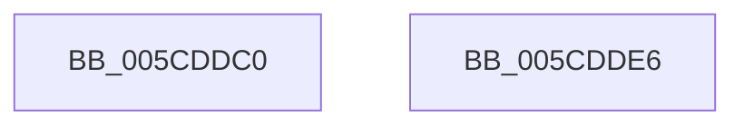

# PfSnEnablePrefetcherTimerRoutine

- RVA: `0x005CDDC0`–`0x005CDDE7` (길이 `39` bytes)
- VA: `0x00000001405CDDC0`
- 실행 섹션: `.text`
- PDB 이름 있음: `예`; PDB Function 태그: `아니요`
- unwind 정보 RVA: `0x0005CF00`
- 디코드: `13`개 명령, `39/39` bytes 표시
- 미해석 바이트: `0` (있으면 어셈블리에 `.byte`로 보존)

> 이 문서는 커널 이미지의 기계어와 PDB 기호를 분석해 생성했습니다. 4번과 5번은 함수 원형과 자료형을 바이너리 사용 방식에서 추정한 C 해석이며 원본 소스 복구 결과는 아닙니다.

## 1. Dependencies

- 직접 호출 지점: **2**; 고유 호출 대상: **2**
- 직접 호출자로 확인된 함수: **0**
- RIP 상대 이미지 참조: **0**

### Outgoing calls
- `0x005CDDD1` → [PfSnUpdatePrefetcherFlags](PfSnUpdatePrefetcherFlags_function_005CDDF0.md) (function, `0x005CDDF0`)
- `0x005CDDDB` → [ExFreePoolWithTag](../../poolcode/B8/ExFreePoolWithTag_function_00B82870.md) (function, `0x00B82870`)

### Direct callers
- 이 함수 시작 RVA로 연결되는 직접 call은 확인되지 않았습니다. 간접 호출은 완전히 역산할 수 없습니다.

### Static image references
- 디코드된 RIP-relative 메모리 참조가 없습니다.

## 2. Other-region calls and transfers

- 다른 실행 섹션으로 향하는 call: **1**
  - `0x005CDDDB` → [ExFreePoolWithTag](../../poolcode/B8/ExFreePoolWithTag_function_00B82870.md) (`.text` → `POOLCODE`)
- 별도 외부 분기/꼬리 이동을 확인하지 못했습니다.

## 3. Assembly (complete function range)

```asm
005CDDC0  40 53                           push rbx
005CDDC2  48 83 EC 20                     sub rsp, 0x20
005CDDC6  48 8B DA                        mov rbx, rdx
005CDDC9  33 D2                           xor edx, edx
005CDDCB  8B 8B 80 00 00 00               mov ecx, dword ptr [rbx + 0x80]
005CDDD1  E8 1A 00 00 00                  call 0x1405cddf0
005CDDD6  33 D2                           xor edx, edx
005CDDD8  48 8B CB                        mov rcx, rbx
005CDDDB  E8 90 4A 5B 00                  call 0x140b82870
005CDDE0  48 83 C4 20                     add rsp, 0x20
005CDDE4  5B                              pop rbx
005CDDE5  C3                              ret
005CDDE6  CC                              int3
```

## 4. C-style interpretation (structured pseudocode)

```c
__int64 __fastcall PfSnEnablePrefetcherTimerRoutine(__int64 a1, __int64 a2)
{
    __int64 result;
    __int64 v_rsp;

    v_rsp = (v_rsp) - (32);
    a2 = 0;
    result = PfSnUpdatePrefetcherFlags((unsigned int)(*(unsigned int *)(a2 + 128)), a2, a3, a4);
    a2 = 0;
    result = ExFreePoolWithTag(0, a2, a3, a4);
    v_rsp = (v_rsp) + (32);
    return result;
}
```

## 5. (Beta) C Style

```c
int64_t PfSnEnablePrefetcherTimerRoutine(int64_t Arg1, void *Arg2)
{
    uint8_t *arg2 = (uint8_t *)Arg2;

    int64_t result;
    int64_t local_rsp;

    local_rsp = (local_rsp) - (32);
    Arg2 = 0;
    result = PfSnUpdatePrefetcherFlags((uint32_t)(*(uint32_t *)(arg2 + 0x80)), Arg2, a3, a4);
    Arg2 = 0;
    result = ExFreePoolWithTag(0, Arg2, a3, a4);
    local_rsp = (local_rsp) + (32);
    return result;
}
```

### 관측된 메모리 오프셋

구조체 형식이 확인되지 않은 접근은 인자 기준의 오프셋으로만 기록했습니다.

| 기준 인자 | 오프셋 표현 | 폭 (bit) | 접근 |
|---|---:|---:|---|
| `Arg2` | `+ 0x80` | `32` | `R` |

## 6. Execution-region graph

[열기: 2D/3D 그래프와 함수 탐색 컨트롤 패널](../../../control-panel.html?section=text&rva=0x005CDDC0&view=graph)

- 2D 그래프는 위에서 아래로 흐르고, 3D 그래프는 빈 공간을 드래그해 회전합니다. Shift+드래그는 이동, 휠은 확대·축소, 함수 노드 선택은 대상 보고서 이동입니다.

### Static fallback


