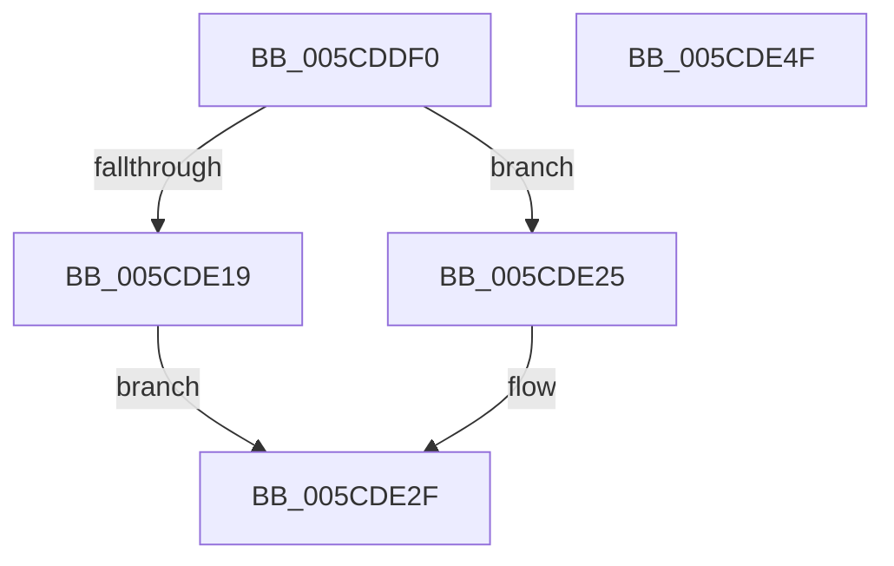

# PfSnUpdatePrefetcherFlags

- RVA: `0x005CDDF0`–`0x005CDE50` (길이 `96` bytes)
- VA: `0x00000001405CDDF0`
- 실행 섹션: `.text`
- PDB 이름 있음: `예`; PDB Function 태그: `아니요`
- unwind 정보 RVA: `0x00060BC4`
- 디코드: `28`개 명령, `96/96` bytes 표시
- 미해석 바이트: `0` (있으면 어셈블리에 `.byte`로 보존)

> 이 문서는 커널 이미지의 기계어와 PDB 기호를 분석해 생성했습니다. 4번과 5번은 함수 원형과 자료형을 바이너리 사용 방식에서 추정한 C 해석이며 원본 소스 복구 결과는 아닙니다.

## 1. Dependencies

- 직접 호출 지점: **2**; 고유 호출 대상: **2**
- 직접 호출자로 확인된 함수: **2**
- RIP 상대 이미지 참조: **3**

### Outgoing calls
- `0x005CDE0A` → [KeAcquireSpinLockRaiseToDpc](../20/KeAcquireSpinLockRaiseToDpc_function_00208470.md) (function, `0x00208470`)
- `0x005CDE38` → [KeReleaseSpinLock](../39/KeReleaseSpinLock_function_00392BA0.md) (function, `0x00392BA0`)

### Direct callers
- [PfSnEnablePrefetcherTimerRoutine](PfSnEnablePrefetcherTimerRoutine_function_005CDDC0.md) at `0x005CDDD1`
- [PfSnBeginBootPhase](../../pagelk/B6/PfSnBeginBootPhase_function_00B6BAC4.md) at `0x00B6BB19`
- [PfSnBeginBootPhase](../../pagelk/B6/PfSnBeginBootPhase_function_00B6BAC4.md) at `0x00B6BB46`
- [PfSnBeginBootPhase](../../pagelk/B6/PfSnBeginBootPhase_function_00B6BAC4.md) at `0x00B6BB56`
- [PfSnBeginBootPhase](../../pagelk/B6/PfSnBeginBootPhase_function_00B6BAC4.md) at `0x00B6BB65`
- [PfSnBeginBootPhase](../../pagelk/B6/PfSnBeginBootPhase_function_00B6BAC4.md) at `0x00B6BB91`

### Static image references
- `0x005CDE03` → RVA `0x00E67260` (`.data`; read)
- `0x005CDE0F` → RVA `0x00E67360` (`.data`; read)
- `0x005CDE1D` → RVA `0x00E67360` (`.data`; write)

## 2. Other-region calls and transfers

- 다른 실행 섹션으로 향하는 call: **0**
- 별도 외부 분기/꼬리 이동을 확인하지 못했습니다.

## 3. Assembly (complete function range)

```asm
005CDDF0  48 89 5C 24 08                  mov qword ptr [rsp + 8], rbx
005CDDF5  48 89 74 24 10                  mov qword ptr [rsp + 0x10], rsi
005CDDFA  57                              push rdi
005CDDFB  48 83 EC 20                     sub rsp, 0x20
005CDDFF  8B F9                           mov edi, ecx
005CDE01  8B DA                           mov ebx, edx
005CDE03  48 8D 0D 56 94 89 00            lea rcx, [rip + 0x899456]
005CDE0A  E8 61 A6 C3 FF                  call 0x140208470
005CDE0F  8B 35 4B 95 89 00               mov esi, dword ptr [rip + 0x89954b]
005CDE15  85 DB                           test ebx, ebx
005CDE17  74 0C                           je 0x1405cde25
005CDE19  8B D6                           mov edx, esi
005CDE1B  0B D7                           or edx, edi
005CDE1D  89 15 3D 95 89 00               mov dword ptr [rip + 0x89953d], edx
005CDE23  EB 0A                           jmp 0x1405cde2f
005CDE25  F7 D7                           not edi
005CDE27  23 FE                           and edi, esi
005CDE29  89 3D 31 95 89 00               mov dword ptr [rip + 0x899531], edi
005CDE2F  8A D0                           mov dl, al
005CDE31  48 8D 0D 28 94 89 00            lea rcx, [rip + 0x899428]
005CDE38  E8 63 4D DC FF                  call 0x140392ba0
005CDE3D  48 8B 5C 24 30                  mov rbx, qword ptr [rsp + 0x30]
005CDE42  8B C6                           mov eax, esi
005CDE44  48 8B 74 24 38                  mov rsi, qword ptr [rsp + 0x38]
005CDE49  48 83 C4 20                     add rsp, 0x20
005CDE4D  5F                              pop rdi
005CDE4E  C3                              ret
005CDE4F  CC                              int3
```

## 4. C-style interpretation (structured pseudocode)

```c
__int64 __fastcall PfSnUpdatePrefetcherFlags(int a1, int a2)
{
    __int64 result;
    __int64 v_rdi;
    __int64 v_rsp;
    unsigned __int64 v_stack_p10;
    unsigned __int64 v_stack_p8;

    v_stack_p8 = v_rbx;
    v_stack_p10 = v_rsi;
    v_rsp = (v_rsp) - (32);
    result = KeAcquireSpinLockRaiseToDpc(v_rip + 9016406, a2, a3, a4);
    if ((unsigned int)((unsigned int)(a2)) == 0) goto loc_005CDE25;
    a2 = (unsigned int)(((unsigned int)((unsigned int)((unsigned int)(*(unsigned int *)(v_rip + 9016651))))) | ((unsigned int)((unsigned int)(a1))));
    *(unsigned int *)(v_rip + 9016637) = a2;
    goto loc_005CDE2F;
loc_005CDE25:
    v_rdi = (unsigned int)(~((unsigned int)(a1)));
    v_rdi = (unsigned int)((v_rdi) & ((unsigned int)((unsigned int)(*(unsigned int *)(v_rip + 9016651)))));
    *(unsigned int *)(v_rip + 9016625) = (unsigned int)(v_rdi);
loc_005CDE2F:
    result = KeReleaseSpinLock(v_rip + 9016360, (unsigned __int8)(result), a3, a4);
    v_rsp = (v_rsp) + (32);
    return (unsigned int)((unsigned int)((unsigned int)(*(unsigned int *)(v_rip + 9016651))));
}
```

## 5. (Beta) C Style

```c
int64_t PfSnUpdatePrefetcherFlags(int32_t Arg1, int32_t Arg2)
{
    int64_t result;
    int64_t local_rdi;
    int64_t local_rsp;
    uint64_t v_stack_p10;
    uint64_t v_stack_p8;

    v_stack_p8 = local_rbx;
    v_stack_p10 = local_rsi;
    local_rsp = (local_rsp) - (32);
    result = KeAcquireSpinLockRaiseToDpc(v_rip + 9016406, Arg2, a3, a4);
    if ((uint32_t)((uint32_t)(Arg2)) == 0) goto loc_005CDE25;
    Arg2 = (uint32_t)(((uint32_t)((uint32_t)((uint32_t)(*(uint32_t *)(v_rip + 0x89954B))))) | ((uint32_t)((uint32_t)(Arg1))));
    *(uint32_t *)(v_rip + 0x89953D) = Arg2;
    goto loc_005CDE2F;
loc_005CDE25:
    local_rdi = (uint32_t)(~((uint32_t)(Arg1)));
    local_rdi = (uint32_t)((local_rdi) & ((uint32_t)((uint32_t)(*(uint32_t *)(v_rip + 0x89954B)))));
    *(uint32_t *)(v_rip + 0x899531) = (uint32_t)(local_rdi);
loc_005CDE2F:
    result = KeReleaseSpinLock(v_rip + 9016360, (uint8_t)(result), a3, a4);
    local_rsp = (local_rsp) + (32);
    return (uint32_t)((uint32_t)((uint32_t)(*(uint32_t *)(v_rip + 0x89954B))));
}
```

## 6. Execution-region graph

[열기: 2D/3D 그래프와 함수 탐색 컨트롤 패널](../../../control-panel.html?section=text&rva=0x005CDDF0&view=graph)

- 2D 그래프는 위에서 아래로 흐르고, 3D 그래프는 빈 공간을 드래그해 회전합니다. Shift+드래그는 이동, 휠은 확대·축소, 함수 노드 선택은 대상 보고서 이동입니다.

### Static fallback


