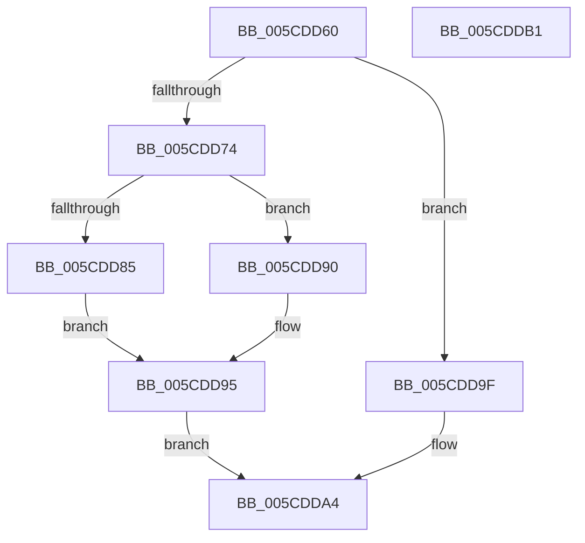

# PfTSetTraceWorkerPriority

- RVA: `0x005CDD60`–`0x005CDDB2` (길이 `82` bytes)
- VA: `0x00000001405CDD60`
- 실행 섹션: `.text`
- PDB 이름 있음: `예`; PDB Function 태그: `아니요`
- unwind 정보 RVA: `0x0005CAAC`
- 디코드: `26`개 명령, `82/82` bytes 표시
- 미해석 바이트: `0` (있으면 어셈블리에 `.byte`로 보존)

> 이 문서는 커널 이미지의 기계어와 PDB 기호를 분석해 생성했습니다. 4번과 5번은 함수 원형과 자료형을 바이너리 사용 방식에서 추정한 C 해석이며 원본 소스 복구 결과는 아닙니다.

## 1. Dependencies

- 직접 호출 지점: **3**; 고유 호출 대상: **3**
- 직접 호출자로 확인된 함수: **3**
- RIP 상대 이미지 참조: **0**

### Outgoing calls
- `0x005CDD74` → [PfpPartitionAccessTraceLockAcquire](../../pagelk/B6/PfpPartitionAccessTraceLockAcquire_function_00B6BBC4.md) (function, `0x00B6BBC4`)
- `0x005CDD87` → [KeSetPriorityThread](../2C/KeSetPriorityThread_function_002C76E0.md) (function, `0x002C76E0`)
- `0x005CDD98` → [PfpPartitionAccessTraceLockRelease](../../pagelk/B6/PfpPartitionAccessTraceLockRelease_function_00B6BBE0.md) (function, `0x00B6BBE0`)

### Direct callers
- [PfpLogScenarioEventCallback](../../page/75/PfpLogScenarioEventCallback_function_007507B0.md) at `0x007507F2`
- [PfpLogScenarioEventCallback](../../page/75/PfpLogScenarioEventCallback_function_007507B0.md) at `0x007508C5`
- [PfSetSuperfetchInformation](../../page/AD/PfSetSuperfetchInformation_function_00ADE6E8.md) at `0x00ADE98B`
- [PfpPowerActionSleepSystemPhaseCallback](../../pagelk/B6/PfpPowerActionSleepSystemPhaseCallback_function_00B6B270.md) at `0x00B6B29E`
- [PfpPowerActionSleepSystemPhaseCallback](../../pagelk/B6/PfpPowerActionSleepSystemPhaseCallback_function_00B6B270.md) at `0x00B6B2BB`

### Static image references
- 디코드된 RIP-relative 메모리 참조가 없습니다.

## 2. Other-region calls and transfers

- 다른 실행 섹션으로 향하는 call: **2**
  - `0x005CDD74` → [PfpPartitionAccessTraceLockAcquire](../../pagelk/B6/PfpPartitionAccessTraceLockAcquire_function_00B6BBC4.md) (`.text` → `PAGELK`)
  - `0x005CDD98` → [PfpPartitionAccessTraceLockRelease](../../pagelk/B6/PfpPartitionAccessTraceLockRelease_function_00B6BBE0.md) (`.text` → `PAGELK`)
- 별도 외부 분기/꼬리 이동을 확인하지 못했습니다.

## 3. Assembly (complete function range)

```asm
005CDD60  48 89 5C 24 08                  mov qword ptr [rsp + 8], rbx
005CDD65  57                              push rdi
005CDD66  48 83 EC 20                     sub rsp, 0x20
005CDD6A  8B DA                           mov ebx, edx
005CDD6C  48 8B F9                        mov rdi, rcx
005CDD6F  83 FA 1F                        cmp edx, 0x1f
005CDD72  77 2B                           ja 0x1405cdd9f
005CDD74  E8 4B DE 59 00                  call 0x140b6bbc4
005CDD79  48 8B 8F A8 00 00 00            mov rcx, qword ptr [rdi + 0xa8]
005CDD80  48 85 C9                        test rcx, rcx
005CDD83  74 0B                           je 0x1405cdd90
005CDD85  8B D3                           mov edx, ebx
005CDD87  E8 54 99 CF FF                  call 0x1402c76e0
005CDD8C  8B D8                           mov ebx, eax
005CDD8E  EB 05                           jmp 0x1405cdd95
005CDD90  BB 21 00 00 00                  mov ebx, 0x21
005CDD95  48 8B CF                        mov rcx, rdi
005CDD98  E8 43 DE 59 00                  call 0x140b6bbe0
005CDD9D  EB 05                           jmp 0x1405cdda4
005CDD9F  BB 20 00 00 00                  mov ebx, 0x20
005CDDA4  8B C3                           mov eax, ebx
005CDDA6  48 8B 5C 24 30                  mov rbx, qword ptr [rsp + 0x30]
005CDDAB  48 83 C4 20                     add rsp, 0x20
005CDDAF  5F                              pop rdi
005CDDB0  C3                              ret
005CDDB1  CC                              int3
```

## 4. C-style interpretation (structured pseudocode)

```c
__int64 __fastcall PfTSetTraceWorkerPriority(__int64 a1, int a2)
{
    __int64 result;
    __int64 v_rsp;
    unsigned __int64 v_stack_p8;

    v_stack_p8 = v_rbx;
    v_rsp = (v_rsp) - (32);
    if (a2 > 31) goto loc_005CDD9F;
    result = PfpPartitionAccessTraceLockAcquire(a1, a2, a3, a4);
    if (*(unsigned __int64 *)(a1 + 168) == 0) goto loc_005CDD90;
    result = KeSetPriorityThread(*(unsigned __int64 *)(a1 + 168), (unsigned int)((unsigned int)((unsigned int)(a2))), a3, a4);
    goto loc_005CDD95;
loc_005CDD90:
loc_005CDD95:
    result = PfpPartitionAccessTraceLockRelease(a1, (unsigned int)((unsigned int)((unsigned int)(a2))), a3, a4);
    goto loc_005CDDA4;
loc_005CDD9F:
loc_005CDDA4:
    v_rsp = (v_rsp) + (32);
    return 32;
}
```

## 5. (Beta) C Style

```c
int64_t PfTSetTraceWorkerPriority(void *Arg1, int32_t Arg2)
{
    uint8_t *arg1 = (uint8_t *)Arg1;

    int64_t result;
    int64_t local_rsp;
    uint64_t v_stack_p8;

    v_stack_p8 = local_rbx;
    local_rsp = (local_rsp) - (32);
    if (Arg2 > 31) goto loc_005CDD9F;
    result = PfpPartitionAccessTraceLockAcquire(Arg1, Arg2, a3, a4);
    if (*(uint64_t *)(arg1 + 0xA8) == 0) goto loc_005CDD90;
    result = KeSetPriorityThread(*(uint64_t *)(arg1 + 0xA8), (uint32_t)((uint32_t)((uint32_t)(Arg2))), a3, a4);
    goto loc_005CDD95;
loc_005CDD90:
loc_005CDD95:
    result = PfpPartitionAccessTraceLockRelease(Arg1, (uint32_t)((uint32_t)((uint32_t)(Arg2))), a3, a4);
    goto loc_005CDDA4;
loc_005CDD9F:
loc_005CDDA4:
    local_rsp = (local_rsp) + (32);
    return 32;
}
```

### 관측된 메모리 오프셋

구조체 형식이 확인되지 않은 접근은 인자 기준의 오프셋으로만 기록했습니다.

| 기준 인자 | 오프셋 표현 | 폭 (bit) | 접근 |
|---|---:|---:|---|
| `Arg1` | `+ 0xA8` | `64` | `R` |

## 6. Execution-region graph

[열기: 2D/3D 그래프와 함수 탐색 컨트롤 패널](../../../control-panel.html?section=text&rva=0x005CDD60&view=graph)

- 2D 그래프는 위에서 아래로 흐르고, 3D 그래프는 빈 공간을 드래그해 회전합니다. Shift+드래그는 이동, 휠은 확대·축소, 함수 노드 선택은 대상 보고서 이동입니다.

### Static fallback


