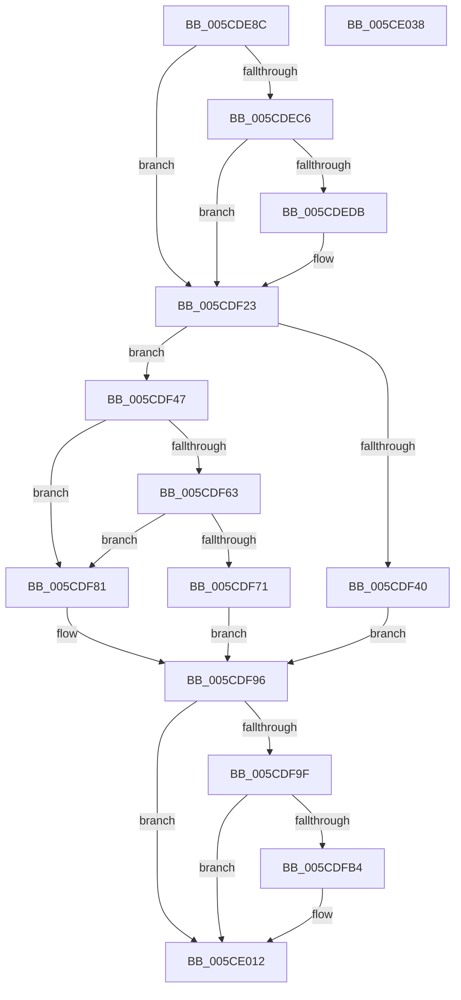

# PfpPartitionCreate

- RVA: `0x005CDE8C`–`0x005CE039` (길이 `429` bytes)
- VA: `0x00000001405CDE8C`
- 실행 섹션: `.text`
- PDB 이름 있음: `예`; PDB Function 태그: `아니요`
- unwind 정보 RVA: `0x000CBBC0`
- 디코드: `108`개 명령, `429/429` bytes 표시
- 미해석 바이트: `0` (있으면 어셈블리에 `.byte`로 보존)

> 이 문서는 커널 이미지의 기계어와 PDB 기호를 분석해 생성했습니다. 4번과 5번은 함수 원형과 자료형을 바이너리 사용 방식에서 추정한 C 해석이며 원본 소스 복구 결과는 아닙니다.

## 1. Dependencies

- 직접 호출 지점: **14**; 고유 호출 대상: **11**
- 직접 호출자로 확인된 함수: **1**
- RIP 상대 이미지 참조: **4**

### Outgoing calls
- `0x005CDED2` → [tlgKeywordOn](../42/tlgKeywordOn_function_0042EAA0.md) (function, `0x0042EAA0`)
- `0x005CDEDE` → [PfpTraceLogPartitionId](PfpTraceLogPartitionId_function_005CE1B0.md) (function, `0x005CE1B0`)
- `0x005CDF1E` → [tlgWriteTransfer_EtwWriteTransfer](../42/tlgWriteTransfer_EtwWriteTransfer_function_004260E0.md) (function, `0x004260E0`)
- `0x005CDF33` → [ExAllocatePool2](../../poolcode/B8/ExAllocatePool2_function_00B820F0.md) (function, `0x00B820F0`)
- `0x005CDF50` → [PfpPartitionInitialize](../../page/75/PfpPartitionInitialize_function_0075221C.md) (function, `0x0075221C`)
- `0x005CDF58` → [PfpPartitionAllocateState](../../page/75/PfpPartitionAllocateState_function_0075200C.md) (function, `0x0075200C`)
- `0x005CDF66` → [PfpPartitionInsertToGlobals](PfpPartitionInsertToGlobals_function_005CE040.md) (function, `0x005CE040`)
- `0x005CDF75` → [ExAcquireRundownProtectionCacheAware](../23/ExAcquireRundownProtectionCacheAware_function_0023D110.md) (function, `0x0023D110`)
- `0x005CDF84` → [PfpPartitionCleanup](../../page/75/PfpPartitionCleanup_function_00752050.md) (function, `0x00752050`)
- `0x005CDF91` → [ExFreePoolWithTag](../../poolcode/B8/ExFreePoolWithTag_function_00B82870.md) (function, `0x00B82870`)
- `0x005CDFAB` → [tlgKeywordOn](../42/tlgKeywordOn_function_0042EAA0.md) (function, `0x0042EAA0`)
- `0x005CDFB7` → [PfpTraceLogPartitionId](PfpTraceLogPartitionId_function_005CE1B0.md) (function, `0x005CE1B0`)
- `0x005CE00D` → [tlgWriteTransfer_EtwWriteTransfer](../42/tlgWriteTransfer_EtwWriteTransfer_function_004260E0.md) (function, `0x004260E0`)
- `0x005CE01B` → [_security_check_cookie](../6A/_security_check_cookie_function_006AC640.md) (function, `0x006AC640`)

### Direct callers
- [PfpPartitionFindOrCreate](../../page/75/PfpPartitionFindOrCreate_function_00752080.md) at `0x00752142`

### Static image references
- `0x005CDEA6` → RVA `0x00E0A740` (`.data`; read)
- `0x005CDEB4` → RVA `0x00E074D8` (`.data`; read)
- `0x005CDEE7` → RVA `0x00048A9C` (`.rdata`; read)
- `0x005CDFC0` → RVA `0x00048B15` (`.rdata`; read)

## 2. Other-region calls and transfers

- 다른 실행 섹션으로 향하는 call: **5**
  - `0x005CDF33` → [ExAllocatePool2](../../poolcode/B8/ExAllocatePool2_function_00B820F0.md) (`.text` → `POOLCODE`)
  - `0x005CDF50` → [PfpPartitionInitialize](../../page/75/PfpPartitionInitialize_function_0075221C.md) (`.text` → `PAGE`)
  - `0x005CDF58` → [PfpPartitionAllocateState](../../page/75/PfpPartitionAllocateState_function_0075200C.md) (`.text` → `PAGE`)
  - `0x005CDF84` → [PfpPartitionCleanup](../../page/75/PfpPartitionCleanup_function_00752050.md) (`.text` → `PAGE`)
  - `0x005CDF91` → [ExFreePoolWithTag](../../poolcode/B8/ExFreePoolWithTag_function_00B82870.md) (`.text` → `POOLCODE`)
- 별도 외부 분기/꼬리 이동을 확인하지 못했습니다.

## 3. Assembly (complete function range)

```asm
005CDE8C  48 89 5C 24 10                  mov qword ptr [rsp + 0x10], rbx
005CDE91  48 89 74 24 20                  mov qword ptr [rsp + 0x20], rsi
005CDE96  55                              push rbp
005CDE97  57                              push rdi
005CDE98  41 56                           push r14
005CDE9A  48 8D 6C 24 B9                  lea rbp, [rsp - 0x47]
005CDE9F  48 81 EC 90 00 00 00            sub rsp, 0x90
005CDEA6  48 8B 05 93 C8 83 00            mov rax, qword ptr [rip + 0x83c893]
005CDEAD  48 33 C4                        xor rax, rsp
005CDEB0  48 89 45 37                     mov qword ptr [rbp + 0x37], rax
005CDEB4  83 3D 1D 96 83 00 04            cmp dword ptr [rip + 0x83961d], 4
005CDEBB  49 8B F0                        mov rsi, r8
005CDEBE  48 8B DA                        mov rbx, rdx
005CDEC1  4C 8B F1                        mov r14, rcx
005CDEC4  76 5D                           jbe 0x1405cdf23
005CDEC6  BA 01 00 00 00                  mov edx, 1
005CDECB  48 8D 0D 06 96 83 00            lea rcx, [rip + 0x839606]
005CDED2  E8 C9 0B E6 FF                  call 0x14042eaa0
005CDED7  84 C0                           test al, al
005CDED9  74 48                           je 0x1405cdf23
005CDEDB  49 8B C8                        mov rcx, r8
005CDEDE  E8 CD 02 00 00                  call 0x1405ce1b0
005CDEE3  83 65 23 00                     and dword ptr [rbp + 0x23], 0
005CDEE7  48 8D 15 AE AB A7 FF            lea rdx, [rip - 0x585452]
005CDEEE  89 45 E7                        mov dword ptr [rbp - 0x19], eax
005CDEF1  48 8D 0D E0 95 83 00            lea rcx, [rip + 0x8395e0]
005CDEF8  48 8D 45 E7                     lea rax, [rbp - 0x19]
005CDEFC  C7 45 1F 04 00 00 00            mov dword ptr [rbp + 0x1f], 4
005CDF03  48 89 45 17                     mov qword ptr [rbp + 0x17], rax
005CDF07  45 33 C9                        xor r9d, r9d
005CDF0A  48 8D 45 F7                     lea rax, [rbp - 9]
005CDF0E  45 33 C0                        xor r8d, r8d
005CDF11  48 89 44 24 28                  mov qword ptr [rsp + 0x28], rax
005CDF16  C7 44 24 20 03 00 00 00         mov dword ptr [rsp + 0x20], 3
005CDF1E  E8 BD 81 E5 FF                  call 0x1404260e0
005CDF23  BA 20 03 00 00                  mov edx, 0x320
005CDF28  B9 40 00 00 00                  mov ecx, 0x40
005CDF2D  41 B8 50 66 50 74               mov r8d, 0x74506650
005CDF33  E8 B8 41 5B 00                  call 0x140b820f0
005CDF38  48 8B F8                        mov rdi, rax
005CDF3B  48 85 C0                        test rax, rax
005CDF3E  75 07                           jne 0x1405cdf47
005CDF40  BB 9A 00 00 C0                  mov ebx, 0xc000009a
005CDF45  EB 4F                           jmp 0x1405cdf96
005CDF47  4C 8B C3                        mov r8, rbx
005CDF4A  48 8B D6                        mov rdx, rsi
005CDF4D  48 8B CF                        mov rcx, rdi
005CDF50  E8 C7 42 18 00                  call 0x14075221c
005CDF55  48 8B CF                        mov rcx, rdi
005CDF58  E8 AF 40 18 00                  call 0x14075200c
005CDF5D  8B D8                           mov ebx, eax
005CDF5F  85 C0                           test eax, eax
005CDF61  78 1E                           js 0x1405cdf81
005CDF63  48 8B CF                        mov rcx, rdi
005CDF66  E8 D5 00 00 00                  call 0x1405ce040
005CDF6B  8B D8                           mov ebx, eax
005CDF6D  85 C0                           test eax, eax
005CDF6F  78 10                           js 0x1405cdf81
005CDF71  48 8B 4F 10                     mov rcx, qword ptr [rdi + 0x10]
005CDF75  E8 96 F1 C6 FF                  call 0x14023d110
005CDF7A  33 DB                           xor ebx, ebx
005CDF7C  49 89 3E                        mov qword ptr [r14], rdi
005CDF7F  EB 15                           jmp 0x1405cdf96
005CDF81  48 8B CF                        mov rcx, rdi
005CDF84  E8 C7 40 18 00                  call 0x140752050
005CDF89  BA 50 66 50 74                  mov edx, 0x74506650
005CDF8E  48 8B CF                        mov rcx, rdi
005CDF91  E8 DA 48 5B 00                  call 0x140b82870
005CDF96  83 3D 3B 95 83 00 04            cmp dword ptr [rip + 0x83953b], 4
005CDF9D  76 73                           jbe 0x1405ce012
005CDF9F  BA 01 00 00 00                  mov edx, 1
005CDFA4  48 8D 0D 2D 95 83 00            lea rcx, [rip + 0x83952d]
005CDFAB  E8 F0 0A E6 FF                  call 0x14042eaa0
005CDFB0  84 C0                           test al, al
005CDFB2  74 5E                           je 0x1405ce012
005CDFB4  48 8B CE                        mov rcx, rsi
005CDFB7  E8 F4 01 00 00                  call 0x1405ce1b0
005CDFBC  83 65 23 00                     and dword ptr [rbp + 0x23], 0
005CDFC0  48 8D 15 4E AB A7 FF            lea rdx, [rip - 0x5854b2]
005CDFC7  83 65 33 00                     and dword ptr [rbp + 0x33], 0
005CDFCB  48 8D 0D 06 95 83 00            lea rcx, [rip + 0x839506]
005CDFD2  89 45 E7                        mov dword ptr [rbp - 0x19], eax
005CDFD5  45 33 C9                        xor r9d, r9d
005CDFD8  48 8D 45 E7                     lea rax, [rbp - 0x19]
005CDFDC  C7 45 1F 04 00 00 00            mov dword ptr [rbp + 0x1f], 4
005CDFE3  48 89 45 17                     mov qword ptr [rbp + 0x17], rax
005CDFE7  45 33 C0                        xor r8d, r8d
005CDFEA  48 8D 45 EB                     lea rax, [rbp - 0x15]
005CDFEE  89 5D EB                        mov dword ptr [rbp - 0x15], ebx
005CDFF1  48 89 45 27                     mov qword ptr [rbp + 0x27], rax
005CDFF5  48 8D 45 F7                     lea rax, [rbp - 9]
005CDFF9  48 89 44 24 28                  mov qword ptr [rsp + 0x28], rax
005CDFFE  C7 44 24 20 04 00 00 00         mov dword ptr [rsp + 0x20], 4
005CE006  C7 45 2F 04 00 00 00            mov dword ptr [rbp + 0x2f], 4
005CE00D  E8 CE 80 E5 FF                  call 0x1404260e0
005CE012  8B C3                           mov eax, ebx
005CE014  48 8B 4D 37                     mov rcx, qword ptr [rbp + 0x37]
005CE018  48 33 CC                        xor rcx, rsp
005CE01B  E8 20 E6 0D 00                  call 0x1406ac640
005CE020  4C 8D 9C 24 90 00 00 00         lea r11, [rsp + 0x90]
005CE028  49 8B 5B 28                     mov rbx, qword ptr [r11 + 0x28]
005CE02C  49 8B 73 38                     mov rsi, qword ptr [r11 + 0x38]
005CE030  49 8B E3                        mov rsp, r11
005CE033  41 5E                           pop r14
005CE035  5F                              pop rdi
005CE036  5D                              pop rbp
005CE037  C3                              ret
005CE038  CC                              int3
```

## 4. C-style interpretation (structured pseudocode)

```c
__int64 __fastcall PfpPartitionCreate(__int64 a1, __int64 a2, __int64 a3, int a4)
{
    __int64 result;
    __int64 v_rbx;
    __int64 v_rsp;
    unsigned __int64 v_stack_m18;
    unsigned __int64 v_stack_m28;
    unsigned int v_stack_m2C;
    unsigned int v_stack_m30;
    unsigned __int64 v_stack_m38;
    unsigned int v_stack_m3C;
    unsigned int v_stack_m40;
    unsigned __int64 v_stack_m48;
    unsigned __int64 v_stack_m5F;
    unsigned __int64 v_stack_m68;
    unsigned __int64 v_stack_m74;
    unsigned int v_stack_m78;
    unsigned __int64 v_stack_m80;
    unsigned int v_stack_m88;
    unsigned __int64 v_stack_p10;
    unsigned __int64 v_stack_p20;

    v_stack_p10 = v_rbx;
    v_stack_p20 = v_rsi;
    v_rsp = (v_rsp) - (144);
    result = (*(unsigned __int64 *)(v_rip + 8636563)) ^ (v_rsp);
    v_stack_m28 = result;
    if ((*(unsigned int *)(v_rip + 8623645)) <= 4) goto loc_005CDF23;
    result = tlgKeywordOn(v_rip + 8623622, 1, a3, a4);
    if ((unsigned __int8)(result) != 0) {
        a1 = a3;
        result = PfpTraceLogPartitionId(a1, 1, a3, a4);
        a2 = v_rip - 5788754;
        v_stack_m78 = (unsigned int)(result);
        a1 = v_rip + 8623584;
        result = v_stack_m78;
        v_stack_m40 = 4;
        v_stack_m48 = result;
        a4 = 0;
        result = v_stack_m68;
        a3 = 0;
        v_stack_m80 = result;
        v_stack_m88 = 3;
        result = tlgWriteTransfer_EtwWriteTransfer(a1, a2, a3, a4);
    }
    result = ExAllocatePool2(64, 800, (unsigned int)(0x74506650ULL), a4);
    if (result != 0) goto loc_005CDF47;
    goto loc_005CDF96;
loc_005CDF47:
    result = PfpPartitionInitialize(result, 0, (unsigned int)(0xC000009AULL), a4);
    result = PfpPartitionAllocateState(result, 0, (unsigned int)(0xC000009AULL), a4);
    if (sign_flag) goto loc_005CDF81;
    result = PfpPartitionInsertToGlobals(result, 0, (unsigned int)(0xC000009AULL), a4);
    if (sign_flag) goto loc_005CDF81;
    result = ExAcquireRundownProtectionCacheAware(*(unsigned __int64 *)(result + 16), 0, (unsigned int)(0xC000009AULL), a4);
    v_rbx = 0;
    *(unsigned __int64 *)(a1) = result;
    goto loc_005CDF96;
loc_005CDF81:
    result = PfpPartitionCleanup(result, 0, (unsigned int)(0xC000009AULL), a4);
    result = ExFreePoolWithTag(result, (unsigned int)(0x74506650ULL), (unsigned int)(0xC000009AULL), a4);
loc_005CDF96:
    if ((*(unsigned int *)(v_rip + 8623419)) <= 4) goto loc_005CE012;
    result = tlgKeywordOn(v_rip + 8623405, 1, (unsigned int)(0xC000009AULL), a4);
    if ((unsigned __int8)(result) != 0) {
        a1 = 0;
        result = PfpTraceLogPartitionId(a1, 1, (unsigned int)(0xC000009AULL), a4);
        a2 = v_rip - 5788850;
        a1 = v_rip + 8623366;
        v_stack_m78 = (unsigned int)(result);
        a4 = 0;
        result = v_stack_m78;
        v_stack_m40 = 4;
        v_stack_m48 = result;
        a3 = 0;
        result = v_stack_m74;
        v_stack_m74 = 0;
        v_stack_m38 = result;
        result = v_stack_m68;
        v_stack_m80 = result;
        v_stack_m88 = 4;
        v_stack_m30 = 4;
        result = tlgWriteTransfer_EtwWriteTransfer(a1, a2, a3, a4);
    }
    a1 = (v_stack_m28) ^ (v_rsp);
    result = _security_check_cookie(a1, a2, a3, a4);
    return result;
}
```

## 5. (Beta) C Style

```c
int64_t PfpPartitionCreate(void *Arg1, int64_t Arg2, int64_t Arg3, int32_t Arg4)
{
    uint8_t *arg1 = (uint8_t *)Arg1;

    int64_t result;
    int64_t local_rbx;
    int64_t local_rsp;
    uint64_t v_stack_m18;
    uint64_t v_stack_m28;
    uint32_t v_stack_m2C;
    uint32_t v_stack_m30;
    uint64_t v_stack_m38;
    uint32_t v_stack_m3C;
    uint32_t v_stack_m40;
    uint64_t v_stack_m48;
    uint64_t v_stack_m5F;
    uint64_t v_stack_m68;
    uint64_t v_stack_m74;
    uint32_t v_stack_m78;
    uint64_t v_stack_m80;
    uint32_t v_stack_m88;
    uint64_t v_stack_p10;
    uint64_t v_stack_p20;

    v_stack_p10 = local_rbx;
    v_stack_p20 = local_rsi;
    local_rsp = (local_rsp) - (144);
    result = (*(uint64_t *)(v_rip + 0x83C893)) ^ (local_rsp);
    v_stack_m28 = result;
    if ((*(uint32_t *)(v_rip + 0x83961D)) <= 4) goto loc_005CDF23;
    result = tlgKeywordOn(v_rip + 8623622, 1, Arg3, Arg4);
    if ((uint8_t)(result) != 0) {
        Arg1 = Arg3;
        result = PfpTraceLogPartitionId(Arg1, 1, Arg3, Arg4);
        Arg2 = v_rip - 5788754;
        v_stack_m78 = (uint32_t)(result);
        Arg1 = v_rip + 8623584;
        result = v_stack_m78;
        v_stack_m40 = 4;
        v_stack_m48 = result;
        Arg4 = 0;
        result = v_stack_m68;
        Arg3 = 0;
        v_stack_m80 = result;
        v_stack_m88 = 3;
        result = tlgWriteTransfer_EtwWriteTransfer(Arg1, Arg2, Arg3, Arg4);
    }
    result = ExAllocatePool2(64, 800, (uint32_t)(0x74506650ULL), Arg4);
    if (result != 0) goto loc_005CDF47;
    goto loc_005CDF96;
loc_005CDF47:
    result = PfpPartitionInitialize(result, 0, (uint32_t)(0xC000009AULL), Arg4);
    result = PfpPartitionAllocateState(result, 0, (uint32_t)(0xC000009AULL), Arg4);
    if (sign_flag) goto loc_005CDF81;
    result = PfpPartitionInsertToGlobals(result, 0, (uint32_t)(0xC000009AULL), Arg4);
    if (sign_flag) goto loc_005CDF81;
    result = ExAcquireRundownProtectionCacheAware(*(uint64_t *)(result + 0x10), 0, (uint32_t)(0xC000009AULL), Arg4);
    local_rbx = 0;
    *(uint64_t *)(arg1) = result;
    goto loc_005CDF96;
loc_005CDF81:
    result = PfpPartitionCleanup(result, 0, (uint32_t)(0xC000009AULL), Arg4);
    result = ExFreePoolWithTag(result, (uint32_t)(0x74506650ULL), (uint32_t)(0xC000009AULL), Arg4);
loc_005CDF96:
    if ((*(uint32_t *)(v_rip + 0x83953B)) <= 4) goto loc_005CE012;
    result = tlgKeywordOn(v_rip + 8623405, 1, (uint32_t)(0xC000009AULL), Arg4);
    if ((uint8_t)(result) != 0) {
        Arg1 = 0;
        result = PfpTraceLogPartitionId(Arg1, 1, (uint32_t)(0xC000009AULL), Arg4);
        Arg2 = v_rip - 5788850;
        Arg1 = v_rip + 8623366;
        v_stack_m78 = (uint32_t)(result);
        Arg4 = 0;
        result = v_stack_m78;
        v_stack_m40 = 4;
        v_stack_m48 = result;
        Arg3 = 0;
        result = v_stack_m74;
        v_stack_m74 = 0;
        v_stack_m38 = result;
        result = v_stack_m68;
        v_stack_m80 = result;
        v_stack_m88 = 4;
        v_stack_m30 = 4;
        result = tlgWriteTransfer_EtwWriteTransfer(Arg1, Arg2, Arg3, Arg4);
    }
    Arg1 = (v_stack_m28) ^ (local_rsp);
    result = _security_check_cookie(Arg1, Arg2, Arg3, Arg4);
    return result;
}
```

### 관측된 메모리 오프셋

구조체 형식이 확인되지 않은 접근은 인자 기준의 오프셋으로만 기록했습니다.

| 기준 인자 | 오프셋 표현 | 폭 (bit) | 접근 |
|---|---:|---:|---|
| `Arg1` | `+ 0x0` | `64` | `W` |

## 6. Execution-region graph

[열기: 2D/3D 그래프와 함수 탐색 컨트롤 패널](../../../control-panel.html?section=text&rva=0x005CDE8C&view=graph)

- 2D 그래프는 위에서 아래로 흐르고, 3D 그래프는 빈 공간을 드래그해 회전합니다. Shift+드래그는 이동, 휠은 확대·축소, 함수 노드 선택은 대상 보고서 이동입니다.

### Static fallback


