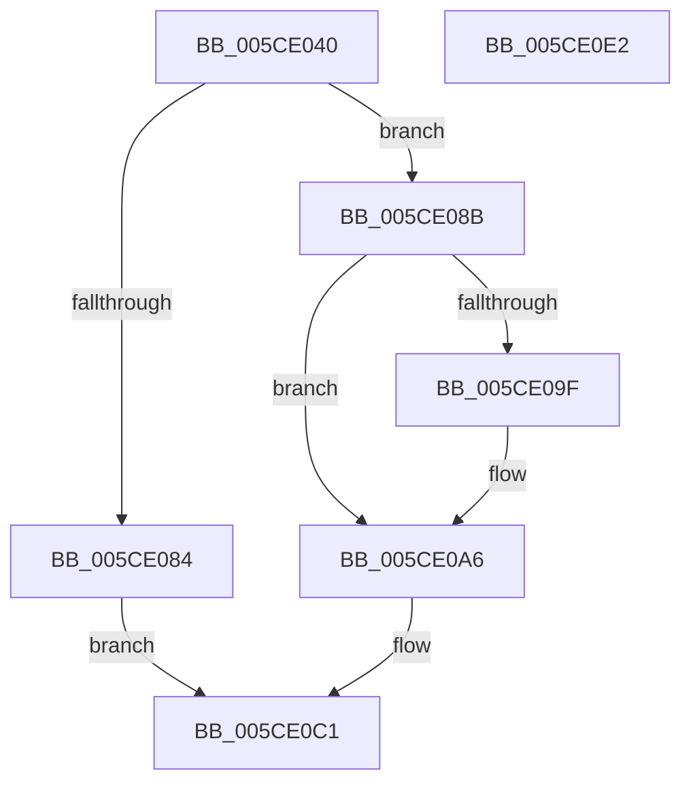

# PfpPartitionInsertToGlobals

- RVA: `0x005CE040`–`0x005CE0E3` (길이 `163` bytes)
- VA: `0x00000001405CE040`
- 실행 섹션: `.text`
- PDB 이름 있음: `예`; PDB Function 태그: `아니요`
- unwind 정보 RVA: `0x0007D3C0`
- 디코드: `45`개 명령, `163/163` bytes 표시
- 미해석 바이트: `0` (있으면 어셈블리에 `.byte`로 보존)

> 이 문서는 커널 이미지의 기계어와 PDB 기호를 분석해 생성했습니다. 4번과 5번은 함수 원형과 자료형을 바이너리 사용 방식에서 추정한 C 해석이며 원본 소스 복구 결과는 아닙니다.

## 1. Dependencies

- 직접 호출 지점: **3**; 고유 호출 대상: **3**
- 직접 호출자로 확인된 함수: **1**
- RIP 상대 이미지 참조: **0**

### Outgoing calls
- `0x005CE077` → [KeAcquireInStackQueuedSpinLock](../27/KeAcquireInStackQueuedSpinLock_function_002757A0.md) (function, `0x002757A0`)
- `0x005CE0BC` → [ExReInitializeRundownProtectionCacheAware](../46/ExReInitializeRundownProtectionCacheAware_function_00464310.md) (function, `0x00464310`)
- `0x005CE0C6` → [KeReleaseInStackQueuedSpinLock](../34/KeReleaseInStackQueuedSpinLock_function_00342CE0.md) (function, `0x00342CE0`)

### Direct callers
- [PfpPartitionCreate](PfpPartitionCreate_function_005CDE8C.md) at `0x005CDF66`

### Static image references
- 디코드된 RIP-relative 메모리 참조가 없습니다.

## 2. Other-region calls and transfers

- 다른 실행 섹션으로 향하는 call: **0**
- 별도 외부 분기/꼬리 이동을 확인하지 못했습니다.

## 3. Assembly (complete function range)

```asm
005CE040  4C 8B DC                        mov r11, rsp
005CE043  49 89 5B 08                     mov qword ptr [r11 + 8], rbx
005CE047  49 89 6B 10                     mov qword ptr [r11 + 0x10], rbp
005CE04B  49 89 73 18                     mov qword ptr [r11 + 0x18], rsi
005CE04F  57                              push rdi
005CE050  48 83 EC 40                     sub rsp, 0x40
005CE054  48 8B 71 08                     mov rsi, qword ptr [rcx + 8]
005CE058  49 8D 53 D8                     lea rdx, [r11 - 0x28]
005CE05C  48 8B 29                        mov rbp, qword ptr [rcx]
005CE05F  0F 57 C0                        xorps xmm0, xmm0
005CE062  48 8B F9                        mov rdi, rcx
005CE065  33 C0                           xor eax, eax
005CE067  0F 11 44 24 20                  movups xmmword ptr [rsp + 0x20], xmm0
005CE06C  48 8D 8E 78 03 00 00            lea rcx, [rsi + 0x378]
005CE073  49 89 43 E8                     mov qword ptr [r11 - 0x18], rax
005CE077  E8 24 77 CA FF                  call 0x1402757a0
005CE07C  33 DB                           xor ebx, ebx
005CE07E  48 39 5D 20                     cmp qword ptr [rbp + 0x20], rbx
005CE082  74 07                           je 0x1405ce08b
005CE084  BB 21 00 00 C0                  mov ebx, 0xc0000021
005CE089  EB 36                           jmp 0x1405ce0c1
005CE08B  48 8D 86 80 03 00 00            lea rax, [rsi + 0x380]
005CE092  48 8B 50 08                     mov rdx, qword ptr [rax + 8]
005CE096  48 8D 4F 18                     lea rcx, [rdi + 0x18]
005CE09A  48 39 02                        cmp qword ptr [rdx], rax
005CE09D  74 07                           je 0x1405ce0a6
005CE09F  B9 03 00 00 00                  mov ecx, 3
005CE0A4  CD 29                           int 0x29
005CE0A6  48 89 01                        mov qword ptr [rcx], rax
005CE0A9  48 89 51 08                     mov qword ptr [rcx + 8], rdx
005CE0AD  48 89 0A                        mov qword ptr [rdx], rcx
005CE0B0  48 89 48 08                     mov qword ptr [rax + 8], rcx
005CE0B4  48 89 7D 20                     mov qword ptr [rbp + 0x20], rdi
005CE0B8  48 8B 4F 10                     mov rcx, qword ptr [rdi + 0x10]
005CE0BC  E8 4F 62 E9 FF                  call 0x140464310
005CE0C1  48 8D 4C 24 20                  lea rcx, [rsp + 0x20]
005CE0C6  E8 15 4C D7 FF                  call 0x140342ce0
005CE0CB  48 8B 6C 24 58                  mov rbp, qword ptr [rsp + 0x58]
005CE0D0  8B C3                           mov eax, ebx
005CE0D2  48 8B 5C 24 50                  mov rbx, qword ptr [rsp + 0x50]
005CE0D7  48 8B 74 24 60                  mov rsi, qword ptr [rsp + 0x60]
005CE0DC  48 83 C4 40                     add rsp, 0x40
005CE0E0  5F                              pop rdi
005CE0E1  C3                              ret
005CE0E2  CC                              int3
```

## 4. C-style interpretation (structured pseudocode)

```c
__int64 __fastcall PfpPartitionInsertToGlobals(__int64 a1)
{
    __int64 result;
    __int64 v_rbx;
    __int64 v_rsp;
    unsigned __int64 v_stack_m28;
    unsigned __int64 v_stack_p10;
    unsigned __int64 v_stack_p18;
    unsigned __int64 v_stack_p8;

    *(unsigned __int64 *)(v_rsp + 8) = v_rbx;
    *(unsigned __int64 *)(v_rsp + 16) = v_rbp;
    *(unsigned __int64 *)(v_rsp + 24) = v_rsi;
    v_rsp = (v_rsp) - (64);
    result = 0;
    v_stack_m28 = v_xmm0;
    *(unsigned __int64 *)(v_rsp - 24) = 0;
    result = KeAcquireInStackQueuedSpinLock(*(unsigned __int64 *)(a1 + 8) + 888, v_rsp - 40, a3, a4);
    v_rbx = 0;
    if ((*(unsigned __int64 *)(*(unsigned __int64 *)(a1) + 32)) == 0) goto loc_005CE08B;
    goto loc_005CE0C1;
loc_005CE08B:
    if ((*(unsigned __int64 *)(*(unsigned __int64 *)(*(unsigned __int64 *)(a1 + 8) + 896 + 8))) != (*(unsigned __int64 *)(a1 + 8) + 896)) {
        a1 = 3;
    }
    *(unsigned __int64 *)(a1) = *(unsigned __int64 *)(a1 + 8) + 896;
    *(unsigned __int64 *)(a1 + 8) = *(unsigned __int64 *)(*(unsigned __int64 *)(a1 + 8) + 896 + 8);
    *(unsigned __int64 *)(*(unsigned __int64 *)(*(unsigned __int64 *)(a1 + 8) + 896 + 8)) = a1;
    *(unsigned __int64 *)(*(unsigned __int64 *)(a1 + 8) + 896 + 8) = a1;
    *(unsigned __int64 *)(*(unsigned __int64 *)(a1) + 32) = a1;
    result = ExReInitializeRundownProtectionCacheAware(*(unsigned __int64 *)(a1 + 16), *(unsigned __int64 *)(*(unsigned __int64 *)(a1 + 8) + 896 + 8), a3, a4);
loc_005CE0C1:
    result = KeReleaseInStackQueuedSpinLock(v_stack_m28, *(unsigned __int64 *)(*(unsigned __int64 *)(a1 + 8) + 896 + 8), a3, a4);
    v_rsp = (v_rsp) + (64);
    return (unsigned int)((unsigned int)((unsigned int)(0xC0000021ULL)));
}
```

## 5. (Beta) C Style

```c
int64_t PfpPartitionInsertToGlobals(void *Arg1)
{
    uint8_t *arg1 = (uint8_t *)Arg1;

    int64_t result;
    int64_t local_rbx;
    int64_t local_rsp;
    uint64_t v_stack_m28;
    uint64_t v_stack_p10;
    uint64_t v_stack_p18;
    uint64_t v_stack_p8;

    *(uint64_t *)(local_rsp + 0x8) = local_rbx;
    *(uint64_t *)(local_rsp + 0x10) = local_rbp;
    *(uint64_t *)(local_rsp + 0x18) = local_rsi;
    local_rsp = (local_rsp) - (64);
    result = 0;
    v_stack_m28 = v_xmm0;
    *(uint64_t *)(local_rsp - 0x18) = 0;
    result = KeAcquireInStackQueuedSpinLock(*(uint64_t *)(arg1 + 0x8) + 888, local_rsp - 40, a3, a4);
    local_rbx = 0;
    if ((*(uint64_t *)(*(uint64_t *)(arg1) + 0x20)) == 0) goto loc_005CE08B;
    goto loc_005CE0C1;
loc_005CE08B:
    if ((*(uint64_t *)(*(uint64_t *)(*(uint64_t *)(arg1 + 0x8) + 0x380 + 0x8))) != (*(uint64_t *)(arg1 + 0x8) + 896)) {
        Arg1 = 3;
    }
    *(uint64_t *)(arg1) = *(uint64_t *)(arg1 + 0x8) + 896;
    *(uint64_t *)(arg1 + 0x8) = *(uint64_t *)(*(uint64_t *)(arg1 + 0x8) + 0x380 + 0x8);
    *(void **)(*(uint64_t *)(*(uint64_t *)(arg1 + 0x8) + 0x380 + 0x8)) = Arg1;
    *(void **)(*(uint64_t *)(arg1 + 0x8) + 0x380 + 0x8) = Arg1;
    *(void **)(*(uint64_t *)(arg1) + 0x20) = Arg1;
    result = ExReInitializeRundownProtectionCacheAware(*(uint64_t *)(arg1 + 0x10), *(uint64_t *)(*(uint64_t *)(arg1 + 0x8) + 0x380 + 0x8), a3, a4);
loc_005CE0C1:
    result = KeReleaseInStackQueuedSpinLock(v_stack_m28, *(uint64_t *)(*(uint64_t *)(arg1 + 0x8) + 0x380 + 0x8), a3, a4);
    local_rsp = (local_rsp) + (64);
    return (uint32_t)((uint32_t)((uint32_t)(0xC0000021ULL)));
}
```

### 관측된 메모리 오프셋

구조체 형식이 확인되지 않은 접근은 인자 기준의 오프셋으로만 기록했습니다.

| 기준 인자 | 오프셋 표현 | 폭 (bit) | 접근 |
|---|---:|---:|---|
| `Arg1` | `+ 0x0` | `64` | `R` |
| `Arg1` | `+ 0x8` | `64` | `R` |
| `Arg1` | `+ 0x10` | `64` | `R` |
| `Arg1` | `+ 0x18` | `64` | `R` |

## 6. Execution-region graph

[열기: 2D/3D 그래프와 함수 탐색 컨트롤 패널](../../../control-panel.html?section=text&rva=0x005CE040&view=graph)

- 2D 그래프는 위에서 아래로 흐르고, 3D 그래프는 빈 공간을 드래그해 회전합니다. Shift+드래그는 이동, 휠은 확대·축소, 함수 노드 선택은 대상 보고서 이동입니다.

### Static fallback


