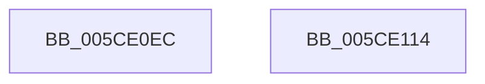

# PfpPartitionIterateAndCheckCanAnyDoAccessLogging

- RVA: `0x005CE0EC`–`0x005CE115` (길이 `41` bytes)
- VA: `0x00000001405CE0EC`
- 실행 섹션: `.text`
- PDB 이름 있음: `예`; PDB Function 태그: `아니요`
- unwind 정보 RVA: `0x0005C788`
- 디코드: `10`개 명령, `41/41` bytes 표시
- 미해석 바이트: `0` (있으면 어셈블리에 `.byte`로 보존)

> 이 문서는 커널 이미지의 기계어와 PDB 기호를 분석해 생성했습니다. 4번과 5번은 함수 원형과 자료형을 바이너리 사용 방식에서 추정한 C 해석이며 원본 소스 복구 결과는 아닙니다.

## 1. Dependencies

- 직접 호출 지점: **1**; 고유 호출 대상: **1**
- 직접 호출자로 확인된 함수: **2**
- RIP 상대 이미지 참조: **1**

### Outgoing calls
- `0x005CE106` → [PfpPartitionIterate](../34/PfpPartitionIterate_function_00341D00.md) (function, `0x00341D00`)

### Direct callers
- [sub_00B47AE6](../../page/B4/Unknown_function_00B47AE6.md) at `0x00B47BDE`
- [PfpScenCtxPrefetchWait](../../pagelk/B6/PfpScenCtxPrefetchWait_function_00B6B5B0.md) at `0x00B6B5E1`

### Static image references
- `0x005CE0FF` → RVA `0x005CDE60` (`PfpPartitionCanDoAccessLoggingCallback`; read)

## 2. Other-region calls and transfers

- 다른 실행 섹션으로 향하는 call: **0**
- 별도 외부 분기/꼬리 이동을 확인하지 못했습니다.

## 3. Assembly (complete function range)

```asm
005CE0EC  48 83 EC 28                     sub rsp, 0x28
005CE0F0  83 64 24 30 00                  and dword ptr [rsp + 0x30], 0
005CE0F5  4C 8D 44 24 30                  lea r8, [rsp + 0x30]
005CE0FA  BA 08 00 00 00                  mov edx, 8
005CE0FF  48 8D 0D 5A FD FF FF            lea rcx, [rip - 0x2a6]
005CE106  E8 F5 3B D7 FF                  call 0x140341d00
005CE10B  8B 44 24 30                     mov eax, dword ptr [rsp + 0x30]
005CE10F  48 83 C4 28                     add rsp, 0x28
005CE113  C3                              ret
005CE114  CC                              int3
```

## 4. C-style interpretation (structured pseudocode)

```c
__int64 __fastcall PfpPartitionIterateAndCheckCanAnyDoAccessLogging(void)
{
    __int64 result;
    __int64 v_rsp;
    unsigned int v_stack_p8;

    v_rsp = (v_rsp) - (40);
    result = PfpPartitionIterate(v_rip - 678, 8, v_stack_p8, a4);
    v_rsp = (v_rsp) + (40);
    return (unsigned int)(v_stack_p8);
}
```

## 5. (Beta) C Style

```c
void PfpPartitionIterateAndCheckCanAnyDoAccessLogging(void)
{
    int64_t result;
    int64_t local_rsp;
    uint32_t v_stack_p8;

    local_rsp = (local_rsp) - (40);
    result = PfpPartitionIterate(v_rip - 678, 8, v_stack_p8, a4);
    local_rsp = (local_rsp) + (40);
    return (uint32_t)(v_stack_p8);
}
```

## 6. Execution-region graph

[열기: 2D/3D 그래프와 함수 탐색 컨트롤 패널](../../../control-panel.html?section=text&rva=0x005CE0EC&view=graph)

- 2D 그래프는 위에서 아래로 흐르고, 3D 그래프는 빈 공간을 드래그해 회전합니다. Shift+드래그는 이동, 휠은 확대·축소, 함수 노드 선택은 대상 보고서 이동입니다.

### Static fallback


