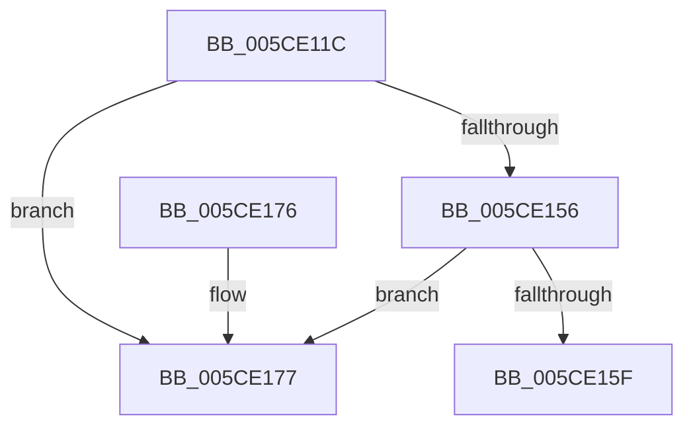

# PfpPartitionRemoveFromGlobals

- RVA: `0x005CE11C`–`0x005CE17E` (길이 `98` bytes)
- VA: `0x00000001405CE11C`
- 실행 섹션: `.text`
- PDB 이름 있음: `예`; PDB Function 태그: `아니요`
- unwind 정보 RVA: `0x000B492C`
- 디코드: `28`개 명령, `98/98` bytes 표시
- 미해석 바이트: `0` (있으면 어셈블리에 `.byte`로 보존)

> 이 문서는 커널 이미지의 기계어와 PDB 기호를 분석해 생성했습니다. 4번과 5번은 함수 원형과 자료형을 바이너리 사용 방식에서 추정한 C 해석이며 원본 소스 복구 결과는 아닙니다.

## 1. Dependencies

- 직접 호출 지점: **2**; 고유 호출 대상: **2**
- 직접 호출자로 확인된 함수: **1**
- RIP 상대 이미지 참조: **0**

### Outgoing calls
- `0x005CE144` → [KeAcquireInStackQueuedSpinLock](../27/KeAcquireInStackQueuedSpinLock_function_002757A0.md) (function, `0x002757A0`)
- `0x005CE16B` → [KeReleaseInStackQueuedSpinLock](../34/KeReleaseInStackQueuedSpinLock_function_00342CE0.md) (function, `0x00342CE0`)

### Direct callers
- [PfDeletePartition](../../page/75/PfDeletePartition_function_00751EB4.md) at `0x00751F5A`

### Static image references
- 디코드된 RIP-relative 메모리 참조가 없습니다.

## 2. Other-region calls and transfers

- 다른 실행 섹션으로 향하는 call: **0**
- 별도 외부 분기/꼬리 이동을 확인하지 못했습니다.

## 3. Assembly (complete function range)

```asm
005CE11C  40 53                           push rbx
005CE11E  48 83 EC 40                     sub rsp, 0x40
005CE122  48 8B D9                        mov rbx, rcx
005CE125  48 8D 54 24 20                  lea rdx, [rsp + 0x20]
005CE12A  48 8B 49 08                     mov rcx, qword ptr [rcx + 8]
005CE12E  0F 57 C0                        xorps xmm0, xmm0
005CE131  33 C0                           xor eax, eax
005CE133  48 81 C1 78 03 00 00            add rcx, 0x378
005CE13A  0F 11 44 24 20                  movups xmmword ptr [rsp + 0x20], xmm0
005CE13F  48 89 44 24 30                  mov qword ptr [rsp + 0x30], rax
005CE144  E8 57 76 CA FF                  call 0x1402757a0
005CE149  48 83 C3 18                     add rbx, 0x18
005CE14D  48 8B 0B                        mov rcx, qword ptr [rbx]
005CE150  48 39 59 08                     cmp qword ptr [rcx + 8], rbx
005CE154  75 21                           jne 0x1405ce177
005CE156  48 8B 43 08                     mov rax, qword ptr [rbx + 8]
005CE15A  48 39 18                        cmp qword ptr [rax], rbx
005CE15D  75 18                           jne 0x1405ce177
005CE15F  48 89 08                        mov qword ptr [rax], rcx
005CE162  48 89 41 08                     mov qword ptr [rcx + 8], rax
005CE166  48 8D 4C 24 20                  lea rcx, [rsp + 0x20]
005CE16B  E8 70 4B D7 FF                  call 0x140342ce0
005CE170  48 83 C4 40                     add rsp, 0x40
005CE174  5B                              pop rbx
005CE175  C3                              ret
005CE176  CC                              int3
005CE177  B9 03 00 00 00                  mov ecx, 3
005CE17C  CD 29                           int 0x29
```

## 4. C-style interpretation (structured pseudocode)

```c
__int64 __fastcall PfpPartitionRemoveFromGlobals(__int64 a1)
{
    __int64 result;
    __int64 v_rbx;
    __int64 v_rsp;
    unsigned __int64 v_stack_m18;
    unsigned __int64 v_stack_m28;

    v_rsp = (v_rsp) - (64);
    result = 0;
    a1 = (*(unsigned __int64 *)(a1 + 8)) + (888);
    v_stack_m28 = v_xmm0;
    v_stack_m18 = 0;
    result = KeAcquireInStackQueuedSpinLock(a1, v_stack_m28, a3, a4);
    v_rbx = (a1) + (24);
    if ((*(unsigned __int64 *)(*(unsigned __int64 *)(v_rbx) + 8)) != v_rbx) goto loc_005CE177;
    if ((*(unsigned __int64 *)(*(unsigned __int64 *)(v_rbx + 8))) != v_rbx) goto loc_005CE177;
    *(unsigned __int64 *)(*(unsigned __int64 *)(v_rbx + 8)) = *(unsigned __int64 *)(v_rbx);
    *(unsigned __int64 *)(*(unsigned __int64 *)(v_rbx) + 8) = *(unsigned __int64 *)(v_rbx + 8);
    result = KeReleaseInStackQueuedSpinLock(v_stack_m28, v_stack_m28, a3, a4);
    v_rsp = (v_rsp) + (64);
    return result;
loc_005CE177:
    return result;
}
```

## 5. (Beta) C Style

```c
int64_t PfpPartitionRemoveFromGlobals(void *Arg1)
{
    uint8_t *arg1 = (uint8_t *)Arg1;

    int64_t result;
    int64_t local_rbx;
    int64_t local_rsp;
    uint64_t v_stack_m18;
    uint64_t v_stack_m28;

    local_rsp = (local_rsp) - (64);
    result = 0;
    Arg1 = (*(uint64_t *)(arg1 + 0x8)) + (888);
    v_stack_m28 = v_xmm0;
    v_stack_m18 = 0;
    result = KeAcquireInStackQueuedSpinLock(Arg1, v_stack_m28, a3, a4);
    local_rbx = (Arg1) + (24);
    if ((*(uint64_t *)(*(uint64_t *)(local_rbx) + 0x8)) != local_rbx) goto loc_005CE177;
    if ((*(uint64_t *)(*(uint64_t *)(local_rbx + 0x8))) != local_rbx) goto loc_005CE177;
    *(uint64_t *)(*(uint64_t *)(local_rbx + 0x8)) = *(uint64_t *)(local_rbx);
    *(uint64_t *)(*(uint64_t *)(local_rbx) + 0x8) = *(uint64_t *)(local_rbx + 0x8);
    result = KeReleaseInStackQueuedSpinLock(v_stack_m28, v_stack_m28, a3, a4);
    local_rsp = (local_rsp) + (64);
    return result;
loc_005CE177:
    return result;
}
```

### 관측된 메모리 오프셋

구조체 형식이 확인되지 않은 접근은 인자 기준의 오프셋으로만 기록했습니다.

| 기준 인자 | 오프셋 표현 | 폭 (bit) | 접근 |
|---|---:|---:|---|
| `Arg1` | `+ 0x0` | `64` | `R` |
| `Arg1` | `+ 0x8` | `64` | `R` |

## 6. Execution-region graph

[열기: 2D/3D 그래프와 함수 탐색 컨트롤 패널](../../../control-panel.html?section=text&rva=0x005CE11C&view=graph)

- 2D 그래프는 위에서 아래로 흐르고, 3D 그래프는 빈 공간을 드래그해 회전합니다. Shift+드래그는 이동, 휠은 확대·축소, 함수 노드 선택은 대상 보고서 이동입니다.

### Static fallback


