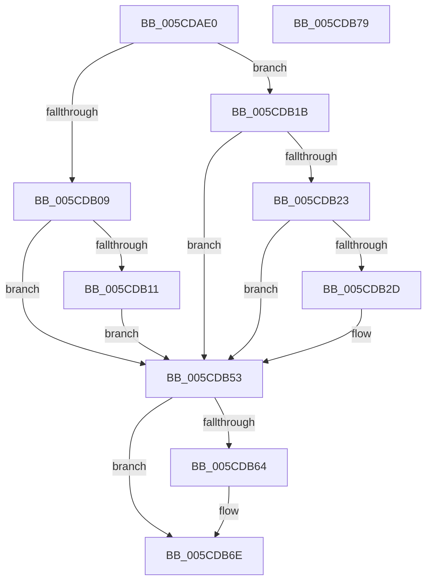

# PfpPowerActionDpcRoutine

- RVA: `0x005CDAE0`–`0x005CDB7A` (길이 `154` bytes)
- VA: `0x00000001405CDAE0`
- 실행 섹션: `.text`
- PDB 이름 있음: `예`; PDB Function 태그: `아니요`
- unwind 정보 RVA: `0x0005CAAC`
- 디코드: `38`개 명령, `154/154` bytes 표시
- 미해석 바이트: `0` (있으면 어셈블리에 `.byte`로 보존)

> 이 문서는 커널 이미지의 기계어와 PDB 기호를 분석해 생성했습니다. 4번과 5번은 함수 원형과 자료형을 바이너리 사용 방식에서 추정한 C 해석이며 원본 소스 복구 결과는 아닙니다.

## 1. Dependencies

- 직접 호출 지점: **4**; 고유 호출 대상: **4**
- 직접 호출자로 확인된 함수: **0**
- RIP 상대 이미지 참조: **6**

### Outgoing calls
- `0x005CDAFA` → [KeAcquireSpinLockAtDpcLevel](../20/KeAcquireSpinLockAtDpcLevel_function_00208430.md) (function, `0x00208430`)
- `0x005CDB4C` → [ExQueueWorkItem](../2F/ExQueueWorkItem_function_002F9520.md) (function, `0x002F9520`)
- `0x005CDB5A` → [KxReleaseSpinLock](../20/KxReleaseSpinLock_function_00206670.md) (function, `0x00206670`)
- `0x005CDB69` → [ExFreePoolWithTag](../../poolcode/B8/ExFreePoolWithTag_function_00B82870.md) (function, `0x00B82870`)

### Direct callers
- 이 함수 시작 RVA로 연결되는 직접 call은 확인되지 않았습니다. 간접 호출은 완전히 역산할 수 없습니다.

### Static image references
- `0x005CDAF0` → RVA `0x00E67138` (`.data`; read)
- `0x005CDB09` → RVA `0x00E67144` (`.data`; read)
- `0x005CDB11` → RVA `0x00F0F22C` (`.data`; read/write)
- `0x005CDB1B` → RVA `0x00E67140` (`.data`; read)
- `0x005CDB23` → RVA `0x00E67128` (`.data`; read)
- `0x005CDB3D` → RVA `0x005CDCB0` (`PfpServiceMainThreadUnboost`; read)

## 2. Other-region calls and transfers

- 다른 실행 섹션으로 향하는 call: **1**
  - `0x005CDB69` → [ExFreePoolWithTag](../../poolcode/B8/ExFreePoolWithTag_function_00B82870.md) (`.text` → `POOLCODE`)
- 별도 외부 분기/꼬리 이동을 확인하지 못했습니다.

## 3. Assembly (complete function range)

```asm
005CDAE0  48 89 5C 24 08                  mov qword ptr [rsp + 8], rbx
005CDAE5  57                              push rdi
005CDAE6  48 83 EC 20                     sub rsp, 0x20
005CDAEA  8B 9A A0 00 00 00               mov ebx, dword ptr [rdx + 0xa0]
005CDAF0  48 8D 0D 41 96 89 00            lea rcx, [rip + 0x899641]
005CDAF7  48 8B FA                        mov rdi, rdx
005CDAFA  E8 31 A9 C3 FF                  call 0x140208430
005CDAFF  8B 87 A4 00 00 00               mov eax, dword ptr [rdi + 0xa4]
005CDB05  85 DB                           test ebx, ebx
005CDB07  75 12                           jne 0x1405cdb1b
005CDB09  39 05 35 96 89 00               cmp dword ptr [rip + 0x899635], eax
005CDB0F  75 42                           jne 0x1405cdb53
005CDB11  F0 83 25 13 17 94 00 FE         lock and dword ptr [rip + 0x941713], 0xfffffffe
005CDB19  EB 38                           jmp 0x1405cdb53
005CDB1B  39 05 1F 96 89 00               cmp dword ptr [rip + 0x89961f], eax
005CDB21  75 30                           jne 0x1405cdb53
005CDB23  48 83 3D FD 95 89 00 00         cmp qword ptr [rip + 0x8995fd], 0
005CDB2B  74 26                           je 0x1405cdb53
005CDB2D  48 8D 8F 80 00 00 00            lea rcx, [rdi + 0x80]
005CDB34  BA 01 00 00 00                  mov edx, 1
005CDB39  48 83 21 00                     and qword ptr [rcx], 0
005CDB3D  48 8D 05 6C 01 00 00            lea rax, [rip + 0x16c]
005CDB44  48 89 41 10                     mov qword ptr [rcx + 0x10], rax
005CDB48  48 89 79 18                     mov qword ptr [rcx + 0x18], rdi
005CDB4C  E8 CF B9 D2 FF                  call 0x1402f9520
005CDB51  33 FF                           xor edi, edi
005CDB53  48 8D 0D DE 95 89 00            lea rcx, [rip + 0x8995de]
005CDB5A  E8 11 8B C3 FF                  call 0x140206670
005CDB5F  48 85 FF                        test rdi, rdi
005CDB62  74 0A                           je 0x1405cdb6e
005CDB64  33 D2                           xor edx, edx
005CDB66  48 8B CF                        mov rcx, rdi
005CDB69  E8 02 4D 5B 00                  call 0x140b82870
005CDB6E  48 8B 5C 24 30                  mov rbx, qword ptr [rsp + 0x30]
005CDB73  48 83 C4 20                     add rsp, 0x20
005CDB77  5F                              pop rdi
005CDB78  C3                              ret
005CDB79  CC                              int3
```

## 4. C-style interpretation (structured pseudocode)

```c
__int64 __fastcall PfpPowerActionDpcRoutine(__int64 a1, __int64 a2)
{
    __int64 result;
    __int64 v_rdi;
    __int64 v_rsp;
    unsigned __int64 v_stack_p8;

    v_stack_p8 = v_rbx;
    v_rsp = (v_rsp) - (32);
    result = KeAcquireSpinLockAtDpcLevel(v_rip + 9016897, a2, a3, a4);
    if ((unsigned int)((unsigned int)(*(unsigned int *)(a2 + 160))) != 0) goto loc_005CDB1B;
    if ((*(unsigned int *)(v_rip + 9016885)) != ((unsigned int)((unsigned int)(*(unsigned int *)(a2 + 164))))) goto loc_005CDB53;
    goto loc_005CDB53;
loc_005CDB1B:
    if ((*(unsigned int *)(v_rip + 9016863)) != ((unsigned int)((unsigned int)(*(unsigned int *)(a2 + 164))))) goto loc_005CDB53;
    result = (unsigned int)(*(unsigned int *)(a2 + 164));
    v_rdi = a2;
    if ((*(unsigned __int64 *)(v_rip + 9016829)) != 0) {
        a1 = a2 + 128;
        a2 = 1;
        result = v_rip + 364;
        *(unsigned __int64 *)(a1 + 16) = result;
        *(unsigned __int64 *)(a1 + 24) = a2;
        result = ExQueueWorkItem(a1, a2, a3, a4);
        v_rdi = 0;
    }
    result = KxReleaseSpinLock(v_rip + 9016798, a2, a3, a4);
    if (0 != 0) {
        a2 = 0;
        a1 = 0;
        result = ExFreePoolWithTag(a1, a2, a3, a4);
    }
    v_rsp = (v_rsp) + (32);
    return result;
}
```

## 5. (Beta) C Style

```c
int64_t PfpPowerActionDpcRoutine(int64_t Arg1, void *Arg2)
{
    uint8_t *arg2 = (uint8_t *)Arg2;

    int64_t result;
    int64_t local_rdi;
    int64_t local_rsp;
    uint64_t v_stack_p8;

    v_stack_p8 = local_rbx;
    local_rsp = (local_rsp) - (32);
    result = KeAcquireSpinLockAtDpcLevel(v_rip + 9016897, Arg2, a3, a4);
    if ((uint32_t)((uint32_t)(*(uint32_t *)(arg2 + 0xA0))) != 0) goto loc_005CDB1B;
    if ((*(uint32_t *)(v_rip + 0x899635)) != ((uint32_t)((uint32_t)(*(uint32_t *)(arg2 + 0xA4))))) goto loc_005CDB53;
    goto loc_005CDB53;
loc_005CDB1B:
    if ((*(uint32_t *)(v_rip + 0x89961F)) != ((uint32_t)((uint32_t)(*(uint32_t *)(arg2 + 0xA4))))) goto loc_005CDB53;
    result = (uint32_t)(*(uint32_t *)(arg2 + 0xA4));
    local_rdi = Arg2;
    if ((*(uint64_t *)(v_rip + 0x8995FD)) != 0) {
        Arg1 = Arg2 + 128;
        Arg2 = 1;
        result = v_rip + 364;
        *(uint64_t *)(Arg1 + 0x10) = result;
        *(void **)(Arg1 + 0x18) = Arg2;
        result = ExQueueWorkItem(Arg1, Arg2, a3, a4);
        local_rdi = 0;
    }
    result = KxReleaseSpinLock(v_rip + 9016798, Arg2, a3, a4);
    if (0 != 0) {
        Arg2 = 0;
        Arg1 = 0;
        result = ExFreePoolWithTag(Arg1, Arg2, a3, a4);
    }
    local_rsp = (local_rsp) + (32);
    return result;
}
```

### 관측된 메모리 오프셋

구조체 형식이 확인되지 않은 접근은 인자 기준의 오프셋으로만 기록했습니다.

| 기준 인자 | 오프셋 표현 | 폭 (bit) | 접근 |
|---|---:|---:|---|
| `Arg2` | `+ 0x0` | `64` | `R/W` |
| `Arg2` | `+ 0x10` | `64` | `W` |
| `Arg2` | `+ 0x18` | `64` | `W` |
| `Arg2` | `+ 0x80` | `64` | `R` |
| `Arg2` | `+ 0xA0` | `32` | `R` |
| `Arg2` | `+ 0xA4` | `32` | `R` |

## 6. Execution-region graph

[열기: 2D/3D 그래프와 함수 탐색 컨트롤 패널](../../../control-panel.html?section=text&rva=0x005CDAE0&view=graph)

- 2D 그래프는 위에서 아래로 흐르고, 3D 그래프는 빈 공간을 드래그해 회전합니다. Shift+드래그는 이동, 휠은 확대·축소, 함수 노드 선택은 대상 보고서 이동입니다.

### Static fallback


