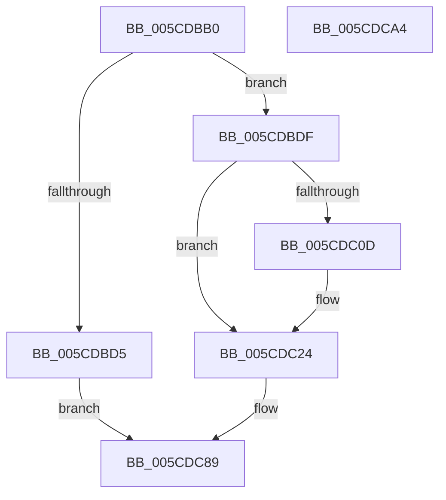

# PfpServiceMainThreadBoost

- RVA: `0x005CDBB0`–`0x005CDCA5` (길이 `245` bytes)
- VA: `0x00000001405CDBB0`
- 실행 섹션: `.text`
- PDB 이름 있음: `예`; PDB Function 태그: `아니요`
- unwind 정보 RVA: `0x00084C9C`
- 디코드: `64`개 명령, `245/245` bytes 표시
- 미해석 바이트: `0` (있으면 어셈블리에 `.byte`로 보존)

> 이 문서는 커널 이미지의 기계어와 PDB 기호를 분석해 생성했습니다. 4번과 5번은 함수 원형과 자료형을 바이너리 사용 방식에서 추정한 C 해석이며 원본 소스 복구 결과는 아닙니다.

## 1. Dependencies

- 직접 호출 지점: **4**; 고유 호출 대상: **4**
- 직접 호출자로 확인된 함수: **1**
- RIP 상대 이미지 참조: **1**

### Outgoing calls
- `0x005CDBF2` → [KeAcquireSpinLockRaiseToDpc](../20/KeAcquireSpinLockRaiseToDpc_function_00208470.md) (function, `0x00208470`)
- `0x005CDC1C` → [KeSetActualBasePriorityThread](../3C/KeSetActualBasePriorityThread_function_003C4370.md) (function, `0x003C4370`)
- `0x005CDC2B` → [KeReleaseSpinLock](../39/KeReleaseSpinLock_function_00392BA0.md) (function, `0x00392BA0`)
- `0x005CDC80` → [KiSetTimerEx](../23/KiSetTimerEx_function_00232CB0.md) (function, `0x00232CB0`)

### Direct callers
- [PfpScenCtxScenarioSet](../../pagelk/B7/PfpScenCtxScenarioSet_function_00B7CFF0.md) at `0x00B7D0FA`

### Static image references
- `0x005CDC5B` → RVA `0x005CDAE0` (`PfpPowerActionDpcRoutine`; read)

## 2. Other-region calls and transfers

- 다른 실행 섹션으로 향하는 call: **0**
- 별도 외부 분기/꼬리 이동을 확인하지 못했습니다.

## 3. Assembly (complete function range)

```asm
005CDBB0  48 89 5C 24 08                  mov qword ptr [rsp + 8], rbx
005CDBB5  48 89 6C 24 10                  mov qword ptr [rsp + 0x10], rbp
005CDBBA  48 89 74 24 18                  mov qword ptr [rsp + 0x18], rsi
005CDBBF  57                              push rdi
005CDBC0  41 56                           push r14
005CDBC2  41 57                           push r15
005CDBC4  48 83 EC 30                     sub rsp, 0x30
005CDBC8  33 DB                           xor ebx, ebx
005CDBCA  48 8B F2                        mov rsi, rdx
005CDBCD  48 8B F9                        mov rdi, rcx
005CDBD0  48 39 1A                        cmp qword ptr [rdx], rbx
005CDBD3  75 0A                           jne 0x1405cdbdf
005CDBD5  BB 22 00 00 80                  mov ebx, 0x80000022
005CDBDA  E9 AA 00 00 00                  jmp 0x1405cdc89
005CDBDF  4C 8B 72 08                     mov r14, qword ptr [rdx + 8]
005CDBE3  48 83 C1 68                     add rcx, 0x68
005CDBE7  41 C7 86 A0 00 00 00 01 00 00 00  mov dword ptr [r14 + 0xa0], 1
005CDBF2  E8 79 A8 C3 FF                  call 0x140208470
005CDBF7  FF 47 70                        inc dword ptr [rdi + 0x70]
005CDBFA  44 8A F8                        mov r15b, al
005CDBFD  8B 47 70                        mov eax, dword ptr [rdi + 0x70]
005CDC00  41 89 86 A4 00 00 00            mov dword ptr [r14 + 0xa4], eax
005CDC07  48 39 5F 58                     cmp qword ptr [rdi + 0x58], rbx
005CDC0B  75 17                           jne 0x1405cdc24
005CDC0D  48 8B 0E                        mov rcx, qword ptr [rsi]
005CDC10  BA 0C 00 00 00                  mov edx, 0xc
005CDC15  48 89 4F 58                     mov qword ptr [rdi + 0x58], rcx
005CDC19  48 89 1E                        mov qword ptr [rsi], rbx
005CDC1C  E8 4F 67 DF FF                  call 0x1403c4370
005CDC21  89 47 60                        mov dword ptr [rdi + 0x60], eax
005CDC24  41 8A D7                        mov dl, r15b
005CDC27  48 8D 4F 68                     lea rcx, [rdi + 0x68]
005CDC2B  E8 70 4F DC FF                  call 0x140392ba0
005CDC30  49 8D 4E 40                     lea rcx, [r14 + 0x40]
005CDC34  4C 89 74 24 20                  mov qword ptr [rsp + 0x20], r14
005CDC39  48 89 19                        mov qword ptr [rcx], rbx
005CDC3C  48 8D 41 08                     lea rax, [rcx + 8]
005CDC40  C6 01 08                        mov byte ptr [rcx], 8
005CDC43  45 33 C9                        xor r9d, r9d
005CDC46  48 89 40 08                     mov qword ptr [rax + 8], rax
005CDC4A  45 33 C0                        xor r8d, r8d
005CDC4D  48 89 00                        mov qword ptr [rax], rax
005CDC50  48 C7 C2 00 3E 14 F4            mov rdx, 0xfffffffff4143e00
005CDC57  48 89 59 18                     mov qword ptr [rcx + 0x18], rbx
005CDC5B  48 8D 05 7E FE FF FF            lea rax, [rip - 0x182]
005CDC62  89 59 3C                        mov dword ptr [rcx + 0x3c], ebx
005CDC65  66 89 59 38                     mov word ptr [rcx + 0x38], bx
005CDC69  49 89 46 18                     mov qword ptr [r14 + 0x18], rax
005CDC6D  41 C7 06 13 01 00 00            mov dword ptr [r14], 0x113
005CDC74  4D 89 76 20                     mov qword ptr [r14 + 0x20], r14
005CDC78  49 89 5E 38                     mov qword ptr [r14 + 0x38], rbx
005CDC7C  49 89 5E 10                     mov qword ptr [r14 + 0x10], rbx
005CDC80  E8 2B 50 C6 FF                  call 0x140232cb0
005CDC85  48 89 5E 08                     mov qword ptr [rsi + 8], rbx
005CDC89  48 8B 6C 24 58                  mov rbp, qword ptr [rsp + 0x58]
005CDC8E  8B C3                           mov eax, ebx
005CDC90  48 8B 5C 24 50                  mov rbx, qword ptr [rsp + 0x50]
005CDC95  48 8B 74 24 60                  mov rsi, qword ptr [rsp + 0x60]
005CDC9A  48 83 C4 30                     add rsp, 0x30
005CDC9E  41 5F                           pop r15
005CDCA0  41 5E                           pop r14
005CDCA2  5F                              pop rdi
005CDCA3  C3                              ret
005CDCA4  CC                              int3
```

## 4. C-style interpretation (structured pseudocode)

```c
__int64 __fastcall PfpServiceMainThreadBoost(__int64 a1, __int64 a2, int a3, int a4)
{
    __int64 result;
    __int64 v_rbx;
    __int64 v_rsp;
    unsigned __int64 v_stack_m28;
    unsigned __int64 v_stack_p10;
    unsigned __int64 v_stack_p18;
    unsigned __int64 v_stack_p8;

    v_stack_p8 = v_rbx;
    v_stack_p10 = v_rbp;
    v_stack_p18 = v_rsi;
    v_rsp = (v_rsp) - (48);
    v_rbx = 0;
    if ((*(unsigned __int64 *)(a2)) != 0) goto loc_005CDBDF;
    goto loc_005CDC89;
loc_005CDBDF:
    a1 = (a1) + (104);
    *(unsigned int *)(*(unsigned __int64 *)(a2 + 8) + 160) = 1;
    result = KeAcquireSpinLockRaiseToDpc(a1, a2, a3, a4);
    *(unsigned int *)(*(unsigned __int64 *)(a2 + 8) + 164) = (unsigned int)((unsigned int)(*(unsigned int *)(a1 + 112)));
    result = (unsigned int)(*(unsigned int *)(a1 + 112));
    if ((*(unsigned __int64 *)(a1 + 88)) == ((unsigned int)(0x80000022ULL))) {
        a1 = *(unsigned __int64 *)(a2);
        a2 = 12;
        *(unsigned __int64 *)(a1 + 88) = a1;
        *(unsigned __int64 *)(a2) = (unsigned int)(0x80000022ULL);
        result = KeSetActualBasePriorityThread(a1, a2, a3, a4);
        *(unsigned int *)(a1 + 96) = (unsigned int)(result);
    }
    result = KeReleaseSpinLock(a1 + 104, (unsigned __int8)((unsigned __int8)(result)), a3, a4);
    v_stack_m28 = *(unsigned __int64 *)(a2 + 8);
    *(unsigned __int64 *)(*(unsigned __int64 *)(a2 + 8) + 64) = (unsigned int)(0x80000022ULL);
    *(unsigned __int8 *)(*(unsigned __int64 *)(a2 + 8) + 64) = 8;
    a4 = 0;
    *(unsigned __int64 *)(*(unsigned __int64 *)(a2 + 8) + 64 + 8 + 8) = *(unsigned __int64 *)(a2 + 8) + 64 + 8;
    a3 = 0;
    *(unsigned __int64 *)(*(unsigned __int64 *)(a2 + 8) + 64 + 8) = *(unsigned __int64 *)(a2 + 8) + 64 + 8;
    *(unsigned __int64 *)(*(unsigned __int64 *)(a2 + 8) + 64 + 24) = (unsigned int)(0x80000022ULL);
    *(unsigned int *)(*(unsigned __int64 *)(a2 + 8) + 64 + 60) = (unsigned int)((unsigned int)(0x80000022ULL));
    *(unsigned __int16 *)(*(unsigned __int64 *)(a2 + 8) + 64 + 56) = (unsigned __int16)((unsigned int)(0x80000022ULL));
    *(unsigned __int64 *)(*(unsigned __int64 *)(a2 + 8) + 24) = v_rip - 386;
    *(unsigned int *)(*(unsigned __int64 *)(a2 + 8)) = 275;
    *(unsigned __int64 *)(*(unsigned __int64 *)(a2 + 8) + 32) = *(unsigned __int64 *)(a2 + 8);
    *(unsigned __int64 *)(*(unsigned __int64 *)(a2 + 8) + 56) = (unsigned int)(0x80000022ULL);
    *(unsigned __int64 *)(*(unsigned __int64 *)(a2 + 8) + 16) = (unsigned int)(0x80000022ULL);
    result = KiSetTimerEx(*(unsigned __int64 *)(a2 + 8) + 64, 0xFFFFFFFFF4143E00ULL, a3, a4);
    *(unsigned __int64 *)(a2 + 8) = (unsigned int)(0x80000022ULL);
loc_005CDC89:
    v_rsp = (v_rsp) + (48);
    return (unsigned int)((unsigned int)((unsigned int)(0x80000022ULL)));
}
```

## 5. (Beta) C Style

```c
int64_t PfpServiceMainThreadBoost(void *Arg1, void *Arg2, int32_t Arg3, int32_t Arg4)
{
    uint8_t *arg1 = (uint8_t *)Arg1;
    uint8_t *arg2 = (uint8_t *)Arg2;

    int64_t result;
    int64_t local_rbx;
    int64_t local_rsp;
    uint64_t v_stack_m28;
    uint64_t v_stack_p10;
    uint64_t v_stack_p18;
    uint64_t v_stack_p8;

    v_stack_p8 = local_rbx;
    v_stack_p10 = local_rbp;
    v_stack_p18 = local_rsi;
    local_rsp = (local_rsp) - (48);
    local_rbx = 0;
    if ((*(uint64_t *)(arg2)) != 0) goto loc_005CDBDF;
    goto loc_005CDC89;
loc_005CDBDF:
    Arg1 = (Arg1) + (104);
    *(uint32_t *)(*(uint64_t *)(arg2 + 0x8) + 0xA0) = 1;
    result = KeAcquireSpinLockRaiseToDpc(Arg1, Arg2, Arg3, Arg4);
    *(uint32_t *)(*(uint64_t *)(arg2 + 0x8) + 0xA4) = (uint32_t)((uint32_t)(*(uint32_t *)(arg1 + 0x70)));
    result = (uint32_t)(*(uint32_t *)(arg1 + 0x70));
    if ((*(uint64_t *)(arg1 + 0x58)) == ((uint32_t)(0x80000022ULL))) {
        Arg1 = *(uint64_t *)(arg2);
        Arg2 = 12;
        *(void **)(arg1 + 0x58) = Arg1;
        *(uint64_t *)(arg2) = (uint32_t)(0x80000022ULL);
        result = KeSetActualBasePriorityThread(Arg1, Arg2, Arg3, Arg4);
        *(uint32_t *)(arg1 + 0x60) = (uint32_t)(result);
    }
    result = KeReleaseSpinLock(Arg1 + 104, (uint8_t)((uint8_t)(result)), Arg3, Arg4);
    v_stack_m28 = *(uint64_t *)(arg2 + 0x8);
    *(uint64_t *)(*(uint64_t *)(arg2 + 0x8) + 0x40) = (uint32_t)(0x80000022ULL);
    *(uint8_t *)(*(uint64_t *)(arg2 + 0x8) + 0x40) = 8;
    Arg4 = 0;
    *(uint64_t *)(*(uint64_t *)(arg2 + 0x8) + 0x40 + 0x8 + 0x8) = *(uint64_t *)(arg2 + 0x8) + 64 + 8;
    Arg3 = 0;
    *(uint64_t *)(*(uint64_t *)(arg2 + 0x8) + 0x40 + 0x8) = *(uint64_t *)(arg2 + 0x8) + 64 + 8;
    *(uint64_t *)(*(uint64_t *)(arg2 + 0x8) + 0x40 + 0x18) = (uint32_t)(0x80000022ULL);
    *(uint32_t *)(*(uint64_t *)(arg2 + 0x8) + 0x40 + 0x3C) = (uint32_t)((uint32_t)(0x80000022ULL));
    *(uint16_t *)(*(uint64_t *)(arg2 + 0x8) + 0x40 + 0x38) = (uint16_t)((uint32_t)(0x80000022ULL));
    *(uint64_t *)(*(uint64_t *)(arg2 + 0x8) + 0x18) = v_rip - 386;
    *(uint32_t *)(*(uint64_t *)(arg2 + 0x8)) = 275;
    *(uint64_t *)(*(uint64_t *)(arg2 + 0x8) + 0x20) = *(uint64_t *)(arg2 + 0x8);
    *(uint64_t *)(*(uint64_t *)(arg2 + 0x8) + 0x38) = (uint32_t)(0x80000022ULL);
    *(uint64_t *)(*(uint64_t *)(arg2 + 0x8) + 0x10) = (uint32_t)(0x80000022ULL);
    result = KiSetTimerEx(*(uint64_t *)(arg2 + 0x8) + 64, 0xFFFFFFFFF4143E00ULL, Arg3, Arg4);
    *(uint64_t *)(arg2 + 0x8) = (uint32_t)(0x80000022ULL);
loc_005CDC89:
    local_rsp = (local_rsp) + (48);
    return (uint32_t)((uint32_t)((uint32_t)(0x80000022ULL)));
}
```

### 관측된 메모리 오프셋

구조체 형식이 확인되지 않은 접근은 인자 기준의 오프셋으로만 기록했습니다.

| 기준 인자 | 오프셋 표현 | 폭 (bit) | 접근 |
|---|---:|---:|---|
| `Arg1` | `+ 0x58` | `64` | `R` |
| `Arg1` | `+ 0x58` | `64` | `W` |
| `Arg1` | `+ 0x60` | `32` | `W` |
| `Arg1` | `+ 0x68` | `64` | `R` |
| `Arg1` | `+ 0x70` | `32` | `R` |
| `Arg1` | `+ 0x70` | `32` | `R/W` |
| `Arg2` | `+ 0x0` | `64` | `R` |
| `Arg2` | `+ 0x0` | `64` | `W` |
| `Arg2` | `+ 0x8` | `64` | `R` |
| `Arg2` | `+ 0x8` | `64` | `W` |

## 6. Execution-region graph

[열기: 2D/3D 그래프와 함수 탐색 컨트롤 패널](../../../control-panel.html?section=text&rva=0x005CDBB0&view=graph)

- 2D 그래프는 위에서 아래로 흐르고, 3D 그래프는 빈 공간을 드래그해 회전합니다. Shift+드래그는 이동, 휠은 확대·축소, 함수 노드 선택은 대상 보고서 이동입니다.

### Static fallback


