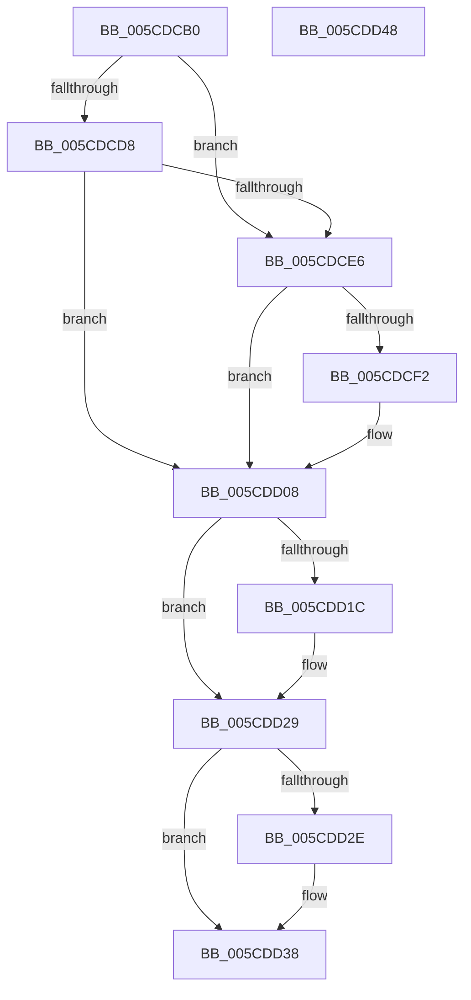

# PfpServiceMainThreadUnboost

- RVA: `0x005CDCB0`–`0x005CDD49` (길이 `153` bytes)
- VA: `0x00000001405CDCB0`
- 실행 섹션: `.text`
- PDB 이름 있음: `예`; PDB Function 태그: `아니요`
- unwind 정보 RVA: `0x00060BC4`
- 디코드: `40`개 명령, `153/153` bytes 표시
- 미해석 바이트: `0` (있으면 어셈블리에 `.byte`로 보존)

> 이 문서는 커널 이미지의 기계어와 PDB 기호를 분석해 생성했습니다. 4번과 5번은 함수 원형과 자료형을 바이너리 사용 방식에서 추정한 C 해석이며 원본 소스 복구 결과는 아닙니다.

## 1. Dependencies

- 직접 호출 지점: **5**; 고유 호출 대상: **5**
- 직접 호출자로 확인된 함수: **1**
- RIP 상대 이미지 참조: **5**

### Outgoing calls
- `0x005CDCCB` → [KeAcquireSpinLockRaiseToDpc](../20/KeAcquireSpinLockRaiseToDpc_function_00208470.md) (function, `0x00208470`)
- `0x005CDD03` → [KeSetActualBasePriorityThread](../3C/KeSetActualBasePriorityThread_function_003C4370.md) (function, `0x003C4370`)
- `0x005CDD12` → [KeReleaseSpinLock](../39/KeReleaseSpinLock_function_00392BA0.md) (function, `0x00392BA0`)
- `0x005CDD24` → [ObDereferenceObjectDeferDeleteWithTag](../26/ObDereferenceObjectDeferDeleteWithTag_function_00263EA0.md) (function, `0x00263EA0`)
- `0x005CDD33` → [ExFreePoolWithTag](../../poolcode/B8/ExFreePoolWithTag_function_00B82870.md) (function, `0x00B82870`)

### Direct callers
- [sub_00B80CFE](../../pagelk/B8/Unknown_function_00B80CFE.md) at `0x00B80DB7`

### Static image references
- `0x005CDCC4` → RVA `0x00E67138` (`.data`; read)
- `0x005CDCDE` → RVA `0x00E67140` (`.data`; read)
- `0x005CDCE6` → RVA `0x00E67128` (`.data`; read)
- `0x005CDCF2` → RVA `0x00E67128` (`.data`; read/write)
- `0x005CDCFD` → RVA `0x00E67130` (`.data`; read)

## 2. Other-region calls and transfers

- 다른 실행 섹션으로 향하는 call: **1**
  - `0x005CDD33` → [ExFreePoolWithTag](../../poolcode/B8/ExFreePoolWithTag_function_00B82870.md) (`.text` → `POOLCODE`)
- 별도 외부 분기/꼬리 이동을 확인하지 못했습니다.

## 3. Assembly (complete function range)

```asm
005CDCB0  48 89 5C 24 08                  mov qword ptr [rsp + 8], rbx
005CDCB5  48 89 74 24 10                  mov qword ptr [rsp + 0x10], rsi
005CDCBA  57                              push rdi
005CDCBB  48 83 EC 20                     sub rsp, 0x20
005CDCBF  48 8B F9                        mov rdi, rcx
005CDCC2  33 DB                           xor ebx, ebx
005CDCC4  48 8D 0D 6D 94 89 00            lea rcx, [rip + 0x89946d]
005CDCCB  E8 A0 A7 C3 FF                  call 0x140208470
005CDCD0  40 8A F0                        mov sil, al
005CDCD3  48 85 FF                        test rdi, rdi
005CDCD6  74 0E                           je 0x1405cdce6
005CDCD8  8B 97 A4 00 00 00               mov edx, dword ptr [rdi + 0xa4]
005CDCDE  39 15 5C 94 89 00               cmp dword ptr [rip + 0x89945c], edx
005CDCE4  75 22                           jne 0x1405cdd08
005CDCE6  48 8B 1D 3B 94 89 00            mov rbx, qword ptr [rip + 0x89943b]
005CDCED  48 85 DB                        test rbx, rbx
005CDCF0  74 16                           je 0x1405cdd08
005CDCF2  48 83 25 2E 94 89 00 00         and qword ptr [rip + 0x89942e], 0
005CDCFA  48 8B CB                        mov rcx, rbx
005CDCFD  8B 15 2D 94 89 00               mov edx, dword ptr [rip + 0x89942d]
005CDD03  E8 68 66 DF FF                  call 0x1403c4370
005CDD08  40 8A D6                        mov dl, sil
005CDD0B  48 8D 0D 26 94 89 00            lea rcx, [rip + 0x899426]
005CDD12  E8 89 4E DC FF                  call 0x140392ba0
005CDD17  48 85 DB                        test rbx, rbx
005CDD1A  74 0D                           je 0x1405cdd29
005CDD1C  BA 44 66 6C 74                  mov edx, 0x746c6644
005CDD21  48 8B CB                        mov rcx, rbx
005CDD24  E8 77 61 C9 FF                  call 0x140263ea0
005CDD29  48 85 FF                        test rdi, rdi
005CDD2C  74 0A                           je 0x1405cdd38
005CDD2E  33 D2                           xor edx, edx
005CDD30  48 8B CF                        mov rcx, rdi
005CDD33  E8 38 4B 5B 00                  call 0x140b82870
005CDD38  48 8B 5C 24 30                  mov rbx, qword ptr [rsp + 0x30]
005CDD3D  48 8B 74 24 38                  mov rsi, qword ptr [rsp + 0x38]
005CDD42  48 83 C4 20                     add rsp, 0x20
005CDD46  5F                              pop rdi
005CDD47  C3                              ret
005CDD48  CC                              int3
```

## 4. C-style interpretation (structured pseudocode)

```c
__int64 __fastcall PfpServiceMainThreadUnboost(__int64 a1)
{
    __int64 result;
    __int64 v_rbx;
    __int64 v_rsp;
    unsigned __int64 v_stack_p10;
    unsigned __int64 v_stack_p8;

    v_stack_p8 = v_rbx;
    v_stack_p10 = v_rsi;
    v_rsp = (v_rsp) - (32);
    v_rbx = 0;
    result = KeAcquireSpinLockRaiseToDpc(v_rip + 9016429, a2, a3, a4);
    if (a1 == 0) goto loc_005CDCE6;
    if ((*(unsigned int *)(v_rip + 9016412)) != ((unsigned int)((unsigned int)(*(unsigned int *)(a1 + 164))))) goto loc_005CDD08;
loc_005CDCE6:
    if (*(unsigned __int64 *)(v_rip + 9016379) != 0) {
        a1 = *(unsigned __int64 *)(v_rip + 9016379);
        a2 = *(unsigned int *)(v_rip + 9016365);
        result = KeSetActualBasePriorityThread(a1, a2, a3, a4);
    }
    result = KeReleaseSpinLock(v_rip + 9016358, (unsigned __int8)((unsigned __int8)(result)), a3, a4);
    if (*(unsigned __int64 *)(v_rip + 9016379) != 0) {
        a2 = 0x746C6644ULL;
        a1 = *(unsigned __int64 *)(v_rip + 9016379);
        result = ObDereferenceObjectDeferDeleteWithTag(a1, a2, a3, a4);
    }
    if (a1 != 0) {
        a2 = 0;
        a1 = a1;
        result = ExFreePoolWithTag(a1, a2, a3, a4);
    }
    v_rsp = (v_rsp) + (32);
    return result;
}
```

## 5. (Beta) C Style

```c
int64_t PfpServiceMainThreadUnboost(int64_t Arg1)
{
    int64_t result;
    int64_t local_rbx;
    int64_t local_rsp;
    uint64_t v_stack_p10;
    uint64_t v_stack_p8;

    v_stack_p8 = local_rbx;
    v_stack_p10 = local_rsi;
    local_rsp = (local_rsp) - (32);
    local_rbx = 0;
    result = KeAcquireSpinLockRaiseToDpc(v_rip + 9016429, a2, a3, a4);
    if (Arg1 == 0) goto loc_005CDCE6;
    if ((*(uint32_t *)(v_rip + 0x89945C)) != ((uint32_t)((uint32_t)(*(uint32_t *)(Arg1 + 0xA4))))) goto loc_005CDD08;
loc_005CDCE6:
    if (*(uint64_t *)(v_rip + 0x89943B) != 0) {
        Arg1 = *(uint64_t *)(v_rip + 0x89943B);
        a2 = *(uint32_t *)(v_rip + 0x89942D);
        result = KeSetActualBasePriorityThread(Arg1, a2, a3, a4);
    }
    result = KeReleaseSpinLock(v_rip + 9016358, (uint8_t)((uint8_t)(result)), a3, a4);
    if (*(uint64_t *)(v_rip + 0x89943B) != 0) {
        a2 = 0x746C6644ULL;
        Arg1 = *(uint64_t *)(v_rip + 0x89943B);
        result = ObDereferenceObjectDeferDeleteWithTag(Arg1, a2, a3, a4);
    }
    if (Arg1 != 0) {
        a2 = 0;
        Arg1 = Arg1;
        result = ExFreePoolWithTag(Arg1, a2, a3, a4);
    }
    local_rsp = (local_rsp) + (32);
    return result;
}
```

## 6. Execution-region graph

[열기: 2D/3D 그래프와 함수 탐색 컨트롤 패널](../../../control-panel.html?section=text&rva=0x005CDCB0&view=graph)

- 2D 그래프는 위에서 아래로 흐르고, 3D 그래프는 빈 공간을 드래그해 회전합니다. Shift+드래그는 이동, 휠은 확대·축소, 함수 노드 선택은 대상 보고서 이동입니다.

### Static fallback


