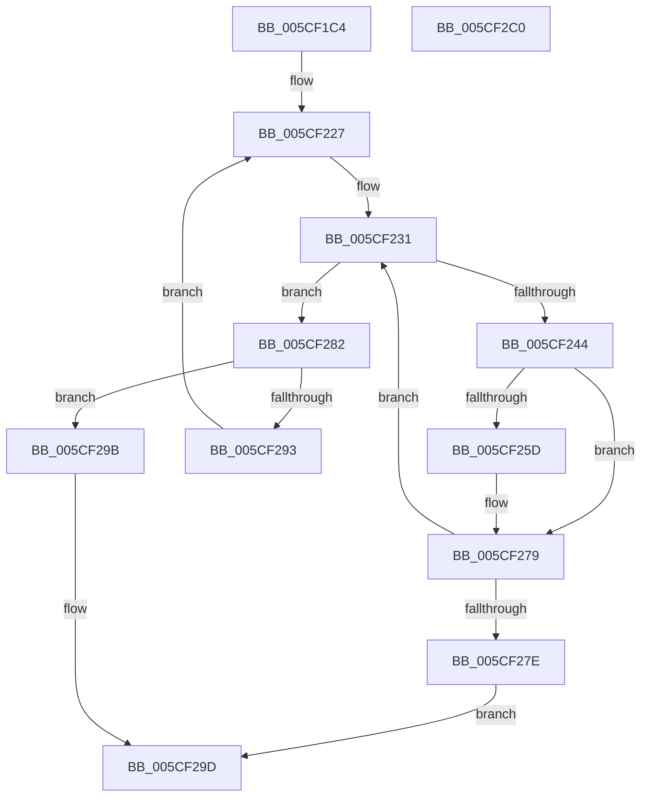

# PoAllProcessorsDeepIdle

- RVA: `0x005CF1C4`–`0x005CF2C1` (길이 `253` bytes)
- VA: `0x00000001405CF1C4`
- 실행 섹션: `.text`
- PDB 이름 있음: `예`; PDB Function 태그: `아니요`
- unwind 정보 RVA: `0x000CBFA4`
- 디코드: `63`개 명령, `253/253` bytes 표시
- 미해석 바이트: `0` (있으면 어셈블리에 `.byte`로 보존)

> 이 문서는 커널 이미지의 기계어와 PDB 기호를 분석해 생성했습니다. 4번과 5번은 함수 원형과 자료형을 바이너리 사용 방식에서 추정한 C 해석이며 원본 소스 복구 결과는 아닙니다.

## 1. Dependencies

- 직접 호출 지점: **4**; 고유 호출 대상: **4**
- 직접 호출자로 확인된 함수: **3**
- RIP 상대 이미지 참조: **3**

### Outgoing calls
- `0x005CF22C` → [KeInitializeSchedulerSubNodeEnumerationContext](../41/KeInitializeSchedulerSubNodeEnumerationContext_function_0041E4B0.md) (function, `0x0041E4B0`)
- `0x005CF23B` → [KeEnumerateNextSchedulerSubNodeInNode](../25/KeEnumerateNextSchedulerSubNodeInNode_function_002566D8.md) (function, `0x002566D8`)
- `0x005CF289` → [MmGetNextNode](../43/MmGetNextNode_function_00436620.md) (function, `0x00436620`)
- `0x005CF2A5` → [_security_check_cookie](../6A/_security_check_cookie_function_006AC640.md) (function, `0x006AC640`)

### Direct callers
- [PpmWakeClockOwnerIfNeeded](../2D/PpmWakeClockOwnerIfNeeded_function_002D0924.md) at `0x002D09A0`
- [PpmIdleEvaluateConstraints](../4C/PpmIdleEvaluateConstraints_function_004CD400.md) at `0x004CD480`
- [KePrepareClockTimerForPlatformIdle](../5B/KePrepareClockTimerForPlatformIdle_function_005BA820.md) at `0x005BA8EC`

### Static image references
- `0x005CF1D9` → RVA `0x00E0A740` (`.data`; read)
- `0x005CF1ED` → RVA `0x00FCF6C0` (`CACHEALI`; read)
- `0x005CF268` → RVA `0x00F231B0` (`.data`; read)

## 2. Other-region calls and transfers

- 다른 실행 섹션으로 향하는 call: **0**
- 별도 외부 분기/꼬리 이동을 확인하지 못했습니다.

## 3. Assembly (complete function range)

```asm
005CF1C4  4C 8B DC                        mov r11, rsp
005CF1C7  49 89 5B 08                     mov qword ptr [r11 + 8], rbx
005CF1CB  49 89 73 10                     mov qword ptr [r11 + 0x10], rsi
005CF1CF  49 89 7B 18                     mov qword ptr [r11 + 0x18], rdi
005CF1D3  41 56                           push r14
005CF1D5  48 83 EC 50                     sub rsp, 0x50
005CF1D9  48 8B 05 60 B5 83 00            mov rax, qword ptr [rip + 0x83b560]
005CF1E0  48 33 C4                        xor rax, rsp
005CF1E3  48 89 44 24 48                  mov qword ptr [rsp + 0x48], rax
005CF1E8  49 83 63 D0 00                  and qword ptr [r11 - 0x30], 0
005CF1ED  4C 8D 35 CC 04 A0 00            lea r14, [rip + 0xa004cc]
005CF1F4  33 C0                           xor eax, eax
005CF1F6  0F 57 C0                        xorps xmm0, xmm0
005CF1F9  21 44 24 20                     and dword ptr [rsp + 0x20], eax
005CF1FD  0F 11 44 24 30                  movups xmmword ptr [rsp + 0x30], xmm0
005CF202  49 89 43 E8                     mov qword ptr [r11 - 0x18], rax
005CF206  65 48 8B 1C 25 20 00 00 00      mov rbx, qword ptr gs:[0x20]
005CF20F  48 8B 83 C0 00 00 00            mov rax, qword ptr [rbx + 0xc0]
005CF216  8B 73 24                        mov esi, dword ptr [rbx + 0x24]
005CF219  0F B7 88 8A 00 00 00            movzx ecx, word ptr [rax + 0x8a]
005CF220  49 8B 14 CE                     mov rdx, qword ptr [r14 + rcx*8]
005CF224  0F B7 3A                        movzx edi, word ptr [rdx]
005CF227  48 8D 4C 24 30                  lea rcx, [rsp + 0x30]
005CF22C  E8 7F F2 E4 FF                  call 0x14041e4b0
005CF231  48 8D 54 24 28                  lea rdx, [rsp + 0x28]
005CF236  48 8D 4C 24 30                  lea rcx, [rsp + 0x30]
005CF23B  E8 98 74 C8 FF                  call 0x1402566d8
005CF240  85 C0                           test eax, eax
005CF242  75 3E                           jne 0x1405cf282
005CF244  48 8B 44 24 28                  mov rax, qword ptr [rsp + 0x28]
005CF249  4C 8B 40 40                     mov r8, qword ptr [rax + 0x40]
005CF24D  4C 8B 88 80 00 00 00            mov r9, qword ptr [rax + 0x80]
005CF254  48 3B 83 C0 00 00 00            cmp rax, qword ptr [rbx + 0xc0]
005CF25B  75 1C                           jne 0x1405cf279
005CF25D  0F B6 83 D1 00 00 00            movzx eax, byte ptr [rbx + 0xd1]
005CF264  49 0F B3 C0                     btr r8, rax
005CF268  48 8B 05 41 3F 95 00            mov rax, qword ptr [rip + 0x953f41]
005CF26F  8B 14 B0                        mov edx, dword ptr [rax + rsi*4]
005CF272  83 E2 3F                        and edx, 0x3f
005CF275  49 0F B3 D1                     btr r9, rdx
005CF279  4D 3B C1                        cmp r8, r9
005CF27C  74 B3                           je 0x1405cf231
005CF27E  32 C0                           xor al, al
005CF280  EB 1B                           jmp 0x1405cf29d
005CF282  48 8D 54 24 20                  lea rdx, [rsp + 0x20]
005CF287  8B CF                           mov ecx, edi
005CF289  E8 92 73 E6 FF                  call 0x140436620
005CF28E  83 F8 FF                        cmp eax, -1
005CF291  74 08                           je 0x1405cf29b
005CF293  8B C0                           mov eax, eax
005CF295  49 8B 14 C6                     mov rdx, qword ptr [r14 + rax*8]
005CF299  EB 8C                           jmp 0x1405cf227
005CF29B  B0 01                           mov al, 1
005CF29D  48 8B 4C 24 48                  mov rcx, qword ptr [rsp + 0x48]
005CF2A2  48 33 CC                        xor rcx, rsp
005CF2A5  E8 96 D3 0D 00                  call 0x1406ac640
005CF2AA  48 8B 5C 24 60                  mov rbx, qword ptr [rsp + 0x60]
005CF2AF  48 8B 74 24 68                  mov rsi, qword ptr [rsp + 0x68]
005CF2B4  48 8B 7C 24 70                  mov rdi, qword ptr [rsp + 0x70]
005CF2B9  48 83 C4 50                     add rsp, 0x50
005CF2BD  41 5E                           pop r14
005CF2BF  C3                              ret
005CF2C0  CC                              int3
```

## 4. C-style interpretation (structured pseudocode)

```c
__int64 __fastcall PoAllProcessorsDeepIdle(void)
{
    __int64 result;
    __int64 v_rsp;
    unsigned __int64 v_stack_m10;
    unsigned __int64 v_stack_m28;
    unsigned __int64 v_stack_m30;
    unsigned int v_stack_m38;
    unsigned __int64 v_stack_p10;
    unsigned __int64 v_stack_p18;
    unsigned __int64 v_stack_p8;

    *(unsigned __int64 *)(v_rsp + 8) = v_rbx;
    *(unsigned __int64 *)(v_rsp + 16) = v_rsi;
    *(unsigned __int64 *)(v_rsp + 24) = v_rdi;
    v_rsp = (v_rsp) - (80);
    result = (*(unsigned __int64 *)(v_rip + 8631648)) ^ (v_rsp);
    v_stack_m10 = result;
    result = 0;
    v_stack_m28 = v_xmm0;
    *(unsigned __int64 *)(v_rsp - 24) = 0;
loc_005CF227:
    result = KeInitializeSchedulerSubNodeEnumerationContext(v_stack_m28, *(unsigned __int64 *)(v_rip + 10486988 + *(unsigned __int16 *)(*(unsigned __int64 *)(*(unsigned __int64 *)(gs_base + (0 + 32)) + 192) + 138) * 8), a3, a4);
loc_005CF231:
    result = KeEnumerateNextSchedulerSubNodeInNode(v_stack_m28, v_stack_m30, a3, a4);
    if ((unsigned int)(result) != 0) goto loc_005CF282;
    result = v_stack_m30;
    if (v_stack_m30 == (*(unsigned __int64 *)(*(unsigned __int64 *)(gs_base + (0 + 32)) + 192))) {
        result = *(unsigned __int8 *)(*(unsigned __int64 *)(gs_base + (0 + 32)) + 209);
        result = *(unsigned __int64 *)(v_rip + 9781057);
        a2 = *(unsigned int *)(result + (unsigned int)(*(unsigned int *)(*(unsigned __int64 *)(gs_base + (0 + 32)) + 36)) * 4);
        a2 = (unsigned int)((a2) & (63));
    }
    if ((*(unsigned __int64 *)(v_stack_m30 + 64)) == (*(unsigned __int64 *)(v_stack_m30 + 128))) goto loc_005CF231;
    result = 0;
    goto loc_005CF29D;
loc_005CF282:
    result = MmGetNextNode((unsigned int)((unsigned int)(*(unsigned __int16 *)(*(unsigned __int64 *)(v_rip + 10486988 + *(unsigned __int16 *)(*(unsigned __int64 *)(*(unsigned __int64 *)(gs_base + (0 + 32)) + 192) + 138) * 8)))), v_stack_m38, *(unsigned __int64 *)(v_stack_m30 + 64), *(unsigned __int64 *)(v_stack_m30 + 128));
    if (((unsigned int)(result)) == -1) goto loc_005CF29B;
    goto loc_005CF227;
loc_005CF29B:
loc_005CF29D:
    a1 = (v_stack_m10) ^ (v_rsp);
    result = _security_check_cookie(a1, *(unsigned __int64 *)(v_rip + 10486988 + (unsigned int)((unsigned int)(result)) * 8), *(unsigned __int64 *)(v_stack_m30 + 64), *(unsigned __int64 *)(v_stack_m30 + 128));
    v_rsp = (v_rsp) + (80);
    return result;
}
```

## 5. (Beta) C Style

```c
void PoAllProcessorsDeepIdle(void)
{
    int64_t result;
    int64_t local_rsp;
    uint64_t v_stack_m10;
    uint64_t v_stack_m28;
    uint64_t v_stack_m30;
    uint32_t v_stack_m38;
    uint64_t v_stack_p10;
    uint64_t v_stack_p18;
    uint64_t v_stack_p8;

    *(uint64_t *)(local_rsp + 0x8) = local_rbx;
    *(uint64_t *)(local_rsp + 0x10) = local_rsi;
    *(uint64_t *)(local_rsp + 0x18) = local_rdi;
    local_rsp = (local_rsp) - (80);
    result = (*(uint64_t *)(v_rip + 0x83B560)) ^ (local_rsp);
    v_stack_m10 = result;
    result = 0;
    v_stack_m28 = v_xmm0;
    *(uint64_t *)(local_rsp - 0x18) = 0;
loc_005CF227:
    result = KeInitializeSchedulerSubNodeEnumerationContext(v_stack_m28, *(uint64_t *)(v_rip + 0xA004CC + *(uint16_t *)(*(uint64_t *)(*(uint64_t *)(gs_base + (0 + 0x20)) + 0xC0) + 0x8A) * 8), a3, a4);
loc_005CF231:
    result = KeEnumerateNextSchedulerSubNodeInNode(v_stack_m28, v_stack_m30, a3, a4);
    if ((uint32_t)(result) != 0) goto loc_005CF282;
    result = v_stack_m30;
    if (v_stack_m30 == (*(uint64_t *)(*(uint64_t *)(gs_base + (0 + 0x20)) + 0xC0))) {
        result = *(uint8_t *)(*(uint64_t *)(gs_base + (0 + 0x20)) + 0xD1);
        result = *(uint64_t *)(v_rip + 0x953F41);
        a2 = *(uint32_t *)(result + (uint32_t)(*(uint32_t *)(*(uint64_t *)(gs_base + (0 + 0x20)) + 0x24)) * 4);
        a2 = (uint32_t)((a2) & (63));
    }
    if ((*(uint64_t *)(v_stack_m30 + 0x40)) == (*(uint64_t *)(v_stack_m30 + 0x80))) goto loc_005CF231;
    result = 0;
    goto loc_005CF29D;
loc_005CF282:
    result = MmGetNextNode((uint32_t)((uint32_t)(*(uint16_t *)(*(uint64_t *)(v_rip + 0xA004CC + *(uint16_t *)(*(uint64_t *)(*(uint64_t *)(gs_base + (0 + 0x20)) + 0xC0) + 0x8A) * 8)))), v_stack_m38, *(uint64_t *)(v_stack_m30 + 0x40), *(uint64_t *)(v_stack_m30 + 0x80));
    if (((uint32_t)(result)) == -1) goto loc_005CF29B;
    goto loc_005CF227;
loc_005CF29B:
loc_005CF29D:
    a1 = (v_stack_m10) ^ (local_rsp);
    result = _security_check_cookie(a1, *(uint64_t *)(v_rip + 0xA004CC + (uint32_t)((uint32_t)(result)) * 8), *(uint64_t *)(v_stack_m30 + 0x40), *(uint64_t *)(v_stack_m30 + 0x80));
    local_rsp = (local_rsp) + (80);
    return result;
}
```

## 6. Execution-region graph

[열기: 2D/3D 그래프와 함수 탐색 컨트롤 패널](../../../control-panel.html?section=text&rva=0x005CF1C4&view=graph)

- 2D 그래프는 위에서 아래로 흐르고, 3D 그래프는 빈 공간을 드래그해 회전합니다. Shift+드래그는 이동, 휠은 확대·축소, 함수 노드 선택은 대상 보고서 이동입니다.

### Static fallback


