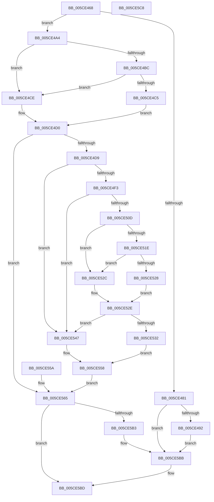

# PoGetRequester

- RVA: `0x005CE468`–`0x005CE5C9` (길이 `353` bytes)
- VA: `0x00000001405CE468`
- 실행 섹션: `.text`
- PDB 이름 있음: `예`; PDB Function 태그: `아니요`
- unwind 정보 RVA: `0x000CBDAC`
- 디코드: `85`개 명령, `353/353` bytes 표시
- 미해석 바이트: `0` (있으면 어셈블리에 `.byte`로 보존)

> 이 문서는 커널 이미지의 기계어와 PDB 기호를 분석해 생성했습니다. 4번과 5번은 함수 원형과 자료형을 바이너리 사용 방식에서 추정한 C 해석이며 원본 소스 복구 결과는 아닙니다.

## 1. Dependencies

- 직접 호출 지점: **5**; 고유 호출 대상: **5**
- 직접 호출자로 확인된 함수: **1**
- RIP 상대 이미지 참조: **0**

### Outgoing calls
- `0x005CE49A` → [ObfReferenceObjectWithTag](../21/ObfReferenceObjectWithTag_function_00210710.md) (function, `0x00210710`)
- `0x005CE539` → [RtlReadULongFromUser](../../page/70/RtlReadULongFromUser_function_00705E08.md) (function, `0x00705E08`)
- `0x005CE54E` → [RtlReadULong64FromUser](../../page/70/RtlReadULong64FromUser_function_00705DCC.md) (function, `0x00705DCC`)
- `0x005CE591` → [PsGetProcessSessionIdEx](../22/PsGetProcessSessionIdEx_function_0022F8F0.md) (function, `0x0022F8F0`)
- `0x005CE5AA` → [PopUnicodeStringDeepCopy](../../page/A2/PopUnicodeStringDeepCopy_function_00A2E6B8.md) (function, `0x00A2E6B8`)

### Direct callers
- [PoCaptureReasonContext](../23/PoCaptureReasonContext_function_00230A38.md) at `0x00230B22`

### Static image references
- 디코드된 RIP-relative 메모리 참조가 없습니다.

## 2. Other-region calls and transfers

- 다른 실행 섹션으로 향하는 call: **3**
  - `0x005CE539` → [RtlReadULongFromUser](../../page/70/RtlReadULongFromUser_function_00705E08.md) (`.text` → `PAGE`)
  - `0x005CE54E` → [RtlReadULong64FromUser](../../page/70/RtlReadULong64FromUser_function_00705DCC.md) (`.text` → `PAGE`)
  - `0x005CE5AA` → [PopUnicodeStringDeepCopy](../../page/A2/PopUnicodeStringDeepCopy_function_00A2E6B8.md) (`.text` → `PAGE`)
- 별도 외부 분기/꼬리 이동을 확인하지 못했습니다.

## 3. Assembly (complete function range)

```asm
005CE468  48 89 5C 24 08                  mov qword ptr [rsp + 8], rbx
005CE46D  4C 89 44 24 18                  mov qword ptr [rsp + 0x18], r8
005CE472  57                              push rdi
005CE473  48 83 EC 20                     sub rsp, 0x20
005CE477  49 8B F8                        mov rdi, r8
005CE47A  48 8B C2                        mov rax, rdx
005CE47D  84 C9                           test cl, cl
005CE47F  75 23                           jne 0x1405ce4a4
005CE481  41 83 20 00                     and dword ptr [r8], 0
005CE485  49 89 50 08                     mov qword ptr [r8 + 8], rdx
005CE489  48 85 C0                        test rax, rax
005CE48C  0F 84 29 01 00 00               je 0x1405ce5bb
005CE492  BA 50 6F 44 67                  mov edx, 0x67446f50
005CE497  48 8B C8                        mov rcx, rax
005CE49A  E8 71 22 C4 FF                  call 0x140210710
005CE49F  E9 17 01 00 00                  jmp 0x1405ce5bb
005CE4A4  48 83 64 24 48 00               and qword ptr [rsp + 0x48], 0
005CE4AA  65 48 8B 14 25 88 01 00 00      mov rdx, qword ptr gs:[0x188]
005CE4B3  F7 42 74 00 04 00 00            test dword ptr [rdx + 0x74], 0x400
005CE4BA  75 12                           jne 0x1405ce4ce
005CE4BC  80 BA 4A 02 00 00 01            cmp byte ptr [rdx + 0x24a], 1
005CE4C3  74 09                           je 0x1405ce4ce
005CE4C5  48 8B 92 F0 00 00 00            mov rdx, qword ptr [rdx + 0xf0]
005CE4CC  EB 02                           jmp 0x1405ce4d0
005CE4CE  33 D2                           xor edx, edx
005CE4D0  48 85 D2                        test rdx, rdx
005CE4D3  0F 84 8C 00 00 00               je 0x1405ce565
005CE4D9  65 48 8B 04 25 88 01 00 00      mov rax, qword ptr gs:[0x188]
005CE4E2  48 8B 80 B8 00 00 00            mov rax, qword ptr [rax + 0xb8]
005CE4E9  48 83 B8 10 03 00 00 00         cmp qword ptr [rax + 0x310], 0
005CE4F1  74 54                           je 0x1405ce547
005CE4F3  65 48 8B 04 25 88 01 00 00      mov rax, qword ptr gs:[0x188]
005CE4FC  48 8B 80 B8 00 00 00            mov rax, qword ptr [rax + 0xb8]
005CE503  48 83 B8 10 03 00 00 00         cmp qword ptr [rax + 0x310], 0
005CE50B  74 3A                           je 0x1405ce547
005CE50D  0F B7 80 EC 06 00 00            movzx eax, word ptr [rax + 0x6ec]
005CE514  B9 4C 01 00 00                  mov ecx, 0x14c
005CE519  66 3B C1                        cmp ax, cx
005CE51C  74 0E                           je 0x1405ce52c
005CE51E  B9 C4 01 00 00                  mov ecx, 0x1c4
005CE523  66 3B C1                        cmp ax, cx
005CE526  74 04                           je 0x1405ce52c
005CE528  32 C0                           xor al, al
005CE52A  EB 02                           jmp 0x1405ce52e
005CE52C  B0 01                           mov al, 1
005CE52E  84 C0                           test al, al
005CE530  74 15                           je 0x1405ce547
005CE532  48 8D 8A 60 2F 00 00            lea rcx, [rdx + 0x2f60]
005CE539  E8 CA 78 13 00                  call 0x140705e08
005CE53E  8B C8                           mov ecx, eax
005CE540  48 89 4C 24 48                  mov qword ptr [rsp + 0x48], rcx
005CE545  EB 11                           jmp 0x1405ce558
005CE547  48 8D 8A 20 17 00 00            lea rcx, [rdx + 0x1720]
005CE54E  E8 79 78 13 00                  call 0x140705dcc
005CE553  48 89 44 24 48                  mov qword ptr [rsp + 0x48], rax
005CE558  EB 0B                           jmp 0x1405ce565
005CE55A  48 83 64 24 48 00               and qword ptr [rsp + 0x48], 0
005CE560  48 8B 7C 24 40                  mov rdi, qword ptr [rsp + 0x40]
005CE565  48 8B 44 24 48                  mov rax, qword ptr [rsp + 0x48]
005CE56A  48 F7 D8                        neg rax
005CE56D  1B C9                           sbb ecx, ecx
005CE56F  F7 D9                           neg ecx
005CE571  FF C1                           inc ecx
005CE573  89 0F                           mov dword ptr [rdi], ecx
005CE575  65 48 8B 04 25 88 01 00 00      mov rax, qword ptr gs:[0x188]
005CE57E  48 8B 98 B8 00 00 00            mov rbx, qword ptr [rax + 0xb8]
005CE585  8B 83 D0 01 00 00               mov eax, dword ptr [rbx + 0x1d0]
005CE58B  89 47 20                        mov dword ptr [rdi + 0x20], eax
005CE58E  48 8B CB                        mov rcx, rbx
005CE591  E8 5A 13 C6 FF                  call 0x14022f8f0
005CE596  89 47 24                        mov dword ptr [rdi + 0x24], eax
005CE599  48 8D 4F 10                     lea rcx, [rdi + 0x10]
005CE59D  41 B9 50 52 43 78               mov r9d, 0x78435250
005CE5A3  48 8B 93 50 03 00 00            mov rdx, qword ptr [rbx + 0x350]
005CE5AA  E8 09 01 46 00                  call 0x140a2e6b8
005CE5AF  85 C0                           test eax, eax
005CE5B1  78 0A                           js 0x1405ce5bd
005CE5B3  48 8B 44 24 48                  mov rax, qword ptr [rsp + 0x48]
005CE5B8  89 47 28                        mov dword ptr [rdi + 0x28], eax
005CE5BB  33 C0                           xor eax, eax
005CE5BD  48 8B 5C 24 30                  mov rbx, qword ptr [rsp + 0x30]
005CE5C2  48 83 C4 20                     add rsp, 0x20
005CE5C6  5F                              pop rdi
005CE5C7  C3                              ret
005CE5C8  CC                              int3
```

## 4. C-style interpretation (structured pseudocode)

```c
__int64 __fastcall PoGetRequester(unsigned __int8 a1, __int64 a2, __int64 a3)
{
    __int64 result;
    __int64 v_rsp;
    unsigned __int64 v_stack_p18;
    unsigned __int64 v_stack_p20;
    unsigned __int64 v_stack_p8;

    v_stack_p8 = v_rbx;
    v_stack_p18 = a3;
    v_rsp = (v_rsp) - (32);
    if (a1 != 0) goto loc_005CE4A4;
    *(unsigned __int64 *)(a3 + 8) = a2;
    if (a2 == 0) goto loc_005CE5BB;
    result = ObfReferenceObjectWithTag(a2, (unsigned int)(0x67446F50ULL), a3, a4);
    goto loc_005CE5BB;
loc_005CE4A4:
    if (((*(unsigned int *)(*(unsigned __int64 *)(gs_base + (0 + 392)) + 116)) & (0x400ULL)) != 0) goto loc_005CE4CE;
    if ((*(unsigned __int8 *)(*(unsigned __int64 *)(gs_base + (0 + 392)) + 586)) == 1) goto loc_005CE4CE;
    goto loc_005CE4D0;
loc_005CE4CE:
    a2 = 0;
loc_005CE4D0:
    if (0 == 0) goto loc_005CE565;
    if ((*(unsigned __int64 *)(*(unsigned __int64 *)(*(unsigned __int64 *)(gs_base + (0 + 392)) + 184) + 784)) == 0) goto loc_005CE547;
    if ((*(unsigned __int64 *)(*(unsigned __int64 *)(*(unsigned __int64 *)(gs_base + (0 + 392)) + 184) + 784)) == 0) goto loc_005CE547;
    if (((unsigned __int16)(*(unsigned __int16 *)(*(unsigned __int64 *)(*(unsigned __int64 *)(gs_base + (0 + 392)) + 184) + 1772))) == 332) goto loc_005CE52C;
    if (((unsigned __int16)(*(unsigned __int16 *)(*(unsigned __int64 *)(*(unsigned __int64 *)(gs_base + (0 + 392)) + 184) + 1772))) == 452) goto loc_005CE52C;
    result = 0;
    goto loc_005CE52E;
loc_005CE52C:
loc_005CE52E:
    if (1 == 0) goto loc_005CE547;
    result = RtlReadULongFromUser(a2 + 12128, a2, a3, a4);
    v_stack_p20 = (unsigned int)((unsigned int)(result));
    goto loc_005CE558;
loc_005CE547:
    result = RtlReadULong64FromUser(a2 + 5920, a2, a3, a4);
    v_stack_p20 = result;
loc_005CE558:
    goto loc_005CE565;
loc_005CE565:
    result = -(v_stack_p20);
    a1 = (unsigned int)(-(a2 + 5920));
    a1 = (unsigned int)((a1) + 1);
    *(unsigned int *)(a3) = a1;
    *(unsigned int *)(a3 + 32) = (unsigned int)((unsigned int)(*(unsigned int *)(*(unsigned __int64 *)(*(unsigned __int64 *)(gs_base + (0 + 392)) + 184) + 464)));
    result = PsGetProcessSessionIdEx(*(unsigned __int64 *)(*(unsigned __int64 *)(gs_base + (0 + 392)) + 184), a2, a3, a4);
    *(unsigned int *)(a3 + 36) = (unsigned int)(result);
    result = PopUnicodeStringDeepCopy(a3 + 16, *(unsigned __int64 *)(*(unsigned __int64 *)(*(unsigned __int64 *)(gs_base + (0 + 392)) + 184) + 848), a3, (unsigned int)(0x78435250ULL));
    if (sign_flag) goto loc_005CE5BD;
    *(unsigned int *)(a3 + 40) = (unsigned int)(v_stack_p20);
loc_005CE5BB:
    result = 0;
loc_005CE5BD:
    v_rsp = (v_rsp) + (32);
    return result;
}
```

## 5. (Beta) C Style

```c
int64_t PoGetRequester(uint8_t Arg1, int64_t Arg2, void *Arg3)
{
    uint8_t *arg3 = (uint8_t *)Arg3;

    int64_t result;
    int64_t local_rsp;
    uint64_t v_stack_p18;
    uint64_t v_stack_p20;
    uint64_t v_stack_p8;

    v_stack_p8 = local_rbx;
    v_stack_p18 = Arg3;
    local_rsp = (local_rsp) - (32);
    if (Arg1 != 0) goto loc_005CE4A4;
    *(uint64_t *)(arg3 + 0x8) = Arg2;
    if (Arg2 == 0) goto loc_005CE5BB;
    result = ObfReferenceObjectWithTag(Arg2, (uint32_t)(0x67446F50ULL), Arg3, a4);
    goto loc_005CE5BB;
loc_005CE4A4:
    if (((*(uint32_t *)(*(uint64_t *)(gs_base + (0 + 0x188)) + 0x74)) & (0x400ULL)) != 0) goto loc_005CE4CE;
    if ((*(uint8_t *)(*(uint64_t *)(gs_base + (0 + 0x188)) + 0x24A)) == 1) goto loc_005CE4CE;
    goto loc_005CE4D0;
loc_005CE4CE:
    Arg2 = 0;
loc_005CE4D0:
    if (0 == 0) goto loc_005CE565;
    if ((*(uint64_t *)(*(uint64_t *)(*(uint64_t *)(gs_base + (0 + 0x188)) + 0xB8) + 0x310)) == 0) goto loc_005CE547;
    if ((*(uint64_t *)(*(uint64_t *)(*(uint64_t *)(gs_base + (0 + 0x188)) + 0xB8) + 0x310)) == 0) goto loc_005CE547;
    if (((uint16_t)(*(uint16_t *)(*(uint64_t *)(*(uint64_t *)(gs_base + (0 + 0x188)) + 0xB8) + 0x6EC))) == 332) goto loc_005CE52C;
    if (((uint16_t)(*(uint16_t *)(*(uint64_t *)(*(uint64_t *)(gs_base + (0 + 0x188)) + 0xB8) + 0x6EC))) == 452) goto loc_005CE52C;
    result = 0;
    goto loc_005CE52E;
loc_005CE52C:
loc_005CE52E:
    if (1 == 0) goto loc_005CE547;
    result = RtlReadULongFromUser(Arg2 + 12128, Arg2, Arg3, a4);
    v_stack_p20 = (uint32_t)((uint32_t)(result));
    goto loc_005CE558;
loc_005CE547:
    result = RtlReadULong64FromUser(Arg2 + 5920, Arg2, Arg3, a4);
    v_stack_p20 = result;
loc_005CE558:
    goto loc_005CE565;
loc_005CE565:
    result = -(v_stack_p20);
    Arg1 = (uint32_t)(-(Arg2 + 5920));
    Arg1 = (uint32_t)((Arg1) + 1);
    *(uint32_t *)(arg3) = Arg1;
    *(uint32_t *)(arg3 + 0x20) = (uint32_t)((uint32_t)(*(uint32_t *)(*(uint64_t *)(*(uint64_t *)(gs_base + (0 + 0x188)) + 0xB8) + 0x1D0)));
    result = PsGetProcessSessionIdEx(*(uint64_t *)(*(uint64_t *)(gs_base + (0 + 0x188)) + 0xB8), Arg2, Arg3, a4);
    *(uint32_t *)(arg3 + 0x24) = (uint32_t)(result);
    result = PopUnicodeStringDeepCopy(Arg3 + 16, *(uint64_t *)(*(uint64_t *)(*(uint64_t *)(gs_base + (0 + 0x188)) + 0xB8) + 0x350), Arg3, (uint32_t)(0x78435250ULL));
    if (sign_flag) goto loc_005CE5BD;
    *(uint32_t *)(arg3 + 0x28) = (uint32_t)(v_stack_p20);
loc_005CE5BB:
    result = 0;
loc_005CE5BD:
    local_rsp = (local_rsp) + (32);
    return result;
}
```

### 관측된 메모리 오프셋

구조체 형식이 확인되지 않은 접근은 인자 기준의 오프셋으로만 기록했습니다.

| 기준 인자 | 오프셋 표현 | 폭 (bit) | 접근 |
|---|---:|---:|---|
| `Arg3` | `+ 0x0` | `32` | `R/W` |
| `Arg3` | `+ 0x0` | `32` | `W` |
| `Arg3` | `+ 0x8` | `64` | `W` |
| `Arg3` | `+ 0x10` | `64` | `R` |
| `Arg3` | `+ 0x20` | `32` | `W` |
| `Arg3` | `+ 0x24` | `32` | `W` |
| `Arg3` | `+ 0x28` | `32` | `W` |

## 6. Execution-region graph

[열기: 2D/3D 그래프와 함수 탐색 컨트롤 패널](../../../control-panel.html?section=text&rva=0x005CE468&view=graph)

- 2D 그래프는 위에서 아래로 흐르고, 3D 그래프는 빈 공간을 드래그해 회전합니다. Shift+드래그는 이동, 휠은 확대·축소, 함수 노드 선택은 대상 보고서 이동입니다.

### Static fallback


