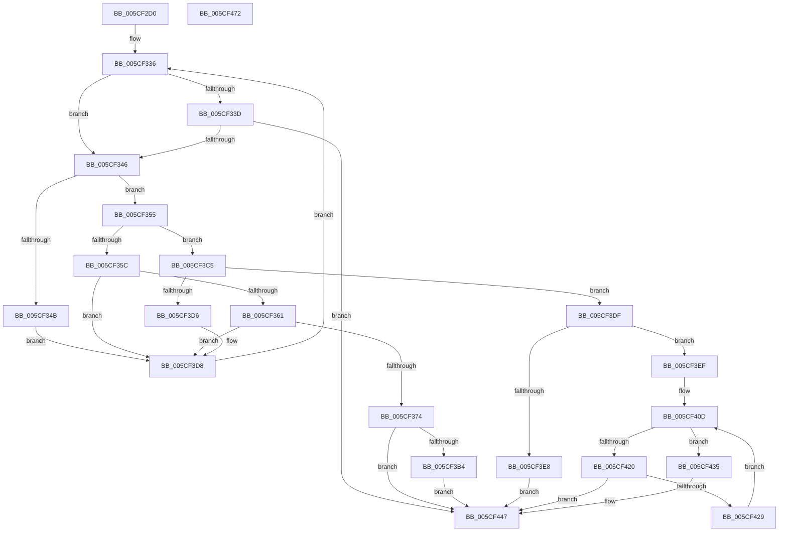

# PoInitiateProcessorWake

- RVA: `0x005CF2D0`–`0x005CF473` (길이 `419` bytes)
- VA: `0x00000001405CF2D0`
- 실행 섹션: `.text`
- PDB 이름 있음: `예`; PDB Function 태그: `아니요`
- unwind 정보 RVA: `0x000CBE7C`
- 디코드: `115`개 명령, `419/419` bytes 표시
- 미해석 바이트: `0` (있으면 어셈블리에 `.byte`로 보존)

> 이 문서는 커널 이미지의 기계어와 PDB 기호를 분석해 생성했습니다. 4번과 5번은 함수 원형과 자료형을 바이너리 사용 방식에서 추정한 C 해석이며 원본 소스 복구 결과는 아닙니다.

## 1. Dependencies

- 직접 호출 지점: **12**; 고유 호출 대상: **9**
- 직접 호출자로 확인된 함수: **0**
- RIP 상대 이미지 참조: **2**

### Outgoing calls
- `0x005CF30B` → [memset](../6C/memset_function_006C6C40.md) (function, `0x006C6C40`)
- `0x005CF312` → [KeGetPrcb](../2D/KeGetPrcb_function_002D85D0.md) (function, `0x002D85D0`)
- `0x005CF369` → [PpmIdleUpdateSynchronizationState](../5D/PpmIdleUpdateSynchronizationState_function_005D0550.md) (function, `0x005D0550`)
- `0x005CF38A` → [memset](../6C/memset_function_006C6C40.md) (function, `0x006C6C40`)
- `0x005CF39D` → [KiCopyAffinityEx](../2C/KiCopyAffinityEx_function_002CE860.md) (function, `0x002CE860`)
- `0x005CF3A7` → [KeIsEmptyAffinityEx](../2D/KeIsEmptyAffinityEx_function_002D1580.md) (function, `0x002D1580`)
- `0x005CF3BB` → [HalRequestIpi](../2D/HalRequestIpi_function_002D1720.md) (function, `0x002D1720`)
- `0x005CF3CD` → [PpmIdleUpdateSynchronizationState](../5D/PpmIdleUpdateSynchronizationState_function_005D0550.md) (function, `0x005D0550`)
- `0x005CF417` → [guard_dispatch_icall](../6B/guard_dispatch_icall_function_006BAAD0.md) (function, `0x006BAAD0`)
- `0x005CF42E` → [PpmIdleTransitionStall](../5D/PpmIdleTransitionStall_function_005D039C.md) (function, `0x005D039C`)
- `0x005CF43F` → [guard_dispatch_icall](../6B/guard_dispatch_icall_function_006BAAD0.md) (function, `0x006BAAD0`)
- `0x005CF451` → [_security_check_cookie](../6A/_security_check_cookie_function_006AC640.md) (function, `0x006AC640`)

### Direct callers
- 이 함수 시작 RVA로 연결되는 직접 call은 확인되지 않았습니다. 간접 호출은 완전히 역산할 수 없습니다.

### Static image references
- `0x005CF2EE` → RVA `0x00E0A740` (`.data`; read)
- `0x005CF3EF` → RVA `0x00FC6EC8` (`ALMOSTRO`; read)

## 2. Other-region calls and transfers

- 다른 실행 섹션으로 향하는 call: **0**
- 별도 외부 분기/꼬리 이동을 확인하지 못했습니다.

## 3. Assembly (complete function range)

```asm
005CF2D0  48 89 5C 24 10                  mov qword ptr [rsp + 0x10], rbx
005CF2D5  48 89 74 24 18                  mov qword ptr [rsp + 0x18], rsi
005CF2DA  55                              push rbp
005CF2DB  57                              push rdi
005CF2DC  41 54                           push r12
005CF2DE  41 56                           push r14
005CF2E0  41 57                           push r15
005CF2E2  48 8D 6C 24 A0                  lea rbp, [rsp - 0x60]
005CF2E7  48 81 EC 60 01 00 00            sub rsp, 0x160
005CF2EE  48 8B 05 4B B4 83 00            mov rax, qword ptr [rip + 0x83b44b]
005CF2F5  48 33 C4                        xor rax, rsp
005CF2F8  48 89 45 50                     mov qword ptr [rbp + 0x50], rax
005CF2FC  8B D9                           mov ebx, ecx
005CF2FE  33 D2                           xor edx, edx
005CF300  48 8D 4C 24 40                  lea rcx, [rsp + 0x40]
005CF305  41 B8 08 01 00 00               mov r8d, 0x108
005CF30B  E8 30 79 0F 00                  call 0x1406c6c40
005CF310  8B CB                           mov ecx, ebx
005CF312  E8 B9 92 D0 FF                  call 0x1402d85d0
005CF317  4C 8B F0                        mov r14, rax
005CF31A  4C 8B B8 40 88 00 00            mov r15, qword ptr [rax + 0x8840]
005CF321  48 8D B0 8C 88 00 00            lea rsi, [rax + 0x888c]
005CF328  8B 1E                           mov ebx, dword ptr [rsi]
005CF32A  C1 EB 18                        shr ebx, 0x18
005CF32D  33 FF                           xor edi, edi
005CF32F  4D 8B A7 98 02 00 00            mov r12, qword ptr [r15 + 0x298]
005CF336  8D 43 FE                        lea eax, [rbx - 2]
005CF339  3C 04                           cmp al, 4
005CF33B  76 09                           jbe 0x1405cf346
005CF33D  80 FB 09                        cmp bl, 9
005CF340  0F 82 01 01 00 00               jb 0x1405cf447
005CF346  80 FB 02                        cmp bl, 2
005CF349  75 0A                           jne 0x1405cf355
005CF34B  8B 1E                           mov ebx, dword ptr [rsi]
005CF34D  C1 EB 18                        shr ebx, 0x18
005CF350  E9 83 00 00 00                  jmp 0x1405cf3d8
005CF355  8D 43 FC                        lea eax, [rbx - 4]
005CF358  A8 FD                           test al, 0xfd
005CF35A  74 69                           je 0x1405cf3c5
005CF35C  80 FB 05                        cmp bl, 5
005CF35F  75 77                           jne 0x1405cf3d8
005CF361  44 8A C3                        mov r8b, bl
005CF364  B2 07                           mov dl, 7
005CF366  48 8B CE                        mov rcx, rsi
005CF369  E8 E2 11 00 00                  call 0x1405d0550
005CF36E  8A D8                           mov bl, al
005CF370  3C 05                           cmp al, 5
005CF372  75 64                           jne 0x1405cf3d8
005CF374  33 D2                           xor edx, edx
005CF376  48 C7 44 24 40 01 00 20 00      mov qword ptr [rsp + 0x40], 0x200001
005CF37F  41 B8 00 01 00 00               mov r8d, 0x100
005CF385  48 8D 4C 24 48                  lea rcx, [rsp + 0x48]
005CF38A  E8 B1 78 0F 00                  call 0x1406c6c40
005CF38F  0F B7 54 24 42                  movzx edx, word ptr [rsp + 0x42]
005CF394  4D 8D 47 48                     lea r8, [r15 + 0x48]
005CF398  48 8D 4C 24 40                  lea rcx, [rsp + 0x40]
005CF39D  E8 BE F4 CF FF                  call 0x1402ce860
005CF3A2  48 8D 4C 24 40                  lea rcx, [rsp + 0x40]
005CF3A7  E8 D4 21 D0 FF                  call 0x1402d1580
005CF3AC  85 C0                           test eax, eax
005CF3AE  0F 85 93 00 00 00               jne 0x1405cf447
005CF3B4  48 8D 54 24 40                  lea rdx, [rsp + 0x40]
005CF3B9  33 C9                           xor ecx, ecx
005CF3BB  E8 60 23 D0 FF                  call 0x1402d1720
005CF3C0  E9 82 00 00 00                  jmp 0x1405cf447
005CF3C5  44 8A C3                        mov r8b, bl
005CF3C8  B2 08                           mov dl, 8
005CF3CA  48 8B CE                        mov rcx, rsi
005CF3CD  E8 7E 11 00 00                  call 0x1405d0550
005CF3D2  3A C3                           cmp al, bl
005CF3D4  74 09                           je 0x1405cf3df
005CF3D6  8A D8                           mov bl, al
005CF3D8  F3 90                           pause
005CF3DA  E9 57 FF FF FF                  jmp 0x1405cf336
005CF3DF  41 38 BE 7D 88 00 00            cmp byte ptr [r14 + 0x887d], dil
005CF3E6  75 07                           jne 0x1405cf3ef
005CF3E8  BF 01 00 00 00                  mov edi, 1
005CF3ED  EB 58                           jmp 0x1405cf447
005CF3EF  48 8B 05 D2 7A 9F 00            mov rax, qword ptr [rip + 0x9f7ad2]
005CF3F6  0F 57 C0                        xorps xmm0, xmm0
005CF3F9  0F 11 44 24 20                  movups xmmword ptr [rsp + 0x20], xmm0
005CF3FE  48 89 44 24 28                  mov qword ptr [rsp + 0x28], rax
005CF403  0F 11 44 24 30                  movups xmmword ptr [rsp + 0x30], xmm0
005CF408  4C 89 74 24 30                  mov qword ptr [rsp + 0x30], r14
005CF40D  49 8B 87 88 02 00 00            mov rax, qword ptr [r15 + 0x288]
005CF414  49 8B CC                        mov rcx, r12
005CF417  E8 B4 B6 0E 00                  call 0x1406baad0
005CF41C  84 C0                           test al, al
005CF41E  75 15                           jne 0x1405cf435
005CF420  8B 06                           mov eax, dword ptr [rsi]
005CF422  C1 E8 18                        shr eax, 0x18
005CF425  3C 08                           cmp al, 8
005CF427  75 1E                           jne 0x1405cf447
005CF429  48 8D 4C 24 20                  lea rcx, [rsp + 0x20]
005CF42E  E8 69 0F 00 00                  call 0x1405d039c
005CF433  EB D8                           jmp 0x1405cf40d
005CF435  49 8B 87 90 02 00 00            mov rax, qword ptr [r15 + 0x290]
005CF43C  49 8B CC                        mov rcx, r12
005CF43F  E8 8C B6 0E 00                  call 0x1406baad0
005CF444  40 8A F8                        mov dil, al
005CF447  40 8A C7                        mov al, dil
005CF44A  48 8B 4D 50                     mov rcx, qword ptr [rbp + 0x50]
005CF44E  48 33 CC                        xor rcx, rsp
005CF451  E8 EA D1 0D 00                  call 0x1406ac640
005CF456  4C 8D 9C 24 60 01 00 00         lea r11, [rsp + 0x160]
005CF45E  49 8B 5B 38                     mov rbx, qword ptr [r11 + 0x38]
005CF462  49 8B 73 40                     mov rsi, qword ptr [r11 + 0x40]
005CF466  49 8B E3                        mov rsp, r11
005CF469  41 5F                           pop r15
005CF46B  41 5E                           pop r14
005CF46D  41 5C                           pop r12
005CF46F  5F                              pop rdi
005CF470  5D                              pop rbp
005CF471  C3                              ret
005CF472  CC                              int3
```

## 4. C-style interpretation (structured pseudocode)

```c
__int64 __fastcall PoInitiateProcessorWake(int a1, int a2)
{
    __int64 result;
    __int64 v_rbx;
    __int64 v_rdi;
    __int64 v_rsp;
    unsigned __int64 v_stack_m140;
    unsigned __int16 v_stack_m146;
    unsigned __int64 v_stack_m148;
    unsigned __int64 v_stack_m158;
    unsigned __int64 v_stack_m160;
    unsigned __int64 v_stack_m168;
    unsigned __int64 v_stack_m28;
    unsigned __int64 v_stack_m38;
    unsigned __int64 v_stack_m88;
    unsigned __int64 v_stack_p10;
    unsigned __int64 v_stack_p18;

    v_stack_p10 = v_rbx;
    v_stack_p18 = v_rsi;
    v_rsp = (v_rsp) - (352);
    result = (*(unsigned __int64 *)(v_rip + 8631371)) ^ (v_rsp);
    v_stack_m38 = result;
    a2 = 0;
    result = memset(v_stack_m148, a2, 264, a4);
    result = KeGetPrcb((unsigned int)((unsigned int)((unsigned int)(a1))), a2, 264, a4);
    v_rbx = (unsigned int)(((unsigned int)(*(unsigned int *)(result + 34956))) >> (24));
    v_rdi = 0;
loc_005CF336:
    if (((unsigned __int8)(v_rbx - 2)) <= 4) goto loc_005CF346;
    if (((unsigned __int8)(v_rbx)) < 9) goto loc_005CF447;
loc_005CF346:
    if (((unsigned __int8)(v_rbx)) != 2) goto loc_005CF355;
    v_rbx = (unsigned int)(((unsigned int)(*(unsigned int *)(result + 34956))) >> (24));
    goto loc_005CF3D8;
loc_005CF355:
    if ((((unsigned __int8)(v_rbx - 4)) & (253)) == 0) goto loc_005CF3C5;
    if (((unsigned __int8)(v_rbx)) != 5) goto loc_005CF3D8;
    result = PpmIdleUpdateSynchronizationState(result + 34956, 7, (unsigned __int8)(v_rbx), a4);
    if (((unsigned __int8)(result)) != 5) goto loc_005CF3D8;
    a2 = 0;
    v_stack_m148 = 0x200001ULL;
    result = memset(v_stack_m140, a2, 256, a4);
    result = KiCopyAffinityEx(v_stack_m148, v_stack_m146, *(unsigned __int64 *)(result + 34880) + 72, a4);
    result = KeIsEmptyAffinityEx(v_stack_m148, v_stack_m146, *(unsigned __int64 *)(result + 34880) + 72, a4);
    if ((unsigned int)(result) != 0) goto loc_005CF447;
    a1 = 0;
    result = HalRequestIpi(a1, v_stack_m148, *(unsigned __int64 *)(result + 34880) + 72, a4);
    goto loc_005CF447;
loc_005CF3C5:
    result = PpmIdleUpdateSynchronizationState(result + 34956, 8, (unsigned __int8)((unsigned __int8)(result)), a4);
    if (((unsigned __int8)(result)) == ((unsigned __int8)((unsigned __int8)(result)))) goto loc_005CF3DF;
loc_005CF3D8:
    goto loc_005CF336;
loc_005CF3DF:
    if ((*(unsigned __int8 *)(result + 34941)) != 0) goto loc_005CF3EF;
    goto loc_005CF447;
loc_005CF3EF:
    v_stack_m168 = v_xmm0;
    v_stack_m160 = *(unsigned __int64 *)(v_rip + 10451666);
    v_stack_m158 = v_xmm0;
    v_stack_m158 = result;
loc_005CF40D:
    result = guard_dispatch_icall(*(unsigned __int64 *)(*(unsigned __int64 *)(result + 34880) + 664), 8, (unsigned __int8)((unsigned __int8)(result)), a4);
    if ((unsigned __int8)(result) != 0) goto loc_005CF435;
    result = (unsigned int)(((unsigned int)(*(unsigned int *)(result + 34956))) >> (24));
    if (((unsigned __int8)(result)) != 8) goto loc_005CF447;
    result = PpmIdleTransitionStall(v_stack_m168, 8, (unsigned __int8)((unsigned __int8)(result)), a4);
    goto loc_005CF40D;
loc_005CF435:
    result = guard_dispatch_icall(*(unsigned __int64 *)(*(unsigned __int64 *)(result + 34880) + 664), 8, (unsigned __int8)((unsigned __int8)(result)), a4);
loc_005CF447:
    a1 = (v_stack_m38) ^ (v_rsp);
    result = _security_check_cookie(a1, 8, (unsigned __int8)((unsigned __int8)(result)), a4);
    return result;
}
```

## 5. (Beta) C Style

```c
int64_t PoInitiateProcessorWake(int32_t Arg1, int32_t Arg2)
{
    int64_t result;
    int64_t local_rbx;
    int64_t local_rdi;
    int64_t local_rsp;
    uint64_t v_stack_m140;
    uint16_t v_stack_m146;
    uint64_t v_stack_m148;
    uint64_t v_stack_m158;
    uint64_t v_stack_m160;
    uint64_t v_stack_m168;
    uint64_t v_stack_m28;
    uint64_t v_stack_m38;
    uint64_t v_stack_m88;
    uint64_t v_stack_p10;
    uint64_t v_stack_p18;

    v_stack_p10 = local_rbx;
    v_stack_p18 = local_rsi;
    local_rsp = (local_rsp) - (352);
    result = (*(uint64_t *)(v_rip + 0x83B44B)) ^ (local_rsp);
    v_stack_m38 = result;
    Arg2 = 0;
    result = memset(v_stack_m148, Arg2, 264, a4);
    result = KeGetPrcb((uint32_t)((uint32_t)((uint32_t)(Arg1))), Arg2, 264, a4);
    local_rbx = (uint32_t)(((uint32_t)(*(uint32_t *)(result + 0x888C))) >> (24));
    local_rdi = 0;
loc_005CF336:
    if (((uint8_t)(local_rbx - 2)) <= 4) goto loc_005CF346;
    if (((uint8_t)(local_rbx)) < 9) goto loc_005CF447;
loc_005CF346:
    if (((uint8_t)(local_rbx)) != 2) goto loc_005CF355;
    local_rbx = (uint32_t)(((uint32_t)(*(uint32_t *)(result + 0x888C))) >> (24));
    goto loc_005CF3D8;
loc_005CF355:
    if ((((uint8_t)(local_rbx - 4)) & (253)) == 0) goto loc_005CF3C5;
    if (((uint8_t)(local_rbx)) != 5) goto loc_005CF3D8;
    result = PpmIdleUpdateSynchronizationState(result + 34956, 7, (uint8_t)(local_rbx), a4);
    if (((uint8_t)(result)) != 5) goto loc_005CF3D8;
    Arg2 = 0;
    v_stack_m148 = 0x200001ULL;
    result = memset(v_stack_m140, Arg2, 256, a4);
    result = KiCopyAffinityEx(v_stack_m148, v_stack_m146, *(uint64_t *)(result + 0x8840) + 72, a4);
    result = KeIsEmptyAffinityEx(v_stack_m148, v_stack_m146, *(uint64_t *)(result + 0x8840) + 72, a4);
    if ((uint32_t)(result) != 0) goto loc_005CF447;
    Arg1 = 0;
    result = HalRequestIpi(Arg1, v_stack_m148, *(uint64_t *)(result + 0x8840) + 72, a4);
    goto loc_005CF447;
loc_005CF3C5:
    result = PpmIdleUpdateSynchronizationState(result + 34956, 8, (uint8_t)((uint8_t)(result)), a4);
    if (((uint8_t)(result)) == ((uint8_t)((uint8_t)(result)))) goto loc_005CF3DF;
loc_005CF3D8:
    goto loc_005CF336;
loc_005CF3DF:
    if ((*(uint8_t *)(result + 0x887D)) != 0) goto loc_005CF3EF;
    goto loc_005CF447;
loc_005CF3EF:
    v_stack_m168 = v_xmm0;
    v_stack_m160 = *(uint64_t *)(v_rip + 0x9F7AD2);
    v_stack_m158 = v_xmm0;
    v_stack_m158 = result;
loc_005CF40D:
    result = guard_dispatch_icall(*(uint64_t *)(*(uint64_t *)(result + 0x8840) + 0x298), 8, (uint8_t)((uint8_t)(result)), a4);
    if ((uint8_t)(result) != 0) goto loc_005CF435;
    result = (uint32_t)(((uint32_t)(*(uint32_t *)(result + 0x888C))) >> (24));
    if (((uint8_t)(result)) != 8) goto loc_005CF447;
    result = PpmIdleTransitionStall(v_stack_m168, 8, (uint8_t)((uint8_t)(result)), a4);
    goto loc_005CF40D;
loc_005CF435:
    result = guard_dispatch_icall(*(uint64_t *)(*(uint64_t *)(result + 0x8840) + 0x298), 8, (uint8_t)((uint8_t)(result)), a4);
loc_005CF447:
    Arg1 = (v_stack_m38) ^ (local_rsp);
    result = _security_check_cookie(Arg1, 8, (uint8_t)((uint8_t)(result)), a4);
    return result;
}
```

## 6. Execution-region graph

[열기: 2D/3D 그래프와 함수 탐색 컨트롤 패널](../../../control-panel.html?section=text&rva=0x005CF2D0&view=graph)

- 2D 그래프는 위에서 아래로 흐르고, 3D 그래프는 빈 공간을 드래그해 회전합니다. Shift+드래그는 이동, 휠은 확대·축소, 함수 노드 선택은 대상 보고서 이동입니다.

### Static fallback


