# PopDetermineBucketFrequencies

- RVA: `0x005CEBF8`–`0x005CEF19` (길이 `801` bytes)
- VA: `0x00000001405CEBF8`
- 실행 섹션: `.text`
- PDB 이름 있음: `예`; PDB Function 태그: `아니요`
- unwind 정보 RVA: `0x000C5A38`
- 디코드: `219`개 명령, `801/801` bytes 표시
- 미해석 바이트: `0` (있으면 어셈블리에 `.byte`로 보존)

> 이 문서는 커널 이미지의 기계어와 PDB 기호를 분석해 생성했습니다. 4번과 5번은 함수 원형과 자료형을 바이너리 사용 방식에서 추정한 C 해석이며 원본 소스 복구 결과는 아닙니다.

## 1. Dependencies

- 직접 호출 지점: **5**; 고유 호출 대상: **3**
- 직접 호출자로 확인된 함수: **1**
- RIP 상대 이미지 참조: **3**

### Outgoing calls
- `0x005CEC7F` → [KeEnumerateNextProcessor](../41/KeEnumerateNextProcessor_function_00415480.md) (function, `0x00415480`)
- `0x005CEC8F` → [KeGetPrcb](../2D/KeGetPrcb_function_002D85D0.md) (function, `0x002D85D0`)
- `0x005CED2E` → [_report_rangecheckfailure](../4F/_report_rangecheckfailure_function_004F5FDC.md) (function, `0x004F5FDC`)
- `0x005CEE99` → [KeGetPrcb](../2D/KeGetPrcb_function_002D85D0.md) (function, `0x002D85D0`)
- `0x005CEEFE` → [KeEnumerateNextProcessor](../41/KeEnumerateNextProcessor_function_00415480.md) (function, `0x00415480`)

### Direct callers
- [PopRegisterEnergyEstimation](PopRegisterEnergyEstimation_function_005CEFB0.md) at `0x005CF02A`

### Static image references
- `0x005CEC18` → RVA `0x00F0EFE8` (`.data`; read)
- `0x005CEC5C` → RVA `0x00E0B438` (`.data`; read)
- `0x005CEC6C` → RVA `0x00E0B430` (`.data`; read)

## 2. Other-region calls and transfers

- 다른 실행 섹션으로 향하는 call: **0**
- 별도 외부 분기/꼬리 이동을 확인하지 못했습니다.

## 3. Assembly (complete function range)

```asm
005CEBF8  40 55                           push rbp
005CEBFA  53                              push rbx
005CEBFB  56                              push rsi
005CEBFC  57                              push rdi
005CEBFD  41 54                           push r12
005CEBFF  41 55                           push r13
005CEC01  41 56                           push r14
005CEC03  41 57                           push r15
005CEC05  48 8B EC                        mov rbp, rsp
005CEC08  48 83 EC 58                     sub rsp, 0x58
005CEC0C  33 C0                           xor eax, eax
005CEC0E  0F 57 C0                        xorps xmm0, xmm0
005CEC11  45 33 F6                        xor r14d, r14d
005CEC14  48 89 45 F0                     mov qword ptr [rbp - 0x10], rax
005CEC18  48 8B 05 C9 03 94 00            mov rax, qword ptr [rip + 0x9403c9]
005CEC1F  41 8B CE                        mov ecx, r14d
005CEC22  0F 11 45 E0                     movups xmmword ptr [rbp - 0x20], xmm0
005CEC26  44 89 75 58                     mov dword ptr [rbp + 0x58], r14d
005CEC2A  8B 18                           mov ebx, dword ptr [rax]
005CEC2C  3B CB                           cmp ecx, ebx
005CEC2E  73 2C                           jae 0x1405cec5c
005CEC30  8B C1                           mov eax, ecx
005CEC32  C7 44 85 60 10 27 00 00         mov dword ptr [rbp + rax*4 + 0x60], 0x2710
005CEC3A  44 89 74 85 C8                  mov dword ptr [rbp + rax*4 - 0x38], r14d
005CEC3F  44 89 74 85 D0                  mov dword ptr [rbp + rax*4 - 0x30], r14d
005CEC44  C6 44 05 50 01                  mov byte ptr [rbp + rax + 0x50], 1
005CEC49  48 83 F8 02                     cmp rax, 2
005CEC4D  0F 83 DB 00 00 00               jae 0x1405ced2e
005CEC53  44 88 74 05 48                  mov byte ptr [rbp + rax + 0x48], r14b
005CEC58  FF C1                           inc ecx
005CEC5A  EB D0                           jmp 0x1405cec2c
005CEC5C  48 8B 05 D5 C7 83 00            mov rax, qword ptr [rip + 0x83c7d5]
005CEC63  BF 1F 85 EB 51                  mov edi, 0x51eb851f
005CEC68  48 89 45 E8                     mov qword ptr [rbp - 0x18], rax
005CEC6C  48 8D 05 BD C7 83 00            lea rax, [rip + 0x83c7bd]
005CEC73  48 89 45 E0                     mov qword ptr [rbp - 0x20], rax
005CEC77  48 8D 55 E0                     lea rdx, [rbp - 0x20]
005CEC7B  48 8D 4D 58                     lea rcx, [rbp + 0x58]
005CEC7F  E8 FC 67 E4 FF                  call 0x140415480
005CEC84  85 C0                           test eax, eax
005CEC86  0F 85 A8 00 00 00               jne 0x1405ced34
005CEC8C  8B 4D 58                        mov ecx, dword ptr [rbp + 0x58]
005CEC8F  E8 3C 99 D0 FF                  call 0x1402d85d0
005CEC94  48 8B 0D 4D 03 94 00            mov rcx, qword ptr [rip + 0x94034d]
005CEC9B  44 0F B6 80 08 8A 00 00         movzx r8d, byte ptr [rax + 0x8a08]
005CECA3  8B 11                           mov edx, dword ptr [rcx]
005CECA5  44 3B C2                        cmp r8d, edx
005CECA8  4C 8B 98 B0 89 00 00            mov r11, qword ptr [rax + 0x89b0]
005CECAF  8B C7                           mov eax, edi
005CECB1  8D 4A FF                        lea ecx, [rdx - 1]
005CECB4  45 8B 8B C0 01 00 00            mov r9d, dword ptr [r11 + 0x1c0]
005CECBB  41 0F 42 C8                     cmovb ecx, r8d
005CECBF  44 8B C1                        mov r8d, ecx
005CECC2  C6 44 0D 48 01                  mov byte ptr [rbp + rcx + 0x48], 1
005CECC7  41 8B C9                        mov ecx, r9d
005CECCA  41 0F AF 8B CC 01 00 00         imul ecx, dword ptr [r11 + 0x1cc]
005CECD2  F7 E1                           mul ecx
005CECD4  41 8B C9                        mov ecx, r9d
005CECD7  8B C7                           mov eax, edi
005CECD9  41 0F AF 8B C4 01 00 00         imul ecx, dword ptr [r11 + 0x1c4]
005CECE1  44 8B D2                        mov r10d, edx
005CECE4  41 C1 EA 05                     shr r10d, 5
005CECE8  F7 E1                           mul ecx
005CECEA  C1 EA 05                        shr edx, 5
005CECED  46 3B 54 85 60                  cmp r10d, dword ptr [rbp + r8*4 + 0x60]
005CECF2  73 05                           jae 0x1405cecf9
005CECF4  46 89 54 85 60                  mov dword ptr [rbp + r8*4 + 0x60], r10d
005CECF9  42 3B 54 85 C8                  cmp edx, dword ptr [rbp + r8*4 - 0x38]
005CECFE  76 05                           jbe 0x1405ced05
005CED00  42 89 54 85 C8                  mov dword ptr [rbp + r8*4 - 0x38], edx
005CED05  46 3B 4C 85 D0                  cmp r9d, dword ptr [rbp + r8*4 - 0x30]
005CED0A  76 05                           jbe 0x1405ced11
005CED0C  46 89 4C 85 D0                  mov dword ptr [rbp + r8*4 - 0x30], r9d
005CED11  45 38 B3 F0 01 00 00            cmp byte ptr [r11 + 0x1f0], r14b
005CED18  0F 85 59 FF FF FF               jne 0x1405cec77
005CED1E  49 83 F8 02                     cmp r8, 2
005CED22  73 0A                           jae 0x1405ced2e
005CED24  46 88 74 05 50                  mov byte ptr [rbp + r8 + 0x50], r14b
005CED29  E9 49 FF FF FF                  jmp 0x1405cec77
005CED2E  E8 A9 72 F2 FF                  call 0x1404f5fdc
005CED33  CC                              int3
005CED34  41 BC 04 00 00 00               mov r12d, 4
005CED3A  85 DB                           test ebx, ebx
005CED3C  0F 84 37 01 00 00               je 0x1405cee79
005CED42  4C 8B 15 9F 02 94 00            mov r10, qword ptr [rip + 0x94029f]
005CED49  4D 8B CE                        mov r9, r14
005CED4C  49 83 C2 3C                     add r10, 0x3c
005CED50  48 89 5D D8                     mov qword ptr [rbp - 0x28], rbx
005CED54  48 8B C3                        mov rax, rbx
005CED57  46 38 74 0D 48                  cmp byte ptr [rbp + r9 + 0x48], r14b
005CED5C  0F 84 02 01 00 00               je 0x1405cee64
005CED62  46 38 74 0D 50                  cmp byte ptr [rbp + r9 + 0x50], r14b
005CED67  41 8B CE                        mov ecx, r14d
005CED6A  46 8B 44 8D C8                  mov r8d, dword ptr [rbp + r9*4 - 0x38]
005CED6F  42 8B 5C 8D 60                  mov ebx, dword ptr [rbp + r9*4 + 0x60]
005CED74  0F 94 C1                        sete cl
005CED77  41 81 F8 10 27 00 00            cmp r8d, 0x2710
005CED7E  72 17                           jb 0x1405ced97
005CED80  42 8B 44 8D D0                  mov eax, dword ptr [rbp + r9*4 - 0x30]
005CED85  41 B8 10 27 00 00               mov r8d, 0x2710
005CED8B  41 3B C0                        cmp eax, r8d
005CED8E  B9 01 00 00 00                  mov ecx, 1
005CED93  44 0F 42 C0                     cmovb r8d, eax
005CED97  0F AF DB                        imul ebx, ebx
005CED9A  45 0F AF C0                     imul r8d, r8d
005CED9E  44 2B C3                        sub r8d, ebx
005CEDA1  85 C9                           test ecx, ecx
005CEDA3  74 15                           je 0x1405cedba
005CEDA5  42 8D 0C 85 00 00 00 00         lea ecx, [r8*4]
005CEDAD  B8 AB AA AA AA                  mov eax, 0xaaaaaaab
005CEDB2  F7 E1                           mul ecx
005CEDB4  44 8B C2                        mov r8d, edx
005CEDB7  41 D1 E8                        shr r8d, 1
005CEDBA  45 8B F8                        mov r15d, r8d
005CEDBD  49 8D 7A E4                     lea rdi, [r10 - 0x1c]
005CEDC1  41 C1 EF 03                     shr r15d, 3
005CEDC5  41 8B F0                        mov esi, r8d
005CEDC8  4D 8B EC                        mov r13, r12
005CEDCB  44 8B E6                        mov r12d, esi
005CEDCE  45 8B DE                        mov r11d, r14d
005CEDD1  41 C1 EC 02                     shr r12d, 2
005CEDD5  B9 10 27 00 00                  mov ecx, 0x2710
005CEDDA  44 03 E3                        add r12d, ebx
005CEDDD  41 8B C4                        mov eax, r12d
005CEDE0  41 2B C7                        sub eax, r15d
005CEDE3  89 47 10                        mov dword ptr [rdi + 0x10], eax
005CEDE6  41 81 FC 00 E1 F5 05            cmp r12d, 0x5f5e100
005CEDED  73 3D                           jae 0x1405cee2c
005CEDEF  41 BE 14 00 00 00               mov r14d, 0x14
005CEDF5  41 3B CB                        cmp ecx, r11d
005CEDF8  74 2F                           je 0x1405cee29
005CEDFA  45 85 F6                        test r14d, r14d
005CEDFD  74 2A                           je 0x1405cee29
005CEDFF  44 8B D9                        mov r11d, ecx
005CEE02  41 8B C4                        mov eax, r12d
005CEE05  0F AF C9                        imul ecx, ecx
005CEE08  41 FF CE                        dec r14d
005CEE0B  2B C1                           sub eax, ecx
005CEE0D  85 C0                           test eax, eax
005CEE0F  7E 05                           jle 0x1405cee16
005CEE11  41 03 C3                        add eax, r11d
005CEE14  EB 05                           jmp 0x1405cee1b
005CEE16  79 03                           jns 0x1405cee1b
005CEE18  41 2B C3                        sub eax, r11d
005CEE1B  43 8D 0C 1B                     lea ecx, [r11 + r11]
005CEE1F  99                              cdq
005CEE20  F7 F9                           idiv ecx
005CEE22  8B C8                           mov ecx, eax
005CEE24  41 03 CB                        add ecx, r11d
005CEE27  75 CC                           jne 0x1405cedf5
005CEE29  45 33 F6                        xor r14d, r14d
005CEE2C  41 BC 04 00 00 00               mov r12d, 4
005CEE32  89 0F                           mov dword ptr [rdi], ecx
005CEE34  49 03 FC                        add rdi, r12
005CEE37  41 03 F0                        add esi, r8d
005CEE3A  49 83 ED 01                     sub r13, 1
005CEE3E  75 8B                           jne 0x1405cedcb
005CEE40  41 83 3A 64                     cmp dword ptr [r10], 0x64
005CEE44  76 1A                           jbe 0x1405cee60
005CEE46  49 8D 4A F4                     lea rcx, [r10 - 0xc]
005CEE4A  45 8B C4                        mov r8d, r12d
005CEE4D  6B 01 64                        imul eax, dword ptr [rcx], 0x64
005CEE50  33 D2                           xor edx, edx
005CEE52  41 F7 32                        div dword ptr [r10]
005CEE55  89 01                           mov dword ptr [rcx], eax
005CEE57  49 03 CC                        add rcx, r12
005CEE5A  49 83 E8 01                     sub r8, 1
005CEE5E  75 ED                           jne 0x1405cee4d
005CEE60  48 8B 45 D8                     mov rax, qword ptr [rbp - 0x28]
005CEE64  49 FF C1                        inc r9
005CEE67  49 83 C2 38                     add r10, 0x38
005CEE6B  48 83 E8 01                     sub rax, 1
005CEE6F  48 89 45 D8                     mov qword ptr [rbp - 0x28], rax
005CEE73  0F 85 DE FE FF FF               jne 0x1405ced57
005CEE79  48 8B 05 B8 C5 83 00            mov rax, qword ptr [rip + 0x83c5b8]
005CEE80  48 89 45 E8                     mov qword ptr [rbp - 0x18], rax
005CEE84  48 8D 05 A5 C5 83 00            lea rax, [rip + 0x83c5a5]
005CEE8B  48 89 45 E0                     mov qword ptr [rbp - 0x20], rax
005CEE8F  66 44 89 75 F0                  mov word ptr [rbp - 0x10], r14w
005CEE94  EB 60                           jmp 0x1405ceef6
005CEE96  8B 4D 58                        mov ecx, dword ptr [rbp + 0x58]
005CEE99  E8 32 97 D0 FF                  call 0x1402d85d0
005CEE9E  4C 8B 0D 43 01 94 00            mov r9, qword ptr [rip + 0x940143]
005CEEA5  4C 8B D0                        mov r10, rax
005CEEA8  4D 8B DC                        mov r11, r12
005CEEAB  44 0F B6 80 08 8A 00 00         movzx r8d, byte ptr [rax + 0x8a08]
005CEEB3  41 8B 11                        mov edx, dword ptr [r9]
005CEEB6  44 3B C2                        cmp r8d, edx
005CEEB9  8D 4A FF                        lea ecx, [rdx - 1]
005CEEBC  41 0F 42 C8                     cmovb ecx, r8d
005CEEC0  4D 8D 41 20                     lea r8, [r9 + 0x20]
005CEEC4  48 6B D1 38                     imul rdx, rcx, 0x38
005CEEC8  4C 8D 88 6A 8A 00 00            lea r9, [rax + 0x8a6a]
005CEECF  4C 03 C2                        add r8, rdx
005CEED2  41 6B 00 64                     imul eax, dword ptr [r8], 0x64
005CEED6  33 D2                           xor edx, edx
005CEED8  49 8B 8A B0 89 00 00            mov rcx, qword ptr [r10 + 0x89b0]
005CEEDF  4D 03 C4                        add r8, r12
005CEEE2  F7 B1 C0 01 00 00               div dword ptr [rcx + 0x1c0]
005CEEE8  66 41 89 01                     mov word ptr [r9], ax
005CEEEC  4D 8D 49 02                     lea r9, [r9 + 2]
005CEEF0  49 83 EB 01                     sub r11, 1
005CEEF4  75 DC                           jne 0x1405ceed2
005CEEF6  48 8D 55 E0                     lea rdx, [rbp - 0x20]
005CEEFA  48 8D 4D 58                     lea rcx, [rbp + 0x58]
005CEEFE  E8 7D 65 E4 FF                  call 0x140415480
005CEF03  85 C0                           test eax, eax
005CEF05  74 8F                           je 0x1405cee96
005CEF07  48 83 C4 58                     add rsp, 0x58
005CEF0B  41 5F                           pop r15
005CEF0D  41 5E                           pop r14
005CEF0F  41 5D                           pop r13
005CEF11  41 5C                           pop r12
005CEF13  5F                              pop rdi
005CEF14  5E                              pop rsi
005CEF15  5B                              pop rbx
005CEF16  5D                              pop rbp
005CEF17  C3                              ret
005CEF18  CC                              int3
```

## 4. C-style interpretation (structured pseudocode)

```c
__int64 __fastcall PopDetermineBucketFrequencies(void)
{
    __int64 result;
    __int64 v_r10;
    __int64 v_r11;
    __int64 v_r12;
    __int64 v_r13;
    __int64 v_r14;
    __int64 v_r15;
    __int64 v_rbx;
    __int64 v_rdi;
    __int64 v_rsi;
    __int64 v_rsp;
    unsigned __int64 v_stack_m50;
    unsigned __int64 v_stack_m58;
    unsigned __int64 v_stack_m60;
    unsigned __int64 v_stack_m68;
    unsigned int v_stack_p18;

    v_rsp = (v_rsp) - (88);
    result = 0;
    v_r14 = 0;
    v_stack_m50 = 0;
    v_stack_m60 = v_xmm0;
    v_stack_p18 = 0;
loc_005CEC2C:
    if (0 >= ((unsigned int)((unsigned int)(*(unsigned int *)(*(unsigned __int64 *)(v_rip + 9700297)))))) goto loc_005CEC5C;
    *(unsigned int *)(v_rsp + 0 * 4 + 96) = 0x2710ULL;
    *(unsigned int *)(v_rsp + 0 * 4 - 56) = 0;
    *(unsigned int *)(v_rsp + 0 * 4 - 48) = 0;
    *(unsigned __int8 *)(v_rsp + 0 * 1 + 80) = 1;
    if (0 >= 2) goto loc_005CED2E;
    *(unsigned __int8 *)(v_rsp + 0 * 1 + 72) = 0;
    a1 = (unsigned int)((0) + 1);
    goto loc_005CEC2C;
loc_005CEC5C:
    v_stack_m58 = *(unsigned __int64 *)(v_rip + 8636373);
    v_stack_m60 = v_rip + 8636349;
loc_005CEC77:
    result = KeEnumerateNextProcessor(v_stack_p18, v_stack_m60, a3, a4);
    if ((unsigned int)(result) != 0) goto loc_005CED34;
    result = KeGetPrcb((unsigned int)(v_stack_p18), v_stack_m60, a3, a4);
    a1 = (unsigned int)(*(unsigned int *)(*(unsigned __int64 *)(v_rip + 9700173))) - 1;
    if (((unsigned int)(*(unsigned __int8 *)(result + 35336))) < ((unsigned int)((unsigned int)(*(unsigned int *)(*(unsigned __int64 *)(v_rip + 9700173)))))) { a1 = (unsigned int)(*(unsigned __int8 *)(result + 35336)); }
    *(unsigned __int8 *)(v_rsp + a1 * 1 + 72) = 1;
    a1 = (unsigned int)(((unsigned int)((unsigned int)((unsigned int)(*(unsigned int *)(*(unsigned __int64 *)(result + 35248) + 448))))) * (*(unsigned int *)(*(unsigned __int64 *)(result + 35248) + 460)));
    a1 = (unsigned int)(((unsigned int)((unsigned int)((unsigned int)(*(unsigned int *)(*(unsigned __int64 *)(result + 35248) + 448))))) * (*(unsigned int *)(*(unsigned __int64 *)(result + 35248) + 452)));
    v_r10 = (unsigned int)(((unsigned int)((unsigned int)((unsigned int)(*(unsigned int *)(*(unsigned __int64 *)(v_rip + 9700173)))))) >> (5));
    a2 = (unsigned int)(((unsigned int)(*(unsigned int *)(*(unsigned __int64 *)(v_rip + 9700173)))) >> (5));
    if (((unsigned int)(v_r10)) < (*(unsigned int *)(v_rsp + (unsigned int)((unsigned int)(a1)) * 4 + 96))) {
        *(unsigned int *)(v_rsp + (unsigned int)((unsigned int)(a1)) * 4 + 96) = (unsigned int)(v_r10);
    }
    if (((unsigned int)(a2)) >= = (*(unsigned int *)(v_rsp + (unsigned int)((unsigned int)(a1)) * 4 - 56))) {
        *(unsigned int *)(v_rsp + (unsigned int)((unsigned int)(a1)) * 4 - 56) = (unsigned int)(a2);
    }
    if (((unsigned int)((unsigned int)(*(unsigned int *)(*(unsigned __int64 *)(result + 35248) + 448)))) >= = (*(unsigned int *)(v_rsp + (unsigned int)((unsigned int)(a1)) * 4 - 48))) {
        *(unsigned int *)(v_rsp + (unsigned int)((unsigned int)(a1)) * 4 - 48) = (unsigned int)((unsigned int)(*(unsigned int *)(*(unsigned __int64 *)(result + 35248) + 448)));
    }
    if ((*(unsigned __int8 *)(*(unsigned __int64 *)(result + 35248) + 496)) != 0) goto loc_005CEC77;
    if (((unsigned int)((unsigned int)(a1))) >= 2) goto loc_005CED2E;
    *(unsigned __int8 *)(v_rsp + (unsigned int)((unsigned int)(a1)) * 1 + 80) = 0;
    goto loc_005CEC77;
loc_005CED2E:
    result = _report_rangecheckfailure(a1, a2, (unsigned int)((unsigned int)(a1)), (unsigned int)(*(unsigned int *)(*(unsigned __int64 *)(result + 35248) + 448)));
loc_005CED34:
    if ((unsigned int)((unsigned int)(*(unsigned int *)(*(unsigned __int64 *)(v_rip + 9700297)))) == 0) goto loc_005CEE79;
    v_r10 = (*(unsigned __int64 *)(v_rip + 9699999)) + (60);
    v_stack_m68 = (unsigned int)(*(unsigned int *)(*(unsigned __int64 *)(v_rip + 9700297)));
loc_005CED57:
    if ((*(unsigned __int8 *)(v_rsp + 0 * 1 + 72)) == 0) goto loc_005CEE64;
    a1 = ((*(unsigned __int8 *)(v_rsp + 0 * 1 + 80)) == 0) ? 1 : 0;
    result = (unsigned int)(*(unsigned int *)(*(unsigned __int64 *)(v_rip + 9700297)));
    if (((unsigned int)((unsigned int)(*(unsigned int *)(v_rsp + 0 * 4 - 56)))) >= 0x2710ULL) {
        result = *(unsigned int *)(v_rsp + 0 * 4 - 48);
        a3 = 0x2710ULL;
        a1 = 1;
        if (((unsigned int)(result)) < ((unsigned int)(a3))) { a3 = (unsigned int)(result); }
    }
    v_rbx = (unsigned int)(((unsigned int)(*(unsigned int *)(v_rsp + 0 * 4 + 96))) * ((unsigned int)((unsigned int)(*(unsigned int *)(v_rsp + 0 * 4 + 96)))));
    a3 = (unsigned int)((a3) * ((unsigned int)(a3)));
    a3 = (unsigned int)((a3) - ((unsigned int)(v_rbx)));
    if ((unsigned int)(a1) != 0) {
        a1 = a3 * 4;
        result = 0xAAAAAAABULL;
        a3 = (unsigned int)(a2);
        a3 = (unsigned int)((a3) >> (1));
    }
    v_r15 = (unsigned int)(((unsigned int)((unsigned int)(a3))) >> (3));
loc_005CEDCB:
    v_r12 = (unsigned int)(((unsigned int)((unsigned int)((unsigned int)((unsigned int)(a3))))) >> (2));
    v_r12 = (unsigned int)((v_r12) + ((unsigned int)(v_rbx)));
    result = (unsigned int)(((unsigned int)((unsigned int)(v_r12))) - ((unsigned int)(v_r15)));
    *(unsigned int *)(v_r10 - 28 + 16) = (unsigned int)(result);
    if (((unsigned int)(v_r12)) >= 0x5F5E100ULL) goto loc_005CEE2C;
loc_005CEDF5:
    if (((unsigned int)((unsigned int)(0x2710ULL))) == 0) goto loc_005CEE29;
    if (20 == 0) goto loc_005CEE29;
    a1 = (unsigned int)(((unsigned int)(0x2710ULL)) * ((unsigned int)((unsigned int)(0x2710ULL))));
    v_r14 = (unsigned int)((20) - 1);
    result = (unsigned int)(((unsigned int)((unsigned int)(v_r12))) - ((unsigned int)(a1)));
    if (condition_is_less_or_equal) goto loc_005CEE16;
    result = (unsigned int)((result) + ((unsigned int)((unsigned int)((unsigned int)((unsigned int)(0x2710ULL))))));
    goto loc_005CEE1B;
loc_005CEE16:
    if (sign_flag) {
        result = (unsigned int)((result) - ((unsigned int)((unsigned int)((unsigned int)((unsigned int)(0x2710ULL))))));
    }
    a1 = (unsigned int)(((unsigned int)((unsigned int)(result))) + ((unsigned int)((unsigned int)((unsigned int)((unsigned int)(0x2710ULL))))));
    if (condition_is_not_equal) goto loc_005CEDF5;
loc_005CEE29:
    v_r14 = 0;
loc_005CEE2C:
    *(unsigned int *)(v_r10 - 28) = (unsigned int)(a1);
    v_rdi = (v_r10 - 28) + (4);
    v_rsi = (unsigned int)(((unsigned int)((unsigned int)(a3))) + ((unsigned int)(a3)));
    v_r13 = (4) - (1);
    if (condition_is_not_equal) goto loc_005CEDCB;
    if ((*(unsigned int *)(v_r10)) <= 100) goto loc_005CEE60;
loc_005CEE4D:
    result = (unsigned int)((result) * (*(unsigned int *)(v_r10 - 12)));
    a2 = 0;
    *(unsigned int *)(v_r10 - 12) = (unsigned int)(result);
    a1 = (v_r10 - 12) + (4);
    a3 = (4) - (1);
    if (condition_is_not_equal) goto loc_005CEE4D;
loc_005CEE60:
loc_005CEE64:
    a4 = (0) + 1;
    v_r10 = (v_r10) + (56);
    result = (v_stack_m68) - (1);
    v_stack_m68 = result;
    if (condition_is_not_equal) goto loc_005CED57;
loc_005CEE79:
    v_stack_m58 = *(unsigned __int64 *)(v_rip + 8635832);
    v_stack_m60 = v_rip + 8635813;
    v_stack_m50 = 0;
    goto loc_005CEEF6;
loc_005CEE96:
    result = KeGetPrcb((unsigned int)(v_stack_p18), a2, a3, a4);
    a1 = (unsigned int)(*(unsigned int *)(*(unsigned __int64 *)(v_rip + 9699651))) - 1;
    if (((unsigned int)(*(unsigned __int8 *)(result + 35336))) < ((unsigned int)((unsigned int)(*(unsigned int *)(*(unsigned __int64 *)(v_rip + 9699651)))))) { a1 = (unsigned int)(*(unsigned __int8 *)(result + 35336)); }
    a2 = ((unsigned int)(*(unsigned int *)(*(unsigned __int64 *)(v_rip + 9699651)))) * (a1);
    a3 = (*(unsigned __int64 *)(v_rip + 9699651) + 32) + (a2);
loc_005CEED2:
    result = (unsigned int)((result) * (*(unsigned int *)(a3)));
    a2 = 0;
    a3 = (a3) + (4);
    *(unsigned __int16 *)(result + 35434) = (unsigned __int16)(result);
    v_r11 = (4) - (1);
    if (condition_is_not_equal) goto loc_005CEED2;
loc_005CEEF6:
    result = KeEnumerateNextProcessor(v_stack_p18, v_stack_m60, a3, result + 35434 + 2);
    if ((unsigned int)(result) == 0) goto loc_005CEE96;
    v_rsp = (v_rsp) + (88);
    return result;
}
```

## 5. (Beta) C Style

```c
void PopDetermineBucketFrequencies(void)
{
    int64_t result;
    int64_t local_r10;
    int64_t local_r11;
    int64_t local_r12;
    int64_t local_r13;
    int64_t local_r14;
    int64_t local_r15;
    int64_t local_rbx;
    int64_t local_rdi;
    int64_t local_rsi;
    int64_t local_rsp;
    uint64_t v_stack_m50;
    uint64_t v_stack_m58;
    uint64_t v_stack_m60;
    uint64_t v_stack_m68;
    uint32_t v_stack_p18;

    local_rsp = (local_rsp) - (88);
    result = 0;
    local_r14 = 0;
    v_stack_m50 = 0;
    v_stack_m60 = v_xmm0;
    v_stack_p18 = 0;
loc_005CEC2C:
    if (0 >= ((uint32_t)((uint32_t)(*(uint32_t *)(*(uint64_t *)(v_rip + 0x9403C9)))))) goto loc_005CEC5C;
    *(uint32_t *)(local_rsp + 0x0 * 4 + 0x60) = 0x2710ULL;
    *(uint32_t *)(local_rsp + 0x0 * 4 - 0x38) = 0;
    *(uint32_t *)(local_rsp + 0x0 * 4 - 0x30) = 0;
    *(uint8_t *)(local_rsp + 0x0 * 1 + 0x50) = 1;
    if (0 >= 2) goto loc_005CED2E;
    *(uint8_t *)(local_rsp + 0x0 * 1 + 0x48) = 0;
    a1 = (uint32_t)((0) + 1);
    goto loc_005CEC2C;
loc_005CEC5C:
    v_stack_m58 = *(uint64_t *)(v_rip + 0x83C7D5);
    v_stack_m60 = v_rip + 8636349;
loc_005CEC77:
    result = KeEnumerateNextProcessor(v_stack_p18, v_stack_m60, a3, a4);
    if ((uint32_t)(result) != 0) goto loc_005CED34;
    result = KeGetPrcb((uint32_t)(v_stack_p18), v_stack_m60, a3, a4);
    a1 = (uint32_t)(*(uint32_t *)(*(uint64_t *)(v_rip + 0x94034D))) - 1;
    if (((uint32_t)(*(uint8_t *)(result + 0x8A08))) < ((uint32_t)((uint32_t)(*(uint32_t *)(*(uint64_t *)(v_rip + 0x94034D)))))) { a1 = (uint32_t)(*(uint8_t *)(result + 0x8A08)); }
    *(uint8_t *)(local_rsp + a1 * 1 + 0x48) = 1;
    a1 = (uint32_t)(((uint32_t)((uint32_t)((uint32_t)(*(uint32_t *)(*(uint64_t *)(result + 0x89B0) + 0x1C0))))) * (*(uint32_t *)(*(uint64_t *)(result + 0x89B0) + 0x1CC)));
    a1 = (uint32_t)(((uint32_t)((uint32_t)((uint32_t)(*(uint32_t *)(*(uint64_t *)(result + 0x89B0) + 0x1C0))))) * (*(uint32_t *)(*(uint64_t *)(result + 0x89B0) + 0x1C4)));
    local_r10 = (uint32_t)(((uint32_t)((uint32_t)((uint32_t)(*(uint32_t *)(*(uint64_t *)(v_rip + 0x94034D)))))) >> (5));
    a2 = (uint32_t)(((uint32_t)(*(uint32_t *)(*(uint64_t *)(v_rip + 0x94034D)))) >> (5));
    if (((uint32_t)(local_r10)) < (*(uint32_t *)(local_rsp + (uint32_t)((uint32_t)(a1)) * 4 + 0x60))) {
        *(uint32_t *)(local_rsp + (uint32_t)((uint32_t)(a1)) * 4 + 0x60) = (uint32_t)(local_r10);
    }
    if (((uint32_t)(a2)) >= = (*(uint32_t *)(local_rsp + (uint32_t)((uint32_t)(a1)) * 4 - 0x38))) {
        *(uint32_t *)(local_rsp + (uint32_t)((uint32_t)(a1)) * 4 - 0x38) = (uint32_t)(a2);
    }
    if (((uint32_t)((uint32_t)(*(uint32_t *)(*(uint64_t *)(result + 0x89B0) + 0x1C0)))) >= = (*(uint32_t *)(local_rsp + (uint32_t)((uint32_t)(a1)) * 4 - 0x30))) {
        *(uint32_t *)(local_rsp + (uint32_t)((uint32_t)(a1)) * 4 - 0x30) = (uint32_t)((uint32_t)(*(uint32_t *)(*(uint64_t *)(result + 0x89B0) + 0x1C0)));
    }
    if ((*(uint8_t *)(*(uint64_t *)(result + 0x89B0) + 0x1F0)) != 0) goto loc_005CEC77;
    if (((uint32_t)((uint32_t)(a1))) >= 2) goto loc_005CED2E;
    *(uint8_t *)(local_rsp + (uint32_t)((uint32_t)(a1)) * 1 + 0x50) = 0;
    goto loc_005CEC77;
loc_005CED2E:
    result = _report_rangecheckfailure(a1, a2, (uint32_t)((uint32_t)(a1)), (uint32_t)(*(uint32_t *)(*(uint64_t *)(result + 0x89B0) + 0x1C0)));
loc_005CED34:
    if ((uint32_t)((uint32_t)(*(uint32_t *)(*(uint64_t *)(v_rip + 0x9403C9)))) == 0) goto loc_005CEE79;
    local_r10 = (*(uint64_t *)(v_rip + 0x94029F)) + (60);
    v_stack_m68 = (uint32_t)(*(uint32_t *)(*(uint64_t *)(v_rip + 0x9403C9)));
loc_005CED57:
    if ((*(uint8_t *)(local_rsp + 0x0 * 1 + 0x48)) == 0) goto loc_005CEE64;
    a1 = ((*(uint8_t *)(local_rsp + 0x0 * 1 + 0x50)) == 0) ? 1 : 0;
    result = (uint32_t)(*(uint32_t *)(*(uint64_t *)(v_rip + 0x9403C9)));
    if (((uint32_t)((uint32_t)(*(uint32_t *)(local_rsp + 0x0 * 4 - 0x38)))) >= 0x2710ULL) {
        result = *(uint32_t *)(local_rsp + 0x0 * 4 - 0x30);
        a3 = 0x2710ULL;
        a1 = 1;
        if (((uint32_t)(result)) < ((uint32_t)(a3))) { a3 = (uint32_t)(result); }
    }
    local_rbx = (uint32_t)(((uint32_t)(*(uint32_t *)(local_rsp + 0x0 * 4 + 0x60))) * ((uint32_t)((uint32_t)(*(uint32_t *)(local_rsp + 0x0 * 4 + 0x60)))));
    a3 = (uint32_t)((a3) * ((uint32_t)(a3)));
    a3 = (uint32_t)((a3) - ((uint32_t)(local_rbx)));
    if ((uint32_t)(a1) != 0) {
        a1 = a3 * 4;
        result = 0xAAAAAAABULL;
        a3 = (uint32_t)(a2);
        a3 = (uint32_t)((a3) >> (1));
    }
    local_r15 = (uint32_t)(((uint32_t)((uint32_t)(a3))) >> (3));
loc_005CEDCB:
    local_r12 = (uint32_t)(((uint32_t)((uint32_t)((uint32_t)((uint32_t)(a3))))) >> (2));
    local_r12 = (uint32_t)((local_r12) + ((uint32_t)(local_rbx)));
    result = (uint32_t)(((uint32_t)((uint32_t)(local_r12))) - ((uint32_t)(local_r15)));
    *(uint32_t *)(local_r10 - 0x1C + 0x10) = (uint32_t)(result);
    if (((uint32_t)(local_r12)) >= 0x5F5E100ULL) goto loc_005CEE2C;
loc_005CEDF5:
    if (((uint32_t)((uint32_t)(0x2710ULL))) == 0) goto loc_005CEE29;
    if (20 == 0) goto loc_005CEE29;
    a1 = (uint32_t)(((uint32_t)(0x2710ULL)) * ((uint32_t)((uint32_t)(0x2710ULL))));
    local_r14 = (uint32_t)((20) - 1);
    result = (uint32_t)(((uint32_t)((uint32_t)(local_r12))) - ((uint32_t)(a1)));
    if (condition_is_less_or_equal) goto loc_005CEE16;
    result = (uint32_t)((result) + ((uint32_t)((uint32_t)((uint32_t)((uint32_t)(0x2710ULL))))));
    goto loc_005CEE1B;
loc_005CEE16:
    if (sign_flag) {
        result = (uint32_t)((result) - ((uint32_t)((uint32_t)((uint32_t)((uint32_t)(0x2710ULL))))));
    }
    a1 = (uint32_t)(((uint32_t)((uint32_t)(result))) + ((uint32_t)((uint32_t)((uint32_t)((uint32_t)(0x2710ULL))))));
    if (condition_is_not_equal) goto loc_005CEDF5;
loc_005CEE29:
    local_r14 = 0;
loc_005CEE2C:
    *(uint32_t *)(local_r10 - 0x1C) = (uint32_t)(a1);
    local_rdi = (local_r10 - 28) + (4);
    local_rsi = (uint32_t)(((uint32_t)((uint32_t)(a3))) + ((uint32_t)(a3)));
    local_r13 = (4) - (1);
    if (condition_is_not_equal) goto loc_005CEDCB;
    if ((*(uint32_t *)(local_r10)) <= 100) goto loc_005CEE60;
loc_005CEE4D:
    result = (uint32_t)((result) * (*(uint32_t *)(local_r10 - 0xC)));
    a2 = 0;
    *(uint32_t *)(local_r10 - 0xC) = (uint32_t)(result);
    a1 = (local_r10 - 12) + (4);
    a3 = (4) - (1);
    if (condition_is_not_equal) goto loc_005CEE4D;
loc_005CEE60:
loc_005CEE64:
    a4 = (0) + 1;
    local_r10 = (local_r10) + (56);
    result = (v_stack_m68) - (1);
    v_stack_m68 = result;
    if (condition_is_not_equal) goto loc_005CED57;
loc_005CEE79:
    v_stack_m58 = *(uint64_t *)(v_rip + 0x83C5B8);
    v_stack_m60 = v_rip + 8635813;
    v_stack_m50 = 0;
    goto loc_005CEEF6;
loc_005CEE96:
    result = KeGetPrcb((uint32_t)(v_stack_p18), a2, a3, a4);
    a1 = (uint32_t)(*(uint32_t *)(*(uint64_t *)(v_rip + 0x940143))) - 1;
    if (((uint32_t)(*(uint8_t *)(result + 0x8A08))) < ((uint32_t)((uint32_t)(*(uint32_t *)(*(uint64_t *)(v_rip + 0x940143)))))) { a1 = (uint32_t)(*(uint8_t *)(result + 0x8A08)); }
    a2 = ((uint32_t)(*(uint32_t *)(*(uint64_t *)(v_rip + 0x940143)))) * (a1);
    a3 = (*(uint64_t *)(v_rip + 0x940143) + 32) + (a2);
loc_005CEED2:
    result = (uint32_t)((result) * (*(uint32_t *)(a3)));
    a2 = 0;
    a3 = (a3) + (4);
    *(uint16_t *)(result + 0x8A6A) = (uint16_t)(result);
    local_r11 = (4) - (1);
    if (condition_is_not_equal) goto loc_005CEED2;
loc_005CEEF6:
    result = KeEnumerateNextProcessor(v_stack_p18, v_stack_m60, a3, result + 35434 + 2);
    if ((uint32_t)(result) == 0) goto loc_005CEE96;
    local_rsp = (local_rsp) + (88);
    return result;
}
```

## 6. Execution-region graph

[열기: 2D/3D 그래프와 함수 탐색 컨트롤 패널](../../../control-panel.html?section=text&rva=0x005CEBF8&view=graph)

- 2D 그래프는 위에서 아래로 흐르고, 3D 그래프는 빈 공간을 드래그해 회전합니다. Shift+드래그는 이동, 휠은 확대·축소, 함수 노드 선택은 대상 보고서 이동입니다.

### Static fallback

```mermaid
flowchart TD
  bb_005CEBF8[BB_005CEBF8]
  bb_005CEC2C[BB_005CEC2C]
  bb_005CEC30[BB_005CEC30]
  bb_005CEC53[BB_005CEC53]
  bb_005CEC5C[BB_005CEC5C]
  bb_005CEC77[BB_005CEC77]
  bb_005CEC8C[BB_005CEC8C]
  bb_005CECF4[BB_005CECF4]
  bb_005CECF9[BB_005CECF9]
  bb_005CED00[BB_005CED00]
  bb_005CED05[BB_005CED05]
  bb_005CED0C[BB_005CED0C]
  bb_005CED11[BB_005CED11]
  bb_005CED1E[BB_005CED1E]
  bb_005CED24[BB_005CED24]
  bb_005CED2E[BB_005CED2E]
  bb_005CED34[BB_005CED34]
  bb_005CED42[BB_005CED42]
  bb_005CED57[BB_005CED57]
  bb_005CED62[BB_005CED62]
  bb_005CED80[BB_005CED80]
  bb_005CED97[BB_005CED97]
  bb_005CEDA5[BB_005CEDA5]
  bb_005CEDBA[BB_005CEDBA]
  bb_005CEDCB[BB_005CEDCB]
  bb_005CEDEF[BB_005CEDEF]
  bb_005CEDF5[BB_005CEDF5]
  bb_005CEDFA[BB_005CEDFA]
  bb_005CEDFF[BB_005CEDFF]
  bb_005CEE11[BB_005CEE11]
  bb_005CEE16[BB_005CEE16]
  bb_005CEE18[BB_005CEE18]
  bb_005CEE1B[BB_005CEE1B]
  bb_005CEE29[BB_005CEE29]
  bb_005CEE2C[BB_005CEE2C]
  bb_005CEE40[BB_005CEE40]
  bb_005CEE46[BB_005CEE46]
  bb_005CEE4D[BB_005CEE4D]
  bb_005CEE60[BB_005CEE60]
  bb_005CEE64[BB_005CEE64]
  bb_005CEE79[BB_005CEE79]
  bb_005CEE96[BB_005CEE96]
  bb_005CEED2[BB_005CEED2]
  bb_005CEEF6[BB_005CEEF6]
  bb_005CEF07[BB_005CEF07]
  bb_005CEF18[BB_005CEF18]
  bb_005CEBF8 -->|flow| bb_005CEC2C
  bb_005CEC2C -->|branch| bb_005CEC5C
  bb_005CEC2C -->|fallthrough| bb_005CEC30
  bb_005CEC30 -->|branch| bb_005CED2E
  bb_005CEC30 -->|fallthrough| bb_005CEC53
  bb_005CEC53 -->|branch| bb_005CEC2C
  bb_005CEC5C -->|flow| bb_005CEC77
  bb_005CEC77 -->|branch| bb_005CED34
  bb_005CEC77 -->|fallthrough| bb_005CEC8C
  bb_005CEC8C -->|branch| bb_005CECF9
  bb_005CEC8C -->|fallthrough| bb_005CECF4
  bb_005CECF4 -->|flow| bb_005CECF9
  bb_005CECF9 -->|branch| bb_005CED05
  bb_005CECF9 -->|fallthrough| bb_005CED00
  bb_005CED00 -->|flow| bb_005CED05
  bb_005CED05 -->|branch| bb_005CED11
  bb_005CED05 -->|fallthrough| bb_005CED0C
  bb_005CED0C -->|flow| bb_005CED11
  bb_005CED11 -->|branch| bb_005CEC77
  bb_005CED11 -->|fallthrough| bb_005CED1E
  bb_005CED1E -->|branch| bb_005CED2E
  bb_005CED1E -->|fallthrough| bb_005CED24
  bb_005CED24 -->|branch| bb_005CEC77
  bb_005CED2E -->|flow| bb_005CED34
  bb_005CED34 -->|branch| bb_005CEE79
  bb_005CED34 -->|fallthrough| bb_005CED42
  bb_005CED42 -->|flow| bb_005CED57
  bb_005CED57 -->|branch| bb_005CEE64
  bb_005CED57 -->|fallthrough| bb_005CED62
  bb_005CED62 -->|branch| bb_005CED97
  bb_005CED62 -->|fallthrough| bb_005CED80
  bb_005CED80 -->|flow| bb_005CED97
  bb_005CED97 -->|branch| bb_005CEDBA
  bb_005CED97 -->|fallthrough| bb_005CEDA5
  bb_005CEDA5 -->|flow| bb_005CEDBA
  bb_005CEDBA -->|flow| bb_005CEDCB
  bb_005CEDCB -->|branch| bb_005CEE2C
  bb_005CEDCB -->|fallthrough| bb_005CEDEF
  bb_005CEDEF -->|flow| bb_005CEDF5
  bb_005CEDF5 -->|branch| bb_005CEE29
  bb_005CEDF5 -->|fallthrough| bb_005CEDFA
  bb_005CEDFA -->|branch| bb_005CEE29
  bb_005CEDFA -->|fallthrough| bb_005CEDFF
  bb_005CEDFF -->|branch| bb_005CEE16
  bb_005CEDFF -->|fallthrough| bb_005CEE11
  bb_005CEE11 -->|branch| bb_005CEE1B
  bb_005CEE16 -->|branch| bb_005CEE1B
  bb_005CEE16 -->|fallthrough| bb_005CEE18
  bb_005CEE18 -->|flow| bb_005CEE1B
  bb_005CEE1B -->|branch| bb_005CEDF5
  bb_005CEE1B -->|fallthrough| bb_005CEE29
  bb_005CEE29 -->|flow| bb_005CEE2C
  bb_005CEE2C -->|branch| bb_005CEDCB
  bb_005CEE2C -->|fallthrough| bb_005CEE40
  bb_005CEE40 -->|branch| bb_005CEE60
  bb_005CEE40 -->|fallthrough| bb_005CEE46
  bb_005CEE46 -->|flow| bb_005CEE4D
  bb_005CEE4D -->|branch| bb_005CEE4D
  bb_005CEE4D -->|fallthrough| bb_005CEE60
  bb_005CEE60 -->|flow| bb_005CEE64
  bb_005CEE64 -->|branch| bb_005CED57
  bb_005CEE64 -->|fallthrough| bb_005CEE79
  bb_005CEE79 -->|branch| bb_005CEEF6
  bb_005CEE96 -->|flow| bb_005CEED2
  bb_005CEED2 -->|branch| bb_005CEED2
  bb_005CEED2 -->|fallthrough| bb_005CEEF6
  bb_005CEEF6 -->|branch| bb_005CEE96
  bb_005CEEF6 -->|fallthrough| bb_005CEF07
```


