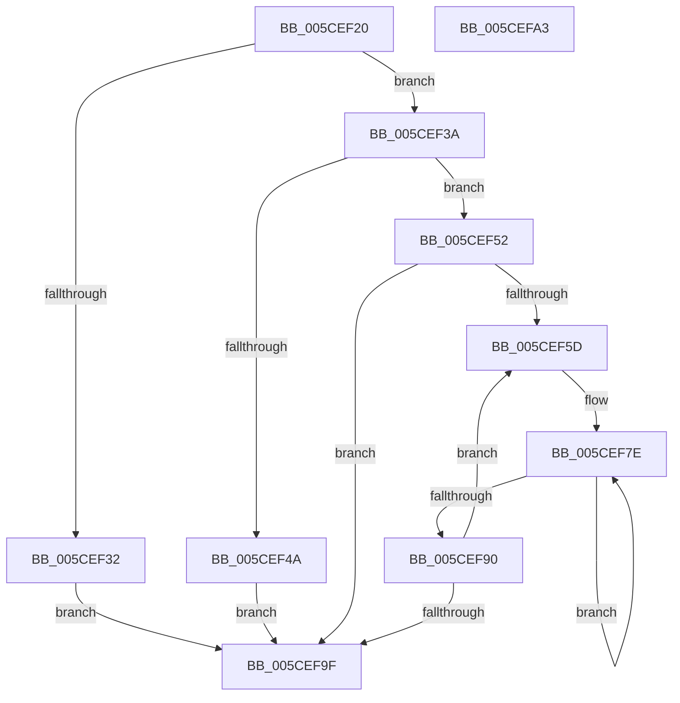

# PopGetEnergyEstimationInfo

- RVA: `0x005CEF20`–`0x005CEFA4` (길이 `132` bytes)
- VA: `0x00000001405CEF20`
- 실행 섹션: `.text`
- PDB 이름 있음: `예`; PDB Function 태그: `아니요`
- unwind 정보 RVA: `0x000DB714`
- 디코드: `40`개 명령, `132/132` bytes 표시
- 미해석 바이트: `0` (있으면 어셈블리에 `.byte`로 보존)

> 이 문서는 커널 이미지의 기계어와 PDB 기호를 분석해 생성했습니다. 4번과 5번은 함수 원형과 자료형을 바이너리 사용 방식에서 추정한 C 해석이며 원본 소스 복구 결과는 아닙니다.

## 1. Dependencies

- 직접 호출 지점: **0**; 고유 호출 대상: **0**
- 직접 호출자로 확인된 함수: **1**
- RIP 상대 이미지 참조: **1**

### Outgoing calls
- 직접 디코드된 call 명령이 없습니다.

### Direct callers
- [PopPowerInformationInternal](../../page/A8/PopPowerInformationInternal_function_00A8B7C0.md) at `0x00A8D269`

### Static image references
- `0x005CEF20` → RVA `0x00F0EFE8` (`.data`; read)

## 2. Other-region calls and transfers

- 다른 실행 섹션으로 향하는 call: **0**
- 별도 외부 분기/꼬리 이동을 확인하지 못했습니다.

## 3. Assembly (complete function range)

```asm
005CEF20  4C 8B 0D C1 00 94 00            mov r9, qword ptr [rip + 0x9400c1]
005CEF27  45 33 C0                        xor r8d, r8d
005CEF2A  4C 8B D9                        mov r11, rcx
005CEF2D  4D 85 C9                        test r9, r9
005CEF30  75 08                           jne 0x1405cef3a
005CEF32  41 B8 01 00 00 C0               mov r8d, 0xc0000001
005CEF38  EB 65                           jmp 0x1405cef9f
005CEF3A  41 8B 09                        mov ecx, dword ptr [r9]
005CEF3D  8B C1                           mov eax, ecx
005CEF3F  C1 E0 04                        shl eax, 4
005CEF42  83 C0 04                        add eax, 4
005CEF45  83 F8 24                        cmp eax, 0x24
005CEF48  76 08                           jbe 0x1405cef52
005CEF4A  41 B8 23 00 00 C0               mov r8d, 0xc0000023
005CEF50  EB 4D                           jmp 0x1405cef9f
005CEF52  41 89 0B                        mov dword ptr [r11], ecx
005CEF55  45 8B D0                        mov r10d, r8d
005CEF58  45 39 01                        cmp dword ptr [r9], r8d
005CEF5B  76 42                           jbe 0x1405cef9f
005CEF5D  41 8B D2                        mov edx, r10d
005CEF60  49 8D 49 08                     lea rcx, [r9 + 8]
005CEF64  48 6B C2 38                     imul rax, rdx, 0x38
005CEF68  48 C1 E2 04                     shl rdx, 4
005CEF6C  48 03 C8                        add rcx, rax
005CEF6F  48 2B D1                        sub rdx, rcx
005CEF72  49 03 D3                        add rdx, r11
005CEF75  4C 8D 49 28                     lea r9, [rcx + 0x28]
005CEF79  B9 04 00 00 00                  mov ecx, 4
005CEF7E  41 8B 01                        mov eax, dword ptr [r9]
005CEF81  42 89 44 0A DC                  mov dword ptr [rdx + r9 - 0x24], eax
005CEF86  4D 8D 49 04                     lea r9, [r9 + 4]
005CEF8A  48 83 E9 01                     sub rcx, 1
005CEF8E  75 EE                           jne 0x1405cef7e
005CEF90  4C 8B 0D 51 00 94 00            mov r9, qword ptr [rip + 0x940051]
005CEF97  41 FF C2                        inc r10d
005CEF9A  45 3B 11                        cmp r10d, dword ptr [r9]
005CEF9D  72 BE                           jb 0x1405cef5d
005CEF9F  41 8B C0                        mov eax, r8d
005CEFA2  C3                              ret
005CEFA3  CC                              int3
```

## 4. C-style interpretation (structured pseudocode)

```c
__int64 __fastcall PopGetEnergyEstimationInfo(__int64 a1, __int64 a2, int a3)
{
    __int64 result;
    __int64 v_r10;

    a3 = 0;
    if (*(unsigned __int64 *)(v_rip + 9699521) != 0) goto loc_005CEF3A;
    goto loc_005CEF9F;
loc_005CEF3A:
    result = (unsigned int)(((unsigned int)((unsigned int)((unsigned int)(*(unsigned int *)(*(unsigned __int64 *)(v_rip + 9699521)))))) << (4));
    result = (unsigned int)((result) + (4));
    if (((unsigned int)(result)) <= 36) goto loc_005CEF52;
    goto loc_005CEF9F;
loc_005CEF52:
    *(unsigned int *)(a1) = (unsigned int)((unsigned int)(*(unsigned int *)(*(unsigned __int64 *)(v_rip + 9699521))));
    if ((*(unsigned int *)(*(unsigned __int64 *)(v_rip + 9699521))) <= ((unsigned int)((unsigned int)(0xC0000023ULL)))) goto loc_005CEF9F;
loc_005CEF5D:
    result = (result) * ((unsigned int)((unsigned int)((unsigned int)((unsigned int)((unsigned int)(0xC0000023ULL))))));
    a2 = ((unsigned int)((unsigned int)((unsigned int)((unsigned int)((unsigned int)(0xC0000023ULL)))))) << (4);
    a1 = (*(unsigned __int64 *)(v_rip + 9699521) + 8) + (result);
    a2 = (a2) - (a1);
    a2 = (a2) + (a1);
loc_005CEF7E:
    *(unsigned int *)(a2 + a1 + 40 * 1 - 36) = (unsigned int)((unsigned int)(*(unsigned int *)(a1 + 40)));
    a1 = (4) - (1);
    if (condition_is_not_equal) goto loc_005CEF7E;
    v_r10 = (unsigned int)(((unsigned int)((unsigned int)((unsigned int)(0xC0000023ULL)))) + 1);
    if (((unsigned int)(v_r10)) < (*(unsigned int *)(*(unsigned __int64 *)(v_rip + 9699409)))) goto loc_005CEF5D;
loc_005CEF9F:
    return (unsigned int)((unsigned int)((unsigned int)(0xC0000023ULL)));
}
```

## 5. (Beta) C Style

```c
int64_t PopGetEnergyEstimationInfo(void *Arg1, int64_t Arg2, int32_t Arg3)
{
    uint8_t *arg1 = (uint8_t *)Arg1;

    int64_t result;
    int64_t local_r10;

    Arg3 = 0;
    if (*(uint64_t *)(v_rip + 0x9400C1) != 0) goto loc_005CEF3A;
    goto loc_005CEF9F;
loc_005CEF3A:
    result = (uint32_t)(((uint32_t)((uint32_t)((uint32_t)(*(uint32_t *)(*(uint64_t *)(v_rip + 0x9400C1)))))) << (4));
    result = (uint32_t)((result) + (4));
    if (((uint32_t)(result)) <= 36) goto loc_005CEF52;
    goto loc_005CEF9F;
loc_005CEF52:
    *(uint32_t *)(arg1) = (uint32_t)((uint32_t)(*(uint32_t *)(*(uint64_t *)(v_rip + 0x9400C1))));
    if ((*(uint32_t *)(*(uint64_t *)(v_rip + 0x9400C1))) <= ((uint32_t)((uint32_t)(0xC0000023ULL)))) goto loc_005CEF9F;
loc_005CEF5D:
    result = (result) * ((uint32_t)((uint32_t)((uint32_t)((uint32_t)((uint32_t)(0xC0000023ULL))))));
    Arg2 = ((uint32_t)((uint32_t)((uint32_t)((uint32_t)((uint32_t)(0xC0000023ULL)))))) << (4);
    Arg1 = (*(uint64_t *)(v_rip + 0x9400C1) + 8) + (result);
    Arg2 = (Arg2) - (Arg1);
    Arg2 = (Arg2) + (Arg1);
loc_005CEF7E:
    *(uint32_t *)(Arg2 + arg1 + 0x28 * 1 - 0x24) = (uint32_t)((uint32_t)(*(uint32_t *)(arg1 + 0x28)));
    Arg1 = (4) - (1);
    if (condition_is_not_equal) goto loc_005CEF7E;
    local_r10 = (uint32_t)(((uint32_t)((uint32_t)((uint32_t)(0xC0000023ULL)))) + 1);
    if (((uint32_t)(local_r10)) < (*(uint32_t *)(*(uint64_t *)(v_rip + 0x940051)))) goto loc_005CEF5D;
loc_005CEF9F:
    return (uint32_t)((uint32_t)((uint32_t)(0xC0000023ULL)));
}
```

### 관측된 메모리 오프셋

구조체 형식이 확인되지 않은 접근은 인자 기준의 오프셋으로만 기록했습니다.

| 기준 인자 | 오프셋 표현 | 폭 (bit) | 접근 |
|---|---:|---:|---|
| `Arg1` | `+ 0x0` | `32` | `W` |

## 6. Execution-region graph

[열기: 2D/3D 그래프와 함수 탐색 컨트롤 패널](../../../control-panel.html?section=text&rva=0x005CEF20&view=graph)

- 2D 그래프는 위에서 아래로 흐르고, 3D 그래프는 빈 공간을 드래그해 회전합니다. Shift+드래그는 이동, 휠은 확대·축소, 함수 노드 선택은 대상 보고서 이동입니다.

### Static fallback


