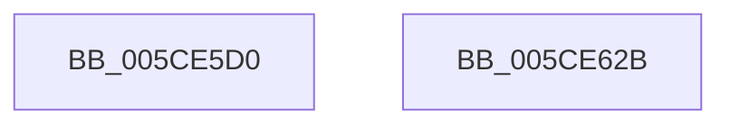

# PopInitializeIRTimer

- RVA: `0x005CE5D0`–`0x005CE62C` (길이 `92` bytes)
- VA: `0x00000001405CE5D0`
- 실행 섹션: `.text`
- PDB 이름 있음: `예`; PDB Function 태그: `아니요`
- unwind 정보 RVA: `0x000B3D80`
- 디코드: `24`개 명령, `92/92` bytes 표시
- 미해석 바이트: `0` (있으면 어셈블리에 `.byte`로 보존)

> 이 문서는 커널 이미지의 기계어와 PDB 기호를 분석해 생성했습니다. 4번과 5번은 함수 원형과 자료형을 바이너리 사용 방식에서 추정한 C 해석이며 원본 소스 복구 결과는 아닙니다.

## 1. Dependencies

- 직접 호출 지점: **2**; 고유 호출 대상: **2**
- 직접 호출자로 확인된 함수: **2**
- RIP 상대 이미지 참조: **0**

### Outgoing calls
- `0x005CE609` → [KeInitializeIRTimer](../3A/KeInitializeIRTimer_function_003A4204.md) (function, `0x003A4204`)
- `0x005CE61B` → [PopInitializeWorkItem](../../page/75/PopInitializeWorkItem_function_007540C8.md) (function, `0x007540C8`)

### Direct callers
- [PopAdaptiveStandbyInitialize](../../page/76/PopAdaptiveStandbyInitialize_function_0076DDF8.md) at `0x0076DFB8`
- [PopNetInitialize](../../init/C4/PopNetInitialize_function_00C423AC.md) at `0x00C4246B`
- [PopNetInitialize](../../init/C4/PopNetInitialize_function_00C423AC.md) at `0x00C42495`

### Static image references
- 디코드된 RIP-relative 메모리 참조가 없습니다.

## 2. Other-region calls and transfers

- 다른 실행 섹션으로 향하는 call: **1**
  - `0x005CE61B` → [PopInitializeWorkItem](../../page/75/PopInitializeWorkItem_function_007540C8.md) (`.text` → `PAGE`)
- 별도 외부 분기/꼬리 이동을 확인하지 못했습니다.

## 3. Assembly (complete function range)

```asm
005CE5D0  48 89 5C 24 08                  mov qword ptr [rsp + 8], rbx
005CE5D5  4C 89 44 24 18                  mov qword ptr [rsp + 0x18], r8
005CE5DA  57                              push rdi
005CE5DB  48 83 EC 30                     sub rsp, 0x30
005CE5DF  B8 08 00 00 00                  mov eax, 8
005CE5E4  49 8B F9                        mov rdi, r9
005CE5E7  66 89 44 24 50                  mov word ptr [rsp + 0x50], ax
005CE5EC  4C 8D 4C 24 50                  lea r9, [rsp + 0x50]
005CE5F1  0F B7 44 24 68                  movzx eax, word ptr [rsp + 0x68]
005CE5F6  45 33 C0                        xor r8d, r8d
005CE5F9  66 89 44 24 52                  mov word ptr [rsp + 0x52], ax
005CE5FE  48 8B D9                        mov rbx, rcx
005CE601  8B 44 24 70                     mov eax, dword ptr [rsp + 0x70]
005CE605  89 44 24 20                     mov dword ptr [rsp + 0x20], eax
005CE609  E8 F6 5B DD FF                  call 0x1403a4204
005CE60E  48 8D 8B 88 00 00 00            lea rcx, [rbx + 0x88]
005CE615  45 33 C0                        xor r8d, r8d
005CE618  48 8B D7                        mov rdx, rdi
005CE61B  E8 A8 5A 18 00                  call 0x1407540c8
005CE620  48 8B 5C 24 40                  mov rbx, qword ptr [rsp + 0x40]
005CE625  48 83 C4 30                     add rsp, 0x30
005CE629  5F                              pop rdi
005CE62A  C3                              ret
005CE62B  CC                              int3
```

## 4. C-style interpretation (structured pseudocode)

```c
__int64 __fastcall PopInitializeIRTimer(__int64 a1, __int64 a2, __int64 a3, __int64 a4, __int64 a5, unsigned __int16 a6, unsigned int a7)
{
    __int64 result;
    __int64 v_rsp;
    unsigned int v_stack_m18;
    unsigned __int64 v_stack_p18;
    unsigned __int16 v_stack_p1A;
    unsigned __int64 v_stack_p8;

    v_stack_p8 = v_rbx;
    v_stack_p18 = a3;
    v_rsp = (v_rsp) - (48);
    v_stack_p18 = 8;
    a3 = 0;
    v_stack_p1A = a6;
    v_stack_m18 = (unsigned int)((unsigned int)(a7));
    result = KeInitializeIRTimer(a1, a2, a3, v_stack_p18);
    a3 = 0;
    result = PopInitializeWorkItem(a1 + 136, a4, a3, v_stack_p18);
    v_rsp = (v_rsp) + (48);
    return result;
}
```

## 5. (Beta) C Style

```c
int64_t PopInitializeIRTimer(void *Arg1, int64_t Arg2, int64_t Arg3, int64_t Arg4, uint64_t Arg5, uint16_t Arg6, uint32_t Arg7)
{
    uint8_t *arg1 = (uint8_t *)Arg1;

    int64_t result;
    int64_t local_rsp;
    uint32_t v_stack_m18;
    uint64_t v_stack_p18;
    uint16_t v_stack_p1A;
    uint64_t v_stack_p8;

    v_stack_p8 = local_rbx;
    v_stack_p18 = Arg3;
    local_rsp = (local_rsp) - (48);
    v_stack_p18 = 8;
    Arg3 = 0;
    v_stack_p1A = Arg6;
    v_stack_m18 = (uint32_t)((uint32_t)(Arg7));
    result = KeInitializeIRTimer(Arg1, Arg2, Arg3, v_stack_p18);
    Arg3 = 0;
    result = PopInitializeWorkItem(Arg1 + 136, Arg4, Arg3, v_stack_p18);
    local_rsp = (local_rsp) + (48);
    return result;
}
```

### 관측된 메모리 오프셋

구조체 형식이 확인되지 않은 접근은 인자 기준의 오프셋으로만 기록했습니다.

| 기준 인자 | 오프셋 표현 | 폭 (bit) | 접근 |
|---|---:|---:|---|
| `Arg1` | `+ 0x88` | `64` | `R` |

## 6. Execution-region graph

[열기: 2D/3D 그래프와 함수 탐색 컨트롤 패널](../../../control-panel.html?section=text&rva=0x005CE5D0&view=graph)

- 2D 그래프는 위에서 아래로 흐르고, 3D 그래프는 빈 공간을 드래그해 회전합니다. Shift+드래그는 이동, 휠은 확대·축소, 함수 노드 선택은 대상 보고서 이동입니다.

### Static fallback


