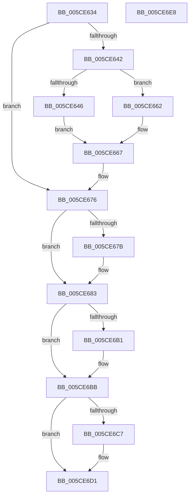

# PopInternalAddToDumpFile

- RVA: `0x005CE634`–`0x005CE6E9` (길이 `181` bytes)
- VA: `0x00000001405CE634`
- 실행 섹션: `.text`
- PDB 이름 있음: `예`; PDB Function 태그: `아니요`
- unwind 정보 RVA: `0x0005CF00`
- 디코드: `45`개 명령, `181/181` bytes 표시
- 미해석 바이트: `0` (있으면 어셈블리에 `.byte`로 보존)

> 이 문서는 커널 이미지의 기계어와 PDB 기호를 분석해 생성했습니다. 4번과 5번은 함수 원형과 자료형을 바이너리 사용 방식에서 추정한 C 해석이며 원본 소스 복구 결과는 아닙니다.

## 1. Dependencies

- 직접 호출 지점: **7**; 고유 호출 대상: **2**
- 직접 호출자로 확인된 함수: **17**
- RIP 상대 이미지 참조: **5**

### Outgoing calls
- `0x005CE671` → [IoAddTriageDumpDataBlock](../42/IoAddTriageDumpDataBlock_function_00428374.md) (function, `0x00428374`)
- `0x005CE67E` → [PopInternalSaveStackToDumpFile](PopInternalSaveStackToDumpFile_function_005CE6F0.md) (function, `0x005CE6F0`)
- `0x005CE68F` → [IoAddTriageDumpDataBlock](../42/IoAddTriageDumpDataBlock_function_00428374.md) (function, `0x00428374`)
- `0x005CE6A0` → [IoAddTriageDumpDataBlock](../42/IoAddTriageDumpDataBlock_function_00428374.md) (function, `0x00428374`)
- `0x005CE6B6` → [IoAddTriageDumpDataBlock](../42/IoAddTriageDumpDataBlock_function_00428374.md) (function, `0x00428374`)
- `0x005CE6CC` → [IoAddTriageDumpDataBlock](../42/IoAddTriageDumpDataBlock_function_00428374.md) (function, `0x00428374`)
- `0x005CE6DD` → [IoAddTriageDumpDataBlock](../42/IoAddTriageDumpDataBlock_function_00428374.md) (function, `0x00428374`)

### Direct callers
- [PopSetRange](../47/PopSetRange_function_0047C750.md) at `0x0047C79C`
- [IopAddBugcheckTriageDataFromParameters](../59/IopAddBugcheckTriageDataFromParameters_function_00593E54.md) at `0x0059414D`
- [KiCollectTriageDumpDataBlocks](../5B/KiCollectTriageDumpDataBlocks_function_005B43F8.md) at `0x005B45EE`
- [PopIrpWatchdogBugcheck](PopIrpWatchdogBugcheck_function_005CE868.md) at `0x005CE9E7`
- [PopPowerActionWatchdog](../5D/PopPowerActionWatchdog_function_005D51A0.md) at `0x005D51AB`
- [sub_006F4B48](../6F/Unknown_function_006F4B48.md) at `0x006F4B50`
- [PopFreeHiberContext](../../page/70/PopFreeHiberContext_function_00704F1C.md) at `0x00705055`
- [PoShutdownBugCheck](../../page/75/PoShutdownBugCheck_function_0075E580.md) at `0x0075E5D3`
- [PopAllocateHiberContext](../../page/AD/PopAllocateHiberContext_function_00ADC05C.md) at `0x00ADC507`
- [PopAllocateHiberContext](../../page/AD/PopAllocateHiberContext_function_00ADC05C.md) at `0x00ADC517`
- [PopAllocateHiberContext](../../page/AD/PopAllocateHiberContext_function_00ADC05C.md) at `0x00ADC5AD`
- [PopAllocateHiberContext](../../page/AD/PopAllocateHiberContext_function_00ADC05C.md) at `0x00ADC5BD`
- [sub_00B3BE18](../../page/B3/Unknown_function_00B3BE18.md) at `0x00B3BE4D`
- [PopCreateDumpMdl](../../pagelk/B6/PopCreateDumpMdl_function_00B6CF5C.md) at `0x00B6D017`
- [PopDecompressHiberBlocks](../../pagelk/B6/PopDecompressHiberBlocks_function_00B6D074.md) at `0x00B6D513`
- [PopDecompressHiberBlocks](../../pagelk/B6/PopDecompressHiberBlocks_function_00B6D074.md) at `0x00B6D549`
- [PopHiberReadChecksums](../../pagelk/B6/PopHiberReadChecksums_function_00B6DD54.md) at `0x00B6DF4D`
- [PopRequestRead](../../pagelk/B6/PopRequestRead_function_00B6E6DC.md) at `0x00B6EA81`
- [PopRequestRead](../../pagelk/B6/PopRequestRead_function_00B6E6DC.md) at `0x00B6EA95`
- [PopRequestRead](../../pagelk/B6/PopRequestRead_function_00B6E6DC.md) at `0x00B6EACF`
- [PopRequestWrite](../../pagelk/B6/PopRequestWrite_function_00B6EB14.md) at `0x00B6EEDF`
- [PopRequestWrite](../../pagelk/B6/PopRequestWrite_function_00B6EB14.md) at `0x00B6EEF3`
- [PopRequestWrite](../../pagelk/B6/PopRequestWrite_function_00B6EB14.md) at `0x00B6EF29`
- [PopRequestWrite](../../pagelk/B6/PopRequestWrite_function_00B6EB14.md) at `0x00B6EF3D`
- [PopRequestWrite](../../pagelk/B6/PopRequestWrite_function_00B6EB14.md) at `0x00B6EF73`
- [PopRequestWrite](../../pagelk/B6/PopRequestWrite_function_00B6EB14.md) at `0x00B6EF87`
- [PopSaveHiberContext](../../pagelk/B6/PopSaveHiberContext_function_00B6F050.md) at `0x00B6F3FD`
- [PopSaveHiberContext](../../pagelk/B6/PopSaveHiberContext_function_00B6F050.md) at `0x00B6FADF`
- [PopRestoreHiberContext](../../pagelk/B7/PopRestoreHiberContext_function_00B777F0.md) at `0x00B77AC4`

### Static image references
- `0x005CE688` → RVA `0x00F0BF20` (`.data`; read)
- `0x005CE699` → RVA `0x00F0BD40` (`.data`; read)
- `0x005CE6A5` → RVA `0x00F0BD88` (`.data`; read)
- `0x005CE6BB` → RVA `0x00F0BD90` (`.data`; read)
- `0x005CE6D6` → RVA `0x00F0C020` (`.data`; read)

## 2. Other-region calls and transfers

- 다른 실행 섹션으로 향하는 call: **0**
- 별도 외부 분기/꼬리 이동을 확인하지 못했습니다.

## 3. Assembly (complete function range)

```asm
005CE634  40 53                           push rbx
005CE636  48 83 EC 20                     sub rsp, 0x20
005CE63A  49 8B D8                        mov rbx, r8
005CE63D  48 85 C9                        test rcx, rcx
005CE640  74 34                           je 0x1405ce676
005CE642  85 D2                           test edx, edx
005CE644  74 1C                           je 0x1405ce662
005CE646  8B D2                           mov edx, edx
005CE648  4C 8B C9                        mov r9, rcx
005CE64B  41 81 E1 FF 0F 00 00            and r9d, 0xfff
005CE652  48 81 C2 FF 0F 00 00            add rdx, 0xfff
005CE659  49 03 D1                        add rdx, r9
005CE65C  48 C1 EA 0C                     shr rdx, 0xc
005CE660  EB 05                           jmp 0x1405ce667
005CE662  BA 01 00 00 00                  mov edx, 1
005CE667  C1 E2 0C                        shl edx, 0xc
005CE66A  48 81 E1 00 F0 FF FF            and rcx, 0xfffffffffffff000
005CE671  E8 FE 9C E5 FF                  call 0x140428374
005CE676  48 85 DB                        test rbx, rbx
005CE679  74 08                           je 0x1405ce683
005CE67B  48 8B CB                        mov rcx, rbx
005CE67E  E8 6D 00 00 00                  call 0x1405ce6f0
005CE683  BA E8 00 00 00                  mov edx, 0xe8
005CE688  48 8D 0D 91 D8 93 00            lea rcx, [rip + 0x93d891]
005CE68F  E8 E0 9C E5 FF                  call 0x140428374
005CE694  BA E0 01 00 00                  mov edx, 0x1e0
005CE699  48 8D 0D A0 D6 93 00            lea rcx, [rip + 0x93d6a0]
005CE6A0  E8 CF 9C E5 FF                  call 0x140428374
005CE6A5  48 8B 0D DC D6 93 00            mov rcx, qword ptr [rip + 0x93d6dc]
005CE6AC  48 85 C9                        test rcx, rcx
005CE6AF  74 0A                           je 0x1405ce6bb
005CE6B1  BA D8 01 00 00                  mov edx, 0x1d8
005CE6B6  E8 B9 9C E5 FF                  call 0x140428374
005CE6BB  48 8B 0D CE D6 93 00            mov rcx, qword ptr [rip + 0x93d6ce]
005CE6C2  48 85 C9                        test rcx, rcx
005CE6C5  74 0A                           je 0x1405ce6d1
005CE6C7  BA F0 01 00 00                  mov edx, 0x1f0
005CE6CC  E8 A3 9C E5 FF                  call 0x140428374
005CE6D1  BA C0 02 00 00                  mov edx, 0x2c0
005CE6D6  48 8D 0D 43 D9 93 00            lea rcx, [rip + 0x93d943]
005CE6DD  E8 92 9C E5 FF                  call 0x140428374
005CE6E2  48 83 C4 20                     add rsp, 0x20
005CE6E6  5B                              pop rbx
005CE6E7  C3                              ret
005CE6E8  CC                              int3
```

## 4. C-style interpretation (structured pseudocode)

```c
__int64 __fastcall PopInternalAddToDumpFile(__int64 a1, int a2, __int64 a3)
{
    __int64 result;
    __int64 v_rsp;

    v_rsp = (v_rsp) - (32);
    if (a1 == 0) goto loc_005CE676;
    if (a2 == 0) goto loc_005CE662;
    a4 = (unsigned int)((a1) & (0xFFFULL));
    a2 = ((unsigned int)(a2)) + (0xFFFULL);
    a2 = (a2) + (a4);
    a2 = (a2) >> (12);
    goto loc_005CE667;
loc_005CE662:
loc_005CE667:
    a2 = (unsigned int)((1) << (12));
    a1 = (a1) & (0xFFFFFFFFFFFFF000ULL);
    result = IoAddTriageDumpDataBlock(a1, a2, a3, a4);
loc_005CE676:
    if (a3 != 0) {
        a1 = a3;
        result = PopInternalSaveStackToDumpFile(a1, a2, a3, a4);
    }
    result = IoAddTriageDumpDataBlock(v_rip + 9689233, 232, a3, a4);
    result = IoAddTriageDumpDataBlock(v_rip + 9688736, 480, a3, a4);
    if (*(unsigned __int64 *)(v_rip + 9688796) != 0) {
        a2 = 472;
        result = IoAddTriageDumpDataBlock(*(unsigned __int64 *)(v_rip + 9688796), a2, a3, a4);
    }
    if (*(unsigned __int64 *)(v_rip + 9688782) != 0) {
        a2 = 496;
        result = IoAddTriageDumpDataBlock(*(unsigned __int64 *)(v_rip + 9688782), a2, a3, a4);
    }
    result = IoAddTriageDumpDataBlock(v_rip + 9689411, 704, a3, a4);
    v_rsp = (v_rsp) + (32);
    return result;
}
```

## 5. (Beta) C Style

```c
int64_t PopInternalAddToDumpFile(int64_t Arg1, int32_t Arg2, int64_t Arg3)
{
    int64_t result;
    int64_t local_rsp;

    local_rsp = (local_rsp) - (32);
    if (Arg1 == 0) goto loc_005CE676;
    if (Arg2 == 0) goto loc_005CE662;
    a4 = (uint32_t)((Arg1) & (0xFFFULL));
    Arg2 = ((uint32_t)(Arg2)) + (0xFFFULL);
    Arg2 = (Arg2) + (a4);
    Arg2 = (Arg2) >> (12);
    goto loc_005CE667;
loc_005CE662:
loc_005CE667:
    Arg2 = (uint32_t)((1) << (12));
    Arg1 = (Arg1) & (0xFFFFFFFFFFFFF000ULL);
    result = IoAddTriageDumpDataBlock(Arg1, Arg2, Arg3, a4);
loc_005CE676:
    if (Arg3 != 0) {
        Arg1 = Arg3;
        result = PopInternalSaveStackToDumpFile(Arg1, Arg2, Arg3, a4);
    }
    result = IoAddTriageDumpDataBlock(v_rip + 9689233, 232, Arg3, a4);
    result = IoAddTriageDumpDataBlock(v_rip + 9688736, 480, Arg3, a4);
    if (*(uint64_t *)(v_rip + 0x93D6DC) != 0) {
        Arg2 = 472;
        result = IoAddTriageDumpDataBlock(*(uint64_t *)(v_rip + 0x93D6DC), Arg2, Arg3, a4);
    }
    if (*(uint64_t *)(v_rip + 0x93D6CE) != 0) {
        Arg2 = 496;
        result = IoAddTriageDumpDataBlock(*(uint64_t *)(v_rip + 0x93D6CE), Arg2, Arg3, a4);
    }
    result = IoAddTriageDumpDataBlock(v_rip + 9689411, 704, Arg3, a4);
    local_rsp = (local_rsp) + (32);
    return result;
}
```

## 6. Execution-region graph

[열기: 2D/3D 그래프와 함수 탐색 컨트롤 패널](../../../control-panel.html?section=text&rva=0x005CE634&view=graph)

- 2D 그래프는 위에서 아래로 흐르고, 3D 그래프는 빈 공간을 드래그해 회전합니다. Shift+드래그는 이동, 휠은 확대·축소, 함수 노드 선택은 대상 보고서 이동입니다.

### Static fallback


