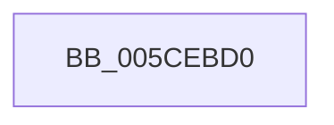

# PopInternalError

- RVA: `0x005CEBD0`–`0x005CEBEF` (길이 `31` bytes)
- VA: `0x00000001405CEBD0`
- 실행 섹션: `.text`
- PDB 이름 있음: `예`; PDB Function 태그: `아니요`
- unwind 정보 RVA: `0x000622F0`
- 디코드: `8`개 명령, `31/31` bytes 표시
- 미해석 바이트: `0` (있으면 어셈블리에 `.byte`로 보존)

> 이 문서는 커널 이미지의 기계어와 PDB 기호를 분석해 생성했습니다. 4번과 5번은 함수 원형과 자료형을 바이너리 사용 방식에서 추정한 C 해석이며 원본 소스 복구 결과는 아닙니다.

## 1. Dependencies

- 직접 호출 지점: **1**; 고유 호출 대상: **1**
- 직접 호출자로 확인된 함수: **4**
- RIP 상대 이미지 참조: **0**

### Outgoing calls
- `0x005CEBE9` → [KeBugCheckEx](../4F/KeBugCheckEx_function_004FD660.md) (function, `0x004FD660`)

### Direct callers
- [sub_006F4AC2](../6F/Unknown_function_006F4AC2.md) at `0x006F4B37`
- [PopCreateDumpMdl](../../pagelk/B6/PopCreateDumpMdl_function_00B6CF5C.md) at `0x00B6CF83`
- [PopSaveHiberContext](../../pagelk/B6/PopSaveHiberContext_function_00B6F050.md) at `0x00B6F178`
- [PopWriteHiberPages](../../pagelk/B6/PopWriteHiberPages_function_00B6FF78.md) at `0x00B700B9`

### Static image references
- 디코드된 RIP-relative 메모리 참조가 없습니다.

## 2. Other-region calls and transfers

- 다른 실행 섹션으로 향하는 call: **0**
- 별도 외부 분기/꼬리 이동을 확인하지 못했습니다.

## 3. Assembly (complete function range)

```asm
005CEBD0  48 83 EC 38                     sub rsp, 0x38
005CEBD4  48 83 64 24 20 00               and qword ptr [rsp + 0x20], 0
005CEBDA  45 33 C9                        xor r9d, r9d
005CEBDD  44 8B C1                        mov r8d, ecx
005CEBE0  B9 A0 00 00 00                  mov ecx, 0xa0
005CEBE5  41 8D 51 02                     lea edx, [r9 + 2]
005CEBE9  E8 72 EA F2 FF                  call 0x1404fd660
005CEBEE  CC                              int3
```

## 4. C-style interpretation (structured pseudocode)

```c
__int64 __fastcall PopInternalError(int a1, __int64 a2, __int64 a3, int a4)
{
    __int64 result;
    __int64 v_rsp;
    unsigned __int64 v_stack_m18;

    v_rsp = (v_rsp) - (56);
    a4 = 0;
    result = KeBugCheckEx(160, a4 + 2, (unsigned int)(a1), a4);
    return result;
}
```

## 5. (Beta) C Style

```c
int64_t PopInternalError(int32_t Arg1, int64_t Arg2, int64_t Arg3, int32_t Arg4)
{
    int64_t result;
    int64_t local_rsp;
    uint64_t v_stack_m18;

    local_rsp = (local_rsp) - (56);
    Arg4 = 0;
    result = KeBugCheckEx(160, Arg4 + 2, (uint32_t)(Arg1), Arg4);
    return result;
}
```

## 6. Execution-region graph

[열기: 2D/3D 그래프와 함수 탐색 컨트롤 패널](../../../control-panel.html?section=text&rva=0x005CEBD0&view=graph)

- 2D 그래프는 위에서 아래로 흐르고, 3D 그래프는 빈 공간을 드래그해 회전합니다. Shift+드래그는 이동, 휠은 확대·축소, 함수 노드 선택은 대상 보고서 이동입니다.

### Static fallback


