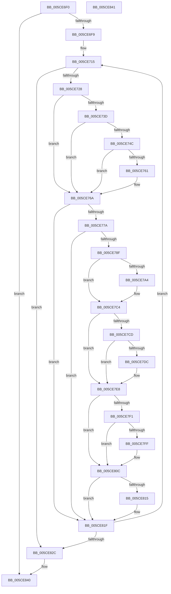

# PopInternalSaveStackToDumpFile

- RVA: `0x005CE6F0`–`0x005CE842` (길이 `338` bytes)
- VA: `0x00000001405CE6F0`
- 실행 섹션: `.text`
- PDB 이름 있음: `예`; PDB Function 태그: `아니요`
- unwind 정보 RVA: `0x000BEAEC`
- 디코드: `89`개 명령, `338/338` bytes 표시
- 미해석 바이트: `0` (있으면 어셈블리에 `.byte`로 보존)

> 이 문서는 커널 이미지의 기계어와 PDB 기호를 분석해 생성했습니다. 4번과 5번은 함수 원형과 자료형을 바이너리 사용 방식에서 추정한 C 해석이며 원본 소스 복구 결과는 아닙니다.

## 1. Dependencies

- 직접 호출 지점: **13**; 고유 호출 대상: **2**
- 직접 호출자로 확인된 함수: **2**
- RIP 상대 이미지 참조: **0**

### Outgoing calls
- `0x005CE71B` → [KiIsAddressRangeValid](../4B/KiIsAddressRangeValid_function_004B0278.md) (function, `0x004B0278`)
- `0x005CE72F` → [IoAddTriageDumpDataBlock](../42/IoAddTriageDumpDataBlock_function_00428374.md) (function, `0x00428374`)
- `0x005CE743` → [KiIsAddressRangeValid](../4B/KiIsAddressRangeValid_function_004B0278.md) (function, `0x004B0278`)
- `0x005CE753` → [IoAddTriageDumpDataBlock](../42/IoAddTriageDumpDataBlock_function_00428374.md) (function, `0x00428374`)
- `0x005CE765` → [IoAddTriageDumpDataBlock](../42/IoAddTriageDumpDataBlock_function_00428374.md) (function, `0x00428374`)
- `0x005CE782` → [KiIsAddressRangeValid](../4B/KiIsAddressRangeValid_function_004B0278.md) (function, `0x004B0278`)
- `0x005CE796` → [IoAddTriageDumpDataBlock](../42/IoAddTriageDumpDataBlock_function_00428374.md) (function, `0x00428374`)
- `0x005CE7BF` → [IoAddTriageDumpDataBlock](../42/IoAddTriageDumpDataBlock_function_00428374.md) (function, `0x00428374`)
- `0x005CE7D3` → [KiIsAddressRangeValid](../4B/KiIsAddressRangeValid_function_004B0278.md) (function, `0x004B0278`)
- `0x005CE7E3` → [IoAddTriageDumpDataBlock](../42/IoAddTriageDumpDataBlock_function_00428374.md) (function, `0x00428374`)
- `0x005CE7F6` → [KiIsAddressRangeValid](../4B/KiIsAddressRangeValid_function_004B0278.md) (function, `0x004B0278`)
- `0x005CE807` → [IoAddTriageDumpDataBlock](../42/IoAddTriageDumpDataBlock_function_00428374.md) (function, `0x00428374`)
- `0x005CE81A` → [IoAddTriageDumpDataBlock](../42/IoAddTriageDumpDataBlock_function_00428374.md) (function, `0x00428374`)

### Direct callers
- [PopInternalAddToDumpFile](PopInternalAddToDumpFile_function_005CE634.md) at `0x005CE67E`
- [PopFxDirectedWorkOrderWatchdog](../5D/PopFxDirectedWorkOrderWatchdog_function_005D2820.md) at `0x005D283B`

### Static image references
- 디코드된 RIP-relative 메모리 참조가 없습니다.

## 2. Other-region calls and transfers

- 다른 실행 섹션으로 향하는 call: **0**
- 별도 외부 분기/꼬리 이동을 확인하지 못했습니다.

## 3. Assembly (complete function range)

```asm
005CE6F0  48 85 C9                        test rcx, rcx
005CE6F3  0F 84 47 01 00 00               je 0x1405ce840
005CE6F9  48 89 5C 24 08                  mov qword ptr [rsp + 8], rbx
005CE6FE  48 89 6C 24 10                  mov qword ptr [rsp + 0x10], rbp
005CE703  48 89 74 24 18                  mov qword ptr [rsp + 0x18], rsi
005CE708  57                              push rdi
005CE709  48 83 EC 20                     sub rsp, 0x20
005CE70D  48 8B D9                        mov rbx, rcx
005CE710  BD 50 01 00 00                  mov ebp, 0x150
005CE715  48 8B D5                        mov rdx, rbp
005CE718  48 8B CB                        mov rcx, rbx
005CE71B  E8 58 1B EE FF                  call 0x1404b0278
005CE720  84 C0                           test al, al
005CE722  0F 84 04 01 00 00               je 0x1405ce82c
005CE728  0F B7 53 02                     movzx edx, word ptr [rbx + 2]
005CE72C  48 8B CB                        mov rcx, rbx
005CE72F  E8 40 9C E5 FF                  call 0x140428374
005CE734  48 8B 7B 08                     mov rdi, qword ptr [rbx + 8]
005CE738  48 85 FF                        test rdi, rdi
005CE73B  74 2D                           je 0x1405ce76a
005CE73D  48 8B D5                        mov rdx, rbp
005CE740  48 8B CF                        mov rcx, rdi
005CE743  E8 30 1B EE FF                  call 0x1404b0278
005CE748  84 C0                           test al, al
005CE74A  74 1E                           je 0x1405ce76a
005CE74C  0F BF 57 02                     movsx edx, word ptr [rdi + 2]
005CE750  48 8B CF                        mov rcx, rdi
005CE753  E8 1C 9C E5 FF                  call 0x140428374
005CE758  48 8B 4F 40                     mov rcx, qword ptr [rdi + 0x40]
005CE75C  48 85 C9                        test rcx, rcx
005CE75F  74 09                           je 0x1405ce76a
005CE761  0F B7 57 38                     movzx edx, word ptr [rdi + 0x38]
005CE765  E8 0A 9C E5 FF                  call 0x140428374
005CE76A  48 8B BB 38 01 00 00            mov rdi, qword ptr [rbx + 0x138]
005CE771  48 85 FF                        test rdi, rdi
005CE774  0F 84 A5 00 00 00               je 0x1405ce81f
005CE77A  BA 08 00 00 00                  mov edx, 8
005CE77F  48 8B CF                        mov rcx, rdi
005CE782  E8 F1 1A EE FF                  call 0x1404b0278
005CE787  84 C0                           test al, al
005CE789  0F 84 90 00 00 00               je 0x1405ce81f
005CE78F  0F B7 57 02                     movzx edx, word ptr [rdi + 2]
005CE793  48 8B CF                        mov rcx, rdi
005CE796  E8 D9 9B E5 FF                  call 0x140428374
005CE79B  48 8B 4F 28                     mov rcx, qword ptr [rdi + 0x28]
005CE79F  48 85 C9                        test rcx, rcx
005CE7A2  74 20                           je 0x1405ce7c4
005CE7A4  8B D1                           mov edx, ecx
005CE7A6  48 81 E1 00 F0 FF FF            and rcx, 0xfffffffffffff000
005CE7AD  81 E2 FF 0F 00 00               and edx, 0xfff
005CE7B3  81 C2 FF 11 00 00               add edx, 0x11ff
005CE7B9  81 E2 00 F0 FF FF               and edx, 0xfffff000
005CE7BF  E8 B0 9B E5 FF                  call 0x140428374
005CE7C4  48 8B 77 30                     mov rsi, qword ptr [rdi + 0x30]
005CE7C8  48 85 F6                        test rsi, rsi
005CE7CB  74 1B                           je 0x1405ce7e8
005CE7CD  48 8B D5                        mov rdx, rbp
005CE7D0  48 8B CE                        mov rcx, rsi
005CE7D3  E8 A0 1A EE FF                  call 0x1404b0278
005CE7D8  84 C0                           test al, al
005CE7DA  74 0C                           je 0x1405ce7e8
005CE7DC  0F B7 56 02                     movzx edx, word ptr [rsi + 2]
005CE7E0  48 8B CE                        mov rcx, rsi
005CE7E3  E8 8C 9B E5 FF                  call 0x140428374
005CE7E8  48 8B 4F 48                     mov rcx, qword ptr [rdi + 0x48]
005CE7EC  48 85 C9                        test rcx, rcx
005CE7EF  74 1B                           je 0x1405ce80c
005CE7F1  BA 60 00 00 00                  mov edx, 0x60
005CE7F6  E8 7D 1A EE FF                  call 0x1404b0278
005CE7FB  84 C0                           test al, al
005CE7FD  74 0D                           je 0x1405ce80c
005CE7FF  48 8B 4F 48                     mov rcx, qword ptr [rdi + 0x48]
005CE803  0F BF 51 02                     movsx edx, word ptr [rcx + 2]
005CE807  E8 68 9B E5 FF                  call 0x140428374
005CE80C  48 8B 4F 18                     mov rcx, qword ptr [rdi + 0x18]
005CE810  48 85 C9                        test rcx, rcx
005CE813  74 0A                           je 0x1405ce81f
005CE815  BA 68 00 00 00                  mov edx, 0x68
005CE81A  E8 55 9B E5 FF                  call 0x140428374
005CE81F  48 8B 5B 18                     mov rbx, qword ptr [rbx + 0x18]
005CE823  48 85 DB                        test rbx, rbx
005CE826  0F 85 E9 FE FF FF               jne 0x1405ce715
005CE82C  48 8B 5C 24 30                  mov rbx, qword ptr [rsp + 0x30]
005CE831  48 8B 6C 24 38                  mov rbp, qword ptr [rsp + 0x38]
005CE836  48 8B 74 24 40                  mov rsi, qword ptr [rsp + 0x40]
005CE83B  48 83 C4 20                     add rsp, 0x20
005CE83F  5F                              pop rdi
005CE840  C3                              ret
005CE841  CC                              int3
```

## 4. C-style interpretation (structured pseudocode)

```c
__int64 __fastcall PopInternalSaveStackToDumpFile(__int64 a1)
{
    __int64 result;
    __int64 v_rsp;
    unsigned __int64 v_stack_p10;
    unsigned __int64 v_stack_p18;
    unsigned __int64 v_stack_p8;

    if (a1 == 0) goto loc_005CE840;
    v_stack_p8 = v_rbx;
    v_stack_p10 = v_rbp;
    v_stack_p18 = v_rsi;
    v_rsp = (v_rsp) - (32);
loc_005CE715:
    result = KiIsAddressRangeValid(a1, 336, a3, a4);
    if ((unsigned __int8)(result) == 0) goto loc_005CE82C;
    result = IoAddTriageDumpDataBlock(a1, *(unsigned __int16 *)(a1 + 2), a3, a4);
    if (*(unsigned __int64 *)(a1 + 8) == 0) goto loc_005CE76A;
    result = KiIsAddressRangeValid(*(unsigned __int64 *)(a1 + 8), 336, a3, a4);
    if ((unsigned __int8)(result) == 0) goto loc_005CE76A;
    result = IoAddTriageDumpDataBlock(*(unsigned __int64 *)(a1 + 8), (__int16)(*(unsigned __int16 *)(*(unsigned __int64 *)(a1 + 8) + 2)), a3, a4);
    if (*(unsigned __int64 *)(*(unsigned __int64 *)(a1 + 8) + 64) != 0) {
        a2 = *(unsigned __int16 *)(*(unsigned __int64 *)(a1 + 8) + 56);
        result = IoAddTriageDumpDataBlock(*(unsigned __int64 *)(*(unsigned __int64 *)(a1 + 8) + 64), a2, a3, a4);
    }
    if (*(unsigned __int64 *)(a1 + 312) == 0) goto loc_005CE81F;
    result = KiIsAddressRangeValid(*(unsigned __int64 *)(a1 + 312), 8, a3, a4);
    if ((unsigned __int8)(result) == 0) goto loc_005CE81F;
    result = IoAddTriageDumpDataBlock(*(unsigned __int64 *)(a1 + 312), *(unsigned __int16 *)(*(unsigned __int64 *)(a1 + 312) + 2), a3, a4);
    if (*(unsigned __int64 *)(*(unsigned __int64 *)(a1 + 312) + 40) != 0) {
        a2 = (unsigned int)(*(unsigned __int64 *)(*(unsigned __int64 *)(a1 + 312) + 40));
        a1 = (*(unsigned __int64 *)(*(unsigned __int64 *)(a1 + 312) + 40)) & (0xFFFFFFFFFFFFF000ULL);
        a2 = (unsigned int)((a2) & (0xFFFULL));
        a2 = (unsigned int)((a2) + (0x11FFULL));
        a2 = (unsigned int)((a2) & (0xFFFFF000ULL));
        result = IoAddTriageDumpDataBlock(a1, a2, a3, a4);
    }
    if (*(unsigned __int64 *)(*(unsigned __int64 *)(a1 + 312) + 48) == 0) goto loc_005CE7E8;
    result = KiIsAddressRangeValid(*(unsigned __int64 *)(*(unsigned __int64 *)(a1 + 312) + 48), 336, a3, a4);
    if ((unsigned __int8)(result) != 0) {
        a2 = *(unsigned __int16 *)(*(unsigned __int64 *)(*(unsigned __int64 *)(a1 + 312) + 48) + 2);
        a1 = *(unsigned __int64 *)(*(unsigned __int64 *)(a1 + 312) + 48);
        result = IoAddTriageDumpDataBlock(a1, a2, a3, a4);
    }
    if (*(unsigned __int64 *)(*(unsigned __int64 *)(a1 + 312) + 72) == 0) goto loc_005CE80C;
    result = KiIsAddressRangeValid(*(unsigned __int64 *)(*(unsigned __int64 *)(a1 + 312) + 72), 96, a3, a4);
    if ((unsigned __int8)(result) != 0) {
        a1 = *(unsigned __int64 *)(*(unsigned __int64 *)(a1 + 312) + 72);
        a2 = (__int16)(*(unsigned __int16 *)(a1 + 2));
        result = IoAddTriageDumpDataBlock(a1, a2, a3, a4);
    }
    if (*(unsigned __int64 *)(*(unsigned __int64 *)(a1 + 312) + 24) != 0) {
        a2 = 104;
        result = IoAddTriageDumpDataBlock(*(unsigned __int64 *)(*(unsigned __int64 *)(a1 + 312) + 24), a2, a3, a4);
    }
    if (*(unsigned __int64 *)(a1 + 24) != 0) goto loc_005CE715;
loc_005CE82C:
    v_rsp = (v_rsp) + (32);
loc_005CE840:
    return result;
}
```

## 5. (Beta) C Style

```c
int64_t PopInternalSaveStackToDumpFile(int64_t Arg1)
{
    int64_t result;
    int64_t local_rsp;
    uint64_t v_stack_p10;
    uint64_t v_stack_p18;
    uint64_t v_stack_p8;

    if (Arg1 == 0) goto loc_005CE840;
    v_stack_p8 = local_rbx;
    v_stack_p10 = local_rbp;
    v_stack_p18 = local_rsi;
    local_rsp = (local_rsp) - (32);
loc_005CE715:
    result = KiIsAddressRangeValid(Arg1, 336, a3, a4);
    if ((uint8_t)(result) == 0) goto loc_005CE82C;
    result = IoAddTriageDumpDataBlock(Arg1, *(uint16_t *)(Arg1 + 0x2), a3, a4);
    if (*(uint64_t *)(Arg1 + 0x8) == 0) goto loc_005CE76A;
    result = KiIsAddressRangeValid(*(uint64_t *)(Arg1 + 0x8), 336, a3, a4);
    if ((uint8_t)(result) == 0) goto loc_005CE76A;
    result = IoAddTriageDumpDataBlock(*(uint64_t *)(Arg1 + 0x8), (int16_t)(*(uint16_t *)(*(uint64_t *)(Arg1 + 0x8) + 0x2)), a3, a4);
    if (*(uint64_t *)(*(uint64_t *)(Arg1 + 0x8) + 0x40) != 0) {
        a2 = *(uint16_t *)(*(uint64_t *)(Arg1 + 0x8) + 0x38);
        result = IoAddTriageDumpDataBlock(*(uint64_t *)(*(uint64_t *)(Arg1 + 0x8) + 0x40), a2, a3, a4);
    }
    if (*(uint64_t *)(Arg1 + 0x138) == 0) goto loc_005CE81F;
    result = KiIsAddressRangeValid(*(uint64_t *)(Arg1 + 0x138), 8, a3, a4);
    if ((uint8_t)(result) == 0) goto loc_005CE81F;
    result = IoAddTriageDumpDataBlock(*(uint64_t *)(Arg1 + 0x138), *(uint16_t *)(*(uint64_t *)(Arg1 + 0x138) + 0x2), a3, a4);
    if (*(uint64_t *)(*(uint64_t *)(Arg1 + 0x138) + 0x28) != 0) {
        a2 = (uint32_t)(*(uint64_t *)(*(uint64_t *)(Arg1 + 0x138) + 0x28));
        Arg1 = (*(uint64_t *)(*(uint64_t *)(Arg1 + 0x138) + 0x28)) & (0xFFFFFFFFFFFFF000ULL);
        a2 = (uint32_t)((a2) & (0xFFFULL));
        a2 = (uint32_t)((a2) + (0x11FFULL));
        a2 = (uint32_t)((a2) & (0xFFFFF000ULL));
        result = IoAddTriageDumpDataBlock(Arg1, a2, a3, a4);
    }
    if (*(uint64_t *)(*(uint64_t *)(Arg1 + 0x138) + 0x30) == 0) goto loc_005CE7E8;
    result = KiIsAddressRangeValid(*(uint64_t *)(*(uint64_t *)(Arg1 + 0x138) + 0x30), 336, a3, a4);
    if ((uint8_t)(result) != 0) {
        a2 = *(uint16_t *)(*(uint64_t *)(*(uint64_t *)(Arg1 + 0x138) + 0x30) + 0x2);
        Arg1 = *(uint64_t *)(*(uint64_t *)(Arg1 + 0x138) + 0x30);
        result = IoAddTriageDumpDataBlock(Arg1, a2, a3, a4);
    }
    if (*(uint64_t *)(*(uint64_t *)(Arg1 + 0x138) + 0x48) == 0) goto loc_005CE80C;
    result = KiIsAddressRangeValid(*(uint64_t *)(*(uint64_t *)(Arg1 + 0x138) + 0x48), 96, a3, a4);
    if ((uint8_t)(result) != 0) {
        Arg1 = *(uint64_t *)(*(uint64_t *)(Arg1 + 0x138) + 0x48);
        a2 = (int16_t)(*(uint16_t *)(Arg1 + 0x2));
        result = IoAddTriageDumpDataBlock(Arg1, a2, a3, a4);
    }
    if (*(uint64_t *)(*(uint64_t *)(Arg1 + 0x138) + 0x18) != 0) {
        a2 = 104;
        result = IoAddTriageDumpDataBlock(*(uint64_t *)(*(uint64_t *)(Arg1 + 0x138) + 0x18), a2, a3, a4);
    }
    if (*(uint64_t *)(Arg1 + 0x18) != 0) goto loc_005CE715;
loc_005CE82C:
    local_rsp = (local_rsp) + (32);
loc_005CE840:
    return result;
}
```

## 6. Execution-region graph

[열기: 2D/3D 그래프와 함수 탐색 컨트롤 패널](../../../control-panel.html?section=text&rva=0x005CE6F0&view=graph)

- 2D 그래프는 위에서 아래로 흐르고, 3D 그래프는 빈 공간을 드래그해 회전합니다. Shift+드래그는 이동, 휠은 확대·축소, 함수 노드 선택은 대상 보고서 이동입니다.

### Static fallback


