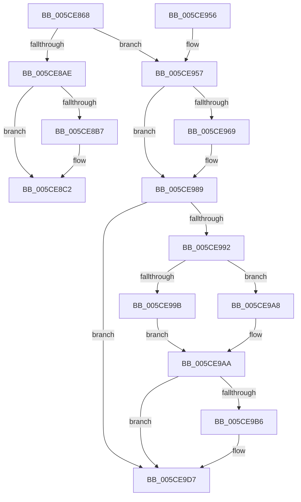

# PopIrpWatchdogBugcheck

- RVA: `0x005CE868`–`0x005CEA5E` (길이 `502` bytes)
- VA: `0x00000001405CE868`
- 실행 섹션: `.text`
- PDB 이름 있음: `예`; PDB Function 태그: `아니요`
- unwind 정보 RVA: `0x000CBDE4`
- 디코드: `112`개 명령, `502/502` bytes 표시
- 미해석 바이트: `0` (있으면 어셈블리에 `.byte`로 보존)

> 이 문서는 커널 이미지의 기계어와 PDB 기호를 분석해 생성했습니다. 4번과 5번은 함수 원형과 자료형을 바이너리 사용 방식에서 추정한 C 해석이며 원본 소스 복구 결과는 아닙니다.

## 1. Dependencies

- 직접 호출 지점: **7**; 고유 호출 대상: **6**
- 직접 호출자로 확인된 함수: **4**
- RIP 상대 이미지 참조: **11**

### Outgoing calls
- `0x005CE934` → [EtwWriteEx](../25/EtwWriteEx_function_0025F0D0.md) (function, `0x0025F0D0`)
- `0x005CE940` → [_security_check_cookie](../6A/_security_check_cookie_function_006AC640.md) (function, `0x006AC640`)
- `0x005CE974` → [KeAcquireInStackQueuedSpinLock](../27/KeAcquireInStackQueuedSpinLock_function_002757A0.md) (function, `0x002757A0`)
- `0x005CE9E7` → [PopInternalAddToDumpFile](PopInternalAddToDumpFile_function_005CE634.md) (function, `0x005CE634`)
- `0x005CE9F4` → [IoAddTriageDumpDataBlock](../42/IoAddTriageDumpDataBlock_function_00428374.md) (function, `0x00428374`)
- `0x005CEA01` → [IoAddTriageDumpDataBlock](../42/IoAddTriageDumpDataBlock_function_00428374.md) (function, `0x00428374`)
- `0x005CEA58` → [KeBugCheckEx](../4F/KeBugCheckEx_function_004FD660.md) (function, `0x004FD660`)

### Direct callers
- [PopCompleteIrpWatchdog](../26/PopCompleteIrpWatchdog_function_0026EB94.md) at `0x0026EC24`
- [PopDisableIrpWatchdog](../4A/PopDisableIrpWatchdog_function_004A95E8.md) at `0x004A9673`
- [PopIrpWatchdog](PopIrpWatchdog_function_005CE850.md) at `0x005CE857`
- [PopBroadcastBlameBugcheckCallback](../../pagelk/B7/PopBroadcastBlameBugcheckCallback_function_00B70B40.md) at `0x00B70C40`

### Static image references
- `0x005CE87A` → RVA `0x00E0A740` (`.data`; read)
- `0x005CE89C` → RVA `0x00F0CF0C` (`.data`; read)
- `0x005CE8E6` → RVA `0x00022830` (`.rdata`; read)
- `0x005CE90D` → RVA `0x00F0B408` (`.data`; read)
- `0x005CE960` → RVA `0x00F0BD28` (`.data`; read)
- `0x005CE96D` → RVA `0x00F0CA50` (`.data`; read)
- `0x005CE982` → RVA `0x00F0BD28` (`.data`; write)
- `0x005CEA0A` → RVA `0x00F0CA40` (`.data`; read)
- `0x005CEA19` → RVA `0x00F091F0` (`.data`; read)
- `0x005CEA30` → RVA `0x00EFAAB8` (`.data`; read)
- `0x005CEA40` → RVA `0x00EFAAB0` (`.data`; read)

## 2. Other-region calls and transfers

- 다른 실행 섹션으로 향하는 call: **0**
- 별도 외부 분기/꼬리 이동을 확인하지 못했습니다.

## 3. Assembly (complete function range)

```asm
005CE868  48 89 5C 24 10                  mov qword ptr [rsp + 0x10], rbx
005CE86D  55                              push rbp
005CE86E  48 8D 6C 24 A9                  lea rbp, [rsp - 0x57]
005CE873  48 81 EC D0 00 00 00            sub rsp, 0xd0
005CE87A  48 8B 05 BF BE 83 00            mov rax, qword ptr [rip + 0x83bebf]
005CE881  48 33 C4                        xor rax, rsp
005CE884  48 89 45 47                     mov qword ptr [rbp + 0x47], rax
005CE888  48 83 65 C7 00                  and qword ptr [rbp - 0x39], 0
005CE88D  33 C0                           xor eax, eax
005CE88F  21 45 DB                        and dword ptr [rbp - 0x25], eax
005CE892  0F 57 C0                        xorps xmm0, xmm0
005CE895  48 89 45 0F                     mov qword ptr [rbp + 0xf], rax
005CE899  48 8B D9                        mov rbx, rcx
005CE89C  8B 05 6A E6 93 00               mov eax, dword ptr [rip + 0x93e66a]
005CE8A2  0F 11 45 FF                     movups xmmword ptr [rbp - 1], xmm0
005CE8A6  A8 04                           test al, 4
005CE8A8  0F 84 A9 00 00 00               je 0x1405ce957
005CE8AE  48 8B 41 18                     mov rax, qword ptr [rcx + 0x18]
005CE8B2  48 85 C0                        test rax, rax
005CE8B5  74 0B                           je 0x1405ce8c2
005CE8B7  48 8B 80 38 01 00 00            mov rax, qword ptr [rax + 0x138]
005CE8BE  48 8B 40 28                     mov rax, qword ptr [rax + 0x28]
005CE8C2  0F B7 48 28                     movzx ecx, word ptr [rax + 0x28]
005CE8C6  48 8D 55 C7                     lea rdx, [rbp - 0x39]
005CE8CA  83 65 23 00                     and dword ptr [rbp + 0x23], 0
005CE8CE  45 33 C9                        xor r9d, r9d
005CE8D1  83 65 33 00                     and dword ptr [rbp + 0x33], 0
005CE8D5  45 33 C0                        xor r8d, r8d
005CE8D8  48 89 55 17                     mov qword ptr [rbp + 0x17], rdx
005CE8DC  48 8D 55 CF                     lea rdx, [rbp - 0x31]
005CE8E0  D1 E9                           shr ecx, 1
005CE8E2  48 89 55 27                     mov qword ptr [rbp + 0x27], rdx
005CE8E6  48 8D 15 43 3F A5 FF            lea rdx, [rip - 0x5ac0bd]
005CE8ED  89 4D CF                        mov dword ptr [rbp - 0x31], ecx
005CE8F0  C7 45 1F 08 00 00 00            mov dword ptr [rbp + 0x1f], 8
005CE8F7  C7 45 2F 04 00 00 00            mov dword ptr [rbp + 0x2f], 4
005CE8FE  48 8B 40 30                     mov rax, qword ptr [rax + 0x30]
005CE902  83 65 43 00                     and dword ptr [rbp + 0x43], 0
005CE906  48 89 45 37                     mov qword ptr [rbp + 0x37], rax
005CE90A  8D 04 09                        lea eax, [rcx + rcx]
005CE90D  48 8B 0D F4 CA 93 00            mov rcx, qword ptr [rip + 0x93caf4]
005CE914  89 45 3F                        mov dword ptr [rbp + 0x3f], eax
005CE917  48 8D 45 17                     lea rax, [rbp + 0x17]
005CE91B  48 89 44 24 38                  mov qword ptr [rsp + 0x38], rax
005CE920  C7 44 24 30 03 00 00 00         mov dword ptr [rsp + 0x30], 3
005CE928  48 83 64 24 28 00               and qword ptr [rsp + 0x28], 0
005CE92E  48 83 64 24 20 00               and qword ptr [rsp + 0x20], 0
005CE934  E8 97 07 C9 FF                  call 0x14025f0d0
005CE939  48 8B 4D 47                     mov rcx, qword ptr [rbp + 0x47]
005CE93D  48 33 CC                        xor rcx, rsp
005CE940  E8 FB DC 0D 00                  call 0x1406ac640
005CE945  48 8B 9C 24 E8 00 00 00         mov rbx, qword ptr [rsp + 0xe8]
005CE94D  48 81 C4 D0 00 00 00            add rsp, 0xd0
005CE954  5D                              pop rbp
005CE955  C3                              ret
005CE956  CC                              int3
005CE957  65 48 8B 04 25 88 01 00 00      mov rax, qword ptr gs:[0x188]
005CE960  48 39 05 C1 D3 93 00            cmp qword ptr [rip + 0x93d3c1], rax
005CE967  74 20                           je 0x1405ce989
005CE969  48 8D 55 FF                     lea rdx, [rbp - 1]
005CE96D  48 8D 0D DC E0 93 00            lea rcx, [rip + 0x93e0dc]
005CE974  E8 27 6E CA FF                  call 0x1402757a0
005CE979  65 48 8B 04 25 88 01 00 00      mov rax, qword ptr gs:[0x188]
005CE982  48 89 05 9F D3 93 00            mov qword ptr [rip + 0x93d39f], rax
005CE989  83 BB BC 00 00 00 00            cmp dword ptr [rbx + 0xbc], 0
005CE990  75 45                           jne 0x1405ce9d7
005CE992  48 8B 43 18                     mov rax, qword ptr [rbx + 0x18]
005CE996  48 85 C0                        test rax, rax
005CE999  74 0D                           je 0x1405ce9a8
005CE99B  48 8B 80 38 01 00 00            mov rax, qword ptr [rax + 0x138]
005CE9A2  48 8B 50 28                     mov rdx, qword ptr [rax + 0x28]
005CE9A6  EB 02                           jmp 0x1405ce9aa
005CE9A8  33 D2                           xor edx, edx
005CE9AA  48 8B 92 08 01 00 00            mov rdx, qword ptr [rdx + 0x108]
005CE9B1  48 85 D2                        test rdx, rdx
005CE9B4  74 21                           je 0x1405ce9d7
005CE9B6  48 0F BE 42 42                  movsx rax, byte ptr [rdx + 0x42]
005CE9BB  48 8D 0C C0                     lea rcx, [rax + rax*8]
005CE9BF  8A 83 B8 00 00 00               mov al, byte ptr [rbx + 0xb8]
005CE9C5  48 8B 94 CA C8 00 00 00         mov rdx, qword ptr [rdx + rcx*8 + 0xc8]
005CE9CD  38 82 B8 00 00 00               cmp byte ptr [rdx + 0xb8], al
005CE9D3  48 0F 44 DA                     cmove rbx, rdx
005CE9D7  48 8B 43 10                     mov rax, qword ptr [rbx + 0x10]
005CE9DB  33 D2                           xor edx, edx
005CE9DD  48 89 45 C7                     mov qword ptr [rbp - 0x39], rax
005CE9E1  33 C9                           xor ecx, ecx
005CE9E3  4C 8B 43 18                     mov r8, qword ptr [rbx + 0x18]
005CE9E7  E8 48 FC FF FF                  call 0x1405ce634
005CE9EC  48 8B 4D C7                     mov rcx, qword ptr [rbp - 0x39]
005CE9F0  0F B7 51 02                     movzx edx, word ptr [rcx + 2]
005CE9F4  E8 7B 99 E5 FF                  call 0x140428374
005CE9F9  BA 38 01 00 00                  mov edx, 0x138
005CE9FE  48 8B CB                        mov rcx, rbx
005CEA01  E8 6E 99 E5 FF                  call 0x140428374
005CEA06  83 65 DB 00                     and dword ptr [rbp - 0x25], 0
005CEA0A  48 8D 05 2F E0 93 00            lea rax, [rip + 0x93e02f]
005CEA11  48 89 45 DF                     mov qword ptr [rbp - 0x21], rax
005CEA15  4C 8D 4D D7                     lea r9, [rbp - 0x29]
005CEA19  48 8D 05 D0 A7 93 00            lea rax, [rip + 0x93a7d0]
005CEA20  C7 45 D7 00 80 02 00            mov dword ptr [rbp - 0x29], 0x28000
005CEA27  48 89 45 E7                     mov qword ptr [rbp - 0x19], rax
005CEA2B  BA 03 00 00 00                  mov edx, 3
005CEA30  48 8B 05 81 C0 92 00            mov rax, qword ptr [rip + 0x92c081]
005CEA37  B9 9F 00 00 00                  mov ecx, 0x9f
005CEA3C  48 89 45 EF                     mov qword ptr [rbp - 0x11], rax
005CEA40  48 8B 05 69 C0 92 00            mov rax, qword ptr [rip + 0x92c069]
005CEA47  48 89 45 F7                     mov qword ptr [rbp - 9], rax
005CEA4B  48 8B 45 C7                     mov rax, qword ptr [rbp - 0x39]
005CEA4F  4C 8B 43 18                     mov r8, qword ptr [rbx + 0x18]
005CEA53  48 89 44 24 20                  mov qword ptr [rsp + 0x20], rax
005CEA58  E8 03 EC F2 FF                  call 0x1404fd660
005CEA5D  CC                              int3
```

## 4. C-style interpretation (structured pseudocode)

```c
__int64 __fastcall PopIrpWatchdogBugcheck(__int64 a1, __int64 a2, int a3, int a4)
{
    __int64 result;
    __int64 v_rbx;
    __int64 v_rsp;
    unsigned __int64 v_stack_m18;
    unsigned int v_stack_m1C;
    unsigned int v_stack_m20;
    unsigned __int64 v_stack_m28;
    unsigned int v_stack_m2C;
    unsigned int v_stack_m30;
    unsigned __int64 v_stack_m38;
    unsigned int v_stack_m3C;
    unsigned int v_stack_m40;
    unsigned __int64 v_stack_m48;
    unsigned __int64 v_stack_m50;
    unsigned __int64 v_stack_m5F;
    unsigned __int64 v_stack_m60;
    unsigned __int64 v_stack_m68;
    unsigned __int64 v_stack_m70;
    unsigned __int64 v_stack_m78;
    unsigned __int64 v_stack_m80;
    unsigned int v_stack_m84;
    unsigned __int64 v_stack_m88;
    unsigned __int64 v_stack_m90;
    unsigned __int64 v_stack_m98;
    unsigned __int64 v_stack_mA0;
    unsigned int v_stack_mA8;
    unsigned __int64 v_stack_mB0;
    unsigned __int64 v_stack_mB8;
    unsigned __int64 v_stack_p10;
    unsigned __int64 v_stack_p20;

    v_stack_p10 = v_rbx;
    v_rsp = (v_rsp) - (208);
    result = (*(unsigned __int64 *)(v_rip + 8634047)) ^ (v_rsp);
    v_stack_m18 = result;
    result = 0;
    v_stack_m50 = 0;
    v_stack_m60 = v_xmm0;
    if ((((unsigned __int8)((unsigned int)(*(unsigned int *)(v_rip + 9692778)))) & (4)) == 0) goto loc_005CE957;
    result = *(unsigned __int64 *)(a1 + 24);
    if (*(unsigned __int64 *)(a1 + 24) != 0) {
        result = *(unsigned __int64 *)(*(unsigned __int64 *)(a1 + 24) + 312);
        result = *(unsigned __int64 *)(result + 40);
    }
    a4 = 0;
    a3 = 0;
    v_stack_m48 = v_stack_m98;
    a1 = (unsigned int)((*(unsigned __int16 *)(result + 40)) >> (1));
    v_stack_m38 = v_stack_m90;
    v_stack_m90 = (unsigned int)(a1);
    v_stack_m40 = 8;
    v_stack_m30 = 4;
    v_stack_m28 = *(unsigned __int64 *)(result + 48);
    v_stack_m20 = (unsigned int)(a1 + a1 * 1);
    v_stack_mA0 = v_stack_m48;
    v_stack_mA8 = 3;
    result = EtwWriteEx(*(unsigned __int64 *)(v_rip + 9685748), v_rip - 5947581, a3, a4);
    a1 = (v_stack_m18) ^ (v_rsp);
    result = _security_check_cookie(a1, v_rip - 5947581, a3, a4);
    v_rsp = (v_rsp) + (208);
    return result;
loc_005CE957:
    result = *(unsigned __int64 *)(gs_base + (0 + 392));
    if ((*(unsigned __int64 *)(v_rip + 9688001)) != (*(unsigned __int64 *)(gs_base + (0 + 392)))) {
        a2 = v_stack_m60;
        a1 = v_rip + 9691356;
        result = KeAcquireInStackQueuedSpinLock(a1, a2, a3, a4);
        result = *(unsigned __int64 *)(gs_base + (0 + 392));
        *(unsigned __int64 *)(v_rip + 9687967) = result;
    }
    if ((*(unsigned int *)(v_stack_p10 + 188)) != 0) goto loc_005CE9D7;
    if (*(unsigned __int64 *)(v_stack_p10 + 24) == 0) goto loc_005CE9A8;
    goto loc_005CE9AA;
loc_005CE9A8:
    a2 = 0;
loc_005CE9AA:
    result = *(unsigned __int64 *)(*(unsigned __int64 *)(v_stack_p10 + 24) + 312);
    v_rbx = v_stack_p10;
    if (*(unsigned __int64 *)(a2 + 264) != 0) {
        result = (__int8)(*(unsigned __int8 *)(*(unsigned __int64 *)(a2 + 264) + 66));
        a1 = result + result * 8;
        result = *(unsigned __int8 *)(v_stack_p10 + 184);
        a2 = *(unsigned __int64 *)(*(unsigned __int64 *)(a2 + 264) + a1 * 8 + 200);
        v_rbx = v_stack_p10;
        if ((*(unsigned __int8 *)(a2 + 184)) == ((unsigned __int8)(result))) { v_rbx = a2; }
    }
    a2 = 0;
    v_stack_m98 = *(unsigned __int64 *)(v_rbx + 16);
    a1 = 0;
    result = PopInternalAddToDumpFile(a1, a2, *(unsigned __int64 *)(v_rbx + 24), a4);
    result = IoAddTriageDumpDataBlock(v_stack_m98, *(unsigned __int16 *)(v_stack_m98 + 2), *(unsigned __int64 *)(v_rbx + 24), a4);
    result = IoAddTriageDumpDataBlock(v_rbx, 312, *(unsigned __int64 *)(v_rbx + 24), a4);
    v_stack_m80 = v_rip + 9691183;
    v_stack_m88 = 0x28000ULL;
    v_stack_m78 = v_rip + 9676752;
    v_stack_m70 = *(unsigned __int64 *)(v_rip + 9617537);
    v_stack_m68 = *(unsigned __int64 *)(v_rip + 9617513);
    v_stack_p20 = v_stack_m98;
    result = KeBugCheckEx(159, 3, *(unsigned __int64 *)(v_rbx + 24), v_stack_m88);
    return result;
}
```

## 5. (Beta) C Style

```c
int64_t PopIrpWatchdogBugcheck(void *Arg1, int64_t Arg2, int32_t Arg3, int32_t Arg4)
{
    uint8_t *arg1 = (uint8_t *)Arg1;

    int64_t result;
    int64_t local_rbx;
    int64_t local_rsp;
    uint64_t v_stack_m18;
    uint32_t v_stack_m1C;
    uint32_t v_stack_m20;
    uint64_t v_stack_m28;
    uint32_t v_stack_m2C;
    uint32_t v_stack_m30;
    uint64_t v_stack_m38;
    uint32_t v_stack_m3C;
    uint32_t v_stack_m40;
    uint64_t v_stack_m48;
    uint64_t v_stack_m50;
    uint64_t v_stack_m5F;
    uint64_t v_stack_m60;
    uint64_t v_stack_m68;
    uint64_t v_stack_m70;
    uint64_t v_stack_m78;
    uint64_t v_stack_m80;
    uint32_t v_stack_m84;
    uint64_t v_stack_m88;
    uint64_t v_stack_m90;
    uint64_t v_stack_m98;
    uint64_t v_stack_mA0;
    uint32_t v_stack_mA8;
    uint64_t v_stack_mB0;
    uint64_t v_stack_mB8;
    uint64_t v_stack_p10;
    uint64_t v_stack_p20;

    v_stack_p10 = local_rbx;
    local_rsp = (local_rsp) - (208);
    result = (*(uint64_t *)(v_rip + 0x83BEBF)) ^ (local_rsp);
    v_stack_m18 = result;
    result = 0;
    v_stack_m50 = 0;
    v_stack_m60 = v_xmm0;
    if ((((uint8_t)((uint32_t)(*(uint32_t *)(v_rip + 0x93E66A)))) & (4)) == 0) goto loc_005CE957;
    result = *(uint64_t *)(arg1 + 0x18);
    if (*(uint64_t *)(arg1 + 0x18) != 0) {
        result = *(uint64_t *)(*(uint64_t *)(arg1 + 0x18) + 0x138);
        result = *(uint64_t *)(result + 0x28);
    }
    Arg4 = 0;
    Arg3 = 0;
    v_stack_m48 = v_stack_m98;
    Arg1 = (uint32_t)((*(uint16_t *)(result + 0x28)) >> (1));
    v_stack_m38 = v_stack_m90;
    v_stack_m90 = (uint32_t)(Arg1);
    v_stack_m40 = 8;
    v_stack_m30 = 4;
    v_stack_m28 = *(uint64_t *)(result + 0x30);
    v_stack_m20 = (uint32_t)(Arg1 + Arg1 * 1);
    v_stack_mA0 = v_stack_m48;
    v_stack_mA8 = 3;
    result = EtwWriteEx(*(uint64_t *)(v_rip + 0x93CAF4), v_rip - 5947581, Arg3, Arg4);
    Arg1 = (v_stack_m18) ^ (local_rsp);
    result = _security_check_cookie(Arg1, v_rip - 5947581, Arg3, Arg4);
    local_rsp = (local_rsp) + (208);
    return result;
loc_005CE957:
    result = *(uint64_t *)(gs_base + (0 + 0x188));
    if ((*(uint64_t *)(v_rip + 0x93D3C1)) != (*(uint64_t *)(gs_base + (0 + 0x188)))) {
        Arg2 = v_stack_m60;
        Arg1 = v_rip + 9691356;
        result = KeAcquireInStackQueuedSpinLock(Arg1, Arg2, Arg3, Arg4);
        result = *(uint64_t *)(gs_base + (0 + 0x188));
        *(uint64_t *)(v_rip + 0x93D39F) = result;
    }
    if ((*(uint32_t *)(v_stack_p10 + 0xBC)) != 0) goto loc_005CE9D7;
    if (*(uint64_t *)(v_stack_p10 + 0x18) == 0) goto loc_005CE9A8;
    goto loc_005CE9AA;
loc_005CE9A8:
    Arg2 = 0;
loc_005CE9AA:
    result = *(uint64_t *)(*(uint64_t *)(v_stack_p10 + 0x18) + 0x138);
    local_rbx = v_stack_p10;
    if (*(uint64_t *)(Arg2 + 0x108) != 0) {
        result = (int8_t)(*(uint8_t *)(*(uint64_t *)(Arg2 + 0x108) + 0x42));
        Arg1 = result + result * 8;
        result = *(uint8_t *)(v_stack_p10 + 0xB8);
        Arg2 = *(uint64_t *)(*(uint64_t *)(Arg2 + 0x108) + arg1 * 8 + 0xC8);
        local_rbx = v_stack_p10;
        if ((*(uint8_t *)(Arg2 + 0xB8)) == ((uint8_t)(result))) { local_rbx = Arg2; }
    }
    Arg2 = 0;
    v_stack_m98 = *(uint64_t *)(local_rbx + 0x10);
    Arg1 = 0;
    result = PopInternalAddToDumpFile(Arg1, Arg2, *(uint64_t *)(local_rbx + 0x18), Arg4);
    result = IoAddTriageDumpDataBlock(v_stack_m98, *(uint16_t *)(v_stack_m98 + 0x2), *(uint64_t *)(local_rbx + 0x18), Arg4);
    result = IoAddTriageDumpDataBlock(local_rbx, 312, *(uint64_t *)(local_rbx + 0x18), Arg4);
    v_stack_m80 = v_rip + 9691183;
    v_stack_m88 = 0x28000ULL;
    v_stack_m78 = v_rip + 9676752;
    v_stack_m70 = *(uint64_t *)(v_rip + 0x92C081);
    v_stack_m68 = *(uint64_t *)(v_rip + 0x92C069);
    v_stack_p20 = v_stack_m98;
    result = KeBugCheckEx(159, 3, *(uint64_t *)(local_rbx + 0x18), v_stack_m88);
    return result;
}
```

### 관측된 메모리 오프셋

구조체 형식이 확인되지 않은 접근은 인자 기준의 오프셋으로만 기록했습니다.

| 기준 인자 | 오프셋 표현 | 폭 (bit) | 접근 |
|---|---:|---:|---|
| `Arg1` | `+ 0x18` | `64` | `R` |
| `Arg1` | `+ 0xB8` | `8` | `R` |
| `Arg1` | `+ 0xBC` | `32` | `R` |

## 6. Execution-region graph

[열기: 2D/3D 그래프와 함수 탐색 컨트롤 패널](../../../control-panel.html?section=text&rva=0x005CE868&view=graph)

- 2D 그래프는 위에서 아래로 흐르고, 3D 그래프는 빈 공간을 드래그해 회전합니다. Shift+드래그는 이동, 휠은 확대·축소, 함수 노드 선택은 대상 보고서 이동입니다.

### Static fallback


