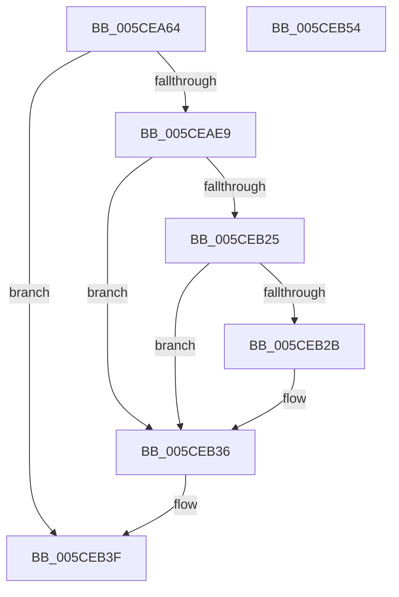

# PopReadShutdownPolicy

- RVA: `0x005CEA64`–`0x005CEB55` (길이 `241` bytes)
- VA: `0x00000001405CEA64`
- 실행 섹션: `.text`
- PDB 이름 있음: `예`; PDB Function 태그: `아니요`
- unwind 정보 RVA: `0x000CBE00`
- 디코드: `58`개 명령, `241/241` bytes 표시
- 미해석 바이트: `0` (있으면 어셈블리에 `.byte`로 보존)

> 이 문서는 커널 이미지의 기계어와 PDB 기호를 분석해 생성했습니다. 4번과 5번은 함수 원형과 자료형을 바이너리 사용 방식에서 추정한 C 해석이며 원본 소스 복구 결과는 아닙니다.

## 1. Dependencies

- 직접 호출 지점: **6**; 고유 호출 대상: **5**
- 직접 호출자로 확인된 함수: **1**
- RIP 상대 이미지 참조: **4**

### Outgoing calls
- `0x005CEAAB` → [RtlInitUnicodeString](../42/RtlInitUnicodeString_function_0042A780.md) (function, `0x0042A780`)
- `0x005CEAE0` → [ZwOpenKey](../6A/ZwOpenKey_function_006AD310.md) (function, `0x006AD310`)
- `0x005CEAF4` → [RtlInitUnicodeString](../42/RtlInitUnicodeString_function_0042A780.md) (function, `0x0042A780`)
- `0x005CEB1C` → [ZwQueryValueKey](../6A/ZwQueryValueKey_function_006AD3B0.md) (function, `0x006AD3B0`)
- `0x005CEB3A` → [ZwClose](../6A/ZwClose_function_006AD2B0.md) (function, `0x006AD2B0`)
- `0x005CEB46` → [_security_check_cookie](../6A/_security_check_cookie_function_006AC640.md) (function, `0x006AC640`)

### Direct callers
- [PopTransitionSystemPowerStateEx](../../pagelk/B7/PopTransitionSystemPowerStateEx_function_00B7E8C0.md) at `0x00B7E9D0`

### Static image references
- `0x005CEA72` → RVA `0x00E0A740` (`.data`; read)
- `0x005CEA82` → RVA `0x00029570` (`.rdata`; read)
- `0x005CEAE9` → RVA `0x00029530` (`.rdata`; read)
- `0x005CEB2F` → RVA `0x00F0C2E4` (`.data`; write)

## 2. Other-region calls and transfers

- 다른 실행 섹션으로 향하는 call: **0**
- 별도 외부 분기/꼬리 이동을 확인하지 못했습니다.

## 3. Assembly (complete function range)

```asm
005CEA64  40 55                           push rbp
005CEA66  48 8D 6C 24 A9                  lea rbp, [rsp - 0x57]
005CEA6B  48 81 EC A0 00 00 00            sub rsp, 0xa0
005CEA72  48 8B 05 C7 BC 83 00            mov rax, qword ptr [rip + 0x83bcc7]
005CEA79  48 33 C4                        xor rax, rsp
005CEA7C  48 89 45 4F                     mov qword ptr [rbp + 0x4f], rax
005CEA80  33 C0                           xor eax, eax
005CEA82  48 8D 15 E7 AA A5 FF            lea rdx, [rip - 0x5a5519]
005CEA89  21 45 23                        and dword ptr [rbp + 0x23], eax
005CEA8C  48 8D 4D F7                     lea rcx, [rbp - 9]
005CEA90  48 21 45 EF                     and qword ptr [rbp - 0x11], rax
005CEA94  0F 57 C0                        xorps xmm0, xmm0
005CEA97  21 45 E7                        and dword ptr [rbp - 0x19], eax
005CEA9A  89 45 0B                        mov dword ptr [rbp + 0xb], eax
005CEA9D  21 45 0B                        and dword ptr [rbp + 0xb], eax
005CEAA0  0F 11 45 F7                     movups xmmword ptr [rbp - 9], xmm0
005CEAA4  89 45 47                        mov dword ptr [rbp + 0x47], eax
005CEAA7  0F 11 45 37                     movups xmmword ptr [rbp + 0x37], xmm0
005CEAAB  E8 D0 BC E5 FF                  call 0x14042a780
005CEAB0  48 83 65 0F 00                  and qword ptr [rbp + 0xf], 0
005CEAB5  48 8D 45 F7                     lea rax, [rbp - 9]
005CEAB9  0F 57 C0                        xorps xmm0, xmm0
005CEABC  48 89 45 17                     mov qword ptr [rbp + 0x17], rax
005CEAC0  4C 8D 45 07                     lea r8, [rbp + 7]
005CEAC4  C7 45 07 30 00 00 00            mov dword ptr [rbp + 7], 0x30
005CEACB  BA 19 00 02 00                  mov edx, 0x20019
005CEAD0  C7 45 1F 40 02 00 00            mov dword ptr [rbp + 0x1f], 0x240
005CEAD7  48 8D 4D EF                     lea rcx, [rbp - 0x11]
005CEADB  F3 0F 7F 45 27                  movdqu xmmword ptr [rbp + 0x27], xmm0
005CEAE0  E8 2B E8 0D 00                  call 0x1406ad310
005CEAE5  85 C0                           test eax, eax
005CEAE7  78 56                           js 0x1405ceb3f
005CEAE9  48 8D 15 40 AA A5 FF            lea rdx, [rip - 0x5a55c0]
005CEAF0  48 8D 4D F7                     lea rcx, [rbp - 9]
005CEAF4  E8 87 BC E5 FF                  call 0x14042a780
005CEAF9  48 8B 4D EF                     mov rcx, qword ptr [rbp - 0x11]
005CEAFD  48 8D 45 E7                     lea rax, [rbp - 0x19]
005CEB01  48 89 44 24 28                  mov qword ptr [rsp + 0x28], rax
005CEB06  4C 8D 4D 37                     lea r9, [rbp + 0x37]
005CEB0A  41 B8 02 00 00 00               mov r8d, 2
005CEB10  C7 44 24 20 14 00 00 00         mov dword ptr [rsp + 0x20], 0x14
005CEB18  48 8D 55 F7                     lea rdx, [rbp - 9]
005CEB1C  E8 8F E8 0D 00                  call 0x1406ad3b0
005CEB21  85 C0                           test eax, eax
005CEB23  78 11                           js 0x1405ceb36
005CEB25  83 7D 3B 04                     cmp dword ptr [rbp + 0x3b], 4
005CEB29  75 0B                           jne 0x1405ceb36
005CEB2B  80 7D 43 01                     cmp byte ptr [rbp + 0x43], 1
005CEB2F  0F 94 05 AE D7 93 00            sete byte ptr [rip + 0x93d7ae]
005CEB36  48 8B 4D EF                     mov rcx, qword ptr [rbp - 0x11]
005CEB3A  E8 71 E7 0D 00                  call 0x1406ad2b0
005CEB3F  48 8B 4D 4F                     mov rcx, qword ptr [rbp + 0x4f]
005CEB43  48 33 CC                        xor rcx, rsp
005CEB46  E8 F5 DA 0D 00                  call 0x1406ac640
005CEB4B  48 81 C4 A0 00 00 00            add rsp, 0xa0
005CEB52  5D                              pop rbp
005CEB53  C3                              ret
005CEB54  CC                              int3
```

## 4. C-style interpretation (structured pseudocode)

```c
__int64 __fastcall PopReadShutdownPolicy(void)
{
    __int64 result;
    __int64 v_rsp;
    unsigned __int64 v_stack_m10;
    unsigned int v_stack_m18;
    unsigned __int8 v_stack_m1C;
    unsigned int v_stack_m24;
    unsigned __int64 v_stack_m28;
    unsigned __int64 v_stack_m38;
    unsigned int v_stack_m3C;
    unsigned int v_stack_m40;
    unsigned __int64 v_stack_m48;
    unsigned __int64 v_stack_m50;
    unsigned int v_stack_m54;
    unsigned __int64 v_stack_m58;
    unsigned __int64 v_stack_m5F;
    unsigned __int64 v_stack_m68;
    unsigned __int64 v_stack_m70;
    unsigned int v_stack_m78;
    unsigned __int64 v_stack_m80;
    unsigned int v_stack_m88;

    v_rsp = (v_rsp) - (160);
    result = (*(unsigned __int64 *)(v_rip + 8633543)) ^ (v_rsp);
    v_stack_m10 = result;
    result = 0;
    v_stack_m54 = 0;
    v_stack_m68 = v_xmm0;
    v_stack_m18 = 0;
    v_stack_m28 = v_xmm0;
    result = RtlInitUnicodeString(v_stack_m68, v_rip - 5920025, a3, a4);
    v_stack_m48 = v_stack_m68;
    v_stack_m58 = 48;
    v_stack_m40 = 576;
    v_stack_m38 = v_xmm0;
    result = ZwOpenKey(v_stack_m70, (unsigned int)(0x20019ULL), v_stack_m58, a4);
    if (sign_flag) goto loc_005CEB3F;
    result = RtlInitUnicodeString(v_stack_m68, v_rip - 5920192, v_stack_m58, a4);
    v_stack_m80 = v_stack_m78;
    v_stack_m88 = 20;
    result = ZwQueryValueKey(v_stack_m70, v_stack_m68, 2, v_stack_m28);
    if (sign_flag) goto loc_005CEB36;
    if (v_stack_m24 == 4) {
    }
    result = ZwClose(v_stack_m70, v_stack_m68, 2, v_stack_m28);
loc_005CEB3F:
    a1 = (v_stack_m10) ^ (v_rsp);
    result = _security_check_cookie(a1, v_stack_m68, 2, v_stack_m28);
    v_rsp = (v_rsp) + (160);
    return result;
}
```

## 5. (Beta) C Style

```c
void PopReadShutdownPolicy(void)
{
    int64_t result;
    int64_t local_rsp;
    uint64_t v_stack_m10;
    uint32_t v_stack_m18;
    uint8_t v_stack_m1C;
    uint32_t v_stack_m24;
    uint64_t v_stack_m28;
    uint64_t v_stack_m38;
    uint32_t v_stack_m3C;
    uint32_t v_stack_m40;
    uint64_t v_stack_m48;
    uint64_t v_stack_m50;
    uint32_t v_stack_m54;
    uint64_t v_stack_m58;
    uint64_t v_stack_m5F;
    uint64_t v_stack_m68;
    uint64_t v_stack_m70;
    uint32_t v_stack_m78;
    uint64_t v_stack_m80;
    uint32_t v_stack_m88;

    local_rsp = (local_rsp) - (160);
    result = (*(uint64_t *)(v_rip + 0x83BCC7)) ^ (local_rsp);
    v_stack_m10 = result;
    result = 0;
    v_stack_m54 = 0;
    v_stack_m68 = v_xmm0;
    v_stack_m18 = 0;
    v_stack_m28 = v_xmm0;
    result = RtlInitUnicodeString(v_stack_m68, v_rip - 5920025, a3, a4);
    v_stack_m48 = v_stack_m68;
    v_stack_m58 = 48;
    v_stack_m40 = 576;
    v_stack_m38 = v_xmm0;
    result = ZwOpenKey(v_stack_m70, (uint32_t)(0x20019ULL), v_stack_m58, a4);
    if (sign_flag) goto loc_005CEB3F;
    result = RtlInitUnicodeString(v_stack_m68, v_rip - 5920192, v_stack_m58, a4);
    v_stack_m80 = v_stack_m78;
    v_stack_m88 = 20;
    result = ZwQueryValueKey(v_stack_m70, v_stack_m68, 2, v_stack_m28);
    if (sign_flag) goto loc_005CEB36;
    if (v_stack_m24 == 4) {
    }
    result = ZwClose(v_stack_m70, v_stack_m68, 2, v_stack_m28);
loc_005CEB3F:
    a1 = (v_stack_m10) ^ (local_rsp);
    result = _security_check_cookie(a1, v_stack_m68, 2, v_stack_m28);
    local_rsp = (local_rsp) + (160);
    return result;
}
```

## 6. Execution-region graph

[열기: 2D/3D 그래프와 함수 탐색 컨트롤 패널](../../../control-panel.html?section=text&rva=0x005CEA64&view=graph)

- 2D 그래프는 위에서 아래로 흐르고, 3D 그래프는 빈 공간을 드래그해 회전합니다. Shift+드래그는 이동, 휠은 확대·축소, 함수 노드 선택은 대상 보고서 이동입니다.

### Static fallback


