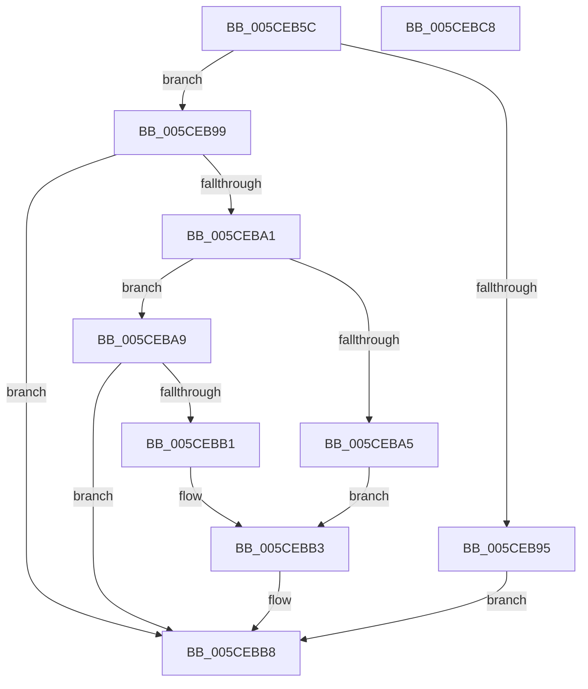

# PopReadUlongPowerKey

- RVA: `0x005CEB5C`–`0x005CEBC9` (길이 `109` bytes)
- VA: `0x00000001405CEB5C`
- 실행 섹션: `.text`
- PDB 이름 있음: `예`; PDB Function 태그: `아니요`
- unwind 정보 RVA: `0x000794E0`
- 디코드: `35`개 명령, `109/109` bytes 표시
- 미해석 바이트: `0` (있으면 어셈블리에 `.byte`로 보존)

> 이 문서는 커널 이미지의 기계어와 PDB 기호를 분석해 생성했습니다. 4번과 5번은 함수 원형과 자료형을 바이너리 사용 방식에서 추정한 C 해석이며 원본 소스 복구 결과는 아닙니다.

## 1. Dependencies

- 직접 호출 지점: **1**; 고유 호출 대상: **1**
- 직접 호출자로 확인된 함수: **2**
- RIP 상대 이미지 참조: **1**

### Outgoing calls
- `0x005CEB8C` → [PopReadRegKeyValue](../4B/PopReadRegKeyValue_function_004B5F64.md) (function, `0x004B5F64`)

### Direct callers
- [PopQueryHiberPersistedRegValue](../../page/75/PopQueryHiberPersistedRegValue_function_0075DDFC.md) at `0x0075DED9`
- [PopBatteryInitPhaseTwo](../../init/C4/PopBatteryInitPhaseTwo_function_00C42148.md) at `0x00C42177`
- [PopBatteryInitPhaseTwo](../../init/C4/PopBatteryInitPhaseTwo_function_00C42148.md) at `0x00C421B0`

### Static image references
- `0x005CEB85` → RVA `0x00029610` (`.rdata`; read)

## 2. Other-region calls and transfers

- 다른 실행 섹션으로 향하는 call: **0**
- 별도 외부 분기/꼬리 이동을 확인하지 못했습니다.

## 3. Assembly (complete function range)

```asm
005CEB5C  48 89 5C 24 08                  mov qword ptr [rsp + 8], rbx
005CEB61  48 89 74 24 10                  mov qword ptr [rsp + 0x10], rsi
005CEB66  57                              push rdi
005CEB67  48 83 EC 30                     sub rsp, 0x30
005CEB6B  41 8B F0                        mov esi, r8d
005CEB6E  48 89 54 24 20                  mov qword ptr [rsp + 0x20], rdx
005CEB73  41 B8 04 00 00 00               mov r8d, 4
005CEB79  48 8B DA                        mov rbx, rdx
005CEB7C  41 8B F9                        mov edi, r9d
005CEB7F  48 8B D1                        mov rdx, rcx
005CEB82  45 8B C8                        mov r9d, r8d
005CEB85  48 8D 0D 84 AA A5 FF            lea rcx, [rip - 0x5a557c]
005CEB8C  E8 D3 73 EE FF                  call 0x1404b5f64
005CEB91  85 C0                           test eax, eax
005CEB93  79 04                           jns 0x1405ceb99
005CEB95  89 33                           mov dword ptr [rbx], esi
005CEB97  EB 1F                           jmp 0x1405cebb8
005CEB99  8B 0B                           mov ecx, dword ptr [rbx]
005CEB9B  3B 4C 24 68                     cmp ecx, dword ptr [rsp + 0x68]
005CEB9F  74 17                           je 0x1405cebb8
005CEBA1  3B CF                           cmp ecx, edi
005CEBA3  73 04                           jae 0x1405ceba9
005CEBA5  89 3B                           mov dword ptr [rbx], edi
005CEBA7  EB 0A                           jmp 0x1405cebb3
005CEBA9  8B 54 24 60                     mov edx, dword ptr [rsp + 0x60]
005CEBAD  3B CA                           cmp ecx, edx
005CEBAF  76 07                           jbe 0x1405cebb8
005CEBB1  89 13                           mov dword ptr [rbx], edx
005CEBB3  B8 32 02 00 C0                  mov eax, 0xc0000232
005CEBB8  48 8B 5C 24 40                  mov rbx, qword ptr [rsp + 0x40]
005CEBBD  48 8B 74 24 48                  mov rsi, qword ptr [rsp + 0x48]
005CEBC2  48 83 C4 30                     add rsp, 0x30
005CEBC6  5F                              pop rdi
005CEBC7  C3                              ret
005CEBC8  CC                              int3
```

## 4. C-style interpretation (structured pseudocode)

```c
__int64 __fastcall PopReadUlongPowerKey(__int64 a1, __int64 a2, int a3, int a4, unsigned int a5, unsigned int a6)
{
    __int64 result;
    __int64 v_rsp;
    unsigned __int64 v_stack_m18;
    unsigned __int64 v_stack_p10;
    unsigned __int64 v_stack_p8;

    v_stack_p8 = v_rbx;
    v_stack_p10 = v_rsi;
    v_rsp = (v_rsp) - (48);
    v_stack_m18 = a2;
    result = PopReadRegKeyValue(v_rip - 5920124, a1, 4, 4);
    if (!sign_flag) goto loc_005CEB99;
    *(unsigned int *)(a2) = (unsigned int)((unsigned int)(a3));
    goto loc_005CEBB8;
loc_005CEB99:
    if (((unsigned int)((unsigned int)(*(unsigned int *)(a2)))) == a6) goto loc_005CEBB8;
    if (((unsigned int)((unsigned int)(*(unsigned int *)(a2)))) >= ((unsigned int)((unsigned int)(a4)))) goto loc_005CEBA9;
    *(unsigned int *)(a2) = (unsigned int)((unsigned int)(a4));
    goto loc_005CEBB3;
loc_005CEBA9:
    if (((unsigned int)((unsigned int)(*(unsigned int *)(a2)))) <= ((unsigned int)((unsigned int)(a5)))) goto loc_005CEBB8;
    *(unsigned int *)(a2) = (unsigned int)((unsigned int)(a5));
loc_005CEBB3:
loc_005CEBB8:
    v_rsp = (v_rsp) + (48);
    return (unsigned int)(0xC0000232ULL);
}
```

## 5. (Beta) C Style

```c
int64_t PopReadUlongPowerKey(int64_t Arg1, void *Arg2, int32_t Arg3, int32_t Arg4, uint32_t Arg5, uint32_t Arg6)
{
    uint8_t *arg2 = (uint8_t *)Arg2;

    int64_t result;
    int64_t local_rsp;
    uint64_t v_stack_m18;
    uint64_t v_stack_p10;
    uint64_t v_stack_p8;

    v_stack_p8 = local_rbx;
    v_stack_p10 = local_rsi;
    local_rsp = (local_rsp) - (48);
    v_stack_m18 = Arg2;
    result = PopReadRegKeyValue(v_rip - 5920124, Arg1, 4, 4);
    if (!sign_flag) goto loc_005CEB99;
    *(uint32_t *)(arg2) = (uint32_t)((uint32_t)(Arg3));
    goto loc_005CEBB8;
loc_005CEB99:
    if (((uint32_t)((uint32_t)(*(uint32_t *)(arg2)))) == Arg6) goto loc_005CEBB8;
    if (((uint32_t)((uint32_t)(*(uint32_t *)(arg2)))) >= ((uint32_t)((uint32_t)(Arg4)))) goto loc_005CEBA9;
    *(uint32_t *)(arg2) = (uint32_t)((uint32_t)(Arg4));
    goto loc_005CEBB3;
loc_005CEBA9:
    if (((uint32_t)((uint32_t)(*(uint32_t *)(arg2)))) <= ((uint32_t)((uint32_t)(Arg5)))) goto loc_005CEBB8;
    *(uint32_t *)(arg2) = (uint32_t)((uint32_t)(Arg5));
loc_005CEBB3:
loc_005CEBB8:
    local_rsp = (local_rsp) + (48);
    return (uint32_t)(0xC0000232ULL);
}
```

### 관측된 메모리 오프셋

구조체 형식이 확인되지 않은 접근은 인자 기준의 오프셋으로만 기록했습니다.

| 기준 인자 | 오프셋 표현 | 폭 (bit) | 접근 |
|---|---:|---:|---|
| `Arg2` | `+ 0x0` | `32` | `R` |
| `Arg2` | `+ 0x0` | `32` | `W` |

## 6. Execution-region graph

[열기: 2D/3D 그래프와 함수 탐색 컨트롤 패널](../../../control-panel.html?section=text&rva=0x005CEB5C&view=graph)

- 2D 그래프는 위에서 아래로 흐르고, 3D 그래프는 빈 공간을 드래그해 회전합니다. Shift+드래그는 이동, 휠은 확대·축소, 함수 노드 선택은 대상 보고서 이동입니다.

### Static fallback


