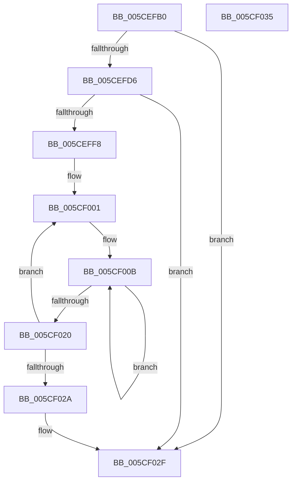

# PopRegisterEnergyEstimation

- RVA: `0x005CEFB0`–`0x005CF036` (길이 `134` bytes)
- VA: `0x00000001405CEFB0`
- 실행 섹션: `.text`
- PDB 이름 있음: `예`; PDB Function 태그: `아니요`
- unwind 정보 RVA: `0x0005CF00`
- 디코드: `38`개 명령, `134/134` bytes 표시
- 미해석 바이트: `0` (있으면 어셈블리에 `.byte`로 보존)

> 이 문서는 커널 이미지의 기계어와 PDB 기호를 분석해 생성했습니다. 4번과 5번은 함수 원형과 자료형을 바이너리 사용 방식에서 추정한 C 해석이며 원본 소스 복구 결과는 아닙니다.

## 1. Dependencies

- 직접 호출 지점: **2**; 고유 호출 대상: **2**
- 직접 호출자로 확인된 함수: **0**
- RIP 상대 이미지 참조: **4**

### Outgoing calls
- `0x005CEFE7` → [ExAllocatePool2](../../poolcode/B8/ExAllocatePool2_function_00B820F0.md) (function, `0x00B820F0`)
- `0x005CF02A` → [PopDetermineBucketFrequencies](PopDetermineBucketFrequencies_function_005CEBF8.md) (function, `0x005CEBF8`)

### Direct callers
- 이 함수 시작 RVA로 연결되는 직접 call은 확인되지 않았습니다. 간접 호출은 완전히 역산할 수 없습니다.

### Static image references
- `0x005CEFB9` → RVA `0x00F0EFD8` (`.data`; write)
- `0x005CEFC0` → RVA `0x00F0EFE0` (`.data`; write)
- `0x005CEFCC` → RVA `0x00F0EFE8` (`.data`; read)
- `0x005CEFEC` → RVA `0x00F0EFE8` (`.data`; write)

## 2. Other-region calls and transfers

- 다른 실행 섹션으로 향하는 call: **1**
  - `0x005CEFE7` → [ExAllocatePool2](../../poolcode/B8/ExAllocatePool2_function_00B820F0.md) (`.text` → `POOLCODE`)
- 별도 외부 분기/꼬리 이동을 확인하지 못했습니다.

## 3. Assembly (complete function range)

```asm
005CEFB0  40 53                           push rbx
005CEFB2  48 83 EC 20                     sub rsp, 0x20
005CEFB6  41 F6 D8                        neg r8b
005CEFB9  48 89 0D 18 00 94 00            mov qword ptr [rip + 0x940018], rcx
005CEFC0  48 89 15 19 00 94 00            mov qword ptr [rip + 0x940019], rdx
005CEFC7  1B DB                           sbb ebx, ebx
005CEFC9  83 C3 02                        add ebx, 2
005CEFCC  48 83 3D 14 00 94 00 00         cmp qword ptr [rip + 0x940014], 0
005CEFD4  75 59                           jne 0x1405cf02f
005CEFD6  6B D3 38                        imul edx, ebx, 0x38
005CEFD9  B9 40 00 00 00                  mov ecx, 0x40
005CEFDE  41 B8 50 50 4D 70               mov r8d, 0x704d5050
005CEFE4  83 C2 08                        add edx, 8
005CEFE7  E8 04 31 5B 00                  call 0x140b820f0
005CEFEC  48 89 05 F5 FF 93 00            mov qword ptr [rip + 0x93fff5], rax
005CEFF3  48 85 C0                        test rax, rax
005CEFF6  74 37                           je 0x1405cf02f
005CEFF8  89 18                           mov dword ptr [rax], ebx
005CEFFA  48 83 C0 30                     add rax, 0x30
005CEFFE  44 8B C3                        mov r8d, ebx
005CF001  45 33 C9                        xor r9d, r9d
005CF004  48 8B D0                        mov rdx, rax
005CF007  41 8D 49 19                     lea ecx, [r9 + 0x19]
005CF00B  89 4A F0                        mov dword ptr [rdx - 0x10], ecx
005CF00E  41 FF C1                        inc r9d
005CF011  83 C1 19                        add ecx, 0x19
005CF014  44 89 0A                        mov dword ptr [rdx], r9d
005CF017  48 8D 52 04                     lea rdx, [rdx + 4]
005CF01B  83 F9 7D                        cmp ecx, 0x7d
005CF01E  72 EB                           jb 0x1405cf00b
005CF020  48 83 C0 38                     add rax, 0x38
005CF024  49 83 E8 01                     sub r8, 1
005CF028  75 D7                           jne 0x1405cf001
005CF02A  E8 C9 FB FF FF                  call 0x1405cebf8
005CF02F  48 83 C4 20                     add rsp, 0x20
005CF033  5B                              pop rbx
005CF034  C3                              ret
005CF035  CC                              int3
```

## 4. C-style interpretation (structured pseudocode)

```c
__int64 __fastcall PopRegisterEnergyEstimation(__int64 a1, __int64 a2, unsigned __int8 a3, int a4)
{
    __int64 result;
    __int64 v_rbx;
    __int64 v_rsp;

    v_rsp = (v_rsp) - (32);
    a3 = (unsigned __int8)(-(a3));
    *(unsigned __int64 *)(v_rip + 9699352) = a1;
    *(unsigned __int64 *)(v_rip + 9699353) = a2;
    v_rbx = (unsigned int)((v_rbx) + (2));
    if ((*(unsigned __int64 *)(v_rip + 9699348)) != 0) goto loc_005CF02F;
    a2 = (unsigned int)((a2) * ((unsigned int)(v_rbx)));
    a2 = (unsigned int)((a2) + (8));
    result = ExAllocatePool2(64, a2, (unsigned int)(0x704D5050ULL), a4);
    *(unsigned __int64 *)(v_rip + 9699317) = result;
    if (result == 0) goto loc_005CF02F;
    *(unsigned int *)(result) = (unsigned int)(v_rbx);
    result = (result) + (48);
loc_005CF001:
    a4 = 0;
loc_005CF00B:
    *(unsigned int *)(result - 16) = (unsigned int)(a4 + 25);
    a4 = (unsigned int)((a4) + 1);
    a1 = (unsigned int)((a4 + 25) + (25));
    *(unsigned int *)(result) = a4;
    if (((unsigned int)(a1)) < 125) goto loc_005CF00B;
    result = (result) + (56);
    a3 = ((unsigned int)((unsigned int)(v_rbx))) - (1);
    if (condition_is_not_equal) goto loc_005CF001;
    result = PopDetermineBucketFrequencies(a1, result + 4, a3, a4);
loc_005CF02F:
    v_rsp = (v_rsp) + (32);
    return result;
}
```

## 5. (Beta) C Style

```c
int64_t PopRegisterEnergyEstimation(int64_t Arg1, int64_t Arg2, uint8_t Arg3, int32_t Arg4)
{
    int64_t result;
    int64_t local_rbx;
    int64_t local_rsp;

    local_rsp = (local_rsp) - (32);
    Arg3 = (uint8_t)(-(Arg3));
    *(uint64_t *)(v_rip + 0x940018) = Arg1;
    *(uint64_t *)(v_rip + 0x940019) = Arg2;
    local_rbx = (uint32_t)((local_rbx) + (2));
    if ((*(uint64_t *)(v_rip + 0x940014)) != 0) goto loc_005CF02F;
    Arg2 = (uint32_t)((Arg2) * ((uint32_t)(local_rbx)));
    Arg2 = (uint32_t)((Arg2) + (8));
    result = ExAllocatePool2(64, Arg2, (uint32_t)(0x704D5050ULL), Arg4);
    *(uint64_t *)(v_rip + 0x93FFF5) = result;
    if (result == 0) goto loc_005CF02F;
    *(uint32_t *)(result) = (uint32_t)(local_rbx);
    result = (result) + (48);
loc_005CF001:
    Arg4 = 0;
loc_005CF00B:
    *(uint32_t *)(result - 0x10) = (uint32_t)(Arg4 + 25);
    Arg4 = (uint32_t)((Arg4) + 1);
    Arg1 = (uint32_t)((Arg4 + 25) + (25));
    *(uint32_t *)(result) = Arg4;
    if (((uint32_t)(Arg1)) < 125) goto loc_005CF00B;
    result = (result) + (56);
    Arg3 = ((uint32_t)((uint32_t)(local_rbx))) - (1);
    if (condition_is_not_equal) goto loc_005CF001;
    result = PopDetermineBucketFrequencies(Arg1, result + 4, Arg3, Arg4);
loc_005CF02F:
    local_rsp = (local_rsp) + (32);
    return result;
}
```

## 6. Execution-region graph

[열기: 2D/3D 그래프와 함수 탐색 컨트롤 패널](../../../control-panel.html?section=text&rva=0x005CEFB0&view=graph)

- 2D 그래프는 위에서 아래로 흐르고, 3D 그래프는 빈 공간을 드래그해 회전합니다. Shift+드래그는 이동, 휠은 확대·축소, 함수 노드 선택은 대상 보고서 이동입니다.

### Static fallback


