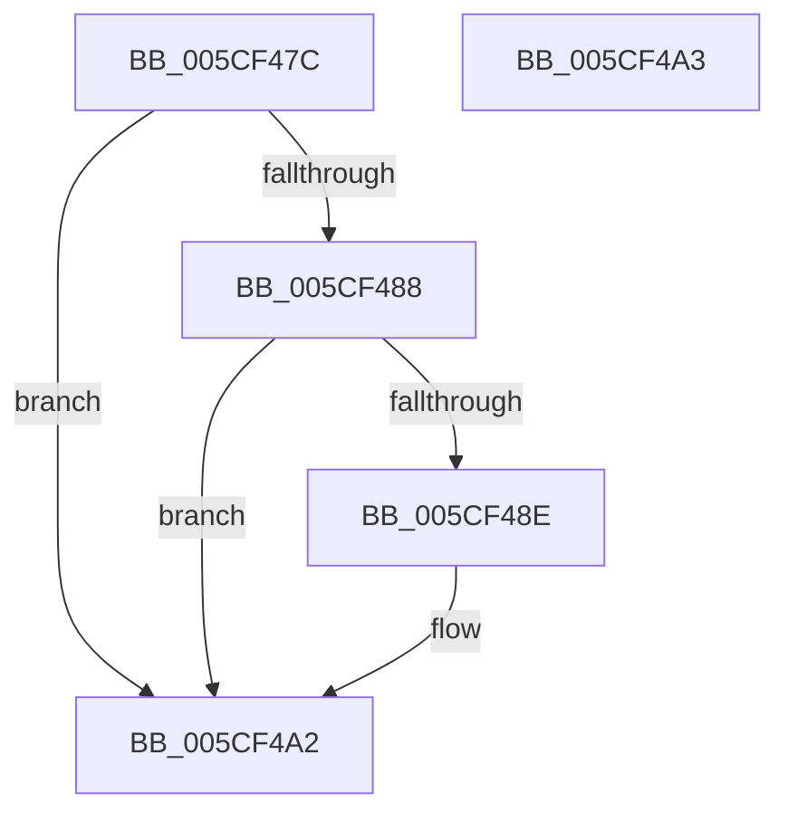

# PpmCancelExitLatencyTrace

- RVA: `0x005CF47C`–`0x005CF4A4` (길이 `40` bytes)
- VA: `0x00000001405CF47C`
- 실행 섹션: `.text`
- PDB 이름 있음: `예`; PDB Function 태그: `아니요`
- unwind 정보 RVA: `0x000DB714`
- 디코드: `13`개 명령, `40/40` bytes 표시
- 미해석 바이트: `0` (있으면 어셈블리에 `.byte`로 보존)

> 이 문서는 커널 이미지의 기계어와 PDB 기호를 분석해 생성했습니다. 4번과 5번은 함수 원형과 자료형을 바이너리 사용 방식에서 추정한 C 해석이며 원본 소스 복구 결과는 아닙니다.

## 1. Dependencies

- 직접 호출 지점: **0**; 고유 호출 대상: **0**
- 직접 호출자로 확인된 함수: **2**
- RIP 상대 이미지 참조: **1**

### Outgoing calls
- 직접 디코드된 call 명령이 없습니다.

### Direct callers
- [KdPowerTransitionEx](../4D/KdPowerTransitionEx_function_004D9150.md) at `0x004D923D`
- [sub_006DCEEE](../6D/Unknown_function_006DCEEE.md) at `0x006DD36C`

### Static image references
- `0x005CF48E` → RVA `0x00E67668` (`.data`; read)

## 2. Other-region calls and transfers

- 다른 실행 섹션으로 향하는 call: **0**
- 별도 외부 분기/꼬리 이동을 확인하지 못했습니다.

## 3. Assembly (complete function range)

```asm
005CF47C  48 8B 91 40 88 00 00            mov rdx, qword ptr [rcx + 0x8840]
005CF483  48 85 D2                        test rdx, rdx
005CF486  74 1A                           je 0x1405cf4a2
005CF488  80 7A 03 00                     cmp byte ptr [rdx + 3], 0
005CF48C  74 14                           je 0x1405cf4a2
005CF48E  8B 05 D4 81 89 00               mov eax, dword ptr [rip + 0x8981d4]
005CF494  33 C9                           xor ecx, ecx
005CF496  85 C0                           test eax, eax
005CF498  0F 95 C1                        setne cl
005CF49B  89 4A 14                        mov dword ptr [rdx + 0x14], ecx
005CF49E  C6 42 03 00                     mov byte ptr [rdx + 3], 0
005CF4A2  C3                              ret
005CF4A3  CC                              int3
```

## 4. C-style interpretation (structured pseudocode)

```c
__int64 __fastcall PpmCancelExitLatencyTrace(__int64 a1)
{
    __int64 result;

    if (*(unsigned __int64 *)(a1 + 34880) == 0) goto loc_005CF4A2;
    if ((*(unsigned __int8 *)(*(unsigned __int64 *)(a1 + 34880) + 3)) != 0) {
        result = *(unsigned int *)(v_rip + 9011668);
        a1 = 0;
        a1 = ((unsigned int)(result) != 0) ? 1 : 0;
        *(unsigned int *)(*(unsigned __int64 *)(a1 + 34880) + 20) = (unsigned int)(a1);
        *(unsigned __int8 *)(*(unsigned __int64 *)(a1 + 34880) + 3) = 0;
    }
    return result;
}
```

## 5. (Beta) C Style

```c
int64_t PpmCancelExitLatencyTrace(void *Arg1)
{
    uint8_t *arg1 = (uint8_t *)Arg1;

    int64_t result;

    if (*(uint64_t *)(arg1 + 0x8840) == 0) goto loc_005CF4A2;
    if ((*(uint8_t *)(*(uint64_t *)(arg1 + 0x8840) + 0x3)) != 0) {
        result = *(uint32_t *)(v_rip + 0x8981D4);
        Arg1 = 0;
        Arg1 = ((uint32_t)(result) != 0) ? 1 : 0;
        *(uint32_t *)(*(uint64_t *)(arg1 + 0x8840) + 0x14) = (uint32_t)(Arg1);
        *(uint8_t *)(*(uint64_t *)(arg1 + 0x8840) + 0x3) = 0;
    }
    return result;
}
```

### 관측된 메모리 오프셋

구조체 형식이 확인되지 않은 접근은 인자 기준의 오프셋으로만 기록했습니다.

| 기준 인자 | 오프셋 표현 | 폭 (bit) | 접근 |
|---|---:|---:|---|
| `Arg1` | `+ 0x8840` | `64` | `R` |

## 6. Execution-region graph

[열기: 2D/3D 그래프와 함수 탐색 컨트롤 패널](../../../control-panel.html?section=text&rva=0x005CF47C&view=graph)

- 2D 그래프는 위에서 아래로 흐르고, 3D 그래프는 빈 공간을 드래그해 회전합니다. Shift+드래그는 이동, 휠은 확대·축소, 함수 노드 선택은 대상 보고서 이동입니다.

### Static fallback


