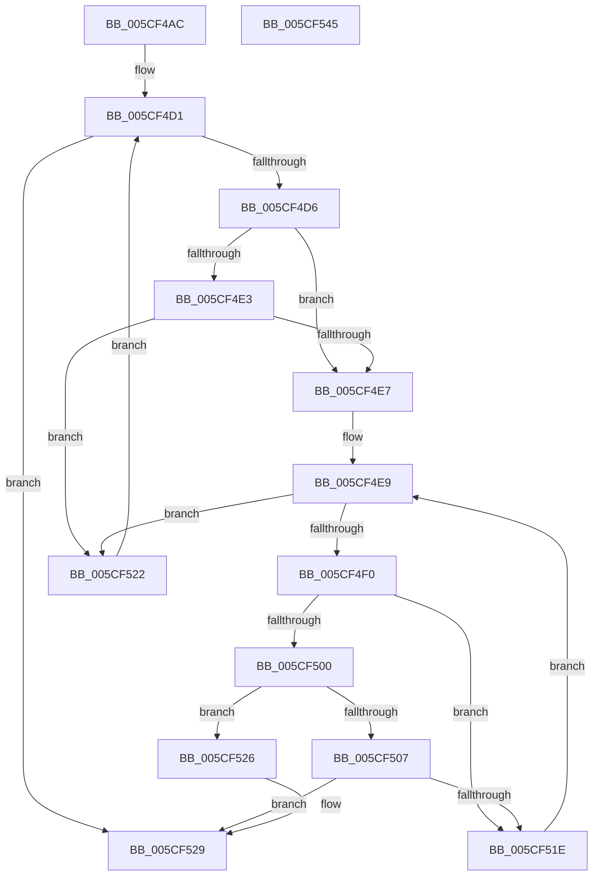

# PpmCheckCoordinatedStateInitiator

- RVA: `0x005CF4AC`–`0x005CF546` (길이 `154` bytes)
- VA: `0x00000001405CF4AC`
- 실행 섹션: `.text`
- PDB 이름 있음: `예`; PDB Function 태그: `아니요`
- unwind 정보 RVA: `0x00060300`
- 디코드: `51`개 명령, `154/154` bytes 표시
- 미해석 바이트: `0` (있으면 어셈블리에 `.byte`로 보존)

> 이 문서는 커널 이미지의 기계어와 PDB 기호를 분석해 생성했습니다. 4번과 5번은 함수 원형과 자료형을 바이너리 사용 방식에서 추정한 C 해석이며 원본 소스 복구 결과는 아닙니다.

## 1. Dependencies

- 직접 호출 지점: **1**; 고유 호출 대상: **1**
- 직접 호출자로 확인된 함수: **2**
- RIP 상대 이미지 참조: **0**

### Outgoing calls
- `0x005CF512` → [PpmCheckCoordinatedStateInitiator](PpmCheckCoordinatedStateInitiator_function_005CF4AC.md) (function, `0x005CF4AC`)

### Direct callers
- [PpmCheckCoordinatedStateInitiator](PpmCheckCoordinatedStateInitiator_function_005CF4AC.md) at `0x005CF512`
- [PpmInstallCoordinatedIdleStates](../../page/75/PpmInstallCoordinatedIdleStates_function_007552A0.md) at `0x0075583F`

### Static image references
- 디코드된 RIP-relative 메모리 참조가 없습니다.

## 2. Other-region calls and transfers

- 다른 실행 섹션으로 향하는 call: **0**
- 별도 외부 분기/꼬리 이동을 확인하지 못했습니다.

## 3. Assembly (complete function range)

```asm
005CF4AC  48 89 5C 24 08                  mov qword ptr [rsp + 8], rbx
005CF4B1  48 89 6C 24 10                  mov qword ptr [rsp + 0x10], rbp
005CF4B6  48 89 74 24 18                  mov qword ptr [rsp + 0x18], rsi
005CF4BB  57                              push rdi
005CF4BC  41 56                           push r14
005CF4BE  41 57                           push r15
005CF4C0  48 83 EC 20                     sub rsp, 0x20
005CF4C4  45 32 C9                        xor r9b, r9b
005CF4C7  4D 8B F0                        mov r14, r8
005CF4CA  33 DB                           xor ebx, ebx
005CF4CC  44 8B FA                        mov r15d, edx
005CF4CF  8B E9                           mov ebp, ecx
005CF4D1  41 3B DF                        cmp ebx, r15d
005CF4D4  73 53                           jae 0x1405cf529
005CF4D6  48 8D 34 5B                     lea rsi, [rbx + rbx*2]
005CF4DA  41 8B 04 F6                     mov eax, dword ptr [r14 + rsi*8]
005CF4DE  83 F8 FF                        cmp eax, -1
005CF4E1  74 04                           je 0x1405cf4e7
005CF4E3  3B C5                           cmp eax, ebp
005CF4E5  75 3B                           jne 0x1405cf522
005CF4E7  33 FF                           xor edi, edi
005CF4E9  41 3B 7C F6 08                  cmp edi, dword ptr [r14 + rsi*8 + 8]
005CF4EE  73 32                           jae 0x1405cf522
005CF4F0  49 8B 44 F6 10                  mov rax, qword ptr [r14 + rsi*8 + 0x10]
005CF4F5  48 8D 14 7F                     lea rdx, [rdi + rdi*2]
005CF4F9  80 7C D0 01 00                  cmp byte ptr [rax + rdx*8 + 1], 0
005CF4FE  74 1E                           je 0x1405cf51e
005CF500  41 83 3C F6 FF                  cmp dword ptr [r14 + rsi*8], -1
005CF505  75 1F                           jne 0x1405cf526
005CF507  4C 8B 44 D0 10                  mov r8, qword ptr [rax + rdx*8 + 0x10]
005CF50C  8B CD                           mov ecx, ebp
005CF50E  8B 54 D0 08                     mov edx, dword ptr [rax + rdx*8 + 8]
005CF512  E8 95 FF FF FF                  call 0x1405cf4ac
005CF517  44 8A C8                        mov r9b, al
005CF51A  84 C0                           test al, al
005CF51C  75 0B                           jne 0x1405cf529
005CF51E  FF C7                           inc edi
005CF520  EB C7                           jmp 0x1405cf4e9
005CF522  FF C3                           inc ebx
005CF524  EB AB                           jmp 0x1405cf4d1
005CF526  41 B1 01                        mov r9b, 1
005CF529  48 8B 5C 24 40                  mov rbx, qword ptr [rsp + 0x40]
005CF52E  41 8A C1                        mov al, r9b
005CF531  48 8B 6C 24 48                  mov rbp, qword ptr [rsp + 0x48]
005CF536  48 8B 74 24 50                  mov rsi, qword ptr [rsp + 0x50]
005CF53B  48 83 C4 20                     add rsp, 0x20
005CF53F  41 5F                           pop r15
005CF541  41 5E                           pop r14
005CF543  5F                              pop rdi
005CF544  C3                              ret
005CF545  CC                              int3
```

## 4. C-style interpretation (structured pseudocode)

```c
__int64 __fastcall PpmCheckCoordinatedStateInitiator(int a1, int a2, __int64 a3, unsigned __int8 a4)
{
    __int64 result;
    __int64 v_rbx;
    __int64 v_rdi;
    __int64 v_rsp;
    unsigned __int64 v_stack_p10;
    unsigned __int64 v_stack_p18;
    unsigned __int64 v_stack_p8;

    v_stack_p8 = v_rbx;
    v_stack_p10 = v_rbp;
    v_stack_p18 = v_rsi;
    v_rsp = (v_rsp) - (32);
    a4 = 0;
    v_rbx = 0;
loc_005CF4D1:
    if (0 >= ((unsigned int)((unsigned int)(a2)))) goto loc_005CF529;
    if (((unsigned int)((unsigned int)(*(unsigned int *)(a3 + v_rbx + v_rbx * 2 * 8)))) == -1) goto loc_005CF4E7;
    if (((unsigned int)((unsigned int)(*(unsigned int *)(a3 + v_rbx + v_rbx * 2 * 8)))) != ((unsigned int)((unsigned int)(a1)))) goto loc_005CF522;
loc_005CF4E7:
    v_rdi = 0;
loc_005CF4E9:
    if (0 >= (*(unsigned int *)(a3 + v_rbx + v_rbx * 2 * 8 + 8))) goto loc_005CF522;
    if ((*(unsigned __int8 *)(*(unsigned __int64 *)(a3 + v_rbx + v_rbx * 2 * 8 + 16) + v_rdi + v_rdi * 2 * 8 + 1)) == 0) goto loc_005CF51E;
    if ((*(unsigned int *)(a3 + v_rbx + v_rbx * 2 * 8)) != -1) goto loc_005CF526;
    result = PpmCheckCoordinatedStateInitiator((unsigned int)((unsigned int)((unsigned int)(a1))), (unsigned int)(*(unsigned int *)(*(unsigned __int64 *)(a3 + v_rbx + v_rbx * 2 * 8 + 16) + v_rdi + v_rdi * 2 * 8 + 8)), *(unsigned __int64 *)(*(unsigned __int64 *)(a3 + v_rbx + v_rbx * 2 * 8 + 16) + v_rdi + v_rdi * 2 * 8 + 16), a4);
    if ((unsigned __int8)(result) != 0) goto loc_005CF529;
loc_005CF51E:
    v_rdi = (unsigned int)((v_rdi) + 1);
    goto loc_005CF4E9;
loc_005CF522:
    v_rbx = (unsigned int)((v_rbx) + 1);
    goto loc_005CF4D1;
loc_005CF526:
loc_005CF529:
    v_rsp = (v_rsp) + (32);
    return 1;
}
```

## 5. (Beta) C Style

```c
int64_t PpmCheckCoordinatedStateInitiator(int32_t Arg1, int32_t Arg2, void *Arg3, uint8_t Arg4)
{
    uint8_t *arg3 = (uint8_t *)Arg3;

    int64_t result;
    int64_t local_rbx;
    int64_t local_rdi;
    int64_t local_rsp;
    uint64_t v_stack_p10;
    uint64_t v_stack_p18;
    uint64_t v_stack_p8;

    v_stack_p8 = local_rbx;
    v_stack_p10 = local_rbp;
    v_stack_p18 = local_rsi;
    local_rsp = (local_rsp) - (32);
    Arg4 = 0;
    local_rbx = 0;
loc_005CF4D1:
    if (0 >= ((uint32_t)((uint32_t)(Arg2)))) goto loc_005CF529;
    if (((uint32_t)((uint32_t)(*(uint32_t *)(arg3 + local_rbx + local_rbx * 2 * 8)))) == -1) goto loc_005CF4E7;
    if (((uint32_t)((uint32_t)(*(uint32_t *)(arg3 + local_rbx + local_rbx * 2 * 8)))) != ((uint32_t)((uint32_t)(Arg1)))) goto loc_005CF522;
loc_005CF4E7:
    local_rdi = 0;
loc_005CF4E9:
    if (0 >= (*(uint32_t *)(arg3 + local_rbx + local_rbx * 2 * 8 + 0x8))) goto loc_005CF522;
    if ((*(uint8_t *)(*(uint64_t *)(arg3 + local_rbx + local_rbx * 2 * 8 + 0x10) + local_rdi + local_rdi * 2 * 8 + 0x1)) == 0) goto loc_005CF51E;
    if ((*(uint32_t *)(arg3 + local_rbx + local_rbx * 2 * 8)) != -1) goto loc_005CF526;
    result = PpmCheckCoordinatedStateInitiator((uint32_t)((uint32_t)((uint32_t)(Arg1))), (uint32_t)(*(uint32_t *)(*(uint64_t *)(arg3 + local_rbx + local_rbx * 2 * 8 + 0x10) + local_rdi + local_rdi * 2 * 8 + 0x8)), *(uint64_t *)(*(uint64_t *)(arg3 + local_rbx + local_rbx * 2 * 8 + 0x10) + local_rdi + local_rdi * 2 * 8 + 0x10), Arg4);
    if ((uint8_t)(result) != 0) goto loc_005CF529;
loc_005CF51E:
    local_rdi = (uint32_t)((local_rdi) + 1);
    goto loc_005CF4E9;
loc_005CF522:
    local_rbx = (uint32_t)((local_rbx) + 1);
    goto loc_005CF4D1;
loc_005CF526:
loc_005CF529:
    local_rsp = (local_rsp) + (32);
    return 1;
}
```

### 관측된 메모리 오프셋

구조체 형식이 확인되지 않은 접근은 인자 기준의 오프셋으로만 기록했습니다.

| 기준 인자 | 오프셋 표현 | 폭 (bit) | 접근 |
|---|---:|---:|---|
| `Arg3` | `+ 0x0 + rsi*8` | `32` | `R` |
| `Arg3` | `+ 0x8 + rsi*8` | `32` | `R` |
| `Arg3` | `+ 0x10 + rsi*8` | `64` | `R` |

## 6. Execution-region graph

[열기: 2D/3D 그래프와 함수 탐색 컨트롤 패널](../../../control-panel.html?section=text&rva=0x005CF4AC&view=graph)

- 2D 그래프는 위에서 아래로 흐르고, 3D 그래프는 빈 공간을 드래그해 회전합니다. Shift+드래그는 이동, 휠은 확대·축소, 함수 노드 선택은 대상 보고서 이동입니다.

### Static fallback


