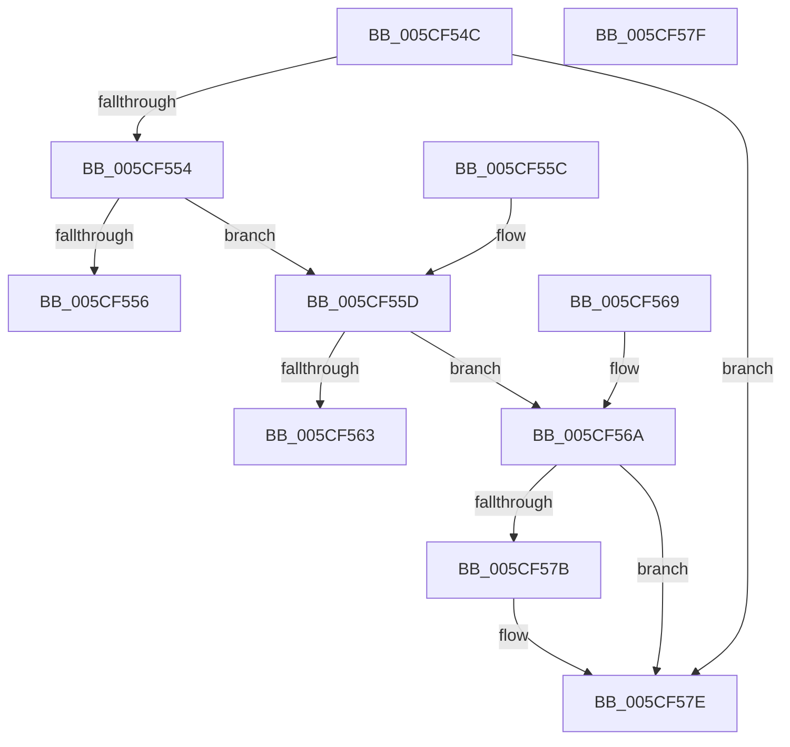

# PpmCheckIdleVeto

- RVA: `0x005CF54C`–`0x005CF580` (길이 `52` bytes)
- VA: `0x00000001405CF54C`
- 실행 섹션: `.text`
- PDB 이름 있음: `예`; PDB Function 태그: `아니요`
- unwind 정보 RVA: `0x000DB714`
- 디코드: `21`개 명령, `52/52` bytes 표시
- 미해석 바이트: `0` (있으면 어셈블리에 `.byte`로 보존)

> 이 문서는 커널 이미지의 기계어와 PDB 기호를 분석해 생성했습니다. 4번과 5번은 함수 원형과 자료형을 바이너리 사용 방식에서 추정한 C 해석이며 원본 소스 복구 결과는 아닙니다.

## 1. Dependencies

- 직접 호출 지점: **0**; 고유 호출 대상: **0**
- 직접 호출자로 확인된 함수: **2**
- RIP 상대 이미지 참조: **0**

### Outgoing calls
- 직접 디코드된 call 명령이 없습니다.

### Direct callers
- [PpmIdleCheckCoordinatedStateEligibility](PpmIdleCheckCoordinatedStateEligibility_function_005CFACC.md) at `0x005CFBF4`
- [PpmIdleCheckProcessorStateEligibility](PpmIdleCheckProcessorStateEligibility_function_005CFD54.md) at `0x005CFDEA`

### Static image references
- 디코드된 RIP-relative 메모리 참조가 없습니다.

## 2. Other-region calls and transfers

- 다른 실행 섹션으로 향하는 call: **0**
- 별도 외부 분기/꼬리 이동을 확인하지 못했습니다.

## 3. Assembly (complete function range)

```asm
005CF54C  8B 11                           mov edx, dword ptr [rcx]
005CF54E  33 C0                           xor eax, eax
005CF550  85 D2                           test edx, edx
005CF552  74 2A                           je 0x1405cf57e
005CF554  79 07                           jns 0x1405cf55d
005CF556  B8 0D 00 00 80                  mov eax, 0x8000000d
005CF55B  C3                              ret
005CF55C  CC                              int3
005CF55D  48 39 41 20                     cmp qword ptr [rcx + 0x20], rax
005CF561  75 07                           jne 0x1405cf56a
005CF563  B8 00 00 00 80                  mov eax, 0x80000000
005CF568  C3                              ret
005CF569  CC                              int3
005CF56A  48 8D 41 08                     lea rax, [rcx + 8]
005CF56E  48 8B 08                        mov rcx, qword ptr [rax]
005CF571  48 3B C8                        cmp rcx, rax
005CF574  B8 00 00 00 80                  mov eax, 0x80000000
005CF579  74 03                           je 0x1405cf57e
005CF57B  8B 41 10                        mov eax, dword ptr [rcx + 0x10]
005CF57E  C3                              ret
005CF57F  CC                              int3
```

## 4. C-style interpretation (structured pseudocode)

```c
__int64 __fastcall PpmCheckIdleVeto(__int64 a1)
{
    __int64 result;

    result = 0;
    if ((unsigned int)((unsigned int)(*(unsigned int *)(a1))) == 0) goto loc_005CF57E;
    if (!sign_flag) goto loc_005CF55D;
    return (unsigned int)(0x8000000DULL);
loc_005CF55D:
    if ((*(unsigned __int64 *)(a1 + 32)) != ((unsigned int)(0x8000000DULL))) goto loc_005CF56A;
    return (unsigned int)(0x80000000ULL);
loc_005CF56A:
    result = (unsigned int)(0x80000000ULL);
    if ((*(unsigned __int64 *)(a1 + 8)) != (a1 + 8)) {
        result = *(unsigned int *)(*(unsigned __int64 *)(a1 + 8) + 16);
    }
    return result;
}
```

## 5. (Beta) C Style

```c
int64_t PpmCheckIdleVeto(void *Arg1)
{
    uint8_t *arg1 = (uint8_t *)Arg1;

    int64_t result;

    result = 0;
    if ((uint32_t)((uint32_t)(*(uint32_t *)(arg1))) == 0) goto loc_005CF57E;
    if (!sign_flag) goto loc_005CF55D;
    return (uint32_t)(0x8000000DULL);
loc_005CF55D:
    if ((*(uint64_t *)(arg1 + 0x20)) != ((uint32_t)(0x8000000DULL))) goto loc_005CF56A;
    return (uint32_t)(0x80000000ULL);
loc_005CF56A:
    result = (uint32_t)(0x80000000ULL);
    if ((*(uint64_t *)(arg1 + 0x8)) != (Arg1 + 8)) {
        result = *(uint32_t *)(*(uint64_t *)(arg1 + 0x8) + 0x10);
    }
    return result;
}
```

### 관측된 메모리 오프셋

구조체 형식이 확인되지 않은 접근은 인자 기준의 오프셋으로만 기록했습니다.

| 기준 인자 | 오프셋 표현 | 폭 (bit) | 접근 |
|---|---:|---:|---|
| `Arg1` | `+ 0x0` | `32` | `R` |
| `Arg1` | `+ 0x0` | `64` | `R` |
| `Arg1` | `+ 0x8` | `64` | `R` |
| `Arg1` | `+ 0x20` | `64` | `R` |

## 6. Execution-region graph

[열기: 2D/3D 그래프와 함수 탐색 컨트롤 패널](../../../control-panel.html?section=text&rva=0x005CF54C&view=graph)

- 2D 그래프는 위에서 아래로 흐르고, 3D 그래프는 빈 공간을 드래그해 회전합니다. Shift+드래그는 이동, 휠은 확대·축소, 함수 노드 선택은 대상 보고서 이동입니다.

### Static fallback


