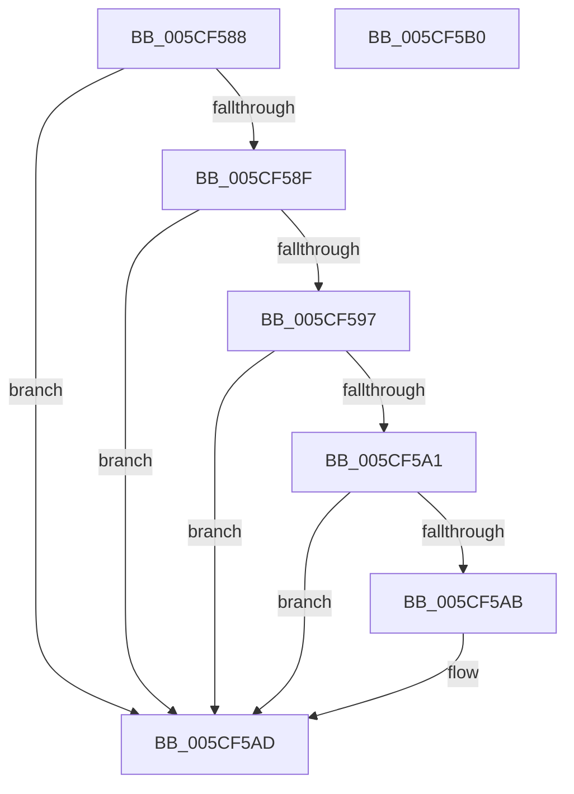

# PpmCheckPreConditionsForDeepSleep

- RVA: `0x005CF588`–`0x005CF5B1` (길이 `41` bytes)
- VA: `0x00000001405CF588`
- 실행 섹션: `.text`
- PDB 이름 있음: `예`; PDB Function 태그: `아니요`
- unwind 정보 RVA: `0x000DB714`
- 디코드: `15`개 명령, `41/41` bytes 표시
- 미해석 바이트: `0` (있으면 어셈블리에 `.byte`로 보존)

> 이 문서는 커널 이미지의 기계어와 PDB 기호를 분석해 생성했습니다. 4번과 5번은 함수 원형과 자료형을 바이너리 사용 방식에서 추정한 C 해석이며 원본 소스 복구 결과는 아닙니다.

## 1. Dependencies

- 직접 호출 지점: **0**; 고유 호출 대상: **0**
- 직접 호출자로 확인된 함수: **1**
- RIP 상대 이미지 참조: **3**

### Outgoing calls
- 직접 디코드된 call 명령이 없습니다.

### Direct callers
- [PpmIdleSelectStates](../2C/PpmIdleSelectStates_function_002CFFE8.md) at `0x002D029A`
- [PpmIdleSelectStates](../2C/PpmIdleSelectStates_function_002CFFE8.md) at `0x002D0614`

### Static image references
- `0x005CF58F` → RVA `0x00F092F2` (`.data`; read)
- `0x005CF597` → RVA `0x00F092F1` (`.data`; read)
- `0x005CF5A1` → RVA `0x00F09320` (`.data`; read)

## 2. Other-region calls and transfers

- 다른 실행 섹션으로 향하는 call: **0**
- 별도 외부 분기/꼬리 이동을 확인하지 못했습니다.

## 3. Assembly (complete function range)

```asm
005CF588  32 D2                           xor dl, dl
005CF58A  38 51 21                        cmp byte ptr [rcx + 0x21], dl
005CF58D  74 1E                           je 0x1405cf5ad
005CF58F  38 15 5D 9D 93 00               cmp byte ptr [rip + 0x939d5d], dl
005CF595  74 16                           je 0x1405cf5ad
005CF597  8A 05 54 9D 93 00               mov al, byte ptr [rip + 0x939d54]
005CF59D  84 C0                           test al, al
005CF59F  74 0C                           je 0x1405cf5ad
005CF5A1  8A 05 79 9D 93 00               mov al, byte ptr [rip + 0x939d79]
005CF5A7  84 C0                           test al, al
005CF5A9  75 02                           jne 0x1405cf5ad
005CF5AB  B2 01                           mov dl, 1
005CF5AD  8A C2                           mov al, dl
005CF5AF  C3                              ret
005CF5B0  CC                              int3
```

## 4. C-style interpretation (structured pseudocode)

```c
__int64 __fastcall PpmCheckPreConditionsForDeepSleep(__int64 a1, unsigned __int8 a2)
{
    a2 = 0;
    if ((*(unsigned __int8 *)(a1 + 33)) == 0) goto loc_005CF5AD;
    if ((*(unsigned __int8 *)(v_rip + 9674077)) == 0) goto loc_005CF5AD;
    if ((unsigned __int8)(*(unsigned __int8 *)(v_rip + 9674068)) == 0) goto loc_005CF5AD;
    if ((unsigned __int8)(*(unsigned __int8 *)(v_rip + 9674105)) == 0) {
        a2 = 1;
    }
    return a2;
}
```

## 5. (Beta) C Style

```c
int64_t PpmCheckPreConditionsForDeepSleep(void *Arg1, uint8_t Arg2)
{
    uint8_t *arg1 = (uint8_t *)Arg1;

    Arg2 = 0;
    if ((*(uint8_t *)(arg1 + 0x21)) == 0) goto loc_005CF5AD;
    if ((*(uint8_t *)(v_rip + 0x939D5D)) == 0) goto loc_005CF5AD;
    if ((uint8_t)(*(uint8_t *)(v_rip + 0x939D54)) == 0) goto loc_005CF5AD;
    if ((uint8_t)(*(uint8_t *)(v_rip + 0x939D79)) == 0) {
        Arg2 = 1;
    }
    return Arg2;
}
```

### 관측된 메모리 오프셋

구조체 형식이 확인되지 않은 접근은 인자 기준의 오프셋으로만 기록했습니다.

| 기준 인자 | 오프셋 표현 | 폭 (bit) | 접근 |
|---|---:|---:|---|
| `Arg1` | `+ 0x21` | `8` | `R` |

## 6. Execution-region graph

[열기: 2D/3D 그래프와 함수 탐색 컨트롤 패널](../../../control-panel.html?section=text&rva=0x005CF588&view=graph)

- 2D 그래프는 위에서 아래로 흐르고, 3D 그래프는 빈 공간을 드래그해 회전합니다. Shift+드래그는 이동, 휠은 확대·축소, 함수 노드 선택은 대상 보고서 이동입니다.

### Static fallback


