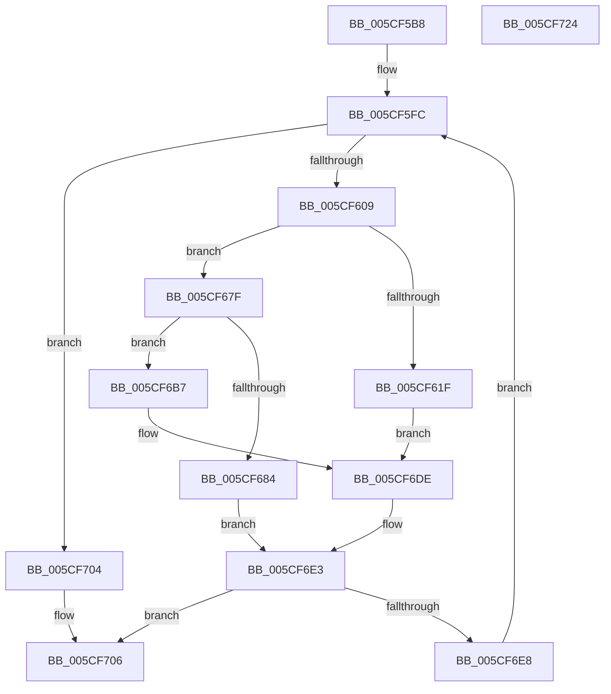

# PpmIdleCheckCoordinatedDependencies

- RVA: `0x005CF5B8`–`0x005CF725` (길이 `365` bytes)
- VA: `0x00000001405CF5B8`
- 실행 섹션: `.text`
- PDB 이름 있음: `예`; PDB Function 태그: `아니요`
- unwind 정보 RVA: `0x000CBF40`
- 디코드: `90`개 명령, `365/365` bytes 표시
- 미해석 바이트: `0` (있으면 어셈블리에 `.byte`로 보존)

> 이 문서는 커널 이미지의 기계어와 PDB 기호를 분석해 생성했습니다. 4번과 5번은 함수 원형과 자료형을 바이너리 사용 방식에서 추정한 C 해석이며 원본 소스 복구 결과는 아닙니다.

## 1. Dependencies

- 직접 호출 지점: **4**; 고유 호출 대상: **4**
- 직접 호출자로 확인된 함수: **2**
- RIP 상대 이미지 참조: **0**

### Outgoing calls
- `0x005CF678` → [PpmIdleCheckCoordinatedDependency](PpmIdleCheckCoordinatedDependency_function_005CF72C.md) (function, `0x005CF72C`)
- `0x005CF6B0` → [PpmIdleSelectCoordinatedProcessorDependency](../5D/PpmIdleSelectCoordinatedProcessorDependency_function_005D02E8.md) (function, `0x005D02E8`)
- `0x005CF6B9` → [KeGetPrcb](../2D/KeGetPrcb_function_002D85D0.md) (function, `0x002D85D0`)
- `0x005CF6D9` → [PpmIdleCheckCoordinatedProcessorDependency](PpmIdleCheckCoordinatedProcessorDependency_function_005CFA34.md) (function, `0x005CFA34`)

### Direct callers
- [PpmIdleCheckCoordinatedDependency](PpmIdleCheckCoordinatedDependency_function_005CF72C.md) at `0x005CF937`
- [PpmIdleCheckCoordinatedStateEligibility](PpmIdleCheckCoordinatedStateEligibility_function_005CFACC.md) at `0x005CFCAA`

### Static image references
- 디코드된 RIP-relative 메모리 참조가 없습니다.

## 2. Other-region calls and transfers

- 다른 실행 섹션으로 향하는 call: **0**
- 별도 외부 분기/꼬리 이동을 확인하지 못했습니다.

## 3. Assembly (complete function range)

```asm
005CF5B8  48 8B C4                        mov rax, rsp
005CF5BB  48 89 58 08                     mov qword ptr [rax + 8], rbx
005CF5BF  48 89 68 10                     mov qword ptr [rax + 0x10], rbp
005CF5C3  48 89 70 20                     mov qword ptr [rax + 0x20], rsi
005CF5C7  44 89 40 18                     mov dword ptr [rax + 0x18], r8d
005CF5CB  57                              push rdi
005CF5CC  41 54                           push r12
005CF5CE  41 55                           push r13
005CF5D0  41 56                           push r14
005CF5D2  41 57                           push r15
005CF5D4  48 83 EC 70                     sub rsp, 0x70
005CF5D8  4C 8B B4 24 F8 00 00 00         mov r14, qword ptr [rsp + 0xf8]
005CF5E0  45 8B F9                        mov r15d, r9d
005CF5E3  48 83 60 C8 00                  and qword ptr [rax - 0x38], 0
005CF5E8  44 8B EA                        mov r13d, edx
005CF5EB  4C 8B A4 24 D8 00 00 00         mov r12, qword ptr [rsp + 0xd8]
005CF5F3  48 8B E9                        mov rbp, rcx
005CF5F6  49 83 0E FF                     or qword ptr [r14], 0xffffffffffffffff
005CF5FA  33 FF                           xor edi, edi
005CF5FC  3B BC 24 D0 00 00 00            cmp edi, dword ptr [rsp + 0xd0]
005CF603  0F 83 FB 00 00 00               jae 0x1405cf704
005CF609  48 8D 0C 7F                     lea rcx, [rdi + rdi*2]
005CF60D  41 8B 04 CC                     mov eax, dword ptr [r12 + rcx*8]
005CF611  49 8D 74 24 08                  lea rsi, [r12 + 8]
005CF616  48 8D 34 CE                     lea rsi, [rsi + rcx*8]
005CF61A  83 F8 FF                        cmp eax, -1
005CF61D  75 60                           jne 0x1405cf67f
005CF61F  4C 8B 8C 24 C0 00 00 00         mov r9, qword ptr [rsp + 0xc0]
005CF627  48 8D 44 24 60                  lea rax, [rsp + 0x60]
005CF62C  48 89 44 24 50                  mov qword ptr [rsp + 0x50], rax
005CF631  41 8B D5                        mov edx, r13d
005CF634  48 8B 84 24 F0 00 00 00         mov rax, qword ptr [rsp + 0xf0]
005CF63C  48 8B CD                        mov rcx, rbp
005CF63F  48 89 44 24 48                  mov qword ptr [rsp + 0x48], rax
005CF644  48 8B 84 24 E8 00 00 00         mov rax, qword ptr [rsp + 0xe8]
005CF64C  48 89 44 24 40                  mov qword ptr [rsp + 0x40], rax
005CF651  48 8B 84 24 E0 00 00 00         mov rax, qword ptr [rsp + 0xe0]
005CF659  48 89 44 24 38                  mov qword ptr [rsp + 0x38], rax
005CF65E  48 8B 84 24 C8 00 00 00         mov rax, qword ptr [rsp + 0xc8]
005CF666  48 89 74 24 30                  mov qword ptr [rsp + 0x30], rsi
005CF66B  44 89 44 24 28                  mov dword ptr [rsp + 0x28], r8d
005CF670  45 8B C7                        mov r8d, r15d
005CF673  48 89 44 24 20                  mov qword ptr [rsp + 0x20], rax
005CF678  E8 AF 00 00 00                  call 0x1405cf72c
005CF67D  EB 5F                           jmp 0x1405cf6de
005CF67F  3B 45 24                        cmp eax, dword ptr [rbp + 0x24]
005CF682  75 33                           jne 0x1405cf6b7
005CF684  48 8B 84 24 E0 00 00 00         mov rax, qword ptr [rsp + 0xe0]
005CF68C  48 83 CB FF                     or rbx, 0xffffffffffffffff
005CF690  4C 8B 8C 24 C0 00 00 00         mov r9, qword ptr [rsp + 0xc0]
005CF698  45 8B C7                        mov r8d, r15d
005CF69B  48 89 44 24 28                  mov qword ptr [rsp + 0x28], rax
005CF6A0  41 8B D5                        mov edx, r13d
005CF6A3  48 8B CD                        mov rcx, rbp
005CF6A6  48 89 74 24 20                  mov qword ptr [rsp + 0x20], rsi
005CF6AB  48 89 5C 24 60                  mov qword ptr [rsp + 0x60], rbx
005CF6B0  E8 33 0C 00 00                  call 0x1405d02e8
005CF6B5  EB 2C                           jmp 0x1405cf6e3
005CF6B7  8B C8                           mov ecx, eax
005CF6B9  E8 12 8F D0 FF                  call 0x1402d85d0
005CF6BE  4C 8B 8C 24 F0 00 00 00         mov r9, qword ptr [rsp + 0xf0]
005CF6C6  48 8B C8                        mov rcx, rax
005CF6C9  48 8D 44 24 60                  lea rax, [rsp + 0x60]
005CF6CE  4C 8B C6                        mov r8, rsi
005CF6D1  41 8B D7                        mov edx, r15d
005CF6D4  48 89 44 24 20                  mov qword ptr [rsp + 0x20], rax
005CF6D9  E8 56 03 00 00                  call 0x1405cfa34
005CF6DE  48 8B 5C 24 60                  mov rbx, qword ptr [rsp + 0x60]
005CF6E3  48 85 C0                        test rax, rax
005CF6E6  75 1E                           jne 0x1405cf706
005CF6E8  49 8B 06                        mov rax, qword ptr [r14]
005CF6EB  44 8B 84 24 B0 00 00 00         mov r8d, dword ptr [rsp + 0xb0]
005CF6F3  48 3B C3                        cmp rax, rbx
005CF6F6  48 0F 42 D8                     cmovb rbx, rax
005CF6FA  FF C7                           inc edi
005CF6FC  49 89 1E                        mov qword ptr [r14], rbx
005CF6FF  E9 F8 FE FF FF                  jmp 0x1405cf5fc
005CF704  33 C0                           xor eax, eax
005CF706  4C 8D 5C 24 70                  lea r11, [rsp + 0x70]
005CF70B  49 8B 5B 30                     mov rbx, qword ptr [r11 + 0x30]
005CF70F  49 8B 6B 38                     mov rbp, qword ptr [r11 + 0x38]
005CF713  49 8B 73 48                     mov rsi, qword ptr [r11 + 0x48]
005CF717  49 8B E3                        mov rsp, r11
005CF71A  41 5F                           pop r15
005CF71C  41 5E                           pop r14
005CF71E  41 5D                           pop r13
005CF720  41 5C                           pop r12
005CF722  5F                              pop rdi
005CF723  C3                              ret
005CF724  CC                              int3
```

## 4. C-style interpretation (structured pseudocode)

```c
__int64 __fastcall PpmIdleCheckCoordinatedDependencies(__int64 a1, int a2, int a3, int a4, __int64 a5, __int64 a6, unsigned int a7, __int64 a8, __int64 a9, __int64 a10, __int64 a11, __int64 a12)
{
    __int64 result;
    __int64 v_rbx;
    __int64 v_rdi;
    __int64 v_rsp;
    unsigned __int64 v_stack_m28;
    unsigned __int64 v_stack_m38;
    unsigned __int64 v_stack_m48;
    unsigned __int64 v_stack_m50;
    unsigned __int64 v_stack_m58;
    unsigned __int64 v_stack_m60;
    unsigned __int64 v_stack_m68;
    unsigned int v_stack_m70;
    unsigned __int64 v_stack_m78;
    unsigned int v_stack_p18;

    *(unsigned __int64 *)(v_rsp + 8) = v_rbx;
    *(unsigned __int64 *)(v_rsp + 16) = v_rbp;
    *(unsigned __int64 *)(v_rsp + 32) = v_rsi;
    *(unsigned int *)(v_rsp + 24) = a3;
    v_rsp = (v_rsp) - (112);
    v_rdi = 0;
loc_005CF5FC:
    if (0 >= a7) goto loc_005CF704;
    if (((unsigned int)((unsigned int)(*(unsigned int *)(a8 + v_rdi + v_rdi * 2 * 8)))) != -1) goto loc_005CF67F;
    v_stack_m48 = v_stack_m38;
    v_stack_m50 = a11;
    v_stack_m58 = a10;
    v_stack_m60 = a9;
    v_stack_m68 = a8 + 8 + v_rdi + v_rdi * 2 * 8;
    v_stack_m70 = a3;
    v_stack_m78 = a6;
    result = PpmIdleCheckCoordinatedDependency(a1, (unsigned int)((unsigned int)((unsigned int)(a2))), (unsigned int)((unsigned int)((unsigned int)(a4))), a5);
    goto loc_005CF6DE;
loc_005CF67F:
    if (((unsigned int)(result)) != (*(unsigned int *)(a1 + 36))) goto loc_005CF6B7;
    v_rbx = (v_rbx) | (-1);
    v_stack_m70 = a9;
    v_stack_m78 = a8 + 8 + v_rdi + v_rdi * 2 * 8;
    v_stack_m38 = v_rbx;
    result = PpmIdleSelectCoordinatedProcessorDependency(a1, (unsigned int)((unsigned int)((unsigned int)(a2))), (unsigned int)((unsigned int)((unsigned int)(a4))), a5);
    goto loc_005CF6E3;
loc_005CF6B7:
    result = KeGetPrcb((unsigned int)((unsigned int)(result)), (unsigned int)((unsigned int)((unsigned int)(a2))), (unsigned int)((unsigned int)((unsigned int)(a4))), a5);
    v_stack_m78 = v_stack_m38;
    result = PpmIdleCheckCoordinatedProcessorDependency(result, (unsigned int)((unsigned int)((unsigned int)(a4))), a8 + 8 + v_rdi + v_rdi * 2 * 8, a11);
loc_005CF6DE:
loc_005CF6E3:
    if (result != 0) goto loc_005CF706;
    v_rbx = v_stack_m38;
    if ((*(unsigned __int64 *)(a12)) < v_stack_m38) { v_rbx = *(unsigned __int64 *)(a12); }
    v_rdi = (unsigned int)((v_rdi) + 1);
    *(unsigned __int64 *)(a12) = v_rbx;
    goto loc_005CF5FC;
loc_005CF704:
    result = 0;
loc_005CF706:
    return result;
}
```

## 5. (Beta) C Style

```c
int64_t PpmIdleCheckCoordinatedDependencies(void *Arg1, int32_t Arg2, int32_t Arg3, int32_t Arg4, int64_t Arg5, int64_t Arg6, uint32_t Arg7, void *Arg8, int64_t Arg9, int64_t Arg10, int64_t Arg11, void *Arg12)
{
    uint8_t *arg1 = (uint8_t *)Arg1;
    uint8_t *arg8 = (uint8_t *)Arg8;
    uint8_t *arg12 = (uint8_t *)Arg12;

    int64_t result;
    int64_t local_rbx;
    int64_t local_rdi;
    int64_t local_rsp;
    uint64_t v_stack_m28;
    uint64_t v_stack_m38;
    uint64_t v_stack_m48;
    uint64_t v_stack_m50;
    uint64_t v_stack_m58;
    uint64_t v_stack_m60;
    uint64_t v_stack_m68;
    uint32_t v_stack_m70;
    uint64_t v_stack_m78;
    uint32_t v_stack_p18;

    *(uint64_t *)(local_rsp + 0x8) = local_rbx;
    *(uint64_t *)(local_rsp + 0x10) = local_rbp;
    *(uint64_t *)(local_rsp + 0x20) = local_rsi;
    *(uint32_t *)(local_rsp + 0x18) = Arg3;
    local_rsp = (local_rsp) - (112);
    local_rdi = 0;
loc_005CF5FC:
    if (0 >= Arg7) goto loc_005CF704;
    if (((uint32_t)((uint32_t)(*(uint32_t *)(arg8 + local_rdi + local_rdi * 2 * 8)))) != -1) goto loc_005CF67F;
    v_stack_m48 = v_stack_m38;
    v_stack_m50 = Arg11;
    v_stack_m58 = Arg10;
    v_stack_m60 = Arg9;
    v_stack_m68 = Arg8 + 8 + local_rdi + local_rdi * 2 * 8;
    v_stack_m70 = Arg3;
    v_stack_m78 = Arg6;
    result = PpmIdleCheckCoordinatedDependency(Arg1, (uint32_t)((uint32_t)((uint32_t)(Arg2))), (uint32_t)((uint32_t)((uint32_t)(Arg4))), Arg5);
    goto loc_005CF6DE;
loc_005CF67F:
    if (((uint32_t)(result)) != (*(uint32_t *)(arg1 + 0x24))) goto loc_005CF6B7;
    local_rbx = (local_rbx) | (-1);
    v_stack_m70 = Arg9;
    v_stack_m78 = Arg8 + 8 + local_rdi + local_rdi * 2 * 8;
    v_stack_m38 = local_rbx;
    result = PpmIdleSelectCoordinatedProcessorDependency(Arg1, (uint32_t)((uint32_t)((uint32_t)(Arg2))), (uint32_t)((uint32_t)((uint32_t)(Arg4))), Arg5);
    goto loc_005CF6E3;
loc_005CF6B7:
    result = KeGetPrcb((uint32_t)((uint32_t)(result)), (uint32_t)((uint32_t)((uint32_t)(Arg2))), (uint32_t)((uint32_t)((uint32_t)(Arg4))), Arg5);
    v_stack_m78 = v_stack_m38;
    result = PpmIdleCheckCoordinatedProcessorDependency(result, (uint32_t)((uint32_t)((uint32_t)(Arg4))), Arg8 + 8 + local_rdi + local_rdi * 2 * 8, Arg11);
loc_005CF6DE:
loc_005CF6E3:
    if (result != 0) goto loc_005CF706;
    local_rbx = v_stack_m38;
    if ((*(uint64_t *)(arg12)) < v_stack_m38) { local_rbx = *(uint64_t *)(arg12); }
    local_rdi = (uint32_t)((local_rdi) + 1);
    *(uint64_t *)(arg12) = local_rbx;
    goto loc_005CF5FC;
loc_005CF704:
    result = 0;
loc_005CF706:
    return result;
}
```

### 관측된 메모리 오프셋

구조체 형식이 확인되지 않은 접근은 인자 기준의 오프셋으로만 기록했습니다.

| 기준 인자 | 오프셋 표현 | 폭 (bit) | 접근 |
|---|---:|---:|---|
| `Arg1` | `+ 0x24` | `32` | `R` |
| `Arg8` | `+ 0x0 + rcx*8` | `32` | `R` |
| `Arg8` | `+ 0x0 + rcx*8` | `64` | `R` |
| `Arg8` | `+ 0x8` | `64` | `R` |
| `Arg12` | `+ 0x0` | `64` | `R` |
| `Arg12` | `+ 0x0` | `64` | `R/W` |
| `Arg12` | `+ 0x0` | `64` | `W` |

## 6. Execution-region graph

[열기: 2D/3D 그래프와 함수 탐색 컨트롤 패널](../../../control-panel.html?section=text&rva=0x005CF5B8&view=graph)

- 2D 그래프는 위에서 아래로 흐르고, 3D 그래프는 빈 공간을 드래그해 회전합니다. Shift+드래그는 이동, 휠은 확대·축소, 함수 노드 선택은 대상 보고서 이동입니다.

### Static fallback


