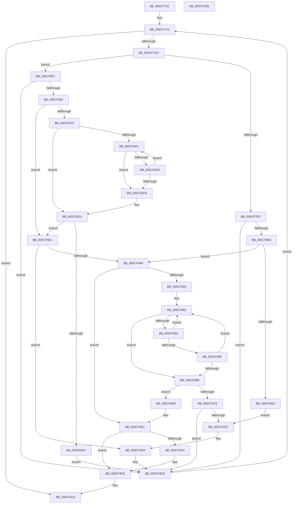

# PpmIdleCheckCoordinatedDependency

- RVA: `0x005CF72C`–`0x005CFA2E` (길이 `770` bytes)
- VA: `0x00000001405CF72C`
- 실행 섹션: `.text`
- PDB 이름 있음: `예`; PDB Function 태그: `아니요`
- unwind 정보 RVA: `0x000CBF24`
- 디코드: `203`개 명령, `770/770` bytes 표시
- 미해석 바이트: `0` (있으면 어셈블리에 `.byte`로 보존)

> 이 문서는 커널 이미지의 기계어와 PDB 기호를 분석해 생성했습니다. 4번과 5번은 함수 원형과 자료형을 바이너리 사용 방식에서 추정한 C 해석이며 원본 소스 복구 결과는 아닙니다.

## 1. Dependencies

- 직접 호출 지점: **8**; 고유 호출 대상: **8**
- 직접 호출자로 확인된 함수: **1**
- RIP 상대 이미지 참조: **2**

### Outgoing calls
- `0x005CF7A4` → [KeCheckProcessorAffinityEx](../30/KeCheckProcessorAffinityEx_function_00305150.md) (function, `0x00305150`)
- `0x005CF83E` → [PpmIdleCheckCoordinatedStateEligibility](PpmIdleCheckCoordinatedStateEligibility_function_005CFACC.md) (function, `0x005CFACC`)
- `0x005CF8AE` → [PpmIdleTransitionStall](../5D/PpmIdleTransitionStall_function_005D039C.md) (function, `0x005D039C`)
- `0x005CF937` → [PpmIdleCheckCoordinatedDependencies](PpmIdleCheckCoordinatedDependencies_function_005CF5B8.md) (function, `0x005CF5B8`)
- `0x005CF989` → [KeEnumerateNextProcessor](../41/KeEnumerateNextProcessor_function_00415480.md) (function, `0x00415480`)
- `0x005CF995` → [KeGetPrcb](../2D/KeGetPrcb_function_002D85D0.md) (function, `0x002D85D0`)
- `0x005CF9A8` → [PpmTestAndLockProcessor](../5D/PpmTestAndLockProcessor_function_005D08B4.md) (function, `0x005D08B4`)
- `0x005CF9D5` → [PpmIdleRollbackCoordinatedSelection](../5D/PpmIdleRollbackCoordinatedSelection_function_005D02A4.md) (function, `0x005D02A4`)

### Direct callers
- [PpmIdleCheckCoordinatedDependencies](PpmIdleCheckCoordinatedDependencies_function_005CF5B8.md) at `0x005CF678`

### Static image references
- `0x005CF792` → RVA `0x00FC6AD0` (`ALMOSTRO`; read)
- `0x005CF873` → RVA `0x00FC6EC8` (`ALMOSTRO`; read)

## 2. Other-region calls and transfers

- 다른 실행 섹션으로 향하는 call: **0**
- 별도 외부 분기/꼬리 이동을 확인하지 못했습니다.

## 3. Assembly (complete function range)

```asm
005CF72C  48 8B C4                        mov rax, rsp
005CF72F  4C 89 48 20                     mov qword ptr [rax + 0x20], r9
005CF733  44 89 40 18                     mov dword ptr [rax + 0x18], r8d
005CF737  89 50 10                        mov dword ptr [rax + 0x10], edx
005CF73A  48 89 48 08                     mov qword ptr [rax + 8], rcx
005CF73E  55                              push rbp
005CF73F  53                              push rbx
005CF740  56                              push rsi
005CF741  57                              push rdi
005CF742  41 54                           push r12
005CF744  41 55                           push r13
005CF746  41 56                           push r14
005CF748  41 57                           push r15
005CF74A  48 8D 68 B9                     lea rbp, [rax - 0x47]
005CF74E  48 81 EC C8 00 00 00            sub rsp, 0xc8
005CF755  83 4D A7 FF                     or dword ptr [rbp - 0x59], 0xffffffff
005CF759  4C 8B C1                        mov r8, rcx
005CF75C  48 8B 75 7F                     mov rsi, qword ptr [rbp + 0x7f]
005CF760  33 C9                           xor ecx, ecx
005CF762  48 89 4D B7                     mov qword ptr [rbp - 0x49], rcx
005CF766  33 C0                           xor eax, eax
005CF768  89 4D AB                        mov dword ptr [rbp - 0x55], ecx
005CF76B  0F 57 C0                        xorps xmm0, xmm0
005CF76E  89 4D A3                        mov dword ptr [rbp - 0x5d], ecx
005CF771  48 89 45 CF                     mov qword ptr [rbp - 0x31], rax
005CF775  48 8B 85 9F 00 00 00            mov rax, qword ptr [rbp + 0x9f]
005CF77C  0F 11 45 BF                     movups xmmword ptr [rbp - 0x41], xmm0
005CF780  48 83 08 FF                     or qword ptr [rax], 0xffffffffffffffff
005CF784  48 8B 46 08                     mov rax, qword ptr [rsi + 8]
005CF788  8B 48 04                        mov ecx, dword ptr [rax + 4]
005CF78B  48 69 D1 C0 01 00 00            imul rdx, rcx, 0x1c0
005CF792  48 8B 0D 37 73 9F 00            mov rcx, qword ptr [rip + 0x9f7337]
005CF799  48 83 E9 80                     sub rcx, -0x80
005CF79D  48 03 CA                        add rcx, rdx
005CF7A0  41 8B 50 24                     mov edx, dword ptr [r8 + 0x24]
005CF7A4  E8 A7 59 D3 FF                  call 0x140305150
005CF7A9  4C 8B AD 8F 00 00 00            mov r13, qword ptr [rbp + 0x8f]
005CF7B0  45 33 C0                        xor r8d, r8d
005CF7B3  45 8B E0                        mov r12d, r8d
005CF7B6  89 45 9F                        mov dword ptr [rbp - 0x61], eax
005CF7B9  8B D0                           mov edx, eax
005CF7BB  BB 01 00 00 80                  mov ebx, 0x80000001
005CF7C0  44 89 65 AF                     mov dword ptr [rbp - 0x51], r12d
005CF7C4  44 3B 26                        cmp r12d, dword ptr [rsi]
005CF7C7  0F 83 49 02 00 00               jae 0x1405cfa16
005CF7CD  48 8B 76 08                     mov rsi, qword ptr [rsi + 8]
005CF7D1  4C 8B 3D F8 72 9F 00            mov r15, qword ptr [rip + 0x9f72f8]
005CF7D8  41 8B C4                        mov eax, r12d
005CF7DB  48 8D 3C 40                     lea rdi, [rax + rax*2]
005CF7DF  8B 4C FE 04                     mov ecx, dword ptr [rsi + rdi*8 + 4]
005CF7E3  4C 69 F1 C0 01 00 00            imul r14, rcx, 0x1c0
005CF7EA  84 D2                           test dl, dl
005CF7EC  74 69                           je 0x1405cf857
005CF7EE  41 8B 45 04                     mov eax, dword ptr [r13 + 4]
005CF7F2  89 45 A3                        mov dword ptr [rbp - 0x5d], eax
005CF7F5  44 38 44 FE 01                  cmp byte ptr [rsi + rdi*8 + 1], r8b
005CF7FA  0F 84 DD 01 00 00               je 0x1405cf9dd
005CF800  4C 8B 4D 67                     mov r9, qword ptr [rbp + 0x67]
005CF804  48 8D 45 B7                     lea rax, [rbp - 0x49]
005CF808  44 8B 45 5F                     mov r8d, dword ptr [rbp + 0x5f]
005CF80C  8B 55 57                        mov edx, dword ptr [rbp + 0x57]
005CF80F  83 4D A7 FF                     or dword ptr [rbp - 0x59], 0xffffffff
005CF813  48 89 44 24 48                  mov qword ptr [rsp + 0x48], rax
005CF818  48 8D 45 A7                     lea rax, [rbp - 0x59]
005CF81C  4C 89 6C 24 40                  mov qword ptr [rsp + 0x40], r13
005CF821  48 89 44 24 38                  mov qword ptr [rsp + 0x38], rax
005CF826  8B 45 77                        mov eax, dword ptr [rbp + 0x77]
005CF829  89 44 24 30                     mov dword ptr [rsp + 0x30], eax
005CF82D  48 8B 45 6F                     mov rax, qword ptr [rbp + 0x6f]
005CF831  89 4C 24 28                     mov dword ptr [rsp + 0x28], ecx
005CF835  48 8B 4D 4F                     mov rcx, qword ptr [rbp + 0x4f]
005CF839  48 89 44 24 20                  mov qword ptr [rsp + 0x20], rax
005CF83E  E8 89 02 00 00                  call 0x1405cfacc
005CF843  45 33 C0                        xor r8d, r8d
005CF846  48 8B D8                        mov rbx, rax
005CF849  48 85 C0                        test rax, rax
005CF84C  0F 84 F9 00 00 00               je 0x1405cf94b
005CF852  E9 78 01 00 00                  jmp 0x1405cf9cf
005CF857  44 38 44 FE 02                  cmp byte ptr [rsi + rdi*8 + 2], r8b
005CF85C  0F 84 7B 01 00 00               je 0x1405cf9dd
005CF862  43 8B 84 3E A0 01 00 00         mov eax, dword ptr [r14 + r15 + 0x1a0]
005CF86A  8B 5D 77                        mov ebx, dword ptr [rbp + 0x77]
005CF86D  0F BA E0 1A                     bt eax, 0x1a
005CF871  72 6E                           jb 0x1405cf8e1
005CF873  48 8B 0D 4E 76 9F 00            mov rcx, qword ptr [rip + 0x9f764e]
005CF87A  0F 57 C0                        xorps xmm0, xmm0
005CF87D  0F 11 45 E7                     movups xmmword ptr [rbp - 0x19], xmm0
005CF881  C6 45 F3 01                     mov byte ptr [rbp - 0xd], 1
005CF885  0F 11 45 D7                     movups xmmword ptr [rbp - 0x29], xmm0
005CF889  48 89 4D DF                     mov qword ptr [rbp - 0x21], rcx
005CF88D  8B C8                           mov ecx, eax
005CF88F  81 E1 00 00 00 03               and ecx, 0x3000000
005CF895  4C 89 45 E7                     mov qword ptr [rbp - 0x19], r8
005CF899  81 F9 00 00 00 01               cmp ecx, 0x1000000
005CF89F  75 30                           jne 0x1405cf8d1
005CF8A1  8B C8                           mov ecx, eax
005CF8A3  C1 E9 1B                        shr ecx, 0x1b
005CF8A6  3B CB                           cmp ecx, ebx
005CF8A8  77 21                           ja 0x1405cf8cb
005CF8AA  48 8D 4D D7                     lea rcx, [rbp - 0x29]
005CF8AE  E8 E9 0A 00 00                  call 0x1405d039c
005CF8B3  43 8B 84 3E A0 01 00 00         mov eax, dword ptr [r14 + r15 + 0x1a0]
005CF8BB  8B C8                           mov ecx, eax
005CF8BD  81 E1 00 00 00 03               and ecx, 0x3000000
005CF8C3  81 F9 00 00 00 01               cmp ecx, 0x1000000
005CF8C9  74 D6                           je 0x1405cf8a1
005CF8CB  8B 55 9F                        mov edx, dword ptr [rbp - 0x61]
005CF8CE  45 33 C0                        xor r8d, r8d
005CF8D1  0F BA E0 1A                     bt eax, 0x1a
005CF8D5  72 0A                           jb 0x1405cf8e1
005CF8D7  BB 0B 00 00 80                  mov ebx, 0x8000000b
005CF8DC  E9 FC 00 00 00                  jmp 0x1405cf9dd
005CF8E1  44 8B 4D 5F                     mov r9d, dword ptr [rbp + 0x5f]
005CF8E5  48 8D 45 B7                     lea rax, [rbp - 0x49]
005CF8E9  47 03 4C 3E 48                  add r9d, dword ptr [r14 + r15 + 0x48]
005CF8EE  8B 55 57                        mov edx, dword ptr [rbp + 0x57]
005CF8F1  48 8B 4D 4F                     mov rcx, qword ptr [rbp + 0x4f]
005CF8F5  48 89 44 24 58                  mov qword ptr [rsp + 0x58], rax
005CF8FA  48 8B 85 97 00 00 00            mov rax, qword ptr [rbp + 0x97]
005CF901  48 89 44 24 50                  mov qword ptr [rsp + 0x50], rax
005CF906  48 8B 44 FE 10                  mov rax, qword ptr [rsi + rdi*8 + 0x10]
005CF90B  4C 89 44 24 48                  mov qword ptr [rsp + 0x48], r8
005CF910  4C 89 44 24 40                  mov qword ptr [rsp + 0x40], r8
005CF915  44 8B C3                        mov r8d, ebx
005CF918  48 89 44 24 38                  mov qword ptr [rsp + 0x38], rax
005CF91D  8B 44 FE 08                     mov eax, dword ptr [rsi + rdi*8 + 8]
005CF921  89 44 24 30                     mov dword ptr [rsp + 0x30], eax
005CF925  48 8B 45 6F                     mov rax, qword ptr [rbp + 0x6f]
005CF929  48 89 44 24 28                  mov qword ptr [rsp + 0x28], rax
005CF92E  48 8B 45 67                     mov rax, qword ptr [rbp + 0x67]
005CF932  48 89 44 24 20                  mov qword ptr [rsp + 0x20], rax
005CF937  E8 7C FC FF FF                  call 0x1405cf5b8
005CF93C  45 33 C0                        xor r8d, r8d
005CF93F  48 8B D8                        mov rbx, rax
005CF942  48 85 C0                        test rax, rax
005CF945  0F 85 8F 00 00 00               jne 0x1405cf9da
005CF94B  44 38 04 FE                     cmp byte ptr [rsi + rdi*8], r8b
005CF94F  0F 84 97 00 00 00               je 0x1405cf9ec
005CF955  48 8B 7D 4F                     mov rdi, qword ptr [rbp + 0x4f]
005CF959  49 8D 8F 80 00 00 00            lea rcx, [r15 + 0x80]
005CF960  4C 8B AD 97 00 00 00            mov r13, qword ptr [rbp + 0x97]
005CF967  45 33 E4                        xor r12d, r12d
005CF96A  49 03 CE                        add rcx, r14
005CF96D  66 44 89 65 CF                  mov word ptr [rbp - 0x31], r12w
005CF972  41 8B DC                        mov ebx, r12d
005CF975  48 8B 41 08                     mov rax, qword ptr [rcx + 8]
005CF979  48 89 45 C7                     mov qword ptr [rbp - 0x39], rax
005CF97D  48 89 4D BF                     mov qword ptr [rbp - 0x41], rcx
005CF981  48 8D 55 BF                     lea rdx, [rbp - 0x41]
005CF985  48 8D 4D AB                     lea rcx, [rbp - 0x55]
005CF989  E8 F2 5A E4 FF                  call 0x140415480
005CF98E  85 C0                           test eax, eax
005CF990  75 23                           jne 0x1405cf9b5
005CF992  8B 4D AB                        mov ecx, dword ptr [rbp - 0x55]
005CF995  E8 36 8C D0 FF                  call 0x1402d85d0
005CF99A  48 3B F8                        cmp rdi, rax
005CF99D  74 E2                           je 0x1405cf981
005CF99F  45 33 C0                        xor r8d, r8d
005CF9A2  49 8B D5                        mov rdx, r13
005CF9A5  48 8B C8                        mov rcx, rax
005CF9A8  E8 07 0F 00 00                  call 0x1405d08b4
005CF9AD  48 8B D8                        mov rbx, rax
005CF9B0  48 85 C0                        test rax, rax
005CF9B3  74 CC                           je 0x1405cf981
005CF9B5  44 8B 65 AF                     mov r12d, dword ptr [rbp - 0x51]
005CF9B9  4C 8B AD 8F 00 00 00            mov r13, qword ptr [rbp + 0x8f]
005CF9C0  48 85 DB                        test rbx, rbx
005CF9C3  74 24                           je 0x1405cf9e9
005CF9C5  8B 55 9F                        mov edx, dword ptr [rbp - 0x61]
005CF9C8  45 33 C0                        xor r8d, r8d
005CF9CB  84 D2                           test dl, dl
005CF9CD  74 0E                           je 0x1405cf9dd
005CF9CF  8B 55 A3                        mov edx, dword ptr [rbp - 0x5d]
005CF9D2  49 8B CD                        mov rcx, r13
005CF9D5  E8 CA 08 00 00                  call 0x1405d02a4
005CF9DA  8B 55 9F                        mov edx, dword ptr [rbp - 0x61]
005CF9DD  48 8B 75 7F                     mov rsi, qword ptr [rbp + 0x7f]
005CF9E1  41 FF C4                        inc r12d
005CF9E4  E9 D7 FD FF FF                  jmp 0x1405cf7c0
005CF9E9  45 33 C0                        xor r8d, r8d
005CF9EC  44 38 45 9F                     cmp byte ptr [rbp - 0x61], r8b
005CF9F0  74 0C                           je 0x1405cf9fe
005CF9F2  48 8B 8D 87 00 00 00            mov rcx, qword ptr [rbp + 0x87]
005CF9F9  8B 45 A7                        mov eax, dword ptr [rbp - 0x59]
005CF9FC  89 01                           mov dword ptr [rcx], eax
005CF9FE  48 8B 95 9F 00 00 00            mov rdx, qword ptr [rbp + 0x9f]
005CFA05  48 8B 4D B7                     mov rcx, qword ptr [rbp - 0x49]
005CFA09  48 8B 02                        mov rax, qword ptr [rdx]
005CFA0C  48 3B C1                        cmp rax, rcx
005CFA0F  48 0F 42 C8                     cmovb rcx, rax
005CFA13  48 89 0A                        mov qword ptr [rdx], rcx
005CFA16  48 8B C3                        mov rax, rbx
005CFA19  48 81 C4 C8 00 00 00            add rsp, 0xc8
005CFA20  41 5F                           pop r15
005CFA22  41 5E                           pop r14
005CFA24  41 5D                           pop r13
005CFA26  41 5C                           pop r12
005CFA28  5F                              pop rdi
005CFA29  5E                              pop rsi
005CFA2A  5B                              pop rbx
005CFA2B  5D                              pop rbp
005CFA2C  C3                              ret
005CFA2D  CC                              int3
```

## 4. C-style interpretation (structured pseudocode)

```c
__int64 __fastcall PpmIdleCheckCoordinatedDependency(__int64 a1, int a2, int a3, __int64 a4)
{
    __int64 result;
    __int64 v_r12;
    __int64 v_r14;
    __int64 v_rsp;
    unsigned __int64 v_stack_mB0;
    unsigned __int64 v_stack_mB8;
    unsigned __int64 v_stack_mC0;
    unsigned __int64 v_stack_mC8;
    unsigned __int64 v_stack_mD0;
    unsigned int v_stack_mD8;
    unsigned int v_stack_mE0;
    unsigned __int64 v_stack_mE8;

    *(unsigned __int64 *)(v_rsp + 32) = a4;
    *(unsigned int *)(v_rsp + 24) = a3;
    *(unsigned int *)(v_rsp + 16) = a2;
    *(unsigned __int64 *)(v_rsp + 8) = a1;
    v_rsp = (v_rsp) - (200);
    a1 = 0;
    *(unsigned __int64 *)(v_rsp - 71 - 73) = 0;
    result = 0;
    *(unsigned int *)(v_rsp - 71 - 85) = 0;
    *(unsigned int *)(v_rsp - 71 - 93) = 0;
    *(unsigned __int64 *)(v_rsp - 71 - 49) = 0;
    *(unsigned __int64 *)(v_rsp - 71 - 65) = v_xmm0;
    a2 = (a2) * ((unsigned int)(*(unsigned int *)(*(unsigned __int64 *)(*(unsigned __int64 *)(v_rsp - 71 + 127) + 8) + 4)));
    a1 = (*(unsigned __int64 *)(v_rip + 10449719)) - (-128);
    a1 = (a1) + (a2);
    result = KeCheckProcessorAffinityEx(a1, (unsigned int)(*(unsigned int *)(a1 + 36)), a1, a4);
    a3 = 0;
    *(unsigned int *)(v_rsp - 71 - 97) = (unsigned int)(result);
loc_005CF7C0:
    *(unsigned int *)(v_rsp - 71 - 81) = 0;
    if (0 >= (*(unsigned int *)(*(unsigned __int64 *)(v_rsp - 71 + 127)))) goto loc_005CFA16;
    v_r14 = (v_r14) * ((unsigned int)(*(unsigned int *)(*(unsigned __int64 *)(*(unsigned __int64 *)(v_rsp - 71 + 127) + 8) + 0 + 0 * 2 * 8 + 4)));
    if ((unsigned __int8)((unsigned int)((unsigned int)(result))) == 0) goto loc_005CF857;
    *(unsigned int *)(v_rsp - 71 - 93) = (unsigned int)((unsigned int)(*(unsigned int *)(*(unsigned __int64 *)(v_rsp - 71 + 143) + 4)));
    if ((*(unsigned __int8 *)(*(unsigned __int64 *)(*(unsigned __int64 *)(v_rsp - 71 + 127) + 8) + 0 + 0 * 2 * 8 + 1)) == 0) goto loc_005CF9DD;
    v_stack_mC0 = v_rsp - 71 - 73;
    v_stack_mC8 = *(unsigned __int64 *)(v_rsp - 71 + 143);
    v_stack_mD0 = v_rsp - 71 - 89;
    v_stack_mD8 = (unsigned int)((unsigned int)(*(unsigned int *)(v_rsp - 71 + 119)));
    v_stack_mE0 = (unsigned int)((unsigned int)(*(unsigned int *)(*(unsigned __int64 *)(*(unsigned __int64 *)(v_rsp - 71 + 127) + 8) + 0 + 0 * 2 * 8 + 4)));
    v_stack_mE8 = *(unsigned __int64 *)(v_rsp - 71 + 111);
    result = PpmIdleCheckCoordinatedStateEligibility(*(unsigned __int64 *)(v_rsp - 71 + 79), (unsigned int)(*(unsigned int *)(v_rsp - 71 + 87)), (unsigned int)(*(unsigned int *)(v_rsp - 71 + 95)), *(unsigned __int64 *)(v_rsp - 71 + 103));
    a3 = 0;
    if (result == 0) goto loc_005CF94B;
    goto loc_005CF9CF;
loc_005CF857:
    if ((*(unsigned __int8 *)(*(unsigned __int64 *)(*(unsigned __int64 *)(v_rsp - 71 + 127) + 8) + 0 + 0 * 2 * 8 + 2)) == 0) goto loc_005CF9DD;
    if ((*(unsigned __int8 *)(*(unsigned __int64 *)(*(unsigned __int64 *)(v_rsp - 71 + 127) + 8) + 0 + 0 * 2 * 8 + 2)) < 0) goto loc_005CF8E1;
    *(unsigned __int64 *)(v_rsp - 71 - 25) = v_xmm0;
    *(unsigned __int8 *)(v_rsp - 71 - 13) = 1;
    *(unsigned __int64 *)(v_rsp - 71 - 41) = v_xmm0;
    *(unsigned __int64 *)(v_rsp - 71 - 33) = *(unsigned __int64 *)(v_rip + 10450510);
    a1 = (unsigned int)(((unsigned int)((unsigned int)((unsigned int)(*(unsigned int *)(v_r14 + *(unsigned __int64 *)(v_rip + 10449656) * 1 + 416))))) & (0x3000000ULL));
    *(unsigned __int64 *)(v_rsp - 71 - 25) = 0;
    if (((unsigned int)(a1)) != 0x1000000ULL) goto loc_005CF8D1;
loc_005CF8A1:
    a1 = (unsigned int)(((unsigned int)((unsigned int)((unsigned int)(*(unsigned int *)(v_r14 + *(unsigned __int64 *)(v_rip + 10449656) * 1 + 416))))) >> (27));
    if (((unsigned int)(a1)) > ((unsigned int)((unsigned int)(*(unsigned int *)(v_rsp - 71 + 119))))) goto loc_005CF8CB;
    result = PpmIdleTransitionStall(v_rsp - 71 - 41, (unsigned int)(*(unsigned int *)(v_rsp - 71 + 87)), a3, *(unsigned __int64 *)(v_rsp - 71 + 103));
    a1 = (unsigned int)(((unsigned int)((unsigned int)((unsigned int)(*(unsigned int *)(v_r14 + *(unsigned __int64 *)(v_rip + 10449656) * 1 + 416))))) & (0x3000000ULL));
    if (((unsigned int)(a1)) == 0x1000000ULL) goto loc_005CF8A1;
loc_005CF8CB:
    a3 = 0;
loc_005CF8D1:
    if (condition_is_below) goto loc_005CF8E1;
    goto loc_005CF9DD;
loc_005CF8E1:
    a4 = (unsigned int)(((unsigned int)(*(unsigned int *)(v_rsp - 71 + 95))) + (*(unsigned int *)(v_r14 + *(unsigned __int64 *)(v_rip + 10449656) * 1 + 72)));
    v_stack_mB0 = v_rsp - 71 - 73;
    v_stack_mB8 = *(unsigned __int64 *)(v_rsp - 71 + 151);
    v_stack_mC0 = 0;
    v_stack_mC8 = 0;
    v_stack_mD0 = *(unsigned __int64 *)(*(unsigned __int64 *)(*(unsigned __int64 *)(v_rsp - 71 + 127) + 8) + 0 + 0 * 2 * 8 + 16);
    v_stack_mD8 = (unsigned int)((unsigned int)(*(unsigned int *)(*(unsigned __int64 *)(*(unsigned __int64 *)(v_rsp - 71 + 127) + 8) + 0 + 0 * 2 * 8 + 8)));
    v_stack_mE0 = *(unsigned __int64 *)(v_rsp - 71 + 111);
    v_stack_mE8 = *(unsigned __int64 *)(v_rsp - 71 + 103);
    result = PpmIdleCheckCoordinatedDependencies(*(unsigned __int64 *)(v_rsp - 71 + 79), (unsigned int)(*(unsigned int *)(v_rsp - 71 + 87)), (unsigned int)((unsigned int)((unsigned int)(0x8000000BULL))), a4);
    a3 = 0;
    if (result != 0) goto loc_005CF9DA;
loc_005CF94B:
    if ((*(unsigned __int8 *)(*(unsigned __int64 *)(*(unsigned __int64 *)(v_rsp - 71 + 127) + 8) + 0 + 0 * 2 * 8)) == 0) goto loc_005CF9EC;
    v_r12 = 0;
    a1 = (*(unsigned __int64 *)(v_rip + 10449656) + 128) + (v_r14);
    *(unsigned __int16 *)(v_rsp - 71 - 49) = 0;
    *(unsigned __int64 *)(v_rsp - 71 - 57) = *(unsigned __int64 *)(a1 + 8);
    *(unsigned __int64 *)(v_rsp - 71 - 65) = a1;
loc_005CF981:
    result = KeEnumerateNextProcessor(v_rsp - 71 - 85, v_rsp - 71 - 65, a3, a4);
    if ((unsigned int)(result) != 0) goto loc_005CF9B5;
    result = KeGetPrcb((unsigned int)(*(unsigned int *)(v_rsp - 71 - 85)), v_rsp - 71 - 65, a3, a4);
    if ((*(unsigned __int64 *)(v_rsp - 71 + 79)) == result) goto loc_005CF981;
    a3 = 0;
    result = PpmTestAndLockProcessor(result, *(unsigned __int64 *)(v_rsp - 71 + 151), a3, a4);
    if (result == 0) goto loc_005CF981;
loc_005CF9B5:
    if (result == 0) goto loc_005CF9E9;
    a3 = 0;
    if ((unsigned __int8)((unsigned int)(*(unsigned int *)(v_rsp - 71 - 97))) == 0) goto loc_005CF9DD;
loc_005CF9CF:
    result = PpmIdleRollbackCoordinatedSelection(*(unsigned __int64 *)(v_rsp - 71 + 143), (unsigned int)(*(unsigned int *)(v_rsp - 71 - 93)), a3, a4);
loc_005CF9DA:
loc_005CF9DD:
    v_r12 = (unsigned int)(((unsigned int)(*(unsigned int *)(v_rsp - 71 - 81))) + 1);
    goto loc_005CF7C0;
loc_005CF9E9:
    a3 = 0;
loc_005CF9EC:
    if ((*(unsigned __int8 *)(v_rsp - 71 - 97)) != 0) {
        a1 = *(unsigned __int64 *)(v_rsp - 71 + 135);
        result = *(unsigned int *)(v_rsp - 71 - 89);
        *(unsigned int *)(a1) = (unsigned int)(result);
    }
    a1 = *(unsigned __int64 *)(v_rsp - 71 - 73);
    if ((*(unsigned __int64 *)(*(unsigned __int64 *)(v_rsp - 71 + 159))) < (*(unsigned __int64 *)(v_rsp - 71 - 73))) { a1 = *(unsigned __int64 *)(*(unsigned __int64 *)(v_rsp - 71 + 159)); }
    *(unsigned __int64 *)(*(unsigned __int64 *)(v_rsp - 71 + 159)) = a1;
loc_005CFA16:
    v_rsp = (v_rsp) + (200);
    return result;
}
```

## 5. (Beta) C Style

```c
int64_t PpmIdleCheckCoordinatedDependency(void *Arg1, int32_t Arg2, int32_t Arg3, int64_t Arg4)
{
    uint8_t *arg1 = (uint8_t *)Arg1;

    int64_t result;
    int64_t local_r12;
    int64_t local_r14;
    int64_t local_rsp;
    uint64_t v_stack_mB0;
    uint64_t v_stack_mB8;
    uint64_t v_stack_mC0;
    uint64_t v_stack_mC8;
    uint64_t v_stack_mD0;
    uint32_t v_stack_mD8;
    uint32_t v_stack_mE0;
    uint64_t v_stack_mE8;

    *(uint64_t *)(local_rsp + 0x20) = Arg4;
    *(uint32_t *)(local_rsp + 0x18) = Arg3;
    *(uint32_t *)(local_rsp + 0x10) = Arg2;
    *(void **)(local_rsp + 0x8) = Arg1;
    local_rsp = (local_rsp) - (200);
    Arg1 = 0;
    *(uint64_t *)(local_rsp - 0x47 - 0x49) = 0;
    result = 0;
    *(uint32_t *)(local_rsp - 0x47 - 0x55) = 0;
    *(uint32_t *)(local_rsp - 0x47 - 0x5D) = 0;
    *(uint64_t *)(local_rsp - 0x47 - 0x31) = 0;
    *(uint64_t *)(local_rsp - 0x47 - 0x41) = v_xmm0;
    Arg2 = (Arg2) * ((uint32_t)(*(uint32_t *)(*(uint64_t *)(*(uint64_t *)(local_rsp - 0x47 + 0x7F) + 0x8) + 0x4)));
    Arg1 = (*(uint64_t *)(v_rip + 0x9F7337)) - (-128);
    Arg1 = (Arg1) + (Arg2);
    result = KeCheckProcessorAffinityEx(Arg1, (uint32_t)(*(uint32_t *)(arg1 + 0x24)), Arg1, Arg4);
    Arg3 = 0;
    *(uint32_t *)(local_rsp - 0x47 - 0x61) = (uint32_t)(result);
loc_005CF7C0:
    *(uint32_t *)(local_rsp - 0x47 - 0x51) = 0;
    if (0 >= (*(uint32_t *)(*(uint64_t *)(local_rsp - 0x47 + 0x7F)))) goto loc_005CFA16;
    local_r14 = (local_r14) * ((uint32_t)(*(uint32_t *)(*(uint64_t *)(*(uint64_t *)(local_rsp - 0x47 + 0x7F) + 0x8) + 0x0 + 0x0 * 2 * 8 + 0x4)));
    if ((uint8_t)((uint32_t)((uint32_t)(result))) == 0) goto loc_005CF857;
    *(uint32_t *)(local_rsp - 0x47 - 0x5D) = (uint32_t)((uint32_t)(*(uint32_t *)(*(uint64_t *)(local_rsp - 0x47 + 0x8F) + 0x4)));
    if ((*(uint8_t *)(*(uint64_t *)(*(uint64_t *)(local_rsp - 0x47 + 0x7F) + 0x8) + 0x0 + 0x0 * 2 * 8 + 0x1)) == 0) goto loc_005CF9DD;
    v_stack_mC0 = local_rsp - 71 - 73;
    v_stack_mC8 = *(uint64_t *)(local_rsp - 0x47 + 0x8F);
    v_stack_mD0 = local_rsp - 71 - 89;
    v_stack_mD8 = (uint32_t)((uint32_t)(*(uint32_t *)(local_rsp - 0x47 + 0x77)));
    v_stack_mE0 = (uint32_t)((uint32_t)(*(uint32_t *)(*(uint64_t *)(*(uint64_t *)(local_rsp - 0x47 + 0x7F) + 0x8) + 0x0 + 0x0 * 2 * 8 + 0x4)));
    v_stack_mE8 = *(uint64_t *)(local_rsp - 0x47 + 0x6F);
    result = PpmIdleCheckCoordinatedStateEligibility(*(uint64_t *)(local_rsp - 0x47 + 0x4F), (uint32_t)(*(uint32_t *)(local_rsp - 0x47 + 0x57)), (uint32_t)(*(uint32_t *)(local_rsp - 0x47 + 0x5F)), *(uint64_t *)(local_rsp - 0x47 + 0x67));
    Arg3 = 0;
    if (result == 0) goto loc_005CF94B;
    goto loc_005CF9CF;
loc_005CF857:
    if ((*(uint8_t *)(*(uint64_t *)(*(uint64_t *)(local_rsp - 0x47 + 0x7F) + 0x8) + 0x0 + 0x0 * 2 * 8 + 0x2)) == 0) goto loc_005CF9DD;
    if ((*(uint8_t *)(*(uint64_t *)(*(uint64_t *)(local_rsp - 0x47 + 0x7F) + 0x8) + 0x0 + 0x0 * 2 * 8 + 0x2)) < 0) goto loc_005CF8E1;
    *(uint64_t *)(local_rsp - 0x47 - 0x19) = v_xmm0;
    *(uint8_t *)(local_rsp - 0x47 - 0xD) = 1;
    *(uint64_t *)(local_rsp - 0x47 - 0x29) = v_xmm0;
    *(uint64_t *)(local_rsp - 0x47 - 0x21) = *(uint64_t *)(v_rip + 0x9F764E);
    Arg1 = (uint32_t)(((uint32_t)((uint32_t)((uint32_t)(*(uint32_t *)(local_r14 + *(uint64_t *)(v_rip + 0x9F72F8) * 1 + 0x1A0))))) & (0x3000000ULL));
    *(uint64_t *)(local_rsp - 0x47 - 0x19) = 0;
    if (((uint32_t)(Arg1)) != 0x1000000ULL) goto loc_005CF8D1;
loc_005CF8A1:
    Arg1 = (uint32_t)(((uint32_t)((uint32_t)((uint32_t)(*(uint32_t *)(local_r14 + *(uint64_t *)(v_rip + 0x9F72F8) * 1 + 0x1A0))))) >> (27));
    if (((uint32_t)(Arg1)) > ((uint32_t)((uint32_t)(*(uint32_t *)(local_rsp - 0x47 + 0x77))))) goto loc_005CF8CB;
    result = PpmIdleTransitionStall(local_rsp - 71 - 41, (uint32_t)(*(uint32_t *)(local_rsp - 0x47 + 0x57)), Arg3, *(uint64_t *)(local_rsp - 0x47 + 0x67));
    Arg1 = (uint32_t)(((uint32_t)((uint32_t)((uint32_t)(*(uint32_t *)(local_r14 + *(uint64_t *)(v_rip + 0x9F72F8) * 1 + 0x1A0))))) & (0x3000000ULL));
    if (((uint32_t)(Arg1)) == 0x1000000ULL) goto loc_005CF8A1;
loc_005CF8CB:
    Arg3 = 0;
loc_005CF8D1:
    if (condition_is_below) goto loc_005CF8E1;
    goto loc_005CF9DD;
loc_005CF8E1:
    Arg4 = (uint32_t)(((uint32_t)(*(uint32_t *)(local_rsp - 0x47 + 0x5F))) + (*(uint32_t *)(local_r14 + *(uint64_t *)(v_rip + 0x9F72F8) * 1 + 0x48)));
    v_stack_mB0 = local_rsp - 71 - 73;
    v_stack_mB8 = *(uint64_t *)(local_rsp - 0x47 + 0x97);
    v_stack_mC0 = 0;
    v_stack_mC8 = 0;
    v_stack_mD0 = *(uint64_t *)(*(uint64_t *)(*(uint64_t *)(local_rsp - 0x47 + 0x7F) + 0x8) + 0x0 + 0x0 * 2 * 8 + 0x10);
    v_stack_mD8 = (uint32_t)((uint32_t)(*(uint32_t *)(*(uint64_t *)(*(uint64_t *)(local_rsp - 0x47 + 0x7F) + 0x8) + 0x0 + 0x0 * 2 * 8 + 0x8)));
    v_stack_mE0 = *(uint64_t *)(local_rsp - 0x47 + 0x6F);
    v_stack_mE8 = *(uint64_t *)(local_rsp - 0x47 + 0x67);
    result = PpmIdleCheckCoordinatedDependencies(*(uint64_t *)(local_rsp - 0x47 + 0x4F), (uint32_t)(*(uint32_t *)(local_rsp - 0x47 + 0x57)), (uint32_t)((uint32_t)((uint32_t)(0x8000000BULL))), Arg4);
    Arg3 = 0;
    if (result != 0) goto loc_005CF9DA;
loc_005CF94B:
    if ((*(uint8_t *)(*(uint64_t *)(*(uint64_t *)(local_rsp - 0x47 + 0x7F) + 0x8) + 0x0 + 0x0 * 2 * 8)) == 0) goto loc_005CF9EC;
    local_r12 = 0;
    Arg1 = (*(uint64_t *)(v_rip + 0x9F72F8) + 128) + (local_r14);
    *(uint16_t *)(local_rsp - 0x47 - 0x31) = 0;
    *(uint64_t *)(local_rsp - 0x47 - 0x39) = *(uint64_t *)(arg1 + 0x8);
    *(void **)(local_rsp - 0x47 - 0x41) = Arg1;
loc_005CF981:
    result = KeEnumerateNextProcessor(local_rsp - 71 - 85, local_rsp - 71 - 65, Arg3, Arg4);
    if ((uint32_t)(result) != 0) goto loc_005CF9B5;
    result = KeGetPrcb((uint32_t)(*(uint32_t *)(local_rsp - 0x47 - 0x55)), local_rsp - 71 - 65, Arg3, Arg4);
    if ((*(uint64_t *)(local_rsp - 0x47 + 0x4F)) == result) goto loc_005CF981;
    Arg3 = 0;
    result = PpmTestAndLockProcessor(result, *(uint64_t *)(local_rsp - 0x47 + 0x97), Arg3, Arg4);
    if (result == 0) goto loc_005CF981;
loc_005CF9B5:
    if (result == 0) goto loc_005CF9E9;
    Arg3 = 0;
    if ((uint8_t)((uint32_t)(*(uint32_t *)(local_rsp - 0x47 - 0x61))) == 0) goto loc_005CF9DD;
loc_005CF9CF:
    result = PpmIdleRollbackCoordinatedSelection(*(uint64_t *)(local_rsp - 0x47 + 0x8F), (uint32_t)(*(uint32_t *)(local_rsp - 0x47 - 0x5D)), Arg3, Arg4);
loc_005CF9DA:
loc_005CF9DD:
    local_r12 = (uint32_t)(((uint32_t)(*(uint32_t *)(local_rsp - 0x47 - 0x51))) + 1);
    goto loc_005CF7C0;
loc_005CF9E9:
    Arg3 = 0;
loc_005CF9EC:
    if ((*(uint8_t *)(local_rsp - 0x47 - 0x61)) != 0) {
        Arg1 = *(uint64_t *)(local_rsp - 0x47 + 0x87);
        result = *(uint32_t *)(local_rsp - 0x47 - 0x59);
        *(uint32_t *)(arg1) = (uint32_t)(result);
    }
    Arg1 = *(uint64_t *)(local_rsp - 0x47 - 0x49);
    if ((*(uint64_t *)(*(uint64_t *)(local_rsp - 0x47 + 0x9F))) < (*(uint64_t *)(local_rsp - 0x47 - 0x49))) { Arg1 = *(uint64_t *)(*(uint64_t *)(local_rsp - 0x47 + 0x9F)); }
    *(void **)(*(uint64_t *)(local_rsp - 0x47 + 0x9F)) = Arg1;
loc_005CFA16:
    local_rsp = (local_rsp) + (200);
    return result;
}
```

### 관측된 메모리 오프셋

구조체 형식이 확인되지 않은 접근은 인자 기준의 오프셋으로만 기록했습니다.

| 기준 인자 | 오프셋 표현 | 폭 (bit) | 접근 |
|---|---:|---:|---|
| `Arg1` | `+ 0x24` | `32` | `R` |

## 6. Execution-region graph

[열기: 2D/3D 그래프와 함수 탐색 컨트롤 패널](../../../control-panel.html?section=text&rva=0x005CF72C&view=graph)

- 2D 그래프는 위에서 아래로 흐르고, 3D 그래프는 빈 공간을 드래그해 회전합니다. Shift+드래그는 이동, 휠은 확대·축소, 함수 노드 선택은 대상 보고서 이동입니다.

### Static fallback


