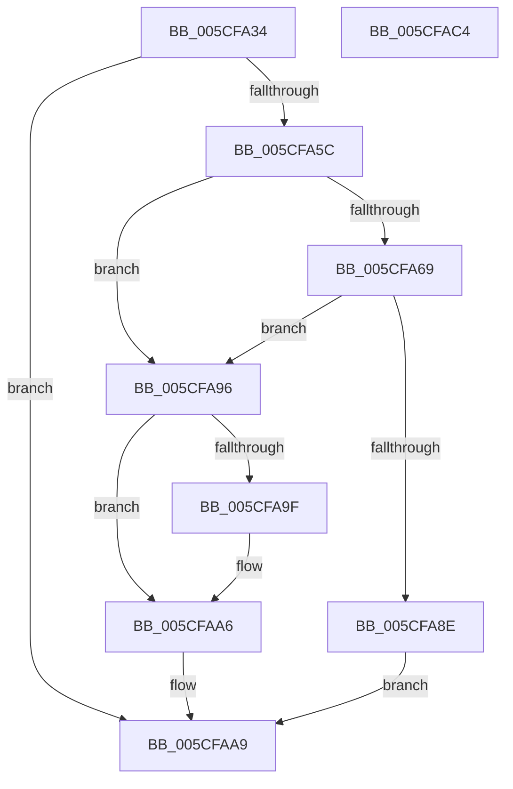

# PpmIdleCheckCoordinatedProcessorDependency

- RVA: `0x005CFA34`–`0x005CFAC5` (길이 `145` bytes)
- VA: `0x00000001405CFA34`
- 실행 섹션: `.text`
- PDB 이름 있음: `예`; PDB Function 태그: `아니요`
- unwind 정보 RVA: `0x00060BC4`
- 디코드: `37`개 명령, `145/145` bytes 표시
- 미해석 바이트: `0` (있으면 어셈블리에 `.byte`로 보존)

> 이 문서는 커널 이미지의 기계어와 PDB 기호를 분석해 생성했습니다. 4번과 5번은 함수 원형과 자료형을 바이너리 사용 방식에서 추정한 C 해석이며 원본 소스 복구 결과는 아닙니다.

## 1. Dependencies

- 직접 호출 지점: **1**; 고유 호출 대상: **1**
- 직접 호출자로 확인된 함수: **1**
- RIP 상대 이미지 참조: **2**

### Outgoing calls
- `0x005CFA4F` → [PpmTestAndLockProcessor](../5D/PpmTestAndLockProcessor_function_005D08B4.md) (function, `0x005D08B4`)

### Direct callers
- [PpmIdleCheckCoordinatedDependencies](PpmIdleCheckCoordinatedDependencies_function_005CF5B8.md) at `0x005CF6D9`

### Static image references
- `0x005CFA5C` → RVA `0x00FC6AD0` (`ALMOSTRO`; read)
- `0x005CFA96` → RVA `0x00FC6A85` (`ALMOSTRO`; read)

## 2. Other-region calls and transfers

- 다른 실행 섹션으로 향하는 call: **0**
- 별도 외부 분기/꼬리 이동을 확인하지 못했습니다.

## 3. Assembly (complete function range)

```asm
005CFA34  48 89 5C 24 08                  mov qword ptr [rsp + 8], rbx
005CFA39  48 89 74 24 10                  mov qword ptr [rsp + 0x10], rsi
005CFA3E  57                              push rdi
005CFA3F  48 83 EC 20                     sub rsp, 0x20
005CFA43  8B F2                           mov esi, edx
005CFA45  48 8B D9                        mov rbx, rcx
005CFA48  49 8B D1                        mov rdx, r9
005CFA4B  48 83 CF FF                     or rdi, 0xffffffffffffffff
005CFA4F  E8 60 0E 00 00                  call 0x1405d08b4
005CFA54  4C 8B C0                        mov r8, rax
005CFA57  48 85 C0                        test rax, rax
005CFA5A  75 4D                           jne 0x1405cfaa9
005CFA5C  48 8B 05 6D 70 9F 00            mov rax, qword ptr [rip + 0x9f706d]
005CFA63  44 38 40 08                     cmp byte ptr [rax + 8], r8b
005CFA67  74 2D                           je 0x1405cfa96
005CFA69  8B 83 80 88 00 00               mov eax, dword ptr [rbx + 0x8880]
005CFA6F  48 69 C8 58 01 00 00            imul rcx, rax, 0x158
005CFA76  48 8B 83 40 88 00 00            mov rax, qword ptr [rbx + 0x8840]
005CFA7D  8B 84 01 38 05 00 00            mov eax, dword ptr [rcx + rax + 0x538]
005CFA84  03 C6                           add eax, esi
005CFA86  3B 83 78 88 00 00               cmp eax, dword ptr [rbx + 0x8878]
005CFA8C  76 08                           jbe 0x1405cfa96
005CFA8E  41 B8 0F 00 00 80               mov r8d, 0x8000000f
005CFA94  EB 13                           jmp 0x1405cfaa9
005CFA96  80 3D E8 6F 9F 00 00            cmp byte ptr [rip + 0x9f6fe8], 0
005CFA9D  74 07                           je 0x1405cfaa6
005CFA9F  48 8B BB 70 88 00 00            mov rdi, qword ptr [rbx + 0x8870]
005CFAA6  45 33 C0                        xor r8d, r8d
005CFAA9  48 8B 44 24 50                  mov rax, qword ptr [rsp + 0x50]
005CFAAE  48 8B 5C 24 30                  mov rbx, qword ptr [rsp + 0x30]
005CFAB3  48 8B 74 24 38                  mov rsi, qword ptr [rsp + 0x38]
005CFAB8  48 89 38                        mov qword ptr [rax], rdi
005CFABB  49 8B C0                        mov rax, r8
005CFABE  48 83 C4 20                     add rsp, 0x20
005CFAC2  5F                              pop rdi
005CFAC3  C3                              ret
005CFAC4  CC                              int3
```

## 4. C-style interpretation (structured pseudocode)

```c
__int64 __fastcall PpmIdleCheckCoordinatedProcessorDependency(__int64 a1, int a2, __int64 a3, __int64 a4, __int64 a5)
{
    __int64 result;
    __int64 v_rdi;
    __int64 v_rsp;
    unsigned __int64 v_stack_p10;
    unsigned __int64 v_stack_p8;

    v_stack_p8 = v_rbx;
    v_stack_p10 = v_rsi;
    v_rsp = (v_rsp) - (32);
    v_rdi = (v_rdi) | (-1);
    result = PpmTestAndLockProcessor(a1, a4, a3, a4);
    if (result != 0) goto loc_005CFAA9;
    if ((*(unsigned __int8 *)(*(unsigned __int64 *)(v_rip + 10449005) + 8)) == ((unsigned __int8)(result))) goto loc_005CFA96;
    a1 = (a1) * ((unsigned int)(*(unsigned int *)(a1 + 34944)));
    result = (unsigned int)(((unsigned int)(*(unsigned int *)(a1 + *(unsigned __int64 *)(a1 + 34880) * 1 + 1336))) + ((unsigned int)((unsigned int)(a2))));
    if (((unsigned int)(result)) <= (*(unsigned int *)(a1 + 34936))) goto loc_005CFA96;
    goto loc_005CFAA9;
loc_005CFA96:
    if ((*(unsigned __int8 *)(v_rip + 10448872)) != 0) {
        v_rdi = *(unsigned __int64 *)(a1 + 34928);
    }
    a3 = 0;
loc_005CFAA9:
    *(unsigned __int64 *)(a5) = v_rdi;
    v_rsp = (v_rsp) + (32);
    return 0;
}
```

## 5. (Beta) C Style

```c
int64_t PpmIdleCheckCoordinatedProcessorDependency(void *Arg1, int32_t Arg2, int64_t Arg3, int64_t Arg4, void *Arg5)
{
    uint8_t *arg1 = (uint8_t *)Arg1;
    uint8_t *arg5 = (uint8_t *)Arg5;

    int64_t result;
    int64_t local_rdi;
    int64_t local_rsp;
    uint64_t v_stack_p10;
    uint64_t v_stack_p8;

    v_stack_p8 = local_rbx;
    v_stack_p10 = local_rsi;
    local_rsp = (local_rsp) - (32);
    local_rdi = (local_rdi) | (-1);
    result = PpmTestAndLockProcessor(Arg1, Arg4, Arg3, Arg4);
    if (result != 0) goto loc_005CFAA9;
    if ((*(uint8_t *)(*(uint64_t *)(v_rip + 0x9F706D) + 0x8)) == ((uint8_t)(result))) goto loc_005CFA96;
    Arg1 = (Arg1) * ((uint32_t)(*(uint32_t *)(arg1 + 0x8880)));
    result = (uint32_t)(((uint32_t)(*(uint32_t *)(arg1 + *(uint64_t *)(arg1 + 0x8840) * 1 + 0x538))) + ((uint32_t)((uint32_t)(Arg2))));
    if (((uint32_t)(result)) <= (*(uint32_t *)(arg1 + 0x8878))) goto loc_005CFA96;
    goto loc_005CFAA9;
loc_005CFA96:
    if ((*(uint8_t *)(v_rip + 0x9F6FE8)) != 0) {
        local_rdi = *(uint64_t *)(arg1 + 0x8870);
    }
    Arg3 = 0;
loc_005CFAA9:
    *(uint64_t *)(arg5) = local_rdi;
    local_rsp = (local_rsp) + (32);
    return 0;
}
```

### 관측된 메모리 오프셋

구조체 형식이 확인되지 않은 접근은 인자 기준의 오프셋으로만 기록했습니다.

| 기준 인자 | 오프셋 표현 | 폭 (bit) | 접근 |
|---|---:|---:|---|
| `Arg1` | `+ 0x8840` | `64` | `R` |
| `Arg1` | `+ 0x8870` | `64` | `R` |
| `Arg1` | `+ 0x8878` | `32` | `R` |
| `Arg1` | `+ 0x8880` | `32` | `R` |
| `Arg5` | `+ 0x0` | `64` | `W` |

## 6. Execution-region graph

[열기: 2D/3D 그래프와 함수 탐색 컨트롤 패널](../../../control-panel.html?section=text&rva=0x005CFA34&view=graph)

- 2D 그래프는 위에서 아래로 흐르고, 3D 그래프는 빈 공간을 드래그해 회전합니다. Shift+드래그는 이동, 휠은 확대·축소, 함수 노드 선택은 대상 보고서 이동입니다.

### Static fallback


