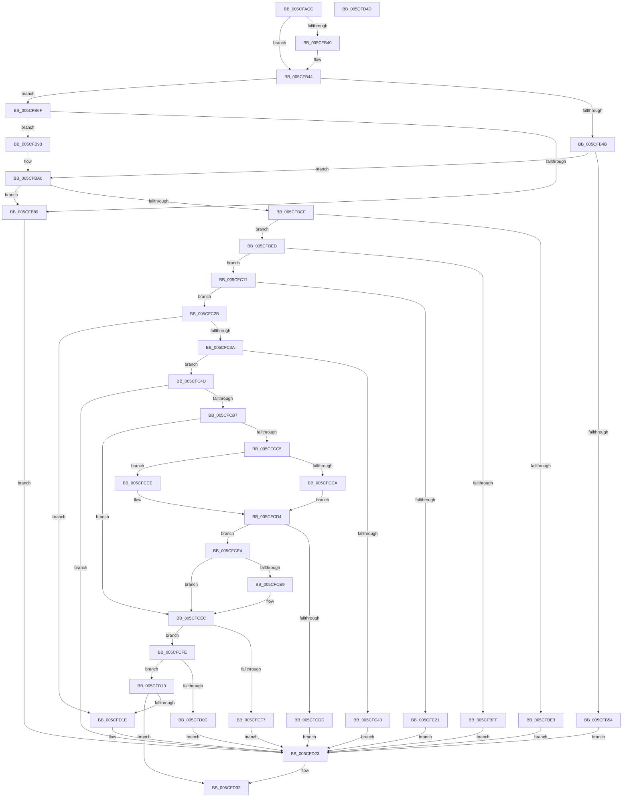

# PpmIdleCheckCoordinatedStateEligibility

- RVA: `0x005CFACC`–`0x005CFD4E` (길이 `642` bytes)
- VA: `0x00000001405CFACC`
- 실행 섹션: `.text`
- PDB 이름 있음: `예`; PDB Function 태그: `아니요`
- unwind 정보 RVA: `0x000CBF60`
- 디코드: `160`개 명령, `642/642` bytes 표시
- 미해석 바이트: `0` (있으면 어셈블리에 `.byte`로 보존)

> 이 문서는 커널 이미지의 기계어와 PDB 기호를 분석해 생성했습니다. 4번과 5번은 함수 원형과 자료형을 바이너리 사용 방식에서 추정한 C 해석이며 원본 소스 복구 결과는 아닙니다.

## 1. Dependencies

- 직접 호출 지점: **5**; 고유 호출 대상: **5**
- 직접 호출자로 확인된 함수: **2**
- RIP 상대 이미지 참조: **1**

### Outgoing calls
- `0x005CFB80` → [KeIsSubsetAffinityEx](../2C/KeIsSubsetAffinityEx_function_002CDC80.md) (function, `0x002CDC80`)
- `0x005CFBF4` → [PpmCheckIdleVeto](PpmCheckIdleVeto_function_005CF54C.md) (function, `0x005CF54C`)
- `0x005CFCAA` → [PpmIdleCheckCoordinatedDependencies](PpmIdleCheckCoordinatedDependencies_function_005CF5B8.md) (function, `0x005CF5B8`)
- `0x005CFD03` → [PpmIdleWaitForDependentTransitions](../5D/PpmIdleWaitForDependentTransitions_function_005D0594.md) (function, `0x005D0594`)
- `0x005CFD2D` → [PpmIdleRollbackCoordinatedSelection](../5D/PpmIdleRollbackCoordinatedSelection_function_005D02A4.md) (function, `0x005D02A4`)

### Direct callers
- [PpmIdleSelectStates](../2C/PpmIdleSelectStates_function_002CFFE8.md) at `0x002D038F`
- [PpmIdleCheckCoordinatedDependency](PpmIdleCheckCoordinatedDependency_function_005CF72C.md) at `0x005CF83E`

### Static image references
- `0x005CFB13` → RVA `0x00FC6AD0` (`ALMOSTRO`; read)

## 2. Other-region calls and transfers

- 다른 실행 섹션으로 향하는 call: **0**
- 별도 외부 분기/꼬리 이동을 확인하지 못했습니다.

## 3. Assembly (complete function range)

```asm
005CFACC  48 8B C4                        mov rax, rsp
005CFACF  48 89 58 18                     mov qword ptr [rax + 0x18], rbx
005CFAD3  4C 89 48 20                     mov qword ptr [rax + 0x20], r9
005CFAD7  89 50 10                        mov dword ptr [rax + 0x10], edx
005CFADA  55                              push rbp
005CFADB  56                              push rsi
005CFADC  57                              push rdi
005CFADD  41 54                           push r12
005CFADF  41 55                           push r13
005CFAE1  41 56                           push r14
005CFAE3  41 57                           push r15
005CFAE5  48 83 EC 70                     sub rsp, 0x70
005CFAE9  8B 9C 24 D8 00 00 00            mov ebx, dword ptr [rsp + 0xd8]
005CFAF0  45 33 E4                        xor r12d, r12d
005CFAF3  48 8B 91 40 88 00 00            mov rdx, qword ptr [rcx + 0x8840]
005CFAFA  4D 8B D1                        mov r10, r9
005CFAFD  48 8B AC 24 F0 00 00 00         mov rbp, qword ptr [rsp + 0xf0]
005CFB05  45 8B F8                        mov r15d, r8d
005CFB08  4C 8B B4 24 F8 00 00 00         mov r14, qword ptr [rsp + 0xf8]
005CFB10  4C 8B E9                        mov r13, rcx
005CFB13  48 8B 35 B6 6F 9F 00            mov rsi, qword ptr [rip + 0x9f6fb6]
005CFB1A  48 69 FB C0 01 00 00            imul rdi, rbx, 0x1c0
005CFB21  4C 89 60 08                     mov qword ptr [rax + 8], r12
005CFB25  4C 8D 9A 50 01 00 00            lea r11, [rdx + 0x150]
005CFB2C  8B 45 04                        mov eax, dword ptr [rbp + 4]
005CFB2F  4C 89 5C 24 60                  mov qword ptr [rsp + 0x60], r11
005CFB34  89 84 24 D8 00 00 00            mov dword ptr [rsp + 0xd8], eax
005CFB3B  4D 85 F6                        test r14, r14
005CFB3E  74 04                           je 0x1405cfb44
005CFB40  49 83 0E FF                     or qword ptr [r14], 0xffffffffffffffff
005CFB44  44 38 64 37 79                  cmp byte ptr [rdi + rsi + 0x79], r12b
005CFB49  74 24                           je 0x1405cfb6f
005CFB4B  44 38 A2 CC 02 00 00            cmp byte ptr [rdx + 0x2cc], r12b
005CFB52  75 4C                           jne 0x1405cfba0
005CFB54  8A 41 21                        mov al, byte ptr [rcx + 0x21]
005CFB57  F6 D8                           neg al
005CFB59  B8 0C 00 00 80                  mov eax, 0x8000000c
005CFB5E  48 1B DB                        sbb rbx, rbx
005CFB61  81 E3 F3 FF FF 7F               and ebx, 0x7ffffff3
005CFB67  48 03 D8                        add rbx, rax
005CFB6A  E9 B4 01 00 00                  jmp 0x1405cfd23
005CFB6F  48 8D 8E 80 00 00 00            lea rcx, [rsi + 0x80]
005CFB76  48 81 C2 D0 02 00 00            add rdx, 0x2d0
005CFB7D  48 03 CF                        add rcx, rdi
005CFB80  E8 FB E0 CF FF                  call 0x1402cdc80
005CFB85  85 C0                           test eax, eax
005CFB87  75 0A                           jne 0x1405cfb93
005CFB89  BB FF FF FF FF                  mov ebx, 0xffffffff
005CFB8E  E9 90 01 00 00                  jmp 0x1405cfd23
005CFB93  4C 8B 94 24 C8 00 00 00         mov r10, qword ptr [rsp + 0xc8]
005CFB9B  4C 8B 5C 24 60                  mov r11, qword ptr [rsp + 0x60]
005CFBA0  44 8B 84 24 E0 00 00 00         mov r8d, dword ptr [rsp + 0xe0]
005CFBA8  41 8B C0                        mov eax, r8d
005CFBAB  65 8B 0C 25 A4 01 00 00         mov ecx, dword ptr gs:[0x1a4]
005CFBB3  81 E1 FF 0F 00 00               and ecx, 0xfff
005CFBB9  C1 E0 1B                        shl eax, 0x1b
005CFBBC  0B C8                           or ecx, eax
005CFBBE  0F BA E9 18                     bts ecx, 0x18
005CFBC2  33 C0                           xor eax, eax
005CFBC4  F0 0F B1 8C 37 A0 01 00 00      lock cmpxchg dword ptr [rdi + rsi + 0x1a0], ecx
005CFBCD  75 BA                           jne 0x1405cfb89
005CFBCF  8B 4D 04                        mov ecx, dword ptr [rbp + 4]
005CFBD2  48 8B 45 10                     mov rax, qword ptr [rbp + 0x10]
005CFBD6  89 1C 88                        mov dword ptr [rax + rcx*4], ebx
005CFBD9  FF 45 04                        inc dword ptr [rbp + 4]
005CFBDC  44 38 64 37 7A                  cmp byte ptr [rdi + rsi + 0x7a], r12b
005CFBE1  75 0A                           jne 0x1405cfbed
005CFBE3  BB 0A 00 00 80                  mov ebx, 0x8000000a
005CFBE8  E9 36 01 00 00                  jmp 0x1405cfd23
005CFBED  48 8D 4E 50                     lea rcx, [rsi + 0x50]
005CFBF1  48 03 CF                        add rcx, rdi
005CFBF4  E8 53 F9 FF FF                  call 0x1405cf54c
005CFBF9  8B D8                           mov ebx, eax
005CFBFB  85 C0                           test eax, eax
005CFBFD  74 12                           je 0x1405cfc11
005CFBFF  48 B8 00 00 00 00 01 00 00 00   movabs rax, 0x100000000
005CFC09  48 0B D8                        or rbx, rax
005CFC0C  E9 12 01 00 00                  jmp 0x1405cfd23
005CFC11  8B 4C 37 48                     mov ecx, dword ptr [rdi + rsi + 0x48]
005CFC15  41 03 CF                        add ecx, r15d
005CFC18  41 3B 8D 78 88 00 00            cmp ecx, dword ptr [r13 + 0x8878]
005CFC1F  76 0A                           jbe 0x1405cfc2b
005CFC21  BB 02 00 00 80                  mov ebx, 0x80000002
005CFC26  E9 F8 00 00 00                  jmp 0x1405cfd23
005CFC2B  8B 84 37 C0 01 00 00            mov eax, dword ptr [rdi + rsi + 0x1c0]
005CFC32  85 C0                           test eax, eax
005CFC34  0F 85 E4 00 00 00               jne 0x1405cfd1e
005CFC3A  8B 44 37 4C                     mov eax, dword ptr [rdi + rsi + 0x4c]
005CFC3E  49 3B C2                        cmp rax, r10
005CFC41  76 0A                           jbe 0x1405cfc4d
005CFC43  BB 03 00 00 80                  mov ebx, 0x80000003
005CFC48  E9 D6 00 00 00                  jmp 0x1405cfd23
005CFC4D  44 8B 4C 37 48                  mov r9d, dword ptr [rdi + rsi + 0x48]
005CFC52  48 8D 84 24 B0 00 00 00         lea rax, [rsp + 0xb0]
005CFC5A  4C 8B A4 24 E8 00 00 00         mov r12, qword ptr [rsp + 0xe8]
005CFC62  45 03 CF                        add r9d, r15d
005CFC65  4C 8B BC 24 D0 00 00 00         mov r15, qword ptr [rsp + 0xd0]
005CFC6D  49 8B CD                        mov rcx, r13
005CFC70  8B 94 24 B8 00 00 00            mov edx, dword ptr [rsp + 0xb8]
005CFC77  48 89 44 24 58                  mov qword ptr [rsp + 0x58], rax
005CFC7C  48 8B 84 37 98 01 00 00         mov rax, qword ptr [rdi + rsi + 0x198]
005CFC84  4C 89 5C 24 50                  mov qword ptr [rsp + 0x50], r11
005CFC89  48 89 6C 24 48                  mov qword ptr [rsp + 0x48], rbp
005CFC8E  4C 89 64 24 40                  mov qword ptr [rsp + 0x40], r12
005CFC93  48 89 44 24 38                  mov qword ptr [rsp + 0x38], rax
005CFC98  8B 44 37 7C                     mov eax, dword ptr [rdi + rsi + 0x7c]
005CFC9C  89 44 24 30                     mov dword ptr [rsp + 0x30], eax
005CFCA0  4C 89 7C 24 28                  mov qword ptr [rsp + 0x28], r15
005CFCA5  4C 89 54 24 20                  mov qword ptr [rsp + 0x20], r10
005CFCAA  E8 09 F9 FF FF                  call 0x1405cf5b8
005CFCAF  48 8B D8                        mov rbx, rax
005CFCB2  48 85 C0                        test rax, rax
005CFCB5  75 6C                           jne 0x1405cfd23
005CFCB7  48 8B 8C 24 B0 00 00 00         mov rcx, qword ptr [rsp + 0xb0]
005CFCBF  48 83 F9 FF                     cmp rcx, -1
005CFCC3  74 27                           je 0x1405cfcec
005CFCC5  4C 3B F9                        cmp r15, rcx
005CFCC8  76 04                           jbe 0x1405cfcce
005CFCCA  33 D2                           xor edx, edx
005CFCCC  EB 06                           jmp 0x1405cfcd4
005CFCCE  48 8B D1                        mov rdx, rcx
005CFCD1  49 2B D7                        sub rdx, r15
005CFCD4  8B 44 37 4C                     mov eax, dword ptr [rdi + rsi + 0x4c]
005CFCD8  48 3B C2                        cmp rax, rdx
005CFCDB  76 07                           jbe 0x1405cfce4
005CFCDD  BB 0E 00 00 80                  mov ebx, 0x8000000e
005CFCE2  EB 3F                           jmp 0x1405cfd23
005CFCE4  4D 85 F6                        test r14, r14
005CFCE7  74 03                           je 0x1405cfcec
005CFCE9  49 89 0E                        mov qword ptr [r14], rcx
005CFCEC  B8 FF FF FF FF                  mov eax, 0xffffffff
005CFCF1  41 39 04 24                     cmp dword ptr [r12], eax
005CFCF5  75 07                           jne 0x1405cfcfe
005CFCF7  BB 01 00 00 80                  mov ebx, 0x80000001
005CFCFC  EB 25                           jmp 0x1405cfd23
005CFCFE  48 8B 4C 24 60                  mov rcx, qword ptr [rsp + 0x60]
005CFD03  E8 8C 08 00 00                  call 0x1405d0594
005CFD08  85 C0                           test eax, eax
005CFD0A  79 07                           jns 0x1405cfd13
005CFD0C  BB 05 00 00 80                  mov ebx, 0x80000005
005CFD11  EB 10                           jmp 0x1405cfd23
005CFD13  8B 84 37 C0 01 00 00            mov eax, dword ptr [rdi + rsi + 0x1c0]
005CFD1A  85 C0                           test eax, eax
005CFD1C  74 14                           je 0x1405cfd32
005CFD1E  BB 04 00 00 80                  mov ebx, 0x80000004
005CFD23  8B 94 24 D8 00 00 00            mov edx, dword ptr [rsp + 0xd8]
005CFD2A  48 8B CD                        mov rcx, rbp
005CFD2D  E8 72 05 00 00                  call 0x1405d02a4
005CFD32  48 8B C3                        mov rax, rbx
005CFD35  48 8B 9C 24 C0 00 00 00         mov rbx, qword ptr [rsp + 0xc0]
005CFD3D  48 83 C4 70                     add rsp, 0x70
005CFD41  41 5F                           pop r15
005CFD43  41 5E                           pop r14
005CFD45  41 5D                           pop r13
005CFD47  41 5C                           pop r12
005CFD49  5F                              pop rdi
005CFD4A  5E                              pop rsi
005CFD4B  5D                              pop rbp
005CFD4C  C3                              ret
005CFD4D  CC                              int3
```

## 4. C-style interpretation (structured pseudocode)

```c
__int64 __fastcall PpmIdleCheckCoordinatedStateEligibility(__int64 a1, int a2, int a3, __int64 a4, __int64 a5, unsigned int a6, unsigned int a7, __int64 a8, __int64 a9, __int64 a10)
{
    __int64 result;
    __int64 v_r12;
    __int64 v_rbx;
    __int64 v_rdi;
    __int64 v_rsp;
    unsigned __int64 v_stack_m48;
    unsigned __int64 v_stack_m50;
    unsigned __int64 v_stack_m58;
    unsigned __int64 v_stack_m60;
    unsigned __int64 v_stack_m68;
    unsigned __int64 v_stack_m70;
    unsigned int v_stack_m78;
    unsigned __int64 v_stack_m80;
    unsigned __int64 v_stack_m88;
    unsigned int v_stack_p10;
    unsigned __int64 v_stack_p18;
    unsigned __int64 v_stack_p20;
    unsigned int v_stack_p30;
    unsigned __int64 v_stack_p8;

    *(unsigned __int64 *)(v_rsp + 24) = v_rbx;
    *(unsigned __int64 *)(v_rsp + 32) = a4;
    *(unsigned int *)(v_rsp + 16) = a2;
    v_rsp = (v_rsp) - (112);
    v_r12 = 0;
    v_rdi = (v_rdi) * ((unsigned int)(a6));
    *(unsigned __int64 *)(v_rsp + 8) = 0;
    v_stack_m48 = *(unsigned __int64 *)(a1 + 34880) + 336;
    v_stack_p30 = (unsigned int)((unsigned int)(*(unsigned int *)(a9 + 4)));
    if (a10 != 0) {
    }
    if ((*(unsigned __int8 *)(v_rdi + *(unsigned __int64 *)(v_rip + 10448822) * 1 + 121)) == 0) goto loc_005CFB6F;
    if ((*(unsigned __int8 *)(*(unsigned __int64 *)(a1 + 34880) + 716)) != 0) goto loc_005CFBA0;
    result = (unsigned __int8)(-(*(unsigned __int8 *)(a1 + 33)));
    v_rbx = (unsigned int)(((unsigned int)(a6)) & (0x7FFFFFF3ULL));
    v_rbx = (v_rbx) + ((unsigned int)(0x8000000CULL));
    goto loc_005CFD23;
loc_005CFB6F:
    a2 = (*(unsigned __int64 *)(a1 + 34880)) + (720);
    a1 = (*(unsigned __int64 *)(v_rip + 10448822) + 128) + (v_rdi);
    result = KeIsSubsetAffinityEx(a1, a2, a3, a4);
    if ((unsigned int)(result) != 0) goto loc_005CFB93;
loc_005CFB89:
    goto loc_005CFD23;
loc_005CFB93:
loc_005CFBA0:
    a1 = (unsigned int)(((unsigned int)(*(unsigned int *)(gs_base + (0 + 420)))) & (0xFFFULL));
    result = (unsigned int)(((unsigned int)((unsigned int)((unsigned int)(a7)))) << (27));
    a1 = (unsigned int)((a1) | ((unsigned int)(result)));
    result = 0;
    if (condition_is_not_equal) goto loc_005CFB89;
    *(unsigned int *)(*(unsigned __int64 *)(a9 + 16) + (unsigned int)(*(unsigned int *)(a9 + 4)) * 4) = (unsigned int)((unsigned int)(0xFFFFFFFFULL));
    if ((*(unsigned __int8 *)(v_rdi + *(unsigned __int64 *)(v_rip + 10448822) * 1 + 122)) != 0) goto loc_005CFBED;
    goto loc_005CFD23;
loc_005CFBED:
    a1 = (*(unsigned __int64 *)(v_rip + 10448822) + 80) + (v_rdi);
    result = PpmCheckIdleVeto(a1, a2, (unsigned int)(a7), a4);
    if ((unsigned int)(result) == 0) goto loc_005CFC11;
    v_rbx = ((unsigned int)((unsigned int)(result))) | (result);
    goto loc_005CFD23;
loc_005CFC11:
    a1 = (unsigned int)(((unsigned int)(*(unsigned int *)(v_rdi + *(unsigned __int64 *)(v_rip + 10448822) * 1 + 72))) + ((unsigned int)((unsigned int)(a3))));
    if (((unsigned int)(a1)) <= (*(unsigned int *)(a1 + 34936))) goto loc_005CFC2B;
    goto loc_005CFD23;
loc_005CFC2B:
    if ((unsigned int)((unsigned int)(*(unsigned int *)(v_rdi + *(unsigned __int64 *)(v_rip + 10448822) * 1 + 448))) != 0) goto loc_005CFD1E;
    if (((unsigned int)(*(unsigned int *)(v_rdi + *(unsigned __int64 *)(v_rip + 10448822) * 1 + 76))) <= v_stack_p20) goto loc_005CFC4D;
    goto loc_005CFD23;
loc_005CFC4D:
    a4 = (unsigned int)(((unsigned int)(*(unsigned int *)(v_rdi + *(unsigned __int64 *)(v_rip + 10448822) * 1 + 72))) + ((unsigned int)((unsigned int)(a3))));
    v_stack_m50 = v_stack_p8;
    v_stack_m58 = v_stack_m48;
    v_stack_m60 = a9;
    v_stack_m68 = a8;
    v_stack_m70 = *(unsigned __int64 *)(v_rdi + *(unsigned __int64 *)(v_rip + 10448822) * 1 + 408);
    v_stack_m78 = (unsigned int)((unsigned int)(*(unsigned int *)(v_rdi + *(unsigned __int64 *)(v_rip + 10448822) * 1 + 124)));
    v_stack_m80 = a5;
    v_stack_m88 = v_stack_p20;
    result = PpmIdleCheckCoordinatedDependencies(a1, (unsigned int)(v_stack_p10), (unsigned int)(a7), a4);
    if (result != 0) goto loc_005CFD23;
    if (v_stack_p8 == -1) goto loc_005CFCEC;
    if (a5 <= v_stack_p8) goto loc_005CFCCE;
    a2 = 0;
    goto loc_005CFCD4;
loc_005CFCCE:
    a2 = (v_stack_p8) - (a5);
loc_005CFCD4:
    if (((unsigned int)(*(unsigned int *)(v_rdi + *(unsigned __int64 *)(v_rip + 10448822) * 1 + 76))) <= a2) goto loc_005CFCE4;
    goto loc_005CFD23;
loc_005CFCE4:
    if (a10 != 0) {
        *(unsigned __int64 *)(a10) = v_stack_p8;
    }
    if ((*(unsigned int *)(a8)) != ((unsigned int)((unsigned int)(0xFFFFFFFFULL)))) goto loc_005CFCFE;
    goto loc_005CFD23;
loc_005CFCFE:
    result = PpmIdleWaitForDependentTransitions(v_stack_m48, a2, (unsigned int)(a7), a4);
    if (!sign_flag) goto loc_005CFD13;
    goto loc_005CFD23;
loc_005CFD13:
    if ((unsigned int)((unsigned int)(*(unsigned int *)(v_rdi + *(unsigned __int64 *)(v_rip + 10448822) * 1 + 448))) == 0) goto loc_005CFD32;
loc_005CFD1E:
loc_005CFD23:
    result = PpmIdleRollbackCoordinatedSelection(a9, (unsigned int)(a6), (unsigned int)(a7), a4);
loc_005CFD32:
    v_rsp = (v_rsp) + (112);
    return (unsigned int)(0x80000004ULL);
}
```

## 5. (Beta) C Style

```c
int64_t PpmIdleCheckCoordinatedStateEligibility(void *Arg1, int32_t Arg2, int32_t Arg3, int64_t Arg4, int64_t Arg5, uint32_t Arg6, uint32_t Arg7, void *Arg8, void *Arg9, int64_t Arg10)
{
    uint8_t *arg1 = (uint8_t *)Arg1;
    uint8_t *arg8 = (uint8_t *)Arg8;
    uint8_t *arg9 = (uint8_t *)Arg9;

    int64_t result;
    int64_t local_r12;
    int64_t local_rbx;
    int64_t local_rdi;
    int64_t local_rsp;
    uint64_t v_stack_m48;
    uint64_t v_stack_m50;
    uint64_t v_stack_m58;
    uint64_t v_stack_m60;
    uint64_t v_stack_m68;
    uint64_t v_stack_m70;
    uint32_t v_stack_m78;
    uint64_t v_stack_m80;
    uint64_t v_stack_m88;
    uint32_t v_stack_p10;
    uint64_t v_stack_p18;
    uint64_t v_stack_p20;
    uint32_t v_stack_p30;
    uint64_t v_stack_p8;

    *(uint64_t *)(local_rsp + 0x18) = local_rbx;
    *(uint64_t *)(local_rsp + 0x20) = Arg4;
    *(uint32_t *)(local_rsp + 0x10) = Arg2;
    local_rsp = (local_rsp) - (112);
    local_r12 = 0;
    local_rdi = (local_rdi) * ((uint32_t)(Arg6));
    *(uint64_t *)(local_rsp + 0x8) = 0;
    v_stack_m48 = *(uint64_t *)(arg1 + 0x8840) + 336;
    v_stack_p30 = (uint32_t)((uint32_t)(*(uint32_t *)(arg9 + 0x4)));
    if (Arg10 != 0) {
    }
    if ((*(uint8_t *)(local_rdi + *(uint64_t *)(v_rip + 0x9F6FB6) * 1 + 0x79)) == 0) goto loc_005CFB6F;
    if ((*(uint8_t *)(*(uint64_t *)(arg1 + 0x8840) + 0x2CC)) != 0) goto loc_005CFBA0;
    result = (uint8_t)(-(*(uint8_t *)(arg1 + 0x21)));
    local_rbx = (uint32_t)(((uint32_t)(Arg6)) & (0x7FFFFFF3ULL));
    local_rbx = (local_rbx) + ((uint32_t)(0x8000000CULL));
    goto loc_005CFD23;
loc_005CFB6F:
    Arg2 = (*(uint64_t *)(arg1 + 0x8840)) + (720);
    Arg1 = (*(uint64_t *)(v_rip + 0x9F6FB6) + 128) + (local_rdi);
    result = KeIsSubsetAffinityEx(Arg1, Arg2, Arg3, Arg4);
    if ((uint32_t)(result) != 0) goto loc_005CFB93;
loc_005CFB89:
    goto loc_005CFD23;
loc_005CFB93:
loc_005CFBA0:
    Arg1 = (uint32_t)(((uint32_t)(*(uint32_t *)(gs_base + (0 + 0x1A4)))) & (0xFFFULL));
    result = (uint32_t)(((uint32_t)((uint32_t)((uint32_t)(Arg7)))) << (27));
    Arg1 = (uint32_t)((Arg1) | ((uint32_t)(result)));
    result = 0;
    if (condition_is_not_equal) goto loc_005CFB89;
    *(uint32_t *)(*(uint64_t *)(arg9 + 0x10) + (uint32_t)(*(uint32_t *)(arg9 + 0x4)) * 4) = (uint32_t)((uint32_t)(0xFFFFFFFFULL));
    if ((*(uint8_t *)(local_rdi + *(uint64_t *)(v_rip + 0x9F6FB6) * 1 + 0x7A)) != 0) goto loc_005CFBED;
    goto loc_005CFD23;
loc_005CFBED:
    Arg1 = (*(uint64_t *)(v_rip + 0x9F6FB6) + 80) + (local_rdi);
    result = PpmCheckIdleVeto(Arg1, Arg2, (uint32_t)(Arg7), Arg4);
    if ((uint32_t)(result) == 0) goto loc_005CFC11;
    local_rbx = ((uint32_t)((uint32_t)(result))) | (result);
    goto loc_005CFD23;
loc_005CFC11:
    Arg1 = (uint32_t)(((uint32_t)(*(uint32_t *)(local_rdi + *(uint64_t *)(v_rip + 0x9F6FB6) * 1 + 0x48))) + ((uint32_t)((uint32_t)(Arg3))));
    if (((uint32_t)(Arg1)) <= (*(uint32_t *)(arg1 + 0x8878))) goto loc_005CFC2B;
    goto loc_005CFD23;
loc_005CFC2B:
    if ((uint32_t)((uint32_t)(*(uint32_t *)(local_rdi + *(uint64_t *)(v_rip + 0x9F6FB6) * 1 + 0x1C0))) != 0) goto loc_005CFD1E;
    if (((uint32_t)(*(uint32_t *)(local_rdi + *(uint64_t *)(v_rip + 0x9F6FB6) * 1 + 0x4C))) <= v_stack_p20) goto loc_005CFC4D;
    goto loc_005CFD23;
loc_005CFC4D:
    Arg4 = (uint32_t)(((uint32_t)(*(uint32_t *)(local_rdi + *(uint64_t *)(v_rip + 0x9F6FB6) * 1 + 0x48))) + ((uint32_t)((uint32_t)(Arg3))));
    v_stack_m50 = v_stack_p8;
    v_stack_m58 = v_stack_m48;
    v_stack_m60 = Arg9;
    v_stack_m68 = Arg8;
    v_stack_m70 = *(uint64_t *)(local_rdi + *(uint64_t *)(v_rip + 0x9F6FB6) * 1 + 0x198);
    v_stack_m78 = (uint32_t)((uint32_t)(*(uint32_t *)(local_rdi + *(uint64_t *)(v_rip + 0x9F6FB6) * 1 + 0x7C)));
    v_stack_m80 = Arg5;
    v_stack_m88 = v_stack_p20;
    result = PpmIdleCheckCoordinatedDependencies(Arg1, (uint32_t)(v_stack_p10), (uint32_t)(Arg7), Arg4);
    if (result != 0) goto loc_005CFD23;
    if (v_stack_p8 == -1) goto loc_005CFCEC;
    if (Arg5 <= v_stack_p8) goto loc_005CFCCE;
    Arg2 = 0;
    goto loc_005CFCD4;
loc_005CFCCE:
    Arg2 = (v_stack_p8) - (Arg5);
loc_005CFCD4:
    if (((uint32_t)(*(uint32_t *)(local_rdi + *(uint64_t *)(v_rip + 0x9F6FB6) * 1 + 0x4C))) <= Arg2) goto loc_005CFCE4;
    goto loc_005CFD23;
loc_005CFCE4:
    if (Arg10 != 0) {
        *(uint64_t *)(Arg10) = v_stack_p8;
    }
    if ((*(uint32_t *)(arg8)) != ((uint32_t)((uint32_t)(0xFFFFFFFFULL)))) goto loc_005CFCFE;
    goto loc_005CFD23;
loc_005CFCFE:
    result = PpmIdleWaitForDependentTransitions(v_stack_m48, Arg2, (uint32_t)(Arg7), Arg4);
    if (!sign_flag) goto loc_005CFD13;
    goto loc_005CFD23;
loc_005CFD13:
    if ((uint32_t)((uint32_t)(*(uint32_t *)(local_rdi + *(uint64_t *)(v_rip + 0x9F6FB6) * 1 + 0x1C0))) == 0) goto loc_005CFD32;
loc_005CFD1E:
loc_005CFD23:
    result = PpmIdleRollbackCoordinatedSelection(Arg9, (uint32_t)(Arg6), (uint32_t)(Arg7), Arg4);
loc_005CFD32:
    local_rsp = (local_rsp) + (112);
    return (uint32_t)(0x80000004ULL);
}
```

### 관측된 메모리 오프셋

구조체 형식이 확인되지 않은 접근은 인자 기준의 오프셋으로만 기록했습니다.

| 기준 인자 | 오프셋 표현 | 폭 (bit) | 접근 |
|---|---:|---:|---|
| `Arg1` | `+ 0x21` | `8` | `R` |
| `Arg1` | `+ 0x8840` | `64` | `R` |
| `Arg1` | `+ 0x8878` | `32` | `R` |
| `Arg8` | `+ 0x0` | `32` | `R` |
| `Arg9` | `+ 0x4` | `32` | `R` |
| `Arg9` | `+ 0x4` | `32` | `R/W` |
| `Arg9` | `+ 0x10` | `64` | `R` |

## 6. Execution-region graph

[열기: 2D/3D 그래프와 함수 탐색 컨트롤 패널](../../../control-panel.html?section=text&rva=0x005CFACC&view=graph)

- 2D 그래프는 위에서 아래로 흐르고, 3D 그래프는 빈 공간을 드래그해 회전합니다. Shift+드래그는 이동, 휠은 확대·축소, 함수 노드 선택은 대상 보고서 이동입니다.

### Static fallback


