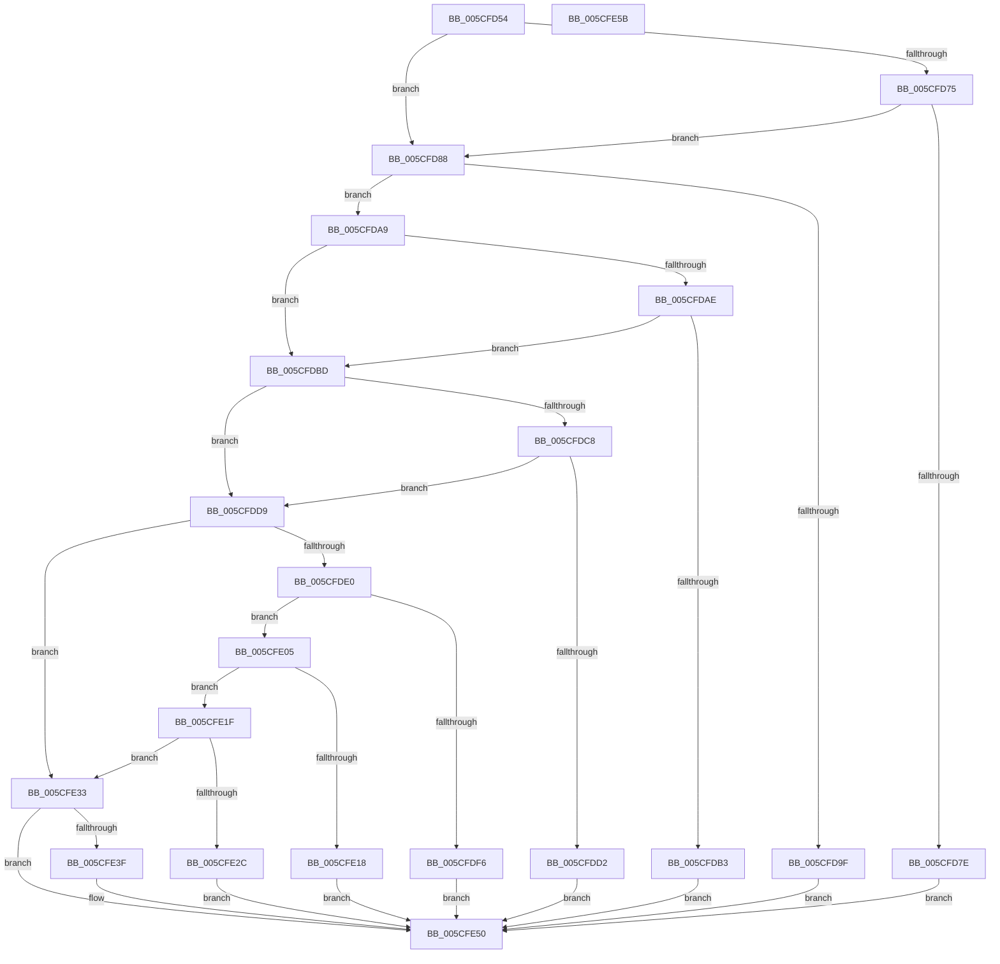

# PpmIdleCheckProcessorStateEligibility

- RVA: `0x005CFD54`–`0x005CFE5C` (길이 `264` bytes)
- VA: `0x00000001405CFD54`
- 실행 섹션: `.text`
- PDB 이름 있음: `예`; PDB Function 태그: `아니요`
- unwind 정보 RVA: `0x0005CAAC`
- 디코드: `65`개 명령, `264/264` bytes 표시
- 미해석 바이트: `0` (있으면 어셈블리에 `.byte`로 보존)

> 이 문서는 커널 이미지의 기계어와 PDB 기호를 분석해 생성했습니다. 4번과 5번은 함수 원형과 자료형을 바이너리 사용 방식에서 추정한 C 해석이며 원본 소스 복구 결과는 아닙니다.

## 1. Dependencies

- 직접 호출 지점: **2**; 고유 호출 대상: **2**
- 직접 호출자로 확인된 함수: **2**
- RIP 상대 이미지 참조: **1**

### Outgoing calls
- `0x005CFDEA` → [PpmCheckIdleVeto](PpmCheckIdleVeto_function_005CF54C.md) (function, `0x005CF54C`)
- `0x005CFE49` → [guard_dispatch_icall](../6B/guard_dispatch_icall_function_006BAAD0.md) (function, `0x006BAAD0`)

### Direct callers
- [PpmIdleSelectStates](../2C/PpmIdleSelectStates_function_002CFFE8.md) at `0x002D06CC`
- [PpmIdleSelectCoordinatedProcessorDependency](../5D/PpmIdleSelectCoordinatedProcessorDependency_function_005D02E8.md) at `0x005D0356`

### Static image references
- `0x005CFD75` → RVA `0x00E0B3B0` (`.data`; read)

## 2. Other-region calls and transfers

- 다른 실행 섹션으로 향하는 call: **0**
- 별도 외부 분기/꼬리 이동을 확인하지 못했습니다.

## 3. Assembly (complete function range)

```asm
005CFD54  48 89 5C 24 08                  mov qword ptr [rsp + 8], rbx
005CFD59  57                              push rdi
005CFD5A  48 83 EC 20                     sub rsp, 0x20
005CFD5E  4C 8B 91 40 88 00 00            mov r10, qword ptr [rcx + 0x8840]
005CFD65  49 8B D9                        mov rbx, r9
005CFD68  41 8B F8                        mov edi, r8d
005CFD6B  4C 8B D9                        mov r11, rcx
005CFD6E  41 83 7A 2C 03                  cmp dword ptr [r10 + 0x2c], 3
005CFD73  75 13                           jne 0x1405cfd88
005CFD75  80 3D 34 B6 83 00 00            cmp byte ptr [rip + 0x83b634], 0
005CFD7C  74 0A                           je 0x1405cfd88
005CFD7E  B8 FE FF FF FF                  mov eax, 0xfffffffe
005CFD83  E9 C8 00 00 00                  jmp 0x1405cfe50
005CFD88  44 8B 4C 24 50                  mov r9d, dword ptr [rsp + 0x50]
005CFD8D  4D 69 C1 58 01 00 00            imul r8, r9, 0x158
005CFD94  43 80 BC 10 77 05 00 00 00      cmp byte ptr [r8 + r10 + 0x577], 0
005CFD9D  74 0A                           je 0x1405cfda9
005CFD9F  B8 0A 00 00 80                  mov eax, 0x8000000a
005CFDA4  E9 A7 00 00 00                  jmp 0x1405cfe50
005CFDA9  83 FA FF                        cmp edx, -1
005CFDAC  74 0F                           je 0x1405cfdbd
005CFDAE  44 3B CA                        cmp r9d, edx
005CFDB1  76 0A                           jbe 0x1405cfdbd
005CFDB3  B8 08 00 00 80                  mov eax, 0x80000008
005CFDB8  E9 93 00 00 00                  jmp 0x1405cfe50
005CFDBD  43 80 BC 10 72 05 00 00 00      cmp byte ptr [r8 + r10 + 0x572], 0
005CFDC6  75 11                           jne 0x1405cfdd9
005CFDC8  41 80 BA CB 02 00 00 00         cmp byte ptr [r10 + 0x2cb], 0
005CFDD0  74 07                           je 0x1405cfdd9
005CFDD2  B8 07 00 00 80                  mov eax, 0x80000007
005CFDD7  EB 77                           jmp 0x1405cfe50
005CFDD9  80 7C 24 58 00                  cmp byte ptr [rsp + 0x58], 0
005CFDDE  75 53                           jne 0x1405cfe33
005CFDE0  49 8D 8A 48 05 00 00            lea rcx, [r10 + 0x548]
005CFDE7  49 03 C8                        add rcx, r8
005CFDEA  E8 5D F7 FF FF                  call 0x1405cf54c
005CFDEF  8B C0                           mov eax, eax
005CFDF1  48 85 C0                        test rax, rax
005CFDF4  74 0F                           je 0x1405cfe05
005CFDF6  48 B9 00 00 00 00 01 00 00 00   movabs rcx, 0x100000000
005CFE00  48 0B C1                        or rax, rcx
005CFE03  EB 4B                           jmp 0x1405cfe50
005CFE05  43 8B 8C 10 38 05 00 00         mov ecx, dword ptr [r8 + r10 + 0x538]
005CFE0D  03 CF                           add ecx, edi
005CFE0F  41 3B 8B 78 88 00 00            cmp ecx, dword ptr [r11 + 0x8878]
005CFE16  76 07                           jbe 0x1405cfe1f
005CFE18  B8 02 00 00 80                  mov eax, 0x80000002
005CFE1D  EB 31                           jmp 0x1405cfe50
005CFE1F  43 8B 84 10 3C 05 00 00         mov eax, dword ptr [r8 + r10 + 0x53c]
005CFE27  48 3B C3                        cmp rax, rbx
005CFE2A  76 07                           jbe 0x1405cfe33
005CFE2C  B8 03 00 00 80                  mov eax, 0x80000003
005CFE31  EB 1D                           jmp 0x1405cfe50
005CFE33  49 8B 82 78 02 00 00            mov rax, qword ptr [r10 + 0x278]
005CFE3A  48 85 C0                        test rax, rax
005CFE3D  74 11                           je 0x1405cfe50
005CFE3F  49 8B 8A 98 02 00 00            mov rcx, qword ptr [r10 + 0x298]
005CFE46  41 8B D1                        mov edx, r9d
005CFE49  E8 82 AC 0E 00                  call 0x1406baad0
005CFE4E  8B C0                           mov eax, eax
005CFE50  48 8B 5C 24 30                  mov rbx, qword ptr [rsp + 0x30]
005CFE55  48 83 C4 20                     add rsp, 0x20
005CFE59  5F                              pop rdi
005CFE5A  C3                              ret
005CFE5B  CC                              int3
```

## 4. C-style interpretation (structured pseudocode)

```c
__int64 __fastcall PpmIdleCheckProcessorStateEligibility(__int64 a1, int a2, int a3, __int64 a4, unsigned int a5, unsigned __int8 a6)
{
    __int64 result;
    __int64 v_rsp;
    unsigned __int64 v_stack_p8;

    v_stack_p8 = v_rbx;
    v_rsp = (v_rsp) - (32);
    if ((*(unsigned int *)(*(unsigned __int64 *)(a1 + 34880) + 44)) != 3) goto loc_005CFD88;
    if ((*(unsigned __int8 *)(v_rip + 8631860)) == 0) goto loc_005CFD88;
    goto loc_005CFE50;
loc_005CFD88:
    a3 = (a3) * ((unsigned int)(a5));
    if ((*(unsigned __int8 *)(a3 + *(unsigned __int64 *)(a1 + 34880) * 1 + 1399)) == 0) goto loc_005CFDA9;
    goto loc_005CFE50;
loc_005CFDA9:
    if (a2 == -1) goto loc_005CFDBD;
    if (((unsigned int)((unsigned int)(a5))) <= a2) goto loc_005CFDBD;
    goto loc_005CFE50;
loc_005CFDBD:
    if ((*(unsigned __int8 *)(a3 + *(unsigned __int64 *)(a1 + 34880) * 1 + 1394)) != 0) goto loc_005CFDD9;
    if ((*(unsigned __int8 *)(*(unsigned __int64 *)(a1 + 34880) + 715)) == 0) goto loc_005CFDD9;
    goto loc_005CFE50;
loc_005CFDD9:
    if (a6 != 0) goto loc_005CFE33;
    a1 = (*(unsigned __int64 *)(a1 + 34880) + 1352) + (a3);
    result = PpmCheckIdleVeto(a1, a2, a3, (unsigned int)(a5));
    if ((unsigned int)((unsigned int)(result)) == 0) goto loc_005CFE05;
    result = ((unsigned int)((unsigned int)(result))) | (a1);
    goto loc_005CFE50;
loc_005CFE05:
    a1 = (unsigned int)(((unsigned int)(*(unsigned int *)(a3 + *(unsigned __int64 *)(a1 + 34880) * 1 + 1336))) + ((unsigned int)((unsigned int)(a3))));
    if (((unsigned int)(a1)) <= (*(unsigned int *)(a1 + 34936))) goto loc_005CFE1F;
    goto loc_005CFE50;
loc_005CFE1F:
    if (((unsigned int)(*(unsigned int *)(a3 + *(unsigned __int64 *)(a1 + 34880) * 1 + 1340))) <= a4) goto loc_005CFE33;
    goto loc_005CFE50;
loc_005CFE33:
    result = *(unsigned __int64 *)(*(unsigned __int64 *)(a1 + 34880) + 632);
    if (*(unsigned __int64 *)(*(unsigned __int64 *)(a1 + 34880) + 632) != 0) {
        a1 = *(unsigned __int64 *)(*(unsigned __int64 *)(a1 + 34880) + 664);
        a2 = (unsigned int)((unsigned int)(a5));
        result = guard_dispatch_icall(a1, a2, a3, (unsigned int)(a5));
        result = (unsigned int)(result);
    }
    v_rsp = (v_rsp) + (32);
    return result;
}
```

## 5. (Beta) C Style

```c
int64_t PpmIdleCheckProcessorStateEligibility(void *Arg1, int32_t Arg2, void *Arg3, int64_t Arg4, uint32_t Arg5, uint8_t Arg6)
{
    uint8_t *arg1 = (uint8_t *)Arg1;
    uint8_t *arg3 = (uint8_t *)Arg3;

    int64_t result;
    int64_t local_rsp;
    uint64_t v_stack_p8;

    v_stack_p8 = local_rbx;
    local_rsp = (local_rsp) - (32);
    if ((*(uint32_t *)(*(uint64_t *)(arg1 + 0x8840) + 0x2C)) != 3) goto loc_005CFD88;
    if ((*(uint8_t *)(v_rip + 0x83B634)) == 0) goto loc_005CFD88;
    goto loc_005CFE50;
loc_005CFD88:
    Arg3 = (Arg3) * ((uint32_t)(Arg5));
    if ((*(uint8_t *)(arg3 + *(uint64_t *)(arg1 + 0x8840) * 1 + 0x577)) == 0) goto loc_005CFDA9;
    goto loc_005CFE50;
loc_005CFDA9:
    if (Arg2 == -1) goto loc_005CFDBD;
    if (((uint32_t)((uint32_t)(Arg5))) <= Arg2) goto loc_005CFDBD;
    goto loc_005CFE50;
loc_005CFDBD:
    if ((*(uint8_t *)(arg3 + *(uint64_t *)(arg1 + 0x8840) * 1 + 0x572)) != 0) goto loc_005CFDD9;
    if ((*(uint8_t *)(*(uint64_t *)(arg1 + 0x8840) + 0x2CB)) == 0) goto loc_005CFDD9;
    goto loc_005CFE50;
loc_005CFDD9:
    if (Arg6 != 0) goto loc_005CFE33;
    Arg1 = (*(uint64_t *)(arg1 + 0x8840) + 1352) + (Arg3);
    result = PpmCheckIdleVeto(Arg1, Arg2, Arg3, (uint32_t)(Arg5));
    if ((uint32_t)((uint32_t)(result)) == 0) goto loc_005CFE05;
    result = ((uint32_t)((uint32_t)(result))) | (Arg1);
    goto loc_005CFE50;
loc_005CFE05:
    Arg1 = (uint32_t)(((uint32_t)(*(uint32_t *)(arg3 + *(uint64_t *)(arg1 + 0x8840) * 1 + 0x538))) + ((uint32_t)((uint32_t)(Arg3))));
    if (((uint32_t)(Arg1)) <= (*(uint32_t *)(arg1 + 0x8878))) goto loc_005CFE1F;
    goto loc_005CFE50;
loc_005CFE1F:
    if (((uint32_t)(*(uint32_t *)(arg3 + *(uint64_t *)(arg1 + 0x8840) * 1 + 0x53C))) <= Arg4) goto loc_005CFE33;
    goto loc_005CFE50;
loc_005CFE33:
    result = *(uint64_t *)(*(uint64_t *)(arg1 + 0x8840) + 0x278);
    if (*(uint64_t *)(*(uint64_t *)(arg1 + 0x8840) + 0x278) != 0) {
        Arg1 = *(uint64_t *)(*(uint64_t *)(arg1 + 0x8840) + 0x298);
        Arg2 = (uint32_t)((uint32_t)(Arg5));
        result = guard_dispatch_icall(Arg1, Arg2, Arg3, (uint32_t)(Arg5));
        result = (uint32_t)(result);
    }
    local_rsp = (local_rsp) + (32);
    return result;
}
```

### 관측된 메모리 오프셋

구조체 형식이 확인되지 않은 접근은 인자 기준의 오프셋으로만 기록했습니다.

| 기준 인자 | 오프셋 표현 | 폭 (bit) | 접근 |
|---|---:|---:|---|
| `Arg1` | `+ 0x8840` | `64` | `R` |
| `Arg3` | `+ 0x572 + r10*1` | `8` | `R` |
| `Arg3` | `+ 0x577 + r10*1` | `8` | `R` |

## 6. Execution-region graph

[열기: 2D/3D 그래프와 함수 탐색 컨트롤 패널](../../../control-panel.html?section=text&rva=0x005CFD54&view=graph)

- 2D 그래프는 위에서 아래로 흐르고, 3D 그래프는 빈 공간을 드래그해 회전합니다. Shift+드래그는 이동, 휠은 확대·축소, 함수 노드 선택은 대상 보고서 이동입니다.

### Static fallback


