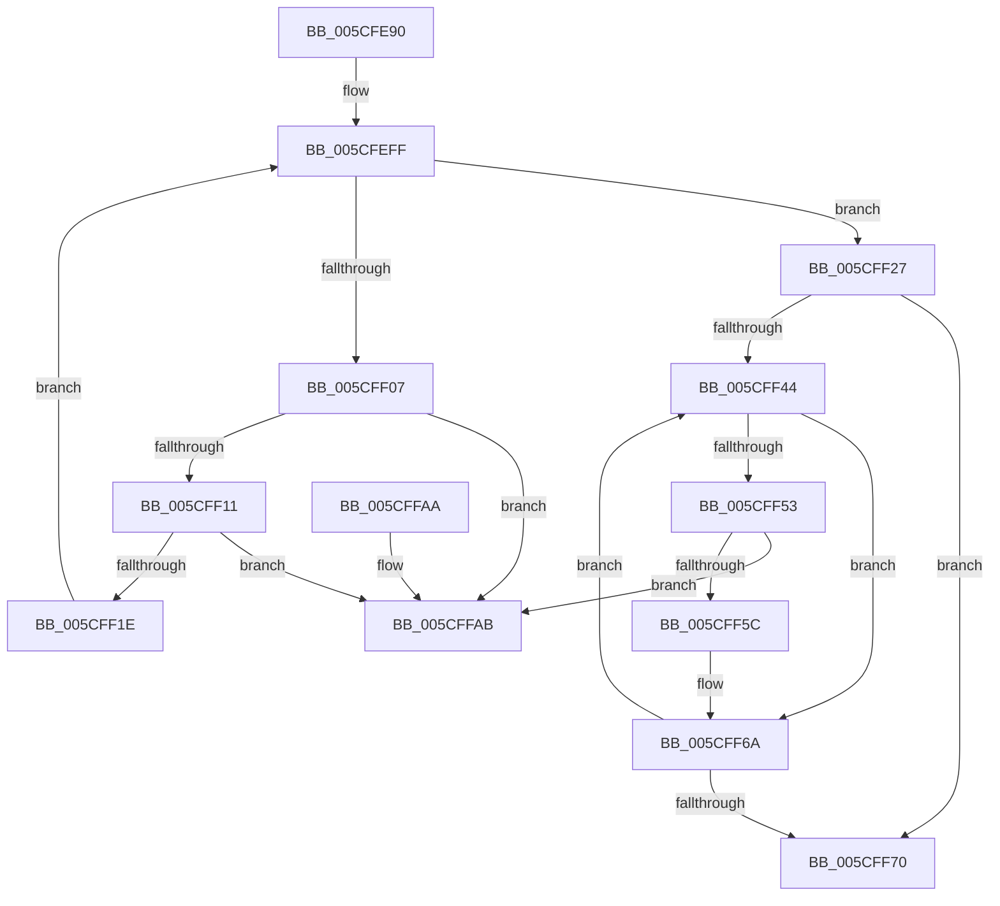

# PpmIdleInstallNewVetoList

- RVA: `0x005CFE90`–`0x005CFFB2` (길이 `290` bytes)
- VA: `0x00000001405CFE90`
- 실행 섹션: `.text`
- PDB 이름 있음: `예`; PDB Function 태그: `아니요`
- unwind 정보 RVA: `0x000CBE5C`
- 디코드: `83`개 명령, `290/290` bytes 표시
- 미해석 바이트: `0` (있으면 어셈블리에 `.byte`로 보존)

> 이 문서는 커널 이미지의 기계어와 PDB 기호를 분석해 생성했습니다. 4번과 5번은 함수 원형과 자료형을 바이너리 사용 방식에서 추정한 C 해석이며 원본 소스 복구 결과는 아닙니다.

## 1. Dependencies

- 직접 호출 지점: **7**; 고유 호출 대상: **7**
- 직접 호출자로 확인된 함수: **1**
- RIP 상대 이미지 참조: **2**

### Outgoing calls
- `0x005CFED1` → [KeFirstGroupAffinityEx](../46/KeFirstGroupAffinityEx_function_00463810.md) (function, `0x00463810`)
- `0x005CFEE0` → [KeSetSystemGroupAffinityThread](../39/KeSetSystemGroupAffinityThread_function_00399140.md) (function, `0x00399140`)
- `0x005CFEEC` → [KeAcquireSpinLockRaiseToDpc](../20/KeAcquireSpinLockRaiseToDpc_function_00208470.md) (function, `0x00208470`)
- `0x005CFF31` → [memcpy](../6C/memcpy_function_006C6840.md) (function, `0x006C6840`)
- `0x005CFF7A` → [KeReleaseSpinLock](../39/KeReleaseSpinLock_function_00392BA0.md) (function, `0x00392BA0`)
- `0x005CFF84` → [KeRevertToUserGroupAffinityThread](../39/KeRevertToUserGroupAffinityThread_function_00398EC0.md) (function, `0x00398EC0`)
- `0x005CFF91` → [_security_check_cookie](../6A/_security_check_cookie_function_006AC640.md) (function, `0x006AC640`)

### Direct callers
- [PpmIdleAllocateVetoReasons](../../page/75/PpmIdleAllocateVetoReasons_function_00754D08.md) at `0x00754ED6`

### Static image references
- `0x005CFEA0` → RVA `0x00E0A740` (`.data`; read)
- `0x005CFEE5` → RVA `0x00F0CA68` (`.data`; read)

## 2. Other-region calls and transfers

- 다른 실행 섹션으로 향하는 call: **0**
- 별도 외부 분기/꼬리 이동을 확인하지 못했습니다.

## 3. Assembly (complete function range)

```asm
005CFE90  48 89 5C 24 10                  mov qword ptr [rsp + 0x10], rbx
005CFE95  55                              push rbp
005CFE96  56                              push rsi
005CFE97  57                              push rdi
005CFE98  41 56                           push r14
005CFE9A  41 57                           push r15
005CFE9C  48 83 EC 50                     sub rsp, 0x50
005CFEA0  48 8B 05 99 A8 83 00            mov rax, qword ptr [rip + 0x83a899]
005CFEA7  48 33 C4                        xor rax, rsp
005CFEAA  48 89 44 24 40                  mov qword ptr [rsp + 0x40], rax
005CFEAF  44 8B FA                        mov r15d, edx
005CFEB2  48 8B F1                        mov rsi, rcx
005CFEB5  48 8D 51 40                     lea rdx, [rcx + 0x40]
005CFEB9  0F 57 C0                        xorps xmm0, xmm0
005CFEBC  0F 57 C9                        xorps xmm1, xmm1
005CFEBF  48 8D 4C 24 20                  lea rcx, [rsp + 0x20]
005CFEC4  49 8B E8                        mov rbp, r8
005CFEC7  0F 11 44 24 20                  movups xmmword ptr [rsp + 0x20], xmm0
005CFECC  0F 11 4C 24 30                  movups xmmword ptr [rsp + 0x30], xmm1
005CFED1  E8 3A 39 E9 FF                  call 0x140463810
005CFED6  48 8D 54 24 30                  lea rdx, [rsp + 0x30]
005CFEDB  48 8D 4C 24 20                  lea rcx, [rsp + 0x20]
005CFEE0  E8 5B 92 DC FF                  call 0x140399140
005CFEE5  48 8D 0D 7C CB 93 00            lea rcx, [rip + 0x93cb7c]
005CFEEC  E8 7F 85 C3 FF                  call 0x140208470
005CFEF1  48 8B 56 30                     mov rdx, qword ptr [rsi + 0x30]
005CFEF5  48 8D 5E 18                     lea rbx, [rsi + 0x18]
005CFEF9  8B 7E 2C                        mov edi, dword ptr [rsi + 0x2c]
005CFEFC  44 8A F0                        mov r14b, al
005CFEFF  48 8B 0B                        mov rcx, qword ptr [rbx]
005CFF02  48 3B CB                        cmp rcx, rbx
005CFF05  74 20                           je 0x1405cff27
005CFF07  48 39 59 08                     cmp qword ptr [rcx + 8], rbx
005CFF0B  0F 85 9A 00 00 00               jne 0x1405cffab
005CFF11  48 8B 01                        mov rax, qword ptr [rcx]
005CFF14  48 39 48 08                     cmp qword ptr [rax + 8], rcx
005CFF18  0F 85 8D 00 00 00               jne 0x1405cffab
005CFF1E  48 89 03                        mov qword ptr [rbx], rax
005CFF21  48 89 58 08                     mov qword ptr [rax + 8], rbx
005CFF25  EB D8                           jmp 0x1405cfeff
005CFF27  4C 8B C7                        mov r8, rdi
005CFF2A  48 8B CD                        mov rcx, rbp
005CFF2D  49 C1 E0 06                     shl r8, 6
005CFF31  E8 0A 69 0F 00                  call 0x1406c6840
005CFF36  33 D2                           xor edx, edx
005CFF38  48 89 6E 30                     mov qword ptr [rsi + 0x30], rbp
005CFF3C  44 89 7E 2C                     mov dword ptr [rsi + 0x2c], r15d
005CFF40  85 FF                           test edi, edi
005CFF42  74 2C                           je 0x1405cff70
005CFF44  8B CA                           mov ecx, edx
005CFF46  48 C1 E1 06                     shl rcx, 6
005CFF4A  48 03 CD                        add rcx, rbp
005CFF4D  83 79 14 00                     cmp dword ptr [rcx + 0x14], 0
005CFF51  76 17                           jbe 0x1405cff6a
005CFF53  48 8B 43 08                     mov rax, qword ptr [rbx + 8]
005CFF57  48 39 18                        cmp qword ptr [rax], rbx
005CFF5A  75 4F                           jne 0x1405cffab
005CFF5C  48 89 19                        mov qword ptr [rcx], rbx
005CFF5F  48 89 41 08                     mov qword ptr [rcx + 8], rax
005CFF63  48 89 08                        mov qword ptr [rax], rcx
005CFF66  48 89 4B 08                     mov qword ptr [rbx + 8], rcx
005CFF6A  FF C2                           inc edx
005CFF6C  3B D7                           cmp edx, edi
005CFF6E  72 D4                           jb 0x1405cff44
005CFF70  41 8A D6                        mov dl, r14b
005CFF73  48 8D 0D EE CA 93 00            lea rcx, [rip + 0x93caee]
005CFF7A  E8 21 2C DC FF                  call 0x140392ba0
005CFF7F  48 8D 4C 24 30                  lea rcx, [rsp + 0x30]
005CFF84  E8 37 8F DC FF                  call 0x140398ec0
005CFF89  48 8B 4C 24 40                  mov rcx, qword ptr [rsp + 0x40]
005CFF8E  48 33 CC                        xor rcx, rsp
005CFF91  E8 AA C6 0D 00                  call 0x1406ac640
005CFF96  48 8B 9C 24 88 00 00 00         mov rbx, qword ptr [rsp + 0x88]
005CFF9E  48 83 C4 50                     add rsp, 0x50
005CFFA2  41 5F                           pop r15
005CFFA4  41 5E                           pop r14
005CFFA6  5F                              pop rdi
005CFFA7  5E                              pop rsi
005CFFA8  5D                              pop rbp
005CFFA9  C3                              ret
005CFFAA  CC                              int3
005CFFAB  B9 03 00 00 00                  mov ecx, 3
005CFFB0  CD 29                           int 0x29
```

## 4. C-style interpretation (structured pseudocode)

```c
__int64 __fastcall PpmIdleInstallNewVetoList(__int64 a1, int a2, __int64 a3)
{
    __int64 result;
    __int64 v_rsp;
    unsigned __int64 v_stack_m38;
    unsigned __int64 v_stack_m48;
    unsigned __int64 v_stack_m58;
    unsigned __int64 v_stack_p10;

    v_stack_p10 = v_rbx;
    v_rsp = (v_rsp) - (80);
    result = (*(unsigned __int64 *)(v_rip + 8628377)) ^ (v_rsp);
    v_stack_m38 = result;
    v_stack_m58 = v_xmm0;
    v_stack_m48 = v_xmm1;
    result = KeFirstGroupAffinityEx(v_stack_m58, a1 + 64, a3, a4);
    result = KeSetSystemGroupAffinityThread(v_stack_m58, v_stack_m48, a3, a4);
    result = KeAcquireSpinLockRaiseToDpc(v_rip + 9685884, v_stack_m48, a3, a4);
loc_005CFEFF:
    if ((*(unsigned __int64 *)(a1 + 24)) == (a1 + 24)) goto loc_005CFF27;
    if ((*(unsigned __int64 *)(*(unsigned __int64 *)(a1 + 24) + 8)) != (a1 + 24)) goto loc_005CFFAB;
    if ((*(unsigned __int64 *)(*(unsigned __int64 *)(*(unsigned __int64 *)(a1 + 24)) + 8)) != (*(unsigned __int64 *)(a1 + 24))) goto loc_005CFFAB;
    *(unsigned __int64 *)(a1 + 24) = *(unsigned __int64 *)(*(unsigned __int64 *)(a1 + 24));
    *(unsigned __int64 *)(*(unsigned __int64 *)(*(unsigned __int64 *)(a1 + 24)) + 8) = a1 + 24;
    goto loc_005CFEFF;
loc_005CFF27:
    a3 = ((unsigned int)(*(unsigned int *)(a1 + 44))) << (6);
    result = memcpy(a3, *(unsigned __int64 *)(a1 + 48), a3, a4);
    a2 = 0;
    *(unsigned __int64 *)(a1 + 48) = a3;
    *(unsigned int *)(a1 + 44) = (unsigned int)((unsigned int)(a2));
    if ((unsigned int)((unsigned int)(*(unsigned int *)(a1 + 44))) == 0) goto loc_005CFF70;
loc_005CFF44:
    a1 = (0) << (6);
    a1 = (a1) + (a3);
    if ((*(unsigned int *)(a1 + 20)) <= 0) goto loc_005CFF6A;
    if ((*(unsigned __int64 *)(*(unsigned __int64 *)(a1 + 24 + 8))) != (a1 + 24)) goto loc_005CFFAB;
    *(unsigned __int64 *)(a1) = a1 + 24;
    *(unsigned __int64 *)(a1 + 8) = *(unsigned __int64 *)(a1 + 24 + 8);
    *(unsigned __int64 *)(*(unsigned __int64 *)(a1 + 24 + 8)) = a1;
    *(unsigned __int64 *)(a1 + 24 + 8) = a1;
loc_005CFF6A:
    a2 = (unsigned int)((a2) + 1);
    if (a2 < ((unsigned int)((unsigned int)(*(unsigned int *)(a1 + 44))))) goto loc_005CFF44;
loc_005CFF70:
    result = KeReleaseSpinLock(v_rip + 9685742, (unsigned __int8)((unsigned __int8)(result)), a3, a4);
    result = KeRevertToUserGroupAffinityThread(v_stack_m48, (unsigned __int8)((unsigned __int8)(result)), a3, a4);
    a1 = (v_stack_m38) ^ (v_rsp);
    result = _security_check_cookie(a1, (unsigned __int8)((unsigned __int8)(result)), a3, a4);
    v_rsp = (v_rsp) + (80);
    return result;
loc_005CFFAB:
    return result;
}
```

## 5. (Beta) C Style

```c
int64_t PpmIdleInstallNewVetoList(void *Arg1, int32_t Arg2, int64_t Arg3)
{
    uint8_t *arg1 = (uint8_t *)Arg1;

    int64_t result;
    int64_t local_rsp;
    uint64_t v_stack_m38;
    uint64_t v_stack_m48;
    uint64_t v_stack_m58;
    uint64_t v_stack_p10;

    v_stack_p10 = local_rbx;
    local_rsp = (local_rsp) - (80);
    result = (*(uint64_t *)(v_rip + 0x83A899)) ^ (local_rsp);
    v_stack_m38 = result;
    v_stack_m58 = v_xmm0;
    v_stack_m48 = v_xmm1;
    result = KeFirstGroupAffinityEx(v_stack_m58, Arg1 + 64, Arg3, a4);
    result = KeSetSystemGroupAffinityThread(v_stack_m58, v_stack_m48, Arg3, a4);
    result = KeAcquireSpinLockRaiseToDpc(v_rip + 9685884, v_stack_m48, Arg3, a4);
loc_005CFEFF:
    if ((*(uint64_t *)(arg1 + 0x18)) == (Arg1 + 24)) goto loc_005CFF27;
    if ((*(uint64_t *)(*(uint64_t *)(arg1 + 0x18) + 0x8)) != (Arg1 + 24)) goto loc_005CFFAB;
    if ((*(uint64_t *)(*(uint64_t *)(*(uint64_t *)(arg1 + 0x18)) + 0x8)) != (*(uint64_t *)(arg1 + 0x18))) goto loc_005CFFAB;
    *(uint64_t *)(arg1 + 0x18) = *(uint64_t *)(*(uint64_t *)(arg1 + 0x18));
    *(void **)(*(uint64_t *)(*(uint64_t *)(arg1 + 0x18)) + 0x8) = Arg1 + 24;
    goto loc_005CFEFF;
loc_005CFF27:
    Arg3 = ((uint32_t)(*(uint32_t *)(arg1 + 0x2C))) << (6);
    result = memcpy(Arg3, *(uint64_t *)(arg1 + 0x30), Arg3, a4);
    Arg2 = 0;
    *(uint64_t *)(arg1 + 0x30) = Arg3;
    *(uint32_t *)(arg1 + 0x2C) = (uint32_t)((uint32_t)(Arg2));
    if ((uint32_t)((uint32_t)(*(uint32_t *)(arg1 + 0x2C))) == 0) goto loc_005CFF70;
loc_005CFF44:
    Arg1 = (0) << (6);
    Arg1 = (Arg1) + (Arg3);
    if ((*(uint32_t *)(arg1 + 0x14)) <= 0) goto loc_005CFF6A;
    if ((*(uint64_t *)(*(uint64_t *)(arg1 + 0x18 + 0x8))) != (Arg1 + 24)) goto loc_005CFFAB;
    *(void **)(arg1) = Arg1 + 24;
    *(uint64_t *)(arg1 + 0x8) = *(uint64_t *)(arg1 + 0x18 + 0x8);
    *(void **)(*(uint64_t *)(arg1 + 0x18 + 0x8)) = Arg1;
    *(void **)(arg1 + 0x18 + 0x8) = Arg1;
loc_005CFF6A:
    Arg2 = (uint32_t)((Arg2) + 1);
    if (Arg2 < ((uint32_t)((uint32_t)(*(uint32_t *)(arg1 + 0x2C))))) goto loc_005CFF44;
loc_005CFF70:
    result = KeReleaseSpinLock(v_rip + 9685742, (uint8_t)((uint8_t)(result)), Arg3, a4);
    result = KeRevertToUserGroupAffinityThread(v_stack_m48, (uint8_t)((uint8_t)(result)), Arg3, a4);
    Arg1 = (v_stack_m38) ^ (local_rsp);
    result = _security_check_cookie(Arg1, (uint8_t)((uint8_t)(result)), Arg3, a4);
    local_rsp = (local_rsp) + (80);
    return result;
loc_005CFFAB:
    return result;
}
```

### 관측된 메모리 오프셋

구조체 형식이 확인되지 않은 접근은 인자 기준의 오프셋으로만 기록했습니다.

| 기준 인자 | 오프셋 표현 | 폭 (bit) | 접근 |
|---|---:|---:|---|
| `Arg1` | `+ 0x0` | `64` | `R` |
| `Arg1` | `+ 0x0` | `64` | `W` |
| `Arg1` | `+ 0x8` | `64` | `R` |
| `Arg1` | `+ 0x8` | `64` | `W` |
| `Arg1` | `+ 0x18` | `64` | `R` |
| `Arg1` | `+ 0x2C` | `32` | `R` |
| `Arg1` | `+ 0x2C` | `32` | `W` |
| `Arg1` | `+ 0x30` | `64` | `R` |
| `Arg1` | `+ 0x30` | `64` | `W` |
| `Arg1` | `+ 0x40` | `64` | `R` |

## 6. Execution-region graph

[열기: 2D/3D 그래프와 함수 탐색 컨트롤 패널](../../../control-panel.html?section=text&rva=0x005CFE90&view=graph)

- 2D 그래프는 위에서 아래로 흐르고, 3D 그래프는 빈 공간을 드래그해 회전합니다. Shift+드래그는 이동, 휠은 확대·축소, 함수 노드 선택은 대상 보고서 이동입니다.

### Static fallback


