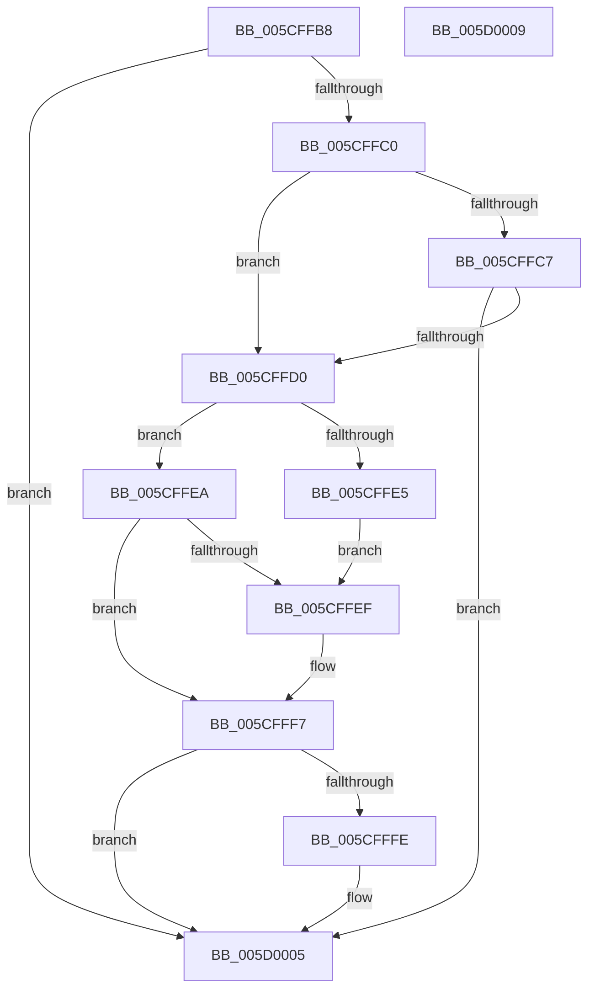

# PpmIdlePrepareExitLatencyTrace

- RVA: `0x005CFFB8`–`0x005D000A` (길이 `82` bytes)
- VA: `0x00000001405CFFB8`
- 실행 섹션: `.text`
- PDB 이름 있음: `예`; PDB Function 태그: `아니요`
- unwind 정보 RVA: `0x000DB714`
- 디코드: `30`개 명령, `82/82` bytes 표시
- 미해석 바이트: `0` (있으면 어셈블리에 `.byte`로 보존)

> 이 문서는 커널 이미지의 기계어와 PDB 기호를 분석해 생성했습니다. 4번과 5번은 함수 원형과 자료형을 바이너리 사용 방식에서 추정한 C 해석이며 원본 소스 복구 결과는 아닙니다.

## 1. Dependencies

- 직접 호출 지점: **0**; 고유 호출 대상: **0**
- 직접 호출자로 확인된 함수: **1**
- RIP 상대 이미지 참조: **1**

### Outgoing calls
- 직접 디코드된 call 명령이 없습니다.

### Direct callers
- [sub_006DCEEE](../6D/Unknown_function_006DCEEE.md) at `0x006DD0A6`

### Static image references
- `0x005CFFD0` → RVA `0x00E67668` (`.data`; read)

## 2. Other-region calls and transfers

- 다른 실행 섹션으로 향하는 call: **0**
- 별도 외부 분기/꼬리 이동을 확인하지 못했습니다.

## 3. Assembly (complete function range)

```asm
005CFFB8  45 33 C0                        xor r8d, r8d
005CFFBB  83 FA FF                        cmp edx, -1
005CFFBE  74 45                           je 0x1405d0005
005CFFC0  8B 41 14                        mov eax, dword ptr [rcx + 0x14]
005CFFC3  85 C0                           test eax, eax
005CFFC5  74 09                           je 0x1405cffd0
005CFFC7  FF C8                           dec eax
005CFFC9  89 41 14                        mov dword ptr [rcx + 0x14], eax
005CFFCC  85 C0                           test eax, eax
005CFFCE  75 35                           jne 0x1405d0005
005CFFD0  44 8B 0D 91 76 89 00            mov r9d, dword ptr [rip + 0x897691]
005CFFD7  41 BA 64 00 00 00               mov r10d, 0x64
005CFFDD  41 8B C0                        mov eax, r8d
005CFFE0  45 3B CA                        cmp r9d, r10d
005CFFE3  76 05                           jbe 0x1405cffea
005CFFE5  45 8B CA                        mov r9d, r10d
005CFFE8  EB 05                           jmp 0x1405cffef
005CFFEA  45 85 C9                        test r9d, r9d
005CFFED  74 08                           je 0x1405cfff7
005CFFEF  33 D2                           xor edx, edx
005CFFF1  41 8B C2                        mov eax, r10d
005CFFF4  41 F7 F1                        div r9d
005CFFF7  89 41 14                        mov dword ptr [rcx + 0x14], eax
005CFFFA  85 C0                           test eax, eax
005CFFFC  74 07                           je 0x1405d0005
005CFFFE  C6 41 03 01                     mov byte ptr [rcx + 3], 1
005D0002  41 B0 01                        mov r8b, 1
005D0005  41 8A C0                        mov al, r8b
005D0008  C3                              ret
005D0009  CC                              int3
```

## 4. C-style interpretation (structured pseudocode)

```c
__int64 __fastcall PpmIdlePrepareExitLatencyTrace(__int64 a1, int a2, int a3)
{
    __int64 result;

    a3 = 0;
    if (a2 == -1) goto loc_005D0005;
    if ((unsigned int)((unsigned int)(*(unsigned int *)(a1 + 20))) == 0) goto loc_005CFFD0;
    result = (unsigned int)(((unsigned int)(*(unsigned int *)(a1 + 20))) - 1);
    *(unsigned int *)(a1 + 20) = (unsigned int)(result);
    if ((unsigned int)(result) != 0) goto loc_005D0005;
loc_005CFFD0:
    if (((unsigned int)((unsigned int)(*(unsigned int *)(v_rip + 9008785)))) <= 100) goto loc_005CFFEA;
    goto loc_005CFFEF;
loc_005CFFEA:
    result = 0;
    if (100 != 0) {
        a2 = 0;
        result = 100;
    }
    *(unsigned int *)(a1 + 20) = (unsigned int)(result);
    if ((unsigned int)(result) != 0) {
        *(unsigned __int8 *)(a1 + 3) = 1;
        a3 = 1;
    }
    return (unsigned __int8)(a3);
}
```

## 5. (Beta) C Style

```c
int64_t PpmIdlePrepareExitLatencyTrace(void *Arg1, int32_t Arg2, int32_t Arg3)
{
    uint8_t *arg1 = (uint8_t *)Arg1;

    int64_t result;

    Arg3 = 0;
    if (Arg2 == -1) goto loc_005D0005;
    if ((uint32_t)((uint32_t)(*(uint32_t *)(arg1 + 0x14))) == 0) goto loc_005CFFD0;
    result = (uint32_t)(((uint32_t)(*(uint32_t *)(arg1 + 0x14))) - 1);
    *(uint32_t *)(arg1 + 0x14) = (uint32_t)(result);
    if ((uint32_t)(result) != 0) goto loc_005D0005;
loc_005CFFD0:
    if (((uint32_t)((uint32_t)(*(uint32_t *)(v_rip + 0x897691)))) <= 100) goto loc_005CFFEA;
    goto loc_005CFFEF;
loc_005CFFEA:
    result = 0;
    if (100 != 0) {
        Arg2 = 0;
        result = 100;
    }
    *(uint32_t *)(arg1 + 0x14) = (uint32_t)(result);
    if ((uint32_t)(result) != 0) {
        *(uint8_t *)(arg1 + 0x3) = 1;
        Arg3 = 1;
    }
    return (uint8_t)(Arg3);
}
```

### 관측된 메모리 오프셋

구조체 형식이 확인되지 않은 접근은 인자 기준의 오프셋으로만 기록했습니다.

| 기준 인자 | 오프셋 표현 | 폭 (bit) | 접근 |
|---|---:|---:|---|
| `Arg1` | `+ 0x3` | `8` | `W` |
| `Arg1` | `+ 0x14` | `32` | `R` |
| `Arg1` | `+ 0x14` | `32` | `W` |

## 6. Execution-region graph

[열기: 2D/3D 그래프와 함수 탐색 컨트롤 패널](../../../control-panel.html?section=text&rva=0x005CFFB8&view=graph)

- 2D 그래프는 위에서 아래로 흐르고, 3D 그래프는 빈 공간을 드래그해 회전합니다. Shift+드래그는 이동, 휠은 확대·축소, 함수 노드 선택은 대상 보고서 이동입니다.

### Static fallback


