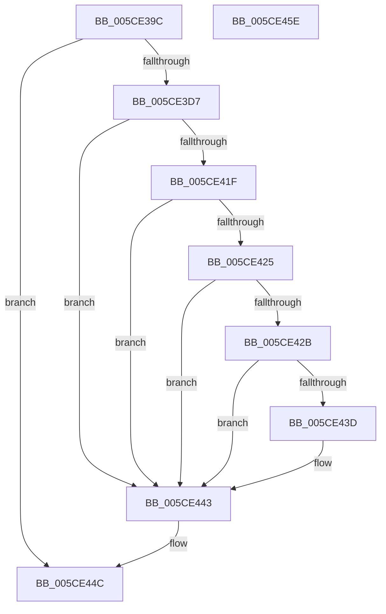

# PpmInitIllegalThrottleLogging

- RVA: `0x005CE39C`–`0x005CE45F` (길이 `195` bytes)
- VA: `0x00000001405CE39C`
- 실행 섹션: `.text`
- PDB 이름 있음: `예`; PDB Function 태그: `아니요`
- unwind 정보 RVA: `0x000CBCE8`
- 디코드: `51`개 명령, `195/195` bytes 표시
- 미해석 바이트: `0` (있으면 어셈블리에 `.byte`로 보존)

> 이 문서는 커널 이미지의 기계어와 PDB 기호를 분석해 생성했습니다. 4번과 5번은 함수 원형과 자료형을 바이너리 사용 방식에서 추정한 C 해석이며 원본 소스 복구 결과는 아닙니다.

## 1. Dependencies

- 직접 호출 지점: **5**; 고유 호출 대상: **5**
- 직접 호출자로 확인된 함수: **1**
- RIP 상대 이미지 참조: **4**

### Outgoing calls
- `0x005CE3CE` → [PopOpenKey](../4B/PopOpenKey_function_004B4330.md) (function, `0x004B4330`)
- `0x005CE3E2` → [RtlInitUnicodeString](../42/RtlInitUnicodeString_function_0042A780.md) (function, `0x0042A780`)
- `0x005CE416` → [ZwQueryValueKey](../6A/ZwQueryValueKey_function_006AD3B0.md) (function, `0x006AD3B0`)
- `0x005CE447` → [ZwClose](../6A/ZwClose_function_006AD2B0.md) (function, `0x006AD2B0`)
- `0x005CE453` → [_security_check_cookie](../6A/_security_check_cookie_function_006AC640.md) (function, `0x006AC640`)

### Direct callers
- [PoInitSystem](../../init/C7/PoInitSystem_function_00C72358.md) at `0x00C72F9B`

### Static image references
- `0x005CE3A5` → RVA `0x00E0A740` (`.data`; read)
- `0x005CE3B7` → RVA `0x0001C4F8` (`.rdata`; read)
- `0x005CE3D7` → RVA `0x00029310` (`.rdata`; read)
- `0x005CE433` → RVA `0x00E0B3EC` (`.data`; write)

## 2. Other-region calls and transfers

- 다른 실행 섹션으로 향하는 call: **0**
- 별도 외부 분기/꼬리 이동을 확인하지 못했습니다.

## 3. Assembly (complete function range)

```asm
005CE39C  40 55                           push rbp
005CE39E  48 8B EC                        mov rbp, rsp
005CE3A1  48 83 EC 70                     sub rsp, 0x70
005CE3A5  48 8B 05 94 C3 83 00            mov rax, qword ptr [rip + 0x83c394]
005CE3AC  48 33 C4                        xor rax, rsp
005CE3AF  48 89 45 F8                     mov qword ptr [rbp - 8], rax
005CE3B3  83 65 C0 00                     and dword ptr [rbp - 0x40], 0
005CE3B7  48 8D 15 3A E1 A4 FF            lea rdx, [rip - 0x5b1ec6]
005CE3BE  48 83 65 C8 00                  and qword ptr [rbp - 0x38], 0
005CE3C3  48 8D 4D C8                     lea rcx, [rbp - 0x38]
005CE3C7  0F 57 C0                        xorps xmm0, xmm0
005CE3CA  0F 11 45 D0                     movups xmmword ptr [rbp - 0x30], xmm0
005CE3CE  E8 5D 5F EE FF                  call 0x1404b4330
005CE3D3  85 C0                           test eax, eax
005CE3D5  78 75                           js 0x1405ce44c
005CE3D7  48 8D 15 32 AF A5 FF            lea rdx, [rip - 0x5a50ce]
005CE3DE  48 8D 4D D0                     lea rcx, [rbp - 0x30]
005CE3E2  E8 99 C3 E5 FF                  call 0x14042a780
005CE3E7  48 8B 4D C8                     mov rcx, qword ptr [rbp - 0x38]
005CE3EB  4C 8D 4D E0                     lea r9, [rbp - 0x20]
005CE3EF  33 C0                           xor eax, eax
005CE3F1  48 8D 55 D0                     lea rdx, [rbp - 0x30]
005CE3F5  89 45 F0                        mov dword ptr [rbp - 0x10], eax
005CE3F8  0F 57 C0                        xorps xmm0, xmm0
005CE3FB  48 8D 45 C0                     lea rax, [rbp - 0x40]
005CE3FF  41 B8 02 00 00 00               mov r8d, 2
005CE405  48 89 44 24 28                  mov qword ptr [rsp + 0x28], rax
005CE40A  C7 44 24 20 14 00 00 00         mov dword ptr [rsp + 0x20], 0x14
005CE412  0F 11 45 E0                     movups xmmword ptr [rbp - 0x20], xmm0
005CE416  E8 95 EF 0D 00                  call 0x1406ad3b0
005CE41B  85 C0                           test eax, eax
005CE41D  78 24                           js 0x1405ce443
005CE41F  83 7D E4 04                     cmp dword ptr [rbp - 0x1c], 4
005CE423  75 1E                           jne 0x1405ce443
005CE425  83 7D E8 04                     cmp dword ptr [rbp - 0x18], 4
005CE429  75 18                           jne 0x1405ce443
005CE42B  8B 45 EC                        mov eax, dword ptr [rbp - 0x14]
005CE42E  B9 10 27 00 00                  mov ecx, 0x2710
005CE433  89 05 B3 CF 83 00               mov dword ptr [rip + 0x83cfb3], eax
005CE439  3B C1                           cmp eax, ecx
005CE43B  76 06                           jbe 0x1405ce443
005CE43D  89 0D A9 CF 83 00               mov dword ptr [rip + 0x83cfa9], ecx
005CE443  48 8B 4D C8                     mov rcx, qword ptr [rbp - 0x38]
005CE447  E8 64 EE 0D 00                  call 0x1406ad2b0
005CE44C  48 8B 4D F8                     mov rcx, qword ptr [rbp - 8]
005CE450  48 33 CC                        xor rcx, rsp
005CE453  E8 E8 E1 0D 00                  call 0x1406ac640
005CE458  48 83 C4 70                     add rsp, 0x70
005CE45C  5D                              pop rbp
005CE45D  C3                              ret
005CE45E  CC                              int3
```

## 4. C-style interpretation (structured pseudocode)

```c
__int64 __fastcall PpmInitIllegalThrottleLogging(void)
{
    __int64 result;
    __int64 v_rsp;
    unsigned __int64 v_stack_m10;
    unsigned int v_stack_m18;
    unsigned int v_stack_m1C;
    unsigned int v_stack_m20;
    unsigned int v_stack_m24;
    unsigned __int64 v_stack_m28;
    unsigned __int64 v_stack_m38;
    unsigned __int64 v_stack_m40;
    unsigned int v_stack_m48;
    unsigned __int64 v_stack_m50;
    unsigned int v_stack_m58;

    v_rsp = (v_rsp) - (112);
    result = (*(unsigned __int64 *)(v_rip + 8635284)) ^ (v_rsp);
    v_stack_m10 = result;
    v_stack_m38 = v_xmm0;
    result = PopOpenKey(v_stack_m40, v_rip - 5971654, a3, a4);
    if (sign_flag) goto loc_005CE44C;
    result = RtlInitUnicodeString(v_stack_m38, v_rip - 5918926, a3, a4);
    result = 0;
    v_stack_m18 = 0;
    v_stack_m50 = v_stack_m48;
    v_stack_m58 = 20;
    v_stack_m28 = v_xmm0;
    result = ZwQueryValueKey(v_stack_m40, v_stack_m38, 2, v_stack_m28);
    if (sign_flag) goto loc_005CE443;
    if (v_stack_m24 != 4) goto loc_005CE443;
    if (v_stack_m20 != 4) goto loc_005CE443;
    *(unsigned int *)(v_rip + 8638387) = (unsigned int)((unsigned int)(v_stack_m1C));
    if (((unsigned int)((unsigned int)(v_stack_m1C))) >= = ((unsigned int)((unsigned int)(0x2710ULL)))) {
        *(unsigned int *)(v_rip + 8638377) = (unsigned int)((unsigned int)(0x2710ULL));
    }
    result = ZwClose(v_stack_m40, v_stack_m38, 2, v_stack_m28);
loc_005CE44C:
    a1 = (v_stack_m10) ^ (v_rsp);
    result = _security_check_cookie(a1, v_stack_m38, 2, v_stack_m28);
    v_rsp = (v_rsp) + (112);
    return result;
}
```

## 5. (Beta) C Style

```c
void PpmInitIllegalThrottleLogging(void)
{
    int64_t result;
    int64_t local_rsp;
    uint64_t v_stack_m10;
    uint32_t v_stack_m18;
    uint32_t v_stack_m1C;
    uint32_t v_stack_m20;
    uint32_t v_stack_m24;
    uint64_t v_stack_m28;
    uint64_t v_stack_m38;
    uint64_t v_stack_m40;
    uint32_t v_stack_m48;
    uint64_t v_stack_m50;
    uint32_t v_stack_m58;

    local_rsp = (local_rsp) - (112);
    result = (*(uint64_t *)(v_rip + 0x83C394)) ^ (local_rsp);
    v_stack_m10 = result;
    v_stack_m38 = v_xmm0;
    result = PopOpenKey(v_stack_m40, v_rip - 5971654, a3, a4);
    if (sign_flag) goto loc_005CE44C;
    result = RtlInitUnicodeString(v_stack_m38, v_rip - 5918926, a3, a4);
    result = 0;
    v_stack_m18 = 0;
    v_stack_m50 = v_stack_m48;
    v_stack_m58 = 20;
    v_stack_m28 = v_xmm0;
    result = ZwQueryValueKey(v_stack_m40, v_stack_m38, 2, v_stack_m28);
    if (sign_flag) goto loc_005CE443;
    if (v_stack_m24 != 4) goto loc_005CE443;
    if (v_stack_m20 != 4) goto loc_005CE443;
    *(uint32_t *)(v_rip + 0x83CFB3) = (uint32_t)((uint32_t)(v_stack_m1C));
    if (((uint32_t)((uint32_t)(v_stack_m1C))) >= = ((uint32_t)((uint32_t)(0x2710ULL)))) {
        *(uint32_t *)(v_rip + 0x83CFA9) = (uint32_t)((uint32_t)(0x2710ULL));
    }
    result = ZwClose(v_stack_m40, v_stack_m38, 2, v_stack_m28);
loc_005CE44C:
    a1 = (v_stack_m10) ^ (local_rsp);
    result = _security_check_cookie(a1, v_stack_m38, 2, v_stack_m28);
    local_rsp = (local_rsp) + (112);
    return result;
}
```

## 6. Execution-region graph

[열기: 2D/3D 그래프와 함수 탐색 컨트롤 패널](../../../control-panel.html?section=text&rva=0x005CE39C&view=graph)

- 2D 그래프는 위에서 아래로 흐르고, 3D 그래프는 빈 공간을 드래그해 회전합니다. Shift+드래그는 이동, 휠은 확대·축소, 함수 노드 선택은 대상 보고서 이동입니다.

### Static fallback


