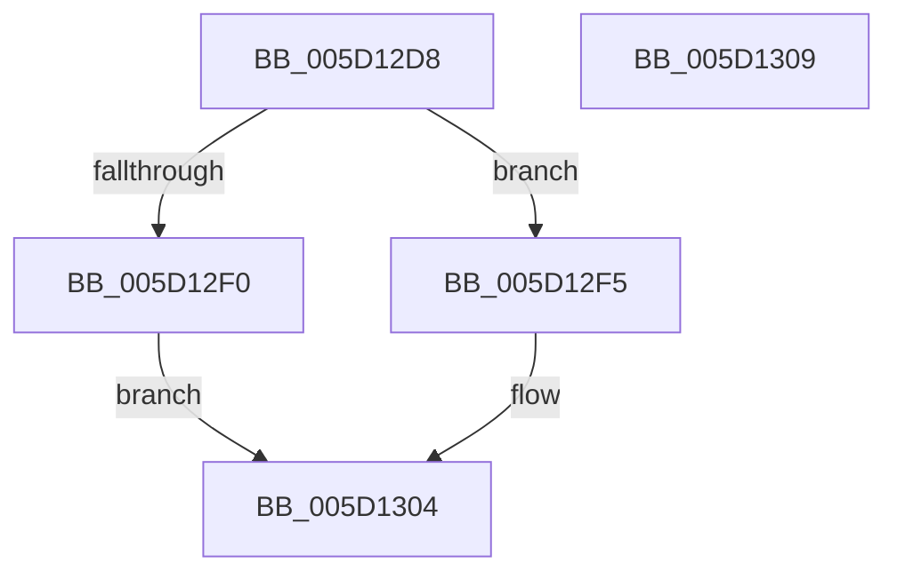

# Feature_Servicing_BatteryTestExempt__private_IsEnabledDeviceUsageNoInline

- RVA: `0x005D12D8`–`0x005D130A` (길이 `50` bytes)
- VA: `0x00000001405D12D8`
- 실행 섹션: `.text`
- PDB 이름 있음: `예`; PDB Function 태그: `아니요`
- unwind 정보 RVA: `0x0005C788`
- 디코드: `14`개 명령, `50/50` bytes 표시
- 미해석 바이트: `0` (있으면 어셈블리에 `.byte`로 보존)

> 이 문서는 커널 이미지의 기계어와 PDB 기호를 분석해 생성했습니다. 4번과 5번은 함수 원형과 자료형을 바이너리 사용 방식에서 추정한 C 해석이며 원본 소스 복구 결과는 아닙니다.

## 1. Dependencies

- 직접 호출 지점: **1**; 고유 호출 대상: **1**
- 직접 호출자로 확인된 함수: **4**
- RIP 상대 이미지 참조: **1**

### Outgoing calls
- `0x005D12FF` → [Feature_Servicing_BatteryTestExempt__private_IsEnabledFallback](Feature_Servicing_BatteryTestExempt__private_IsEnabledFallback_function_005D1310.md) (function, `0x005D1310`)

### Direct callers
- [PopBatteryInitialize](../../page/76/PopBatteryInitialize_function_00766834.md) at `0x00766ABE`
- [PopPowerAdapterAdd](../../page/76/PopPowerAdapterAdd_function_00767430.md) at `0x00767507`
- [PopPowerInformationInternal](../../page/A8/PopPowerInformationInternal_function_00A8B7C0.md) at `0x00A8D2DC`
- [PopBatteryInitPhaseTwo](../../init/C4/PopBatteryInitPhaseTwo_function_00C42148.md) at `0x00C421C5`

### Static image references
- `0x005D12E2` → RVA `0x00FC4AD0` (`.data`; read)

## 2. Other-region calls and transfers

- 다른 실행 섹션으로 향하는 call: **0**
- 별도 외부 분기/꼬리 이동을 확인하지 못했습니다.

## 3. Assembly (complete function range)

```asm
005D12D8  48 83 EC 28                     sub rsp, 0x28
005D12DC  48 83 64 24 30 00               and qword ptr [rsp + 0x30], 0
005D12E2  8B 05 E8 37 9F 00               mov eax, dword ptr [rip + 0x9f37e8]
005D12E8  89 44 24 30                     mov dword ptr [rsp + 0x30], eax
005D12EC  A8 10                           test al, 0x10
005D12EE  74 05                           je 0x1405d12f5
005D12F0  83 E0 01                        and eax, 1
005D12F3  EB 0F                           jmp 0x1405d1304
005D12F5  48 8B 4C 24 30                  mov rcx, qword ptr [rsp + 0x30]
005D12FA  BA 03 00 00 00                  mov edx, 3
005D12FF  E8 0C 00 00 00                  call 0x1405d1310
005D1304  48 83 C4 28                     add rsp, 0x28
005D1308  C3                              ret
005D1309  CC                              int3
```

## 4. C-style interpretation (structured pseudocode)

```c
__int64 __fastcall Feature_Servicing_BatteryTestExempt__private_IsEnabledDeviceUsageNoInline(void)
{
    __int64 result;
    __int64 v_rsp;
    unsigned __int64 v_stack_p8;

    v_rsp = (v_rsp) - (40);
    v_stack_p8 = (unsigned int)((unsigned int)(*(unsigned int *)(v_rip + 10434536)));
    if ((((unsigned __int8)((unsigned int)(*(unsigned int *)(v_rip + 10434536)))) & (16)) == 0) goto loc_005D12F5;
    result = (unsigned int)(((unsigned int)(*(unsigned int *)(v_rip + 10434536))) & (1));
    goto loc_005D1304;
loc_005D12F5:
    result = Feature_Servicing_BatteryTestExempt__private_IsEnabledFallback(v_stack_p8, 3, a3, a4);
loc_005D1304:
    v_rsp = (v_rsp) + (40);
    return result;
}
```

## 5. (Beta) C Style

```c
void Feature_Servicing_BatteryTestExempt__private_IsEnabledDeviceUsageNoInline(void)
{
    int64_t result;
    int64_t local_rsp;
    uint64_t v_stack_p8;

    local_rsp = (local_rsp) - (40);
    v_stack_p8 = (uint32_t)((uint32_t)(*(uint32_t *)(v_rip + 0x9F37E8)));
    if ((((uint8_t)((uint32_t)(*(uint32_t *)(v_rip + 0x9F37E8)))) & (16)) == 0) goto loc_005D12F5;
    result = (uint32_t)(((uint32_t)(*(uint32_t *)(v_rip + 0x9F37E8))) & (1));
    goto loc_005D1304;
loc_005D12F5:
    result = Feature_Servicing_BatteryTestExempt__private_IsEnabledFallback(v_stack_p8, 3, a3, a4);
loc_005D1304:
    local_rsp = (local_rsp) + (40);
    return result;
}
```

## 6. Execution-region graph

[열기: 2D/3D 그래프와 함수 탐색 컨트롤 패널](../../../control-panel.html?section=text&rva=0x005D12D8&view=graph)

- 2D 그래프는 위에서 아래로 흐르고, 3D 그래프는 빈 공간을 드래그해 회전합니다. Shift+드래그는 이동, 휠은 확대·축소, 함수 노드 선택은 대상 보고서 이동입니다.

### Static fallback


