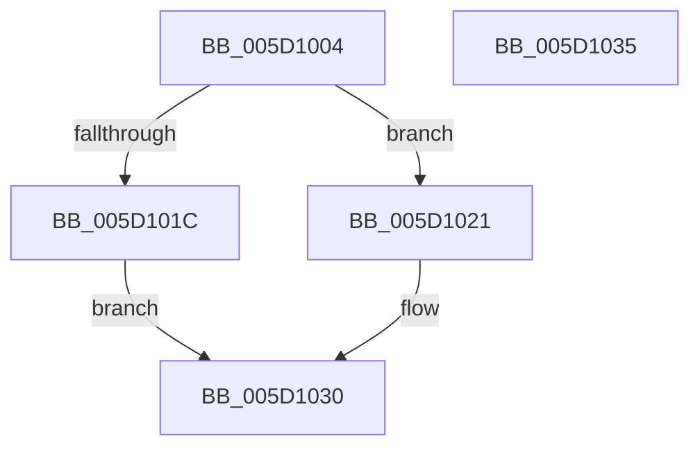

# Feature_Servicing_CoolingFrameworkDeviceCleanupFix__private_IsEnabledDeviceUsageNoInline

- RVA: `0x005D1004`–`0x005D1036` (길이 `50` bytes)
- VA: `0x00000001405D1004`
- 실행 섹션: `.text`
- PDB 이름 있음: `예`; PDB Function 태그: `아니요`
- unwind 정보 RVA: `0x0005C788`
- 디코드: `14`개 명령, `50/50` bytes 표시
- 미해석 바이트: `0` (있으면 어셈블리에 `.byte`로 보존)

> 이 문서는 커널 이미지의 기계어와 PDB 기호를 분석해 생성했습니다. 4번과 5번은 함수 원형과 자료형을 바이너리 사용 방식에서 추정한 C 해석이며 원본 소스 복구 결과는 아닙니다.

## 1. Dependencies

- 직접 호출 지점: **1**; 고유 호출 대상: **1**
- 직접 호출자로 확인된 함수: **12**
- RIP 상대 이미지 참조: **1**

### Outgoing calls
- `0x005D102B` → [Feature_Servicing_CoolingFrameworkDeviceCleanupFix__private_IsEnabledFallback](Feature_Servicing_CoolingFrameworkDeviceCleanupFix__private_IsEnabledFallback_function_005D103C.md) (function, `0x005D103C`)

### Direct callers
- [PopTraceThermalRequestPassiveHistogram](../42/PopTraceThermalRequestPassiveHistogram_function_0042FFB4.md) at `0x0042FFF1`
- [PopTraceThermalRequestPassiveHistogram](../42/PopTraceThermalRequestPassiveHistogram_function_0042FFB4.md) at `0x0043009B`
- [PopTraceThermalRequestPassiveHistogram](../42/PopTraceThermalRequestPassiveHistogram_function_0042FFB4.md) at `0x004301DA`
- [PopPropogateCoolingChange](../4E/PopPropogateCoolingChange_function_004E8FA0.md) at `0x004E8FBF`
- [PopTraceThermalRequestActiveActivity](../4E/PopTraceThermalRequestActiveActivity_function_004E9104.md) at `0x004E914E`
- [PopTraceThermalRequestActiveActivity](../4E/PopTraceThermalRequestActiveActivity_function_004E9104.md) at `0x004E9210`
- [PopTraceThermalRequestActiveActivity](../4E/PopTraceThermalRequestActiveActivity_function_004E9104.md) at `0x004E9377`
- [PopAssociateThermalRequest](../../page/75/PopAssociateThermalRequest_function_00756E78.md) at `0x00756F0C`
- [PopAssociateThermalRequest](../../page/75/PopAssociateThermalRequest_function_00756E78.md) at `0x00756F21`
- [PopAssociateThermalRequest](../../page/75/PopAssociateThermalRequest_function_00756E78.md) at `0x00756F51`
- [PopAssociateThermalRequest](../../page/75/PopAssociateThermalRequest_function_00756E78.md) at `0x007570B3`
- [PopCoolingExtensionPnpNotification](../../page/75/PopCoolingExtensionPnpNotification_function_00757110.md) at `0x0075715B`
- [PopCoolingExtensionPnpNotification](../../page/75/PopCoolingExtensionPnpNotification_function_00757110.md) at `0x007571AB`
- [PopDisableCoolingExtension](../../page/75/PopDisableCoolingExtension_function_00757208.md) at `0x0075725B`
- [PopOrphanCoolingExtension](../../page/75/PopOrphanCoolingExtension_function_00757474.md) at `0x00757490`
- [PopOrphanCoolingExtension](../../page/75/PopOrphanCoolingExtension_function_00757474.md) at `0x00757532`
- [PopOrphanCoolingExtension](../../page/75/PopOrphanCoolingExtension_function_00757474.md) at `0x00757573`
- [PopRegisterCoolingExtensionProtection](../../page/75/PopRegisterCoolingExtensionProtection_function_007575D0.md) at `0x007576A2`
- [PopRegisterCoolingExtensionProtection](../../page/75/PopRegisterCoolingExtensionProtection_function_007575D0.md) at `0x00757766`
- [PopRegisterCoolingExtensionProtection](../../page/75/PopRegisterCoolingExtensionProtection_function_007575D0.md) at `0x007577AB`
- [PopDiagTraceCoolingExtension](../../page/A3/PopDiagTraceCoolingExtension_function_00A39C28.md) at `0x00A39C96`
- [PopDiagTraceCoolingExtension](../../page/A3/PopDiagTraceCoolingExtension_function_00A39C28.md) at `0x00A39DB1`
- [PopCleanCoolingExtension](../../page/AD/PopCleanCoolingExtension_function_00ADF580.md) at `0x00ADF589`
- [PopCleanCoolingExtension](../../page/AD/PopCleanCoolingExtension_function_00ADF580.md) at `0x00ADF5A2`
- [PopDeactiveThermalRequest](../../page/AD/PopDeactiveThermalRequest_function_00ADF634.md) at `0x00ADF734`
- [PopDeactiveThermalRequest](../../page/AD/PopDeactiveThermalRequest_function_00ADF634.md) at `0x00ADF793`
- [PopDiagTraceThermalRequest](../../page/AD/PopDiagTraceThermalRequest_function_00ADF828.md) at `0x00ADF8B1`
- [PopDiagTraceThermalRequest](../../page/AD/PopDiagTraceThermalRequest_function_00ADF828.md) at `0x00ADF985`
- [PopDiagTraceThermalRequest](../../page/AD/PopDiagTraceThermalRequest_function_00ADF828.md) at `0x00ADFAB1`

### Static image references
- `0x005D100E` → RVA `0x00FC4AC8` (`.data`; read)

## 2. Other-region calls and transfers

- 다른 실행 섹션으로 향하는 call: **0**
- 별도 외부 분기/꼬리 이동을 확인하지 못했습니다.

## 3. Assembly (complete function range)

```asm
005D1004  48 83 EC 28                     sub rsp, 0x28
005D1008  48 83 64 24 30 00               and qword ptr [rsp + 0x30], 0
005D100E  8B 05 B4 3A 9F 00               mov eax, dword ptr [rip + 0x9f3ab4]
005D1014  89 44 24 30                     mov dword ptr [rsp + 0x30], eax
005D1018  A8 10                           test al, 0x10
005D101A  74 05                           je 0x1405d1021
005D101C  83 E0 01                        and eax, 1
005D101F  EB 0F                           jmp 0x1405d1030
005D1021  48 8B 4C 24 30                  mov rcx, qword ptr [rsp + 0x30]
005D1026  BA 03 00 00 00                  mov edx, 3
005D102B  E8 0C 00 00 00                  call 0x1405d103c
005D1030  48 83 C4 28                     add rsp, 0x28
005D1034  C3                              ret
005D1035  CC                              int3
```

## 4. C-style interpretation (structured pseudocode)

```c
__int64 __fastcall Feature_Servicing_CoolingFrameworkDeviceCleanupFix__private_IsEnabledDeviceUsageNoInline(void)
{
    __int64 result;
    __int64 v_rsp;
    unsigned __int64 v_stack_p8;

    v_rsp = (v_rsp) - (40);
    v_stack_p8 = (unsigned int)((unsigned int)(*(unsigned int *)(v_rip + 10435252)));
    if ((((unsigned __int8)((unsigned int)(*(unsigned int *)(v_rip + 10435252)))) & (16)) == 0) goto loc_005D1021;
    result = (unsigned int)(((unsigned int)(*(unsigned int *)(v_rip + 10435252))) & (1));
    goto loc_005D1030;
loc_005D1021:
    result = Feature_Servicing_CoolingFrameworkDeviceCleanupFix__private_IsEnabledFallback(v_stack_p8, 3, a3, a4);
loc_005D1030:
    v_rsp = (v_rsp) + (40);
    return result;
}
```

## 5. (Beta) C Style

```c
void Feature_Servicing_CoolingFrameworkDeviceCleanupFix__private_IsEnabledDeviceUsageNoInline(void)
{
    int64_t result;
    int64_t local_rsp;
    uint64_t v_stack_p8;

    local_rsp = (local_rsp) - (40);
    v_stack_p8 = (uint32_t)((uint32_t)(*(uint32_t *)(v_rip + 0x9F3AB4)));
    if ((((uint8_t)((uint32_t)(*(uint32_t *)(v_rip + 0x9F3AB4)))) & (16)) == 0) goto loc_005D1021;
    result = (uint32_t)(((uint32_t)(*(uint32_t *)(v_rip + 0x9F3AB4))) & (1));
    goto loc_005D1030;
loc_005D1021:
    result = Feature_Servicing_CoolingFrameworkDeviceCleanupFix__private_IsEnabledFallback(v_stack_p8, 3, a3, a4);
loc_005D1030:
    local_rsp = (local_rsp) + (40);
    return result;
}
```

## 6. Execution-region graph

[열기: 2D/3D 그래프와 함수 탐색 컨트롤 패널](../../../control-panel.html?section=text&rva=0x005D1004&view=graph)

- 2D 그래프는 위에서 아래로 흐르고, 3D 그래프는 빈 공간을 드래그해 회전합니다. Shift+드래그는 이동, 휠은 확대·축소, 함수 노드 선택은 대상 보고서 이동입니다.

### Static fallback


