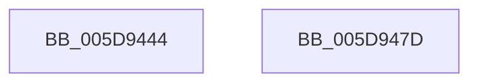

# Feature_UnparkPCoresOnUnimportantUtility__private_GetVariant

- RVA: `0x005D9444`–`0x005D947E` (길이 `58` bytes)
- VA: `0x00000001405D9444`
- 실행 섹션: `.text`
- PDB 이름 있음: `예`; PDB Function 태그: `아니요`
- unwind 정보 RVA: `0x0005CF00`
- 디코드: `16`개 명령, `58/58` bytes 표시
- 미해석 바이트: `0` (있으면 어셈블리에 `.byte`로 보존)

> 이 문서는 커널 이미지의 기계어와 PDB 기호를 분석해 생성했습니다. 4번과 5번은 함수 원형과 자료형을 바이너리 사용 방식에서 추정한 C 해석이며 원본 소스 복구 결과는 아닙니다.

## 1. Dependencies

- 직접 호출 지점: **2**; 고유 호출 대상: **2**
- 직접 호출자로 확인된 함수: **1**
- RIP 상대 이미지 참조: **2**

### Outgoing calls
- `0x005D9458` → [wil_details_FeatureStateCache_GetCachedVariantState](../4A/wil_details_FeatureStateCache_GetCachedVariantState_function_004A3F44.md) (function, `0x004A3F44`)
- `0x005D946A` → [wil_details_FeatureReporting_ReportVariantUsageToService](../37/wil_details_FeatureReporting_ReportVariantUsageToService_function_003782F8.md) (function, `0x003782F8`)

### Direct callers
- [PopInitializeHeteroProcessors](../../page/A5/PopInitializeHeteroProcessors_function_00A53570.md) at `0x00A538D9`

### Static image references
- `0x005D944A` → RVA `0x000DE4A0` (`.rdata`; read)
- `0x005D9451` → RVA `0x00FC4980` (`.data`; read)

## 2. Other-region calls and transfers

- 다른 실행 섹션으로 향하는 call: **0**
- 별도 외부 분기/꼬리 이동을 확인하지 못했습니다.

## 3. Assembly (complete function range)

```asm
005D9444  40 53                           push rbx
005D9446  48 83 EC 20                     sub rsp, 0x20
005D944A  48 8D 15 4F 50 B0 FF            lea rdx, [rip - 0x4fafb1]
005D9451  48 8D 0D 28 B5 9E 00            lea rcx, [rip + 0x9eb528]
005D9458  E8 E7 AA EC FF                  call 0x1404a3f44
005D945D  48 8B D0                        mov rdx, rax
005D9460  48 8D 0D 39 50 B0 FF            lea rcx, [rip - 0x4fafc7]
005D9467  48 8B D8                        mov rbx, rax
005D946A  E8 89 EE D9 FF                  call 0x1403782f8
005D946F  C1 EB 0C                        shr ebx, 0xc
005D9472  83 E3 3F                        and ebx, 0x3f
005D9475  8B C3                           mov eax, ebx
005D9477  48 83 C4 20                     add rsp, 0x20
005D947B  5B                              pop rbx
005D947C  C3                              ret
005D947D  CC                              int3
```

## 4. C-style interpretation (structured pseudocode)

```c
__int64 __fastcall Feature_UnparkPCoresOnUnimportantUtility__private_GetVariant(void)
{
    __int64 result;
    __int64 v_rbx;
    __int64 v_rsp;

    v_rsp = (v_rsp) - (32);
    result = wil_details_FeatureStateCache_GetCachedVariantState(v_rip + 10401064, v_rip - 5222321, a3, a4);
    result = wil_details_FeatureReporting_ReportVariantUsageToService(v_rip - 5222343, result, a3, a4);
    v_rbx = (unsigned int)((result) >> (12));
    v_rbx = (unsigned int)((v_rbx) & (63));
    v_rsp = (v_rsp) + (32);
    return (unsigned int)((unsigned int)(v_rbx));
}
```

## 5. (Beta) C Style

```c
void Feature_UnparkPCoresOnUnimportantUtility__private_GetVariant(void)
{
    int64_t result;
    int64_t local_rbx;
    int64_t local_rsp;

    local_rsp = (local_rsp) - (32);
    result = wil_details_FeatureStateCache_GetCachedVariantState(v_rip + 10401064, v_rip - 5222321, a3, a4);
    result = wil_details_FeatureReporting_ReportVariantUsageToService(v_rip - 5222343, result, a3, a4);
    local_rbx = (uint32_t)((result) >> (12));
    local_rbx = (uint32_t)((local_rbx) & (63));
    local_rsp = (local_rsp) + (32);
    return (uint32_t)((uint32_t)(local_rbx));
}
```

## 6. Execution-region graph

[열기: 2D/3D 그래프와 함수 탐색 컨트롤 패널](../../../control-panel.html?section=text&rva=0x005D9444&view=graph)

- 2D 그래프는 위에서 아래로 흐르고, 3D 그래프는 빈 공간을 드래그해 회전합니다. Shift+드래그는 이동, 휠은 확대·축소, 함수 노드 선택은 대상 보고서 이동입니다.

### Static fallback


