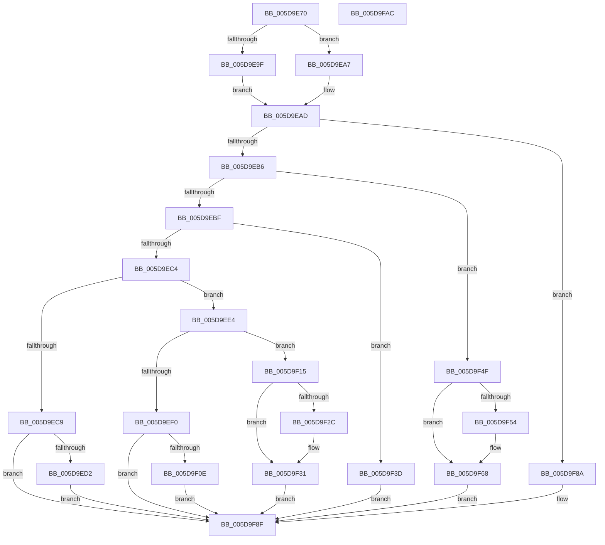

# PdcPoCurrentPdcPhase

- RVA: `0x005D9E70`–`0x005D9FAD` (길이 `317` bytes)
- VA: `0x00000001405D9E70`
- 실행 섹션: `.text`
- PDB 이름 있음: `예`; PDB Function 태그: `아니요`
- unwind 정보 RVA: `0x0005E6B4`
- 디코드: `84`개 명령, `317/317` bytes 표시
- 미해석 바이트: `0` (있으면 어셈블리에 `.byte`로 보존)

> 이 문서는 커널 이미지의 기계어와 PDB 기호를 분석해 생성했습니다. 4번과 5번은 함수 원형과 자료형을 바이너리 사용 방식에서 추정한 C 해석이며 원본 소스 복구 결과는 아닙니다.

## 1. Dependencies

- 직접 호출 지점: **16**; 고유 호출 대상: **16**
- 직접 호출자로 확인된 함수: **0**
- RIP 상대 이미지 참조: **6**

### Outgoing calls
- `0x005D9E94` → [Feature_ExpandSTEIgnoreReasons__private_IsEnabledDeviceUsageNoInline](../4F/Feature_ExpandSTEIgnoreReasons__private_IsEnabledDeviceUsageNoInline_function_004F7AE8.md) (function, `0x004F7AE8`)
- `0x005D9ED5` → [PopNetResiliencyPhaseStateChanged](../../page/76/PopNetResiliencyPhaseStateChanged_function_00768DD8.md) (function, `0x00768DD8`)
- `0x005D9EDA` → [PopPowerAggregatorNotifyResiliencyReached](../../page/76/PopPowerAggregatorNotifyResiliencyReached_function_00764D74.md) (function, `0x00764D74`)
- `0x005D9EE6` → [KeQueryPerformanceCounter](../37/KeQueryPerformanceCounter_function_0037E7E0.md) (function, `0x0037E7E0`)
- `0x005D9EFC` → [PopDeepSleepResiliencyPhaseAccountingBegin](../4A/PopDeepSleepResiliencyPhaseAccountingBegin_function_004A72B4.md) (function, `0x004A72B4`)
- `0x005D9F0E` → [PopFxResumeDeviceAccounting](../43/PopFxResumeDeviceAccounting_function_0043D4D8.md) (function, `0x0043D4D8`)
- `0x005D9F2C` → [PopFxPauseDeviceAccounting](../43/PopFxPauseDeviceAccounting_function_0043D0C8.md) (function, `0x0043D0C8`)
- `0x005D9F36` → [PopDeepSleepResiliencyPhaseAccountingEnd](../4A/PopDeepSleepResiliencyPhaseAccountingEnd_function_004AF6C8.md) (function, `0x004AF6C8`)
- `0x005D9F46` → [PopPowerAggregatorNotifyPdcSleepTransition](../../page/AB/PopPowerAggregatorNotifyPdcSleepTransition_function_00AB11E0.md) (function, `0x00AB11E0`)
- `0x005D9F54` → [PopAcquirePolicyLock](../../pagelk/B7/PopAcquirePolicyLock_function_00B783C0.md) (function, `0x00B783C0`)
- `0x005D9F5E` → [PopSmartSuspendMakePredictions](../../page/AD/PopSmartSuspendMakePredictions_function_00AD9168.md) (function, `0x00AD9168`)
- `0x005D9F63` → [PopReleasePolicyLock](../../pagelk/B7/PopReleasePolicyLock_function_00B78410.md) (function, `0x00B78410`)
- `0x005D9F70` → [PopPowerAggregatorNotifyPdcPhaseState](../../page/76/PopPowerAggregatorNotifyPdcPhaseState_function_00764C54.md) (function, `0x00764C54`)
- `0x005D9F7B` → [PopIdleCsStateChanged](../../page/AD/PopIdleCsStateChanged_function_00AD9DE0.md) (function, `0x00AD9DE0`)
- `0x005D9F83` → [PopAdaptiveStandbyNotifyShellPhaseState](../../page/76/PopAdaptiveStandbyNotifyShellPhaseState_function_0076E2CC.md) (function, `0x0076E2CC`)
- `0x005D9F8A` → [PopDisarmIdlePhaseWatchdog](../../page/91/PopDisarmIdlePhaseWatchdog_function_00914408.md) (function, `0x00914408`)

### Direct callers
- 이 함수 시작 RVA로 연결되는 직접 call은 확인되지 않았습니다. 간접 호출은 완전히 역산할 수 없습니다.

### Static image references
- `0x005D9E9F` → RVA `0x00E679B8` (`.data`; write)
- `0x005D9EA7` → RVA `0x00E67550` (`.data`; write)
- `0x005D9EF2` → RVA `0x00E27D40` (`.data`; write)
- `0x005D9F01` → RVA `0x00E676B0` (`.data`; read)
- `0x005D9F15` → RVA `0x00E27D40` (`.data`; read)
- `0x005D9F1C` → RVA `0x00E27D48` (`.data`; read/write)

## 2. Other-region calls and transfers

- 다른 실행 섹션으로 향하는 call: **10**
  - `0x005D9ED5` → [PopNetResiliencyPhaseStateChanged](../../page/76/PopNetResiliencyPhaseStateChanged_function_00768DD8.md) (`.text` → `PAGE`)
  - `0x005D9EDA` → [PopPowerAggregatorNotifyResiliencyReached](../../page/76/PopPowerAggregatorNotifyResiliencyReached_function_00764D74.md) (`.text` → `PAGE`)
  - `0x005D9F46` → [PopPowerAggregatorNotifyPdcSleepTransition](../../page/AB/PopPowerAggregatorNotifyPdcSleepTransition_function_00AB11E0.md) (`.text` → `PAGE`)
  - `0x005D9F54` → [PopAcquirePolicyLock](../../pagelk/B7/PopAcquirePolicyLock_function_00B783C0.md) (`.text` → `PAGELK`)
  - `0x005D9F5E` → [PopSmartSuspendMakePredictions](../../page/AD/PopSmartSuspendMakePredictions_function_00AD9168.md) (`.text` → `PAGE`)
  - `0x005D9F63` → [PopReleasePolicyLock](../../pagelk/B7/PopReleasePolicyLock_function_00B78410.md) (`.text` → `PAGELK`)
  - `0x005D9F70` → [PopPowerAggregatorNotifyPdcPhaseState](../../page/76/PopPowerAggregatorNotifyPdcPhaseState_function_00764C54.md) (`.text` → `PAGE`)
  - `0x005D9F7B` → [PopIdleCsStateChanged](../../page/AD/PopIdleCsStateChanged_function_00AD9DE0.md) (`.text` → `PAGE`)
  - `0x005D9F83` → [PopAdaptiveStandbyNotifyShellPhaseState](../../page/76/PopAdaptiveStandbyNotifyShellPhaseState_function_0076E2CC.md) (`.text` → `PAGE`)
  - `0x005D9F8A` → [PopDisarmIdlePhaseWatchdog](../../page/91/PopDisarmIdlePhaseWatchdog_function_00914408.md) (`.text` → `PAGE`)
- 별도 외부 분기/꼬리 이동을 확인하지 못했습니다.

## 3. Assembly (complete function range)

```asm
005D9E70  48 8B C4                        mov rax, rsp
005D9E73  48 89 58 08                     mov qword ptr [rax + 8], rbx
005D9E77  48 89 68 10                     mov qword ptr [rax + 0x10], rbp
005D9E7B  48 89 70 18                     mov qword ptr [rax + 0x18], rsi
005D9E7F  48 89 78 20                     mov qword ptr [rax + 0x20], rdi
005D9E83  41 56                           push r14
005D9E85  48 83 EC 20                     sub rsp, 0x20
005D9E89  41 8B D9                        mov ebx, r9d
005D9E8C  45 8B F0                        mov r14d, r8d
005D9E8F  40 8A F2                        mov sil, dl
005D9E92  8B F9                           mov edi, ecx
005D9E94  E8 4F DC F1 FF                  call 0x1404f7ae8
005D9E99  33 ED                           xor ebp, ebp
005D9E9B  85 C0                           test eax, eax
005D9E9D  74 08                           je 0x1405d9ea7
005D9E9F  89 3D 13 DB 88 00               mov dword ptr [rip + 0x88db13], edi
005D9EA5  EB 06                           jmp 0x1405d9ead
005D9EA7  89 3D A3 D6 88 00               mov dword ptr [rip + 0x88d6a3], edi
005D9EAD  83 EF 01                        sub edi, 1
005D9EB0  0F 84 D4 00 00 00               je 0x1405d9f8a
005D9EB6  83 EF 01                        sub edi, 1
005D9EB9  0F 84 90 00 00 00               je 0x1405d9f4f
005D9EBF  83 EF 04                        sub edi, 4
005D9EC2  74 79                           je 0x1405d9f3d
005D9EC4  83 EF 01                        sub edi, 1
005D9EC7  74 1B                           je 0x1405d9ee4
005D9EC9  83 FF 01                        cmp edi, 1
005D9ECC  0F 85 BD 00 00 00               jne 0x1405d9f8f
005D9ED2  40 8A CE                        mov cl, sil
005D9ED5  E8 FE EE 18 00                  call 0x140768dd8
005D9EDA  E8 95 AE 18 00                  call 0x140764d74
005D9EDF  E9 AB 00 00 00                  jmp 0x1405d9f8f
005D9EE4  33 C9                           xor ecx, ecx
005D9EE6  E8 F5 48 DA FF                  call 0x14037e7e0
005D9EEB  40 84 F6                        test sil, sil
005D9EEE  74 25                           je 0x1405d9f15
005D9EF0  33 D2                           xor edx, edx
005D9EF2  48 89 05 47 DE 84 00            mov qword ptr [rip + 0x84de47], rax
005D9EF9  8D 4A 03                        lea ecx, [rdx + 3]
005D9EFC  E8 B3 D3 EC FF                  call 0x1404a72b4
005D9F01  83 3D A8 D7 88 00 02            cmp dword ptr [rip + 0x88d7a8], 2
005D9F08  0F 85 81 00 00 00               jne 0x1405d9f8f
005D9F0E  E8 C5 35 E6 FF                  call 0x14043d4d8
005D9F13  EB 7A                           jmp 0x1405d9f8f
005D9F15  48 2B 05 24 DE 84 00            sub rax, qword ptr [rip + 0x84de24]
005D9F1C  48 01 05 25 DE 84 00            add qword ptr [rip + 0x84de25], rax
005D9F23  83 3D 86 D7 88 00 02            cmp dword ptr [rip + 0x88d786], 2
005D9F2A  75 05                           jne 0x1405d9f31
005D9F2C  E8 97 31 E6 FF                  call 0x14043d0c8
005D9F31  33 D2                           xor edx, edx
005D9F33  8D 4A 03                        lea ecx, [rdx + 3]
005D9F36  E8 8D 57 ED FF                  call 0x1404af6c8
005D9F3B  EB 52                           jmp 0x1405d9f8f
005D9F3D  44 8B C3                        mov r8d, ebx
005D9F40  41 8B D6                        mov edx, r14d
005D9F43  40 8A CE                        mov cl, sil
005D9F46  E8 95 72 4D 00                  call 0x140ab11e0
005D9F4B  8B E8                           mov ebp, eax
005D9F4D  EB 40                           jmp 0x1405d9f8f
005D9F4F  40 84 F6                        test sil, sil
005D9F52  74 14                           je 0x1405d9f68
005D9F54  E8 67 E4 59 00                  call 0x140b783c0
005D9F59  B9 01 00 00 00                  mov ecx, 1
005D9F5E  E8 05 F2 4F 00                  call 0x140ad9168
005D9F63  E8 A8 E4 59 00                  call 0x140b78410
005D9F68  40 8A D6                        mov dl, sil
005D9F6B  B9 02 00 00 00                  mov ecx, 2
005D9F70  E8 DF AC 18 00                  call 0x140764c54
005D9F75  40 84 F6                        test sil, sil
005D9F78  0F 95 C1                        setne cl
005D9F7B  E8 60 FE 4F 00                  call 0x140ad9de0
005D9F80  40 8A CE                        mov cl, sil
005D9F83  E8 44 43 19 00                  call 0x14076e2cc
005D9F88  EB 05                           jmp 0x1405d9f8f
005D9F8A  E8 79 A4 33 00                  call 0x140914408
005D9F8F  48 8B 5C 24 30                  mov rbx, qword ptr [rsp + 0x30]
005D9F94  8B C5                           mov eax, ebp
005D9F96  48 8B 6C 24 38                  mov rbp, qword ptr [rsp + 0x38]
005D9F9B  48 8B 74 24 40                  mov rsi, qword ptr [rsp + 0x40]
005D9FA0  48 8B 7C 24 48                  mov rdi, qword ptr [rsp + 0x48]
005D9FA5  48 83 C4 20                     add rsp, 0x20
005D9FA9  41 5E                           pop r14
005D9FAB  C3                              ret
005D9FAC  CC                              int3
```

## 4. C-style interpretation (structured pseudocode)

```c
__int64 __fastcall PdcPoCurrentPdcPhase(int a1, int a2, int a3, int a4)
{
    __int64 result;
    __int64 v_rbp;
    __int64 v_rdi;
    __int64 v_rsp;
    unsigned __int64 v_stack_p10;
    unsigned __int64 v_stack_p18;
    unsigned __int64 v_stack_p20;
    unsigned __int64 v_stack_p8;

    *(unsigned __int64 *)(v_rsp + 8) = v_rbx;
    *(unsigned __int64 *)(v_rsp + 16) = v_rbp;
    *(unsigned __int64 *)(v_rsp + 24) = v_rsi;
    *(unsigned __int64 *)(v_rsp + 32) = v_rdi;
    v_rsp = (v_rsp) - (32);
    result = Feature_ExpandSTEIgnoreReasons__private_IsEnabledDeviceUsageNoInline(a1, a2, a3, a4);
    v_rbp = 0;
    if ((unsigned int)(result) == 0) goto loc_005D9EA7;
    *(unsigned int *)(v_rip + 8968979) = (unsigned int)((unsigned int)(a1));
    goto loc_005D9EAD;
loc_005D9EA7:
    *(unsigned int *)(v_rip + 8967843) = (unsigned int)((unsigned int)(a1));
loc_005D9EAD:
    v_rdi = (unsigned int)(((unsigned int)(a1)) - (1));
    if (condition_is_equal) goto loc_005D9F8A;
    v_rdi = (unsigned int)((v_rdi) - (1));
    if (condition_is_equal) goto loc_005D9F4F;
    v_rdi = (unsigned int)((v_rdi) - (4));
    if (condition_is_equal) goto loc_005D9F3D;
    v_rdi = (unsigned int)((v_rdi) - (1));
    if (condition_is_equal) goto loc_005D9EE4;
    if (((unsigned int)(v_rdi)) != 1) goto loc_005D9F8F;
    result = PopNetResiliencyPhaseStateChanged((unsigned __int8)((unsigned __int8)(a2)), a2, a3, a4);
    result = PopPowerAggregatorNotifyResiliencyReached((unsigned __int8)((unsigned __int8)(a2)), a2, a3, a4);
    goto loc_005D9F8F;
loc_005D9EE4:
    a1 = 0;
    result = KeQueryPerformanceCounter(a1, a2, a3, a4);
    if ((unsigned __int8)((unsigned __int8)(a2)) == 0) goto loc_005D9F15;
    a2 = 0;
    *(unsigned __int64 *)(v_rip + 8707655) = result;
    result = PopDeepSleepResiliencyPhaseAccountingBegin(a2 + 3, a2, a3, a4);
    if ((*(unsigned int *)(v_rip + 8968104)) != 2) goto loc_005D9F8F;
    result = PopFxResumeDeviceAccounting(a2 + 3, a2, a3, a4);
    goto loc_005D9F8F;
loc_005D9F15:
    result = (result) - (*(unsigned __int64 *)(v_rip + 8707620));
    if ((*(unsigned int *)(v_rip + 8968070)) == 2) {
        result = PopFxPauseDeviceAccounting(a2 + 3, a2, a3, a4);
    }
    a2 = 0;
    result = PopDeepSleepResiliencyPhaseAccountingEnd(a2 + 3, a2, a3, a4);
    goto loc_005D9F8F;
loc_005D9F3D:
    result = PopPowerAggregatorNotifyPdcSleepTransition((unsigned __int8)((unsigned __int8)(a2)), (unsigned int)((unsigned int)((unsigned int)(a3))), (unsigned int)((unsigned int)((unsigned int)(a4))), a4);
    goto loc_005D9F8F;
loc_005D9F4F:
    if ((unsigned __int8)((unsigned __int8)(a2)) != 0) {
        result = PopAcquirePolicyLock((unsigned __int8)((unsigned __int8)(a2)), (unsigned int)((unsigned int)((unsigned int)(a3))), (unsigned int)((unsigned int)((unsigned int)(a4))), a4);
        a1 = 1;
        result = PopSmartSuspendMakePredictions(a1, (unsigned int)((unsigned int)((unsigned int)(a3))), (unsigned int)((unsigned int)((unsigned int)(a4))), a4);
        result = PopReleasePolicyLock(a1, (unsigned int)((unsigned int)((unsigned int)(a3))), (unsigned int)((unsigned int)((unsigned int)(a4))), a4);
    }
    result = PopPowerAggregatorNotifyPdcPhaseState(2, (unsigned __int8)((unsigned __int8)(a2)), (unsigned int)((unsigned int)((unsigned int)(a4))), a4);
    a1 = ((unsigned __int8)((unsigned __int8)(a2)) != 0) ? 1 : 0;
    result = PopIdleCsStateChanged(a1, (unsigned __int8)((unsigned __int8)(a2)), (unsigned int)((unsigned int)((unsigned int)(a4))), a4);
    result = PopAdaptiveStandbyNotifyShellPhaseState((unsigned __int8)((unsigned __int8)(a2)), (unsigned __int8)((unsigned __int8)(a2)), (unsigned int)((unsigned int)((unsigned int)(a4))), a4);
    goto loc_005D9F8F;
loc_005D9F8A:
    result = PopDisarmIdlePhaseWatchdog((unsigned __int8)((unsigned __int8)(a2)), (unsigned __int8)((unsigned __int8)(a2)), (unsigned int)((unsigned int)((unsigned int)(a4))), a4);
loc_005D9F8F:
    v_rsp = (v_rsp) + (32);
    return (unsigned int)((unsigned int)((unsigned int)((unsigned int)(result))));
}
```

## 5. (Beta) C Style

```c
int64_t PdcPoCurrentPdcPhase(int32_t Arg1, int32_t Arg2, int32_t Arg3, int32_t Arg4)
{
    int64_t result;
    int64_t local_rbp;
    int64_t local_rdi;
    int64_t local_rsp;
    uint64_t v_stack_p10;
    uint64_t v_stack_p18;
    uint64_t v_stack_p20;
    uint64_t v_stack_p8;

    *(uint64_t *)(local_rsp + 0x8) = local_rbx;
    *(uint64_t *)(local_rsp + 0x10) = local_rbp;
    *(uint64_t *)(local_rsp + 0x18) = local_rsi;
    *(uint64_t *)(local_rsp + 0x20) = local_rdi;
    local_rsp = (local_rsp) - (32);
    result = Feature_ExpandSTEIgnoreReasons__private_IsEnabledDeviceUsageNoInline(Arg1, Arg2, Arg3, Arg4);
    local_rbp = 0;
    if ((uint32_t)(result) == 0) goto loc_005D9EA7;
    *(uint32_t *)(v_rip + 0x88DB13) = (uint32_t)((uint32_t)(Arg1));
    goto loc_005D9EAD;
loc_005D9EA7:
    *(uint32_t *)(v_rip + 0x88D6A3) = (uint32_t)((uint32_t)(Arg1));
loc_005D9EAD:
    local_rdi = (uint32_t)(((uint32_t)(Arg1)) - (1));
    if (condition_is_equal) goto loc_005D9F8A;
    local_rdi = (uint32_t)((local_rdi) - (1));
    if (condition_is_equal) goto loc_005D9F4F;
    local_rdi = (uint32_t)((local_rdi) - (4));
    if (condition_is_equal) goto loc_005D9F3D;
    local_rdi = (uint32_t)((local_rdi) - (1));
    if (condition_is_equal) goto loc_005D9EE4;
    if (((uint32_t)(local_rdi)) != 1) goto loc_005D9F8F;
    result = PopNetResiliencyPhaseStateChanged((uint8_t)((uint8_t)(Arg2)), Arg2, Arg3, Arg4);
    result = PopPowerAggregatorNotifyResiliencyReached((uint8_t)((uint8_t)(Arg2)), Arg2, Arg3, Arg4);
    goto loc_005D9F8F;
loc_005D9EE4:
    Arg1 = 0;
    result = KeQueryPerformanceCounter(Arg1, Arg2, Arg3, Arg4);
    if ((uint8_t)((uint8_t)(Arg2)) == 0) goto loc_005D9F15;
    Arg2 = 0;
    *(uint64_t *)(v_rip + 0x84DE47) = result;
    result = PopDeepSleepResiliencyPhaseAccountingBegin(Arg2 + 3, Arg2, Arg3, Arg4);
    if ((*(uint32_t *)(v_rip + 0x88D7A8)) != 2) goto loc_005D9F8F;
    result = PopFxResumeDeviceAccounting(Arg2 + 3, Arg2, Arg3, Arg4);
    goto loc_005D9F8F;
loc_005D9F15:
    result = (result) - (*(uint64_t *)(v_rip + 0x84DE24));
    if ((*(uint32_t *)(v_rip + 0x88D786)) == 2) {
        result = PopFxPauseDeviceAccounting(Arg2 + 3, Arg2, Arg3, Arg4);
    }
    Arg2 = 0;
    result = PopDeepSleepResiliencyPhaseAccountingEnd(Arg2 + 3, Arg2, Arg3, Arg4);
    goto loc_005D9F8F;
loc_005D9F3D:
    result = PopPowerAggregatorNotifyPdcSleepTransition((uint8_t)((uint8_t)(Arg2)), (uint32_t)((uint32_t)((uint32_t)(Arg3))), (uint32_t)((uint32_t)((uint32_t)(Arg4))), Arg4);
    goto loc_005D9F8F;
loc_005D9F4F:
    if ((uint8_t)((uint8_t)(Arg2)) != 0) {
        result = PopAcquirePolicyLock((uint8_t)((uint8_t)(Arg2)), (uint32_t)((uint32_t)((uint32_t)(Arg3))), (uint32_t)((uint32_t)((uint32_t)(Arg4))), Arg4);
        Arg1 = 1;
        result = PopSmartSuspendMakePredictions(Arg1, (uint32_t)((uint32_t)((uint32_t)(Arg3))), (uint32_t)((uint32_t)((uint32_t)(Arg4))), Arg4);
        result = PopReleasePolicyLock(Arg1, (uint32_t)((uint32_t)((uint32_t)(Arg3))), (uint32_t)((uint32_t)((uint32_t)(Arg4))), Arg4);
    }
    result = PopPowerAggregatorNotifyPdcPhaseState(2, (uint8_t)((uint8_t)(Arg2)), (uint32_t)((uint32_t)((uint32_t)(Arg4))), Arg4);
    Arg1 = ((uint8_t)((uint8_t)(Arg2)) != 0) ? 1 : 0;
    result = PopIdleCsStateChanged(Arg1, (uint8_t)((uint8_t)(Arg2)), (uint32_t)((uint32_t)((uint32_t)(Arg4))), Arg4);
    result = PopAdaptiveStandbyNotifyShellPhaseState((uint8_t)((uint8_t)(Arg2)), (uint8_t)((uint8_t)(Arg2)), (uint32_t)((uint32_t)((uint32_t)(Arg4))), Arg4);
    goto loc_005D9F8F;
loc_005D9F8A:
    result = PopDisarmIdlePhaseWatchdog((uint8_t)((uint8_t)(Arg2)), (uint8_t)((uint8_t)(Arg2)), (uint32_t)((uint32_t)((uint32_t)(Arg4))), Arg4);
loc_005D9F8F:
    local_rsp = (local_rsp) + (32);
    return (uint32_t)((uint32_t)((uint32_t)((uint32_t)(result))));
}
```

## 6. Execution-region graph

[열기: 2D/3D 그래프와 함수 탐색 컨트롤 패널](../../../control-panel.html?section=text&rva=0x005D9E70&view=graph)

- 2D 그래프는 위에서 아래로 흐르고, 3D 그래프는 빈 공간을 드래그해 회전합니다. Shift+드래그는 이동, 휠은 확대·축소, 함수 노드 선택은 대상 보고서 이동입니다.

### Static fallback


