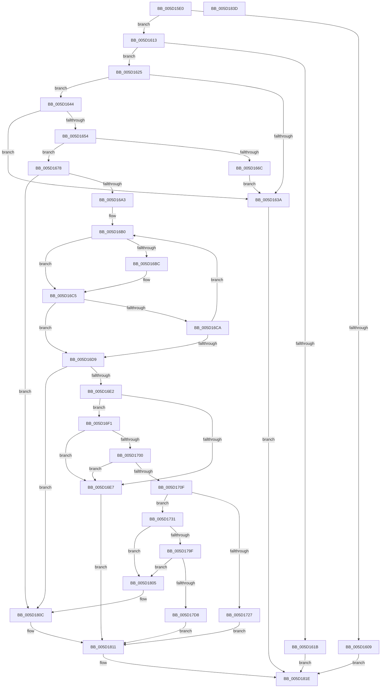

# PoFxAddComponentRelation

- RVA: `0x005D15E0`–`0x005D183E` (길이 `606` bytes)
- VA: `0x00000001405D15E0`
- 실행 섹션: `.text`
- PDB 이름 있음: `예`; PDB Function 태그: `아니요`
- unwind 정보 RVA: `0x00075C18`
- 디코드: `163`개 명령, `606/606` bytes 표시
- 미해석 바이트: `0` (있으면 어셈블리에 `.byte`로 보존)

> 이 문서는 커널 이미지의 기계어와 PDB 기호를 분석해 생성했습니다. 4번과 5번은 함수 원형과 자료형을 바이너리 사용 방식에서 추정한 C 해석이며 원본 소스 복구 결과는 아닙니다.

## 1. Dependencies

- 직접 호출 지점: **13**; 고유 호출 대상: **9**
- 직접 호출자로 확인된 함수: **0**
- RIP 상대 이미지 참조: **0**

### Outgoing calls
- `0x005D165B` → [ExAcquireSpinLockExclusive](../24/ExAcquireSpinLockExclusive_function_00248690.md) (function, `0x00248690`)
- `0x005D1671` → [ExReleaseSpinLockExclusive](../2C/ExReleaseSpinLockExclusive_function_002C0EF0.md) (function, `0x002C0EF0`)
- `0x005D1680` → [PopFxReferenceDevice](../2B/PopFxReferenceDevice_function_002BFD9C.md) (function, `0x002BFD9C`)
- `0x005D168B` → [ExReleaseSpinLockExclusive](../2C/ExReleaseSpinLockExclusive_function_002C0EF0.md) (function, `0x002C0EF0`)
- `0x005D171D` → [ExAllocatePool2](../../poolcode/B8/ExAllocatePool2_function_00B820F0.md) (function, `0x00B820F0`)
- `0x005D1770` → [PopFxActivateComponent](../2D/PopFxActivateComponent_function_002D9DBC.md) (function, `0x002D9DBC`)
- `0x005D1782` → [PopFxActivateComponent](../2D/PopFxActivateComponent_function_002D9DBC.md) (function, `0x002D9DBC`)
- `0x005D178A` → [KeAcquireSpinLockRaiseToDpc](../20/KeAcquireSpinLockRaiseToDpc_function_00208470.md) (function, `0x00208470`)
- `0x005D17B4` → [KeReleaseSpinLock](../39/KeReleaseSpinLock_function_00392BA0.md) (function, `0x00392BA0`)
- `0x005D17C3` → [KeAcquireSpinLockRaiseToDpc](../20/KeAcquireSpinLockRaiseToDpc_function_00208470.md) (function, `0x00208470`)
- `0x005D17EB` → [KeReleaseSpinLock](../39/KeReleaseSpinLock_function_00392BA0.md) (function, `0x00392BA0`)
- `0x005D17FE` → [PopFxIdleComponent](../2C/PopFxIdleComponent_function_002C01D8.md) (function, `0x002C01D8`)
- `0x005D1819` → [PopFxDereferenceDevice](../27/PopFxDereferenceDevice_function_0027038C.md) (function, `0x0027038C`)

### Direct callers
- 이 함수 시작 RVA로 연결되는 직접 call은 확인되지 않았습니다. 간접 호출은 완전히 역산할 수 없습니다.

### Static image references
- 디코드된 RIP-relative 메모리 참조가 없습니다.

## 2. Other-region calls and transfers

- 다른 실행 섹션으로 향하는 call: **1**
  - `0x005D171D` → [ExAllocatePool2](../../poolcode/B8/ExAllocatePool2_function_00B820F0.md) (`.text` → `POOLCODE`)
- 별도 외부 분기/꼬리 이동을 확인하지 못했습니다.

## 3. Assembly (complete function range)

```asm
005D15E0  48 89 5C 24 08                  mov qword ptr [rsp + 8], rbx
005D15E5  48 89 6C 24 10                  mov qword ptr [rsp + 0x10], rbp
005D15EA  48 89 74 24 18                  mov qword ptr [rsp + 0x18], rsi
005D15EF  57                              push rdi
005D15F0  41 54                           push r12
005D15F2  41 55                           push r13
005D15F4  41 56                           push r14
005D15F6  41 57                           push r15
005D15F8  48 83 EC 20                     sub rsp, 0x20
005D15FC  33 DB                           xor ebx, ebx
005D15FE  4D 8B E1                        mov r12, r9
005D1601  48 8B E9                        mov rbp, rcx
005D1604  48 85 C9                        test rcx, rcx
005D1607  75 0A                           jne 0x1405d1613
005D1609  BB EF 00 00 C0                  mov ebx, 0xc00000ef
005D160E  E9 0B 02 00 00                  jmp 0x1405d181e
005D1613  3B 91 64 03 00 00               cmp edx, dword ptr [rcx + 0x364]
005D1619  72 0A                           jb 0x1405d1625
005D161B  BB F0 00 00 C0                  mov ebx, 0xc00000f0
005D1620  E9 F9 01 00 00                  jmp 0x1405d181e
005D1625  0F AE E8                        lfence
005D1628  48 8B 85 68 03 00 00            mov rax, qword ptr [rbp + 0x368]
005D162F  8B CA                           mov ecx, edx
005D1631  4C 8B 3C C8                     mov r15, qword ptr [rax + rcx*8]
005D1635  4D 85 C0                        test r8, r8
005D1638  75 0A                           jne 0x1405d1644
005D163A  BB F1 00 00 C0                  mov ebx, 0xc00000f1
005D163F  E9 DA 01 00 00                  jmp 0x1405d181e
005D1644  49 8B 80 38 01 00 00            mov rax, qword ptr [r8 + 0x138]
005D164B  48 8B 78 28                     mov rdi, qword ptr [rax + 0x28]
005D164F  48 85 FF                        test rdi, rdi
005D1652  74 E6                           je 0x1405d163a
005D1654  48 8D 77 58                     lea rsi, [rdi + 0x58]
005D1658  48 8B CE                        mov rcx, rsi
005D165B  E8 30 70 C7 FF                  call 0x140248690
005D1660  48 8B 7F 50                     mov rdi, qword ptr [rdi + 0x50]
005D1664  44 8A F0                        mov r14b, al
005D1667  48 85 FF                        test rdi, rdi
005D166A  75 0C                           jne 0x1405d1678
005D166C  8A D0                           mov dl, al
005D166E  48 8B CE                        mov rcx, rsi
005D1671  E8 7A F8 CE FF                  call 0x1402c0ef0
005D1676  EB C2                           jmp 0x1405d163a
005D1678  BA 06 00 00 00                  mov edx, 6
005D167D  48 8B CF                        mov rcx, rdi
005D1680  E8 17 E7 CE FF                  call 0x1402bfd9c
005D1685  41 8A D6                        mov dl, r14b
005D1688  48 8B CE                        mov rcx, rsi
005D168B  E8 60 F8 CE FF                  call 0x1402c0ef0
005D1690  44 8B 8F 64 03 00 00            mov r9d, dword ptr [rdi + 0x364]
005D1697  44 8B C3                        mov r8d, ebx
005D169A  45 85 C9                        test r9d, r9d
005D169D  0F 84 69 01 00 00               je 0x1405d180c
005D16A3  48 8B 97 68 03 00 00            mov rdx, qword ptr [rdi + 0x368]
005D16AA  41 BE 01 00 00 00               mov r14d, 1
005D16B0  48 8B 32                        mov rsi, qword ptr [rdx]
005D16B3  49 8B 0C 24                     mov rcx, qword ptr [r12]
005D16B7  48 2B 0E                        sub rcx, qword ptr [rsi]
005D16BA  75 09                           jne 0x1405d16c5
005D16BC  49 8B 4C 24 08                  mov rcx, qword ptr [r12 + 8]
005D16C1  48 2B 4E 08                     sub rcx, qword ptr [rsi + 8]
005D16C5  48 85 C9                        test rcx, rcx
005D16C8  74 0F                           je 0x1405d16d9
005D16CA  45 03 C6                        add r8d, r14d
005D16CD  48 83 C2 08                     add rdx, 8
005D16D1  48 8B F3                        mov rsi, rbx
005D16D4  45 3B C1                        cmp r8d, r9d
005D16D7  72 D7                           jb 0x1405d16b0
005D16D9  48 85 F6                        test rsi, rsi
005D16DC  0F 84 2A 01 00 00               je 0x1405d180c
005D16E2  4C 3B FE                        cmp r15, rsi
005D16E5  75 0A                           jne 0x1405d16f1
005D16E7  BB 0D 00 00 C0                  mov ebx, 0xc000000d
005D16EC  E9 20 01 00 00                  jmp 0x1405d1811
005D16F1  33 C0                           xor eax, eax
005D16F3  F0 0F B1 9D 60 03 00 00         lock cmpxchg dword ptr [rbp + 0x360], ebx
005D16FB  41 84 C6                        test r14b, al
005D16FE  75 E7                           jne 0x1405d16e7
005D1700  33 C0                           xor eax, eax
005D1702  F0 0F B1 9F 60 03 00 00         lock cmpxchg dword ptr [rdi + 0x360], ebx
005D170A  41 84 C6                        test r14b, al
005D170D  75 D8                           jne 0x1405d16e7
005D170F  BA 48 00 00 00                  mov edx, 0x48
005D1714  41 B8 50 46 58 4D               mov r8d, 0x4d584650
005D171A  8D 4A F8                        lea ecx, [rdx - 8]
005D171D  E8 CE 09 5B 00                  call 0x140b820f0
005D1722  48 85 C0                        test rax, rax
005D1725  75 0A                           jne 0x1405d1731
005D1727  BB 9A 00 00 C0                  mov ebx, 0xc000009a
005D172C  E9 E0 00 00 00                  jmp 0x1405d1811
005D1731  44 89 30                        mov dword ptr [rax], r14d
005D1734  4C 8D 60 38                     lea r12, [rax + 0x38]
005D1738  48 89 58 08                     mov qword ptr [rax + 8], rbx
005D173C  4C 8D 70 20                     lea r14, [rax + 0x20]
005D1740  4D 89 76 08                     mov qword ptr [r14 + 8], r14
005D1744  4D 8D AF 80 00 00 00            lea r13, [r15 + 0x80]
005D174B  4D 89 36                        mov qword ptr [r14], r14
005D174E  45 33 C9                        xor r9d, r9d
005D1751  4D 89 64 24 08                  mov qword ptr [r12 + 8], r12
005D1756  48 8B D6                        mov rdx, rsi
005D1759  4D 89 24 24                     mov qword ptr [r12], r12
005D175D  48 8B CF                        mov rcx, rdi
005D1760  83 48 10 0E                     or dword ptr [rax + 0x10], 0xe
005D1764  45 8D 41 01                     lea r8d, [r9 + 1]
005D1768  48 89 70 18                     mov qword ptr [rax + 0x18], rsi
005D176C  4C 89 68 30                     mov qword ptr [rax + 0x30], r13
005D1770  E8 47 86 D0 FF                  call 0x1402d9dbc
005D1775  45 33 C9                        xor r9d, r9d
005D1778  49 8B D7                        mov rdx, r15
005D177B  48 8B CD                        mov rcx, rbp
005D177E  45 8D 41 01                     lea r8d, [r9 + 1]
005D1782  E8 35 86 D0 FF                  call 0x1402d9dbc
005D1787  49 8B CD                        mov rcx, r13
005D178A  E8 E1 6C C3 FF                  call 0x140208470
005D178F  49 8D 97 C8 01 00 00            lea rdx, [r15 + 0x1c8]
005D1796  4C 8B 42 08                     mov r8, qword ptr [rdx + 8]
005D179A  49 39 10                        cmp qword ptr [r8], rdx
005D179D  75 66                           jne 0x1405d1805
005D179F  49 89 14 24                     mov qword ptr [r12], rdx
005D17A3  49 8B CD                        mov rcx, r13
005D17A6  4D 89 44 24 08                  mov qword ptr [r12 + 8], r8
005D17AB  4D 89 20                        mov qword ptr [r8], r12
005D17AE  4C 89 62 08                     mov qword ptr [rdx + 8], r12
005D17B2  8A D0                           mov dl, al
005D17B4  E8 E7 13 DC FF                  call 0x140392ba0
005D17B9  4C 8D A6 80 00 00 00            lea r12, [rsi + 0x80]
005D17C0  49 8B CC                        mov rcx, r12
005D17C3  E8 A8 6C C3 FF                  call 0x140208470
005D17C8  48 81 C6 B8 01 00 00            add rsi, 0x1b8
005D17CF  48 8B 56 08                     mov rdx, qword ptr [rsi + 8]
005D17D3  48 39 32                        cmp qword ptr [rdx], rsi
005D17D6  75 2D                           jne 0x1405d1805
005D17D8  49 89 56 08                     mov qword ptr [r14 + 8], rdx
005D17DC  49 8B CC                        mov rcx, r12
005D17DF  49 89 36                        mov qword ptr [r14], rsi
005D17E2  4C 89 32                        mov qword ptr [rdx], r14
005D17E5  8A D0                           mov dl, al
005D17E7  4C 89 76 08                     mov qword ptr [rsi + 8], r14
005D17EB  E8 B0 13 DC FF                  call 0x140392ba0
005D17F0  41 8B 57 10                     mov edx, dword ptr [r15 + 0x10]
005D17F4  45 33 C9                        xor r9d, r9d
005D17F7  48 8B CD                        mov rcx, rbp
005D17FA  45 8D 41 02                     lea r8d, [r9 + 2]
005D17FE  E8 D5 E9 CE FF                  call 0x1402c01d8
005D1803  EB 0C                           jmp 0x1405d1811
005D1805  B9 03 00 00 00                  mov ecx, 3
005D180A  CD 29                           int 0x29
005D180C  BB F2 00 00 C0                  mov ebx, 0xc00000f2
005D1811  BA 06 00 00 00                  mov edx, 6
005D1816  48 8B CF                        mov rcx, rdi
005D1819  E8 6E EB C9 FF                  call 0x14027038c
005D181E  48 8B 6C 24 58                  mov rbp, qword ptr [rsp + 0x58]
005D1823  8B C3                           mov eax, ebx
005D1825  48 8B 5C 24 50                  mov rbx, qword ptr [rsp + 0x50]
005D182A  48 8B 74 24 60                  mov rsi, qword ptr [rsp + 0x60]
005D182F  48 83 C4 20                     add rsp, 0x20
005D1833  41 5F                           pop r15
005D1835  41 5E                           pop r14
005D1837  41 5D                           pop r13
005D1839  41 5C                           pop r12
005D183B  5F                              pop rdi
005D183C  C3                              ret
005D183D  CC                              int3
```

## 4. C-style interpretation (structured pseudocode)

```c
__int64 __fastcall PoFxAddComponentRelation(__int64 a1, int a2, __int64 a3, __int64 a4)
{
    __int64 result;
    __int64 v_rbx;
    __int64 v_rsi;
    __int64 v_rsp;
    unsigned __int64 v_stack_p10;
    unsigned __int64 v_stack_p18;
    unsigned __int64 v_stack_p8;

    v_stack_p8 = v_rbx;
    v_stack_p10 = v_rbp;
    v_stack_p18 = v_rsi;
    v_rsp = (v_rsp) - (32);
    v_rbx = 0;
    if (a1 != 0) goto loc_005D1613;
    goto loc_005D181E;
loc_005D1613:
    if (a2 < (*(unsigned int *)(a1 + 868))) goto loc_005D1625;
    goto loc_005D181E;
loc_005D1625:
    if (a3 != 0) goto loc_005D1644;
loc_005D163A:
    goto loc_005D181E;
loc_005D1644:
    if (*(unsigned __int64 *)(*(unsigned __int64 *)(a3 + 312) + 40) == 0) goto loc_005D163A;
    result = ExAcquireSpinLockExclusive(*(unsigned __int64 *)(*(unsigned __int64 *)(a3 + 312) + 40) + 88, a2, a3, a4);
    if (*(unsigned __int64 *)(*(unsigned __int64 *)(*(unsigned __int64 *)(a3 + 312) + 40) + 80) != 0) goto loc_005D1678;
    result = ExReleaseSpinLockExclusive(*(unsigned __int64 *)(*(unsigned __int64 *)(a3 + 312) + 40) + 88, (unsigned __int8)(result), a3, a4);
    goto loc_005D163A;
loc_005D1678:
    result = PopFxReferenceDevice(*(unsigned __int64 *)(*(unsigned __int64 *)(*(unsigned __int64 *)(a3 + 312) + 40) + 80), 6, a3, a4);
    result = ExReleaseSpinLockExclusive(*(unsigned __int64 *)(*(unsigned __int64 *)(a3 + 312) + 40) + 88, (unsigned __int8)((unsigned __int8)(result)), a3, a4);
    if ((unsigned int)((unsigned int)(*(unsigned int *)(*(unsigned __int64 *)(*(unsigned __int64 *)(*(unsigned __int64 *)(a3 + 312) + 40) + 80) + 868))) == 0) goto loc_005D180C;
loc_005D16B0:
    a1 = (*(unsigned __int64 *)(a4)) - (*(unsigned __int64 *)(*(unsigned __int64 *)(*(unsigned __int64 *)(*(unsigned __int64 *)(*(unsigned __int64 *)(*(unsigned __int64 *)(a3 + 312) + 40) + 80) + 872))));
    if (!(condition_is_not_equal)) {
        a1 = *(unsigned __int64 *)(a4 + 8);
        a1 = (a1) - (*(unsigned __int64 *)(*(unsigned __int64 *)(*(unsigned __int64 *)(*(unsigned __int64 *)(*(unsigned __int64 *)(*(unsigned __int64 *)(a3 + 312) + 40) + 80) + 872)) + 8));
    }
    if (a1 == 0) goto loc_005D16D9;
    a3 = (unsigned int)(((unsigned int)((unsigned int)((unsigned int)(0xC00000F1ULL)))) + (1));
    a2 = (*(unsigned __int64 *)(*(unsigned __int64 *)(*(unsigned __int64 *)(*(unsigned __int64 *)(a3 + 312) + 40) + 80) + 872)) + (8);
    if (((unsigned int)(a3)) < ((unsigned int)((unsigned int)(*(unsigned int *)(*(unsigned __int64 *)(*(unsigned __int64 *)(*(unsigned __int64 *)(a3 + 312) + 40) + 80) + 868))))) goto loc_005D16B0;
loc_005D16D9:
    if ((unsigned int)(0xC00000F1ULL) == 0) goto loc_005D180C;
    if ((*(unsigned __int64 *)(*(unsigned __int64 *)(a1 + 872) + (unsigned int)(a2) * 8)) != ((unsigned int)(0xC00000F1ULL))) goto loc_005D16F1;
loc_005D16E7:
    goto loc_005D1811;
loc_005D16F1:
    result = 0;
    if (((1) & (0)) != 0) goto loc_005D16E7;
    result = 0;
    if (((1) & (0)) != 0) goto loc_005D16E7;
    result = ExAllocatePool2(72 - 8, 72, (unsigned int)(0x4D584650ULL), (unsigned int)(*(unsigned int *)(*(unsigned __int64 *)(*(unsigned __int64 *)(*(unsigned __int64 *)(a3 + 312) + 40) + 80) + 868)));
    if (result != 0) goto loc_005D1731;
    goto loc_005D1811;
loc_005D1731:
    *(unsigned int *)(result) = 1;
    *(unsigned __int64 *)(result + 8) = (unsigned int)(0xC000009AULL);
    *(unsigned __int64 *)(result + 32 + 8) = result + 32;
    *(unsigned __int64 *)(result + 32) = result + 32;
    a4 = 0;
    *(unsigned __int64 *)(result + 56 + 8) = result + 56;
    *(unsigned __int64 *)(result + 56) = result + 56;
    *(unsigned __int64 *)(result + 24) = (unsigned int)(0xC00000F1ULL);
    *(unsigned __int64 *)(result + 48) = *(unsigned __int64 *)(*(unsigned __int64 *)(a1 + 872) + (unsigned int)(a2) * 8) + 128;
    result = PopFxActivateComponent(*(unsigned __int64 *)(*(unsigned __int64 *)(*(unsigned __int64 *)(a3 + 312) + 40) + 80), (unsigned int)(0xC00000F1ULL), a4 + 1, a4);
    a4 = 0;
    result = PopFxActivateComponent(a1, *(unsigned __int64 *)(*(unsigned __int64 *)(a1 + 872) + (unsigned int)(a2) * 8), a4 + 1, a4);
    result = KeAcquireSpinLockRaiseToDpc(*(unsigned __int64 *)(*(unsigned __int64 *)(a1 + 872) + (unsigned int)(a2) * 8) + 128, *(unsigned __int64 *)(*(unsigned __int64 *)(a1 + 872) + (unsigned int)(a2) * 8), a4 + 1, a4);
    if ((*(unsigned __int64 *)(*(unsigned __int64 *)(*(unsigned __int64 *)(*(unsigned __int64 *)(a1 + 872) + (unsigned int)(a2) * 8) + 456 + 8))) != (*(unsigned __int64 *)(*(unsigned __int64 *)(a1 + 872) + (unsigned int)(a2) * 8) + 456)) goto loc_005D1805;
    *(unsigned __int64 *)(result + 56) = *(unsigned __int64 *)(*(unsigned __int64 *)(a1 + 872) + (unsigned int)(a2) * 8) + 456;
    *(unsigned __int64 *)(result + 56 + 8) = *(unsigned __int64 *)(*(unsigned __int64 *)(*(unsigned __int64 *)(a1 + 872) + (unsigned int)(a2) * 8) + 456 + 8);
    *(unsigned __int64 *)(*(unsigned __int64 *)(*(unsigned __int64 *)(*(unsigned __int64 *)(a1 + 872) + (unsigned int)(a2) * 8) + 456 + 8)) = result + 56;
    *(unsigned __int64 *)(*(unsigned __int64 *)(*(unsigned __int64 *)(a1 + 872) + (unsigned int)(a2) * 8) + 456 + 8) = result + 56;
    result = KeReleaseSpinLock(*(unsigned __int64 *)(*(unsigned __int64 *)(a1 + 872) + (unsigned int)(a2) * 8) + 128, (unsigned __int8)(result), *(unsigned __int64 *)(*(unsigned __int64 *)(*(unsigned __int64 *)(a1 + 872) + (unsigned int)(a2) * 8) + 456 + 8), a4);
    result = KeAcquireSpinLockRaiseToDpc((unsigned int)(0xC00000F1ULL) + 128, (unsigned __int8)(result), *(unsigned __int64 *)(*(unsigned __int64 *)(*(unsigned __int64 *)(a1 + 872) + (unsigned int)(a2) * 8) + 456 + 8), a4);
    v_rsi = ((unsigned int)(0xC00000F1ULL)) + (440);
    if ((*(unsigned __int64 *)(*(unsigned __int64 *)(v_rsi + 8))) != v_rsi) goto loc_005D1805;
    *(unsigned __int64 *)(result + 32 + 8) = *(unsigned __int64 *)(v_rsi + 8);
    *(unsigned __int64 *)(result + 32) = v_rsi;
    *(unsigned __int64 *)(*(unsigned __int64 *)(v_rsi + 8)) = result + 32;
    *(unsigned __int64 *)(v_rsi + 8) = result + 32;
    result = KeReleaseSpinLock((unsigned int)(0xC00000F1ULL) + 128, (unsigned __int8)(result), *(unsigned __int64 *)(*(unsigned __int64 *)(*(unsigned __int64 *)(a1 + 872) + (unsigned int)(a2) * 8) + 456 + 8), a4);
    a4 = 0;
    result = PopFxIdleComponent(a1, (unsigned int)(*(unsigned int *)(*(unsigned __int64 *)(*(unsigned __int64 *)(a1 + 872) + (unsigned int)(a2) * 8) + 16)), a4 + 2, a4);
    goto loc_005D1811;
loc_005D1805:
loc_005D180C:
loc_005D1811:
    result = PopFxDereferenceDevice(*(unsigned __int64 *)(*(unsigned __int64 *)(*(unsigned __int64 *)(a3 + 312) + 40) + 80), 6, a4 + 2, a4);
loc_005D181E:
    v_rsp = (v_rsp) + (32);
    return (unsigned int)((unsigned int)((unsigned int)(0xC00000F2ULL)));
}
```

## 5. (Beta) C Style

```c
int64_t PoFxAddComponentRelation(void *Arg1, int32_t Arg2, int64_t Arg3, void *Arg4)
{
    uint8_t *arg1 = (uint8_t *)Arg1;
    uint8_t *arg4 = (uint8_t *)Arg4;

    int64_t result;
    int64_t local_rbx;
    int64_t local_rsi;
    int64_t local_rsp;
    uint64_t v_stack_p10;
    uint64_t v_stack_p18;
    uint64_t v_stack_p8;

    v_stack_p8 = local_rbx;
    v_stack_p10 = local_rbp;
    v_stack_p18 = local_rsi;
    local_rsp = (local_rsp) - (32);
    local_rbx = 0;
    if (Arg1 != NULL) goto loc_005D1613;
    goto loc_005D181E;
loc_005D1613:
    if (Arg2 < (*(uint32_t *)(arg1 + 0x364))) goto loc_005D1625;
    goto loc_005D181E;
loc_005D1625:
    if (Arg3 != 0) goto loc_005D1644;
loc_005D163A:
    goto loc_005D181E;
loc_005D1644:
    if (*(uint64_t *)(*(uint64_t *)(Arg3 + 0x138) + 0x28) == 0) goto loc_005D163A;
    result = ExAcquireSpinLockExclusive(*(uint64_t *)(*(uint64_t *)(Arg3 + 0x138) + 0x28) + 88, Arg2, Arg3, Arg4);
    if (*(uint64_t *)(*(uint64_t *)(*(uint64_t *)(Arg3 + 0x138) + 0x28) + 0x50) != 0) goto loc_005D1678;
    result = ExReleaseSpinLockExclusive(*(uint64_t *)(*(uint64_t *)(Arg3 + 0x138) + 0x28) + 88, (uint8_t)(result), Arg3, Arg4);
    goto loc_005D163A;
loc_005D1678:
    result = PopFxReferenceDevice(*(uint64_t *)(*(uint64_t *)(*(uint64_t *)(Arg3 + 0x138) + 0x28) + 0x50), 6, Arg3, Arg4);
    result = ExReleaseSpinLockExclusive(*(uint64_t *)(*(uint64_t *)(Arg3 + 0x138) + 0x28) + 88, (uint8_t)((uint8_t)(result)), Arg3, Arg4);
    if ((uint32_t)((uint32_t)(*(uint32_t *)(*(uint64_t *)(*(uint64_t *)(*(uint64_t *)(Arg3 + 0x138) + 0x28) + 0x50) + 0x364))) == 0) goto loc_005D180C;
loc_005D16B0:
    Arg1 = (*(uint64_t *)(arg4)) - (*(uint64_t *)(*(uint64_t *)(*(uint64_t *)(*(uint64_t *)(*(uint64_t *)(*(uint64_t *)(Arg3 + 0x138) + 0x28) + 0x50) + 0x368))));
    if (!(condition_is_not_equal)) {
        Arg1 = *(uint64_t *)(arg4 + 0x8);
        Arg1 = (Arg1) - (*(uint64_t *)(*(uint64_t *)(*(uint64_t *)(*(uint64_t *)(*(uint64_t *)(*(uint64_t *)(Arg3 + 0x138) + 0x28) + 0x50) + 0x368)) + 0x8));
    }
    if (Arg1 == NULL) goto loc_005D16D9;
    Arg3 = (uint32_t)(((uint32_t)((uint32_t)((uint32_t)(0xC00000F1ULL)))) + (1));
    Arg2 = (*(uint64_t *)(*(uint64_t *)(*(uint64_t *)(*(uint64_t *)(Arg3 + 0x138) + 0x28) + 0x50) + 0x368)) + (8);
    if (((uint32_t)(Arg3)) < ((uint32_t)((uint32_t)(*(uint32_t *)(*(uint64_t *)(*(uint64_t *)(*(uint64_t *)(Arg3 + 0x138) + 0x28) + 0x50) + 0x364))))) goto loc_005D16B0;
loc_005D16D9:
    if ((uint32_t)(0xC00000F1ULL) == 0) goto loc_005D180C;
    if ((*(uint64_t *)(*(uint64_t *)(arg1 + 0x368) + (uint32_t)(Arg2) * 8)) != ((uint32_t)(0xC00000F1ULL))) goto loc_005D16F1;
loc_005D16E7:
    goto loc_005D1811;
loc_005D16F1:
    result = 0;
    if (((1) & (0)) != 0) goto loc_005D16E7;
    result = 0;
    if (((1) & (0)) != 0) goto loc_005D16E7;
    result = ExAllocatePool2(72 - 8, 72, (uint32_t)(0x4D584650ULL), (uint32_t)(*(uint32_t *)(*(uint64_t *)(*(uint64_t *)(*(uint64_t *)(Arg3 + 0x138) + 0x28) + 0x50) + 0x364)));
    if (result != 0) goto loc_005D1731;
    goto loc_005D1811;
loc_005D1731:
    *(uint32_t *)(result) = 1;
    *(uint64_t *)(result + 0x8) = (uint32_t)(0xC000009AULL);
    *(uint64_t *)(result + 0x20 + 0x8) = result + 32;
    *(uint64_t *)(result + 0x20) = result + 32;
    Arg4 = 0;
    *(uint64_t *)(result + 0x38 + 0x8) = result + 56;
    *(uint64_t *)(result + 0x38) = result + 56;
    *(uint64_t *)(result + 0x18) = (uint32_t)(0xC00000F1ULL);
    *(uint64_t *)(result + 0x30) = *(uint64_t *)(*(uint64_t *)(arg1 + 0x368) + (uint32_t)(Arg2) * 8) + 128;
    result = PopFxActivateComponent(*(uint64_t *)(*(uint64_t *)(*(uint64_t *)(Arg3 + 0x138) + 0x28) + 0x50), (uint32_t)(0xC00000F1ULL), Arg4 + 1, Arg4);
    Arg4 = 0;
    result = PopFxActivateComponent(Arg1, *(uint64_t *)(*(uint64_t *)(arg1 + 0x368) + (uint32_t)(Arg2) * 8), Arg4 + 1, Arg4);
    result = KeAcquireSpinLockRaiseToDpc(*(uint64_t *)(*(uint64_t *)(arg1 + 0x368) + (uint32_t)(Arg2) * 8) + 128, *(uint64_t *)(*(uint64_t *)(arg1 + 0x368) + (uint32_t)(Arg2) * 8), Arg4 + 1, Arg4);
    if ((*(uint64_t *)(*(uint64_t *)(*(uint64_t *)(*(uint64_t *)(arg1 + 0x368) + (uint32_t)(Arg2) * 8) + 0x1C8 + 0x8))) != (*(uint64_t *)(*(uint64_t *)(arg1 + 0x368) + (uint32_t)(Arg2) * 8) + 456)) goto loc_005D1805;
    *(uint64_t *)(result + 0x38) = *(uint64_t *)(*(uint64_t *)(arg1 + 0x368) + (uint32_t)(Arg2) * 8) + 456;
    *(uint64_t *)(result + 0x38 + 0x8) = *(uint64_t *)(*(uint64_t *)(*(uint64_t *)(arg1 + 0x368) + (uint32_t)(Arg2) * 8) + 0x1C8 + 0x8);
    *(uint64_t *)(*(uint64_t *)(*(uint64_t *)(*(uint64_t *)(arg1 + 0x368) + (uint32_t)(Arg2) * 8) + 0x1C8 + 0x8)) = result + 56;
    *(uint64_t *)(*(uint64_t *)(*(uint64_t *)(arg1 + 0x368) + (uint32_t)(Arg2) * 8) + 0x1C8 + 0x8) = result + 56;
    result = KeReleaseSpinLock(*(uint64_t *)(*(uint64_t *)(arg1 + 0x368) + (uint32_t)(Arg2) * 8) + 128, (uint8_t)(result), *(uint64_t *)(*(uint64_t *)(*(uint64_t *)(arg1 + 0x368) + (uint32_t)(Arg2) * 8) + 0x1C8 + 0x8), Arg4);
    result = KeAcquireSpinLockRaiseToDpc((uint32_t)(0xC00000F1ULL) + 128, (uint8_t)(result), *(uint64_t *)(*(uint64_t *)(*(uint64_t *)(arg1 + 0x368) + (uint32_t)(Arg2) * 8) + 0x1C8 + 0x8), Arg4);
    local_rsi = ((uint32_t)(0xC00000F1ULL)) + (440);
    if ((*(uint64_t *)(*(uint64_t *)(local_rsi + 0x8))) != local_rsi) goto loc_005D1805;
    *(uint64_t *)(result + 0x20 + 0x8) = *(uint64_t *)(local_rsi + 0x8);
    *(uint64_t *)(result + 0x20) = local_rsi;
    *(uint64_t *)(*(uint64_t *)(local_rsi + 0x8)) = result + 32;
    *(uint64_t *)(local_rsi + 0x8) = result + 32;
    result = KeReleaseSpinLock((uint32_t)(0xC00000F1ULL) + 128, (uint8_t)(result), *(uint64_t *)(*(uint64_t *)(*(uint64_t *)(arg1 + 0x368) + (uint32_t)(Arg2) * 8) + 0x1C8 + 0x8), Arg4);
    Arg4 = 0;
    result = PopFxIdleComponent(Arg1, (uint32_t)(*(uint32_t *)(*(uint64_t *)(*(uint64_t *)(arg1 + 0x368) + (uint32_t)(Arg2) * 8) + 0x10)), Arg4 + 2, Arg4);
    goto loc_005D1811;
loc_005D1805:
loc_005D180C:
loc_005D1811:
    result = PopFxDereferenceDevice(*(uint64_t *)(*(uint64_t *)(*(uint64_t *)(Arg3 + 0x138) + 0x28) + 0x50), 6, Arg4 + 2, Arg4);
loc_005D181E:
    local_rsp = (local_rsp) + (32);
    return (uint32_t)((uint32_t)((uint32_t)(0xC00000F2ULL)));
}
```

### 관측된 메모리 오프셋

구조체 형식이 확인되지 않은 접근은 인자 기준의 오프셋으로만 기록했습니다.

| 기준 인자 | 오프셋 표현 | 폭 (bit) | 접근 |
|---|---:|---:|---|
| `Arg1` | `+ 0x360` | `32` | `R` |
| `Arg1` | `+ 0x368` | `64` | `R` |
| `Arg4` | `+ 0x0` | `64` | `R` |
| `Arg4` | `+ 0x8` | `64` | `R` |

## 6. Execution-region graph

[열기: 2D/3D 그래프와 함수 탐색 컨트롤 패널](../../../control-panel.html?section=text&rva=0x005D15E0&view=graph)

- 2D 그래프는 위에서 아래로 흐르고, 3D 그래프는 빈 공간을 드래그해 회전합니다. Shift+드래그는 이동, 휠은 확대·축소, 함수 노드 선택은 대상 보고서 이동입니다.

### Static fallback


