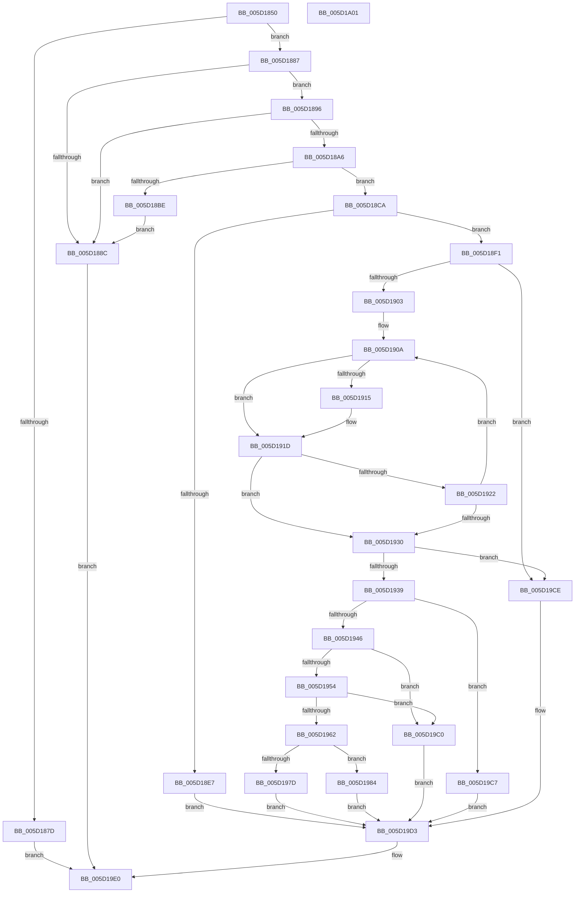

# PoFxAddDeviceRelation

- RVA: `0x005D1850`–`0x005D1A02` (길이 `434` bytes)
- VA: `0x00000001405D1850`
- 실행 섹션: `.text`
- PDB 이름 있음: `예`; PDB Function 태그: `아니요`
- unwind 정보 RVA: `0x0008A350`
- 디코드: `122`개 명령, `434/434` bytes 표시
- 미해석 바이트: `0` (있으면 어셈블리에 `.byte`로 보존)

> 이 문서는 커널 이미지의 기계어와 PDB 기호를 분석해 생성했습니다. 4번과 5번은 함수 원형과 자료형을 바이너리 사용 방식에서 추정한 C 해석이며 원본 소스 복구 결과는 아닙니다.

## 1. Dependencies

- 직접 호출 지점: **10**; 고유 호출 대상: **9**
- 직접 호출자로 확인된 함수: **0**
- RIP 상대 이미지 참조: **0**

### Outgoing calls
- `0x005D18AD` → [ExAcquireSpinLockExclusive](../24/ExAcquireSpinLockExclusive_function_00248690.md) (function, `0x00248690`)
- `0x005D18C3` → [ExReleaseSpinLockExclusive](../2C/ExReleaseSpinLockExclusive_function_002C0EF0.md) (function, `0x002C0EF0`)
- `0x005D18D2` → [PopFxReferenceDevice](../2B/PopFxReferenceDevice_function_002BFD9C.md) (function, `0x002BFD9C`)
- `0x005D18DD` → [ExReleaseSpinLockExclusive](../2C/ExReleaseSpinLockExclusive_function_002C0EF0.md) (function, `0x002C0EF0`)
- `0x005D1970` → [ExAllocatePool2](../../poolcode/B8/ExAllocatePool2_function_00B820F0.md) (function, `0x00B820F0`)
- `0x005D1991` → [PopFxActivateComponent](../2D/PopFxActivateComponent_function_002D9DBC.md) (function, `0x002D9DBC`)
- `0x005D199F` → [PopFxActivateDevice](../4A/PopFxActivateDevice_function_004A0DC8.md) (function, `0x004A0DC8`)
- `0x005D19B0` → [PopFxInsertDeviceRelation](PopFxInsertDeviceRelation_function_005D2CE0.md) (function, `0x005D2CE0`)
- `0x005D19B9` → [PoFxIdleDevice](../48/PoFxIdleDevice_function_00483EE8.md) (function, `0x00483EE8`)
- `0x005D19DB` → [PopFxDereferenceDevice](../27/PopFxDereferenceDevice_function_0027038C.md) (function, `0x0027038C`)

### Direct callers
- 이 함수 시작 RVA로 연결되는 직접 call은 확인되지 않았습니다. 간접 호출은 완전히 역산할 수 없습니다.

### Static image references
- 디코드된 RIP-relative 메모리 참조가 없습니다.

## 2. Other-region calls and transfers

- 다른 실행 섹션으로 향하는 call: **1**
  - `0x005D1970` → [ExAllocatePool2](../../poolcode/B8/ExAllocatePool2_function_00B820F0.md) (`.text` → `POOLCODE`)
- 별도 외부 분기/꼬리 이동을 확인하지 못했습니다.

## 3. Assembly (complete function range)

```asm
005D1850  48 8B C4                        mov rax, rsp
005D1853  48 89 58 08                     mov qword ptr [rax + 8], rbx
005D1857  48 89 68 10                     mov qword ptr [rax + 0x10], rbp
005D185B  48 89 70 18                     mov qword ptr [rax + 0x18], rsi
005D185F  48 89 78 20                     mov qword ptr [rax + 0x20], rdi
005D1863  41 55                           push r13
005D1865  41 56                           push r14
005D1867  41 57                           push r15
005D1869  48 83 EC 20                     sub rsp, 0x20
005D186D  33 DB                           xor ebx, ebx
005D186F  45 8B E9                        mov r13d, r9d
005D1872  4D 8B F8                        mov r15, r8
005D1875  48 8B F1                        mov rsi, rcx
005D1878  48 85 C9                        test rcx, rcx
005D187B  75 0A                           jne 0x1405d1887
005D187D  BB EF 00 00 C0                  mov ebx, 0xc00000ef
005D1882  E9 59 01 00 00                  jmp 0x1405d19e0
005D1887  48 85 D2                        test rdx, rdx
005D188A  75 0A                           jne 0x1405d1896
005D188C  BB F0 00 00 C0                  mov ebx, 0xc00000f0
005D1891  E9 4A 01 00 00                  jmp 0x1405d19e0
005D1896  48 8B 82 38 01 00 00            mov rax, qword ptr [rdx + 0x138]
005D189D  48 8B 78 28                     mov rdi, qword ptr [rax + 0x28]
005D18A1  48 85 FF                        test rdi, rdi
005D18A4  74 E6                           je 0x1405d188c
005D18A6  48 8D 6F 58                     lea rbp, [rdi + 0x58]
005D18AA  48 8B CD                        mov rcx, rbp
005D18AD  E8 DE 6D C7 FF                  call 0x140248690
005D18B2  48 8B 7F 50                     mov rdi, qword ptr [rdi + 0x50]
005D18B6  44 8A F0                        mov r14b, al
005D18B9  48 85 FF                        test rdi, rdi
005D18BC  75 0C                           jne 0x1405d18ca
005D18BE  8A D0                           mov dl, al
005D18C0  48 8B CD                        mov rcx, rbp
005D18C3  E8 28 F6 CE FF                  call 0x1402c0ef0
005D18C8  EB C2                           jmp 0x1405d188c
005D18CA  BA 06 00 00 00                  mov edx, 6
005D18CF  48 8B CF                        mov rcx, rdi
005D18D2  E8 C5 E4 CE FF                  call 0x1402bfd9c
005D18D7  41 8A D6                        mov dl, r14b
005D18DA  48 8B CD                        mov rcx, rbp
005D18DD  E8 0E F6 CE FF                  call 0x1402c0ef0
005D18E2  48 3B FE                        cmp rdi, rsi
005D18E5  75 0A                           jne 0x1405d18f1
005D18E7  BB F0 00 00 C0                  mov ebx, 0xc00000f0
005D18EC  E9 E2 00 00 00                  jmp 0x1405d19d3
005D18F1  44 8B 8F 64 03 00 00            mov r9d, dword ptr [rdi + 0x364]
005D18F8  8B D3                           mov edx, ebx
005D18FA  45 85 C9                        test r9d, r9d
005D18FD  0F 84 CB 00 00 00               je 0x1405d19ce
005D1903  4C 8B 87 68 03 00 00            mov r8, qword ptr [rdi + 0x368]
005D190A  4D 8B 30                        mov r14, qword ptr [r8]
005D190D  49 8B 0F                        mov rcx, qword ptr [r15]
005D1910  49 2B 0E                        sub rcx, qword ptr [r14]
005D1913  75 08                           jne 0x1405d191d
005D1915  49 8B 4F 08                     mov rcx, qword ptr [r15 + 8]
005D1919  49 2B 4E 08                     sub rcx, qword ptr [r14 + 8]
005D191D  48 85 C9                        test rcx, rcx
005D1920  74 0E                           je 0x1405d1930
005D1922  FF C2                           inc edx
005D1924  49 83 C0 08                     add r8, 8
005D1928  4C 8B F3                        mov r14, rbx
005D192B  41 3B D1                        cmp edx, r9d
005D192E  72 DA                           jb 0x1405d190a
005D1930  4D 85 F6                        test r14, r14
005D1933  0F 84 95 00 00 00               je 0x1405d19ce
005D1939  41 8D 45 FE                     lea eax, [r13 - 2]
005D193D  83 F8 02                        cmp eax, 2
005D1940  0F 87 81 00 00 00               ja 0x1405d19c7
005D1946  33 C0                           xor eax, eax
005D1948  F0 0F B1 9E 60 03 00 00         lock cmpxchg dword ptr [rsi + 0x360], ebx
005D1950  A8 01                           test al, 1
005D1952  75 6C                           jne 0x1405d19c0
005D1954  33 C0                           xor eax, eax
005D1956  F0 0F B1 9F 60 03 00 00         lock cmpxchg dword ptr [rdi + 0x360], ebx
005D195E  A8 01                           test al, 1
005D1960  75 5E                           jne 0x1405d19c0
005D1962  BA 48 00 00 00                  mov edx, 0x48
005D1967  41 B8 50 46 58 4D               mov r8d, 0x4d584650
005D196D  8D 4A F8                        lea ecx, [rdx - 8]
005D1970  E8 7B 07 5B 00                  call 0x140b820f0
005D1975  48 8B E8                        mov rbp, rax
005D1978  48 85 C0                        test rax, rax
005D197B  75 07                           jne 0x1405d1984
005D197D  BB 9A 00 00 C0                  mov ebx, 0xc000009a
005D1982  EB 4F                           jmp 0x1405d19d3
005D1984  45 33 C9                        xor r9d, r9d
005D1987  49 8B D6                        mov rdx, r14
005D198A  48 8B CF                        mov rcx, rdi
005D198D  45 8D 41 01                     lea r8d, [r9 + 1]
005D1991  E8 26 84 D0 FF                  call 0x1402d9dbc
005D1996  48 8B 4E 60                     mov rcx, qword ptr [rsi + 0x60]
005D199A  45 33 C0                        xor r8d, r8d
005D199D  33 D2                           xor edx, edx
005D199F  E8 24 F4 EC FF                  call 0x1404a0dc8
005D19A4  4C 8B CD                        mov r9, rbp
005D19A7  45 8B C5                        mov r8d, r13d
005D19AA  48 8B D6                        mov rdx, rsi
005D19AD  49 8B CE                        mov rcx, r14
005D19B0  E8 2B 13 00 00                  call 0x1405d2ce0
005D19B5  48 8B 4E 60                     mov rcx, qword ptr [rsi + 0x60]
005D19B9  E8 2A 25 EB FF                  call 0x140483ee8
005D19BE  EB 13                           jmp 0x1405d19d3
005D19C0  BB 0D 00 00 C0                  mov ebx, 0xc000000d
005D19C5  EB 0C                           jmp 0x1405d19d3
005D19C7  BB F2 00 00 C0                  mov ebx, 0xc00000f2
005D19CC  EB 05                           jmp 0x1405d19d3
005D19CE  BB F1 00 00 C0                  mov ebx, 0xc00000f1
005D19D3  BA 06 00 00 00                  mov edx, 6
005D19D8  48 8B CF                        mov rcx, rdi
005D19DB  E8 AC E9 C9 FF                  call 0x14027038c
005D19E0  48 8B 6C 24 48                  mov rbp, qword ptr [rsp + 0x48]
005D19E5  8B C3                           mov eax, ebx
005D19E7  48 8B 5C 24 40                  mov rbx, qword ptr [rsp + 0x40]
005D19EC  48 8B 74 24 50                  mov rsi, qword ptr [rsp + 0x50]
005D19F1  48 8B 7C 24 58                  mov rdi, qword ptr [rsp + 0x58]
005D19F6  48 83 C4 20                     add rsp, 0x20
005D19FA  41 5F                           pop r15
005D19FC  41 5E                           pop r14
005D19FE  41 5D                           pop r13
005D1A00  C3                              ret
005D1A01  CC                              int3
```

## 4. C-style interpretation (structured pseudocode)

```c
__int64 __fastcall PoFxAddDeviceRelation(__int64 a1, __int64 a2, __int64 a3, int a4)
{
    __int64 result;
    __int64 v_rbx;
    __int64 v_rsp;
    unsigned __int64 v_stack_p10;
    unsigned __int64 v_stack_p18;
    unsigned __int64 v_stack_p20;
    unsigned __int64 v_stack_p8;

    *(unsigned __int64 *)(v_rsp + 8) = v_rbx;
    *(unsigned __int64 *)(v_rsp + 16) = v_rbp;
    *(unsigned __int64 *)(v_rsp + 24) = v_rsi;
    *(unsigned __int64 *)(v_rsp + 32) = v_rdi;
    v_rsp = (v_rsp) - (32);
    v_rbx = 0;
    if (a1 != 0) goto loc_005D1887;
    goto loc_005D19E0;
loc_005D1887:
    if (a2 != 0) goto loc_005D1896;
loc_005D188C:
    goto loc_005D19E0;
loc_005D1896:
    if (*(unsigned __int64 *)(*(unsigned __int64 *)(a2 + 312) + 40) == 0) goto loc_005D188C;
    result = ExAcquireSpinLockExclusive(*(unsigned __int64 *)(*(unsigned __int64 *)(a2 + 312) + 40) + 88, a2, a3, a4);
    if (*(unsigned __int64 *)(*(unsigned __int64 *)(*(unsigned __int64 *)(a2 + 312) + 40) + 80) != 0) goto loc_005D18CA;
    result = ExReleaseSpinLockExclusive(*(unsigned __int64 *)(*(unsigned __int64 *)(a2 + 312) + 40) + 88, (unsigned __int8)(result), a3, a4);
    goto loc_005D188C;
loc_005D18CA:
    result = PopFxReferenceDevice(*(unsigned __int64 *)(*(unsigned __int64 *)(*(unsigned __int64 *)(a2 + 312) + 40) + 80), 6, a3, a4);
    result = ExReleaseSpinLockExclusive(*(unsigned __int64 *)(*(unsigned __int64 *)(a2 + 312) + 40) + 88, (unsigned __int8)((unsigned __int8)(result)), a3, a4);
    if ((*(unsigned __int64 *)(*(unsigned __int64 *)(*(unsigned __int64 *)(a2 + 312) + 40) + 80)) != a1) goto loc_005D18F1;
    goto loc_005D19D3;
loc_005D18F1:
    if ((unsigned int)((unsigned int)(*(unsigned int *)(*(unsigned __int64 *)(*(unsigned __int64 *)(*(unsigned __int64 *)(a2 + 312) + 40) + 80) + 868))) == 0) goto loc_005D19CE;
loc_005D190A:
    a1 = (*(unsigned __int64 *)(a3)) - (*(unsigned __int64 *)(*(unsigned __int64 *)(*(unsigned __int64 *)(*(unsigned __int64 *)(*(unsigned __int64 *)(*(unsigned __int64 *)(a2 + 312) + 40) + 80) + 872))));
    if (!(condition_is_not_equal)) {
        a1 = *(unsigned __int64 *)(a3 + 8);
        a1 = (a1) - (*(unsigned __int64 *)(*(unsigned __int64 *)(*(unsigned __int64 *)(*(unsigned __int64 *)(*(unsigned __int64 *)(*(unsigned __int64 *)(a2 + 312) + 40) + 80) + 872)) + 8));
    }
    if (a1 == 0) goto loc_005D1930;
    a2 = (unsigned int)(((unsigned int)((unsigned int)((unsigned int)(0xC00000F0ULL)))) + 1);
    a3 = (*(unsigned __int64 *)(*(unsigned __int64 *)(*(unsigned __int64 *)(*(unsigned __int64 *)(a2 + 312) + 40) + 80) + 872)) + (8);
    if (((unsigned int)(a2)) < ((unsigned int)((unsigned int)(*(unsigned int *)(*(unsigned __int64 *)(*(unsigned __int64 *)(*(unsigned __int64 *)(a2 + 312) + 40) + 80) + 868))))) goto loc_005D190A;
loc_005D1930:
    if ((unsigned int)(0xC00000F0ULL) == 0) goto loc_005D19CE;
    if (((unsigned int)((unsigned int)(a4) - 2)) > 2) goto loc_005D19C7;
    result = 0;
    if (((0) & (1)) != 0) goto loc_005D19C0;
    result = 0;
    if (((0) & (1)) != 0) goto loc_005D19C0;
    result = ExAllocatePool2(72 - 8, 72, (unsigned int)(0x4D584650ULL), (unsigned int)(*(unsigned int *)(*(unsigned __int64 *)(*(unsigned __int64 *)(*(unsigned __int64 *)(a2 + 312) + 40) + 80) + 868)));
    if (result != 0) goto loc_005D1984;
    goto loc_005D19D3;
loc_005D1984:
    a4 = 0;
    result = PopFxActivateComponent(*(unsigned __int64 *)(*(unsigned __int64 *)(*(unsigned __int64 *)(a2 + 312) + 40) + 80), (unsigned int)(0xC00000F0ULL), a4 + 1, a4);
    a3 = 0;
    a2 = 0;
    result = PopFxActivateDevice(*(unsigned __int64 *)(a1 + 96), a2, a3, a4);
    result = PopFxInsertDeviceRelation((unsigned int)(0xC00000F0ULL), a1, (unsigned int)((unsigned int)((unsigned int)(a4))), result);
    result = PoFxIdleDevice(*(unsigned __int64 *)(a1 + 96), a1, (unsigned int)((unsigned int)((unsigned int)(a4))), result);
    goto loc_005D19D3;
loc_005D19C0:
    goto loc_005D19D3;
loc_005D19C7:
    goto loc_005D19D3;
loc_005D19CE:
loc_005D19D3:
    result = PopFxDereferenceDevice(*(unsigned __int64 *)(*(unsigned __int64 *)(*(unsigned __int64 *)(a2 + 312) + 40) + 80), 6, (unsigned int)((unsigned int)((unsigned int)(a4))), result);
loc_005D19E0:
    v_rsp = (v_rsp) + (32);
    return (unsigned int)((unsigned int)((unsigned int)(0xC00000F1ULL)));
}
```

## 5. (Beta) C Style

```c
int64_t PoFxAddDeviceRelation(void *Arg1, int64_t Arg2, void *Arg3, void *Arg4)
{
    uint8_t *arg1 = (uint8_t *)Arg1;
    uint8_t *arg3 = (uint8_t *)Arg3;
    uint8_t *arg4 = (uint8_t *)Arg4;

    int64_t result;
    int64_t local_rbx;
    int64_t local_rsp;
    uint64_t v_stack_p10;
    uint64_t v_stack_p18;
    uint64_t v_stack_p20;
    uint64_t v_stack_p8;

    *(uint64_t *)(local_rsp + 0x8) = local_rbx;
    *(uint64_t *)(local_rsp + 0x10) = local_rbp;
    *(uint64_t *)(local_rsp + 0x18) = local_rsi;
    *(uint64_t *)(local_rsp + 0x20) = local_rdi;
    local_rsp = (local_rsp) - (32);
    local_rbx = 0;
    if (Arg1 != NULL) goto loc_005D1887;
    goto loc_005D19E0;
loc_005D1887:
    if (Arg2 != 0) goto loc_005D1896;
loc_005D188C:
    goto loc_005D19E0;
loc_005D1896:
    if (*(uint64_t *)(*(uint64_t *)(Arg2 + 0x138) + 0x28) == 0) goto loc_005D188C;
    result = ExAcquireSpinLockExclusive(*(uint64_t *)(*(uint64_t *)(Arg2 + 0x138) + 0x28) + 88, Arg2, Arg3, Arg4);
    if (*(uint64_t *)(*(uint64_t *)(*(uint64_t *)(Arg2 + 0x138) + 0x28) + 0x50) != 0) goto loc_005D18CA;
    result = ExReleaseSpinLockExclusive(*(uint64_t *)(*(uint64_t *)(Arg2 + 0x138) + 0x28) + 88, (uint8_t)(result), Arg3, Arg4);
    goto loc_005D188C;
loc_005D18CA:
    result = PopFxReferenceDevice(*(uint64_t *)(*(uint64_t *)(*(uint64_t *)(Arg2 + 0x138) + 0x28) + 0x50), 6, Arg3, Arg4);
    result = ExReleaseSpinLockExclusive(*(uint64_t *)(*(uint64_t *)(Arg2 + 0x138) + 0x28) + 88, (uint8_t)((uint8_t)(result)), Arg3, Arg4);
    if ((*(uint64_t *)(*(uint64_t *)(*(uint64_t *)(Arg2 + 0x138) + 0x28) + 0x50)) != Arg1) goto loc_005D18F1;
    goto loc_005D19D3;
loc_005D18F1:
    if ((uint32_t)((uint32_t)(*(uint32_t *)(*(uint64_t *)(*(uint64_t *)(*(uint64_t *)(Arg2 + 0x138) + 0x28) + 0x50) + 0x364))) == 0) goto loc_005D19CE;
loc_005D190A:
    Arg1 = (*(uint64_t *)(arg3)) - (*(uint64_t *)(*(uint64_t *)(*(uint64_t *)(*(uint64_t *)(*(uint64_t *)(*(uint64_t *)(Arg2 + 0x138) + 0x28) + 0x50) + 0x368))));
    if (!(condition_is_not_equal)) {
        Arg1 = *(uint64_t *)(arg3 + 0x8);
        Arg1 = (Arg1) - (*(uint64_t *)(*(uint64_t *)(*(uint64_t *)(*(uint64_t *)(*(uint64_t *)(*(uint64_t *)(Arg2 + 0x138) + 0x28) + 0x50) + 0x368)) + 0x8));
    }
    if (Arg1 == NULL) goto loc_005D1930;
    Arg2 = (uint32_t)(((uint32_t)((uint32_t)((uint32_t)(0xC00000F0ULL)))) + 1);
    Arg3 = (*(uint64_t *)(*(uint64_t *)(*(uint64_t *)(*(uint64_t *)(Arg2 + 0x138) + 0x28) + 0x50) + 0x368)) + (8);
    if (((uint32_t)(Arg2)) < ((uint32_t)((uint32_t)(*(uint32_t *)(*(uint64_t *)(*(uint64_t *)(*(uint64_t *)(Arg2 + 0x138) + 0x28) + 0x50) + 0x364))))) goto loc_005D190A;
loc_005D1930:
    if ((uint32_t)(0xC00000F0ULL) == 0) goto loc_005D19CE;
    if (((uint32_t)((uint32_t)(Arg4) - 2)) > 2) goto loc_005D19C7;
    result = 0;
    if (((0) & (1)) != 0) goto loc_005D19C0;
    result = 0;
    if (((0) & (1)) != 0) goto loc_005D19C0;
    result = ExAllocatePool2(72 - 8, 72, (uint32_t)(0x4D584650ULL), (uint32_t)(*(uint32_t *)(*(uint64_t *)(*(uint64_t *)(*(uint64_t *)(Arg2 + 0x138) + 0x28) + 0x50) + 0x364)));
    if (result != 0) goto loc_005D1984;
    goto loc_005D19D3;
loc_005D1984:
    Arg4 = 0;
    result = PopFxActivateComponent(*(uint64_t *)(*(uint64_t *)(*(uint64_t *)(Arg2 + 0x138) + 0x28) + 0x50), (uint32_t)(0xC00000F0ULL), Arg4 + 1, Arg4);
    Arg3 = 0;
    Arg2 = 0;
    result = PopFxActivateDevice(*(uint64_t *)(arg1 + 0x60), Arg2, Arg3, Arg4);
    result = PopFxInsertDeviceRelation((uint32_t)(0xC00000F0ULL), Arg1, (uint32_t)((uint32_t)((uint32_t)(Arg4))), result);
    result = PoFxIdleDevice(*(uint64_t *)(arg1 + 0x60), Arg1, (uint32_t)((uint32_t)((uint32_t)(Arg4))), result);
    goto loc_005D19D3;
loc_005D19C0:
    goto loc_005D19D3;
loc_005D19C7:
    goto loc_005D19D3;
loc_005D19CE:
loc_005D19D3:
    result = PopFxDereferenceDevice(*(uint64_t *)(*(uint64_t *)(*(uint64_t *)(Arg2 + 0x138) + 0x28) + 0x50), 6, (uint32_t)((uint32_t)((uint32_t)(Arg4))), result);
loc_005D19E0:
    local_rsp = (local_rsp) + (32);
    return (uint32_t)((uint32_t)((uint32_t)(0xC00000F1ULL)));
}
```

### 관측된 메모리 오프셋

구조체 형식이 확인되지 않은 접근은 인자 기준의 오프셋으로만 기록했습니다.

| 기준 인자 | 오프셋 표현 | 폭 (bit) | 접근 |
|---|---:|---:|---|
| `Arg1` | `+ 0x60` | `64` | `R` |
| `Arg1` | `+ 0x360` | `32` | `R` |
| `Arg3` | `+ 0x0` | `64` | `R` |
| `Arg3` | `+ 0x8` | `64` | `R` |
| `Arg4` | `- 0x2` | `32` | `R` |

## 6. Execution-region graph

[열기: 2D/3D 그래프와 함수 탐색 컨트롤 패널](../../../control-panel.html?section=text&rva=0x005D1850&view=graph)

- 2D 그래프는 위에서 아래로 흐르고, 3D 그래프는 빈 공간을 드래그해 회전합니다. Shift+드래그는 이동, 휠은 확대·축소, 함수 노드 선택은 대상 보고서 이동입니다.

### Static fallback


