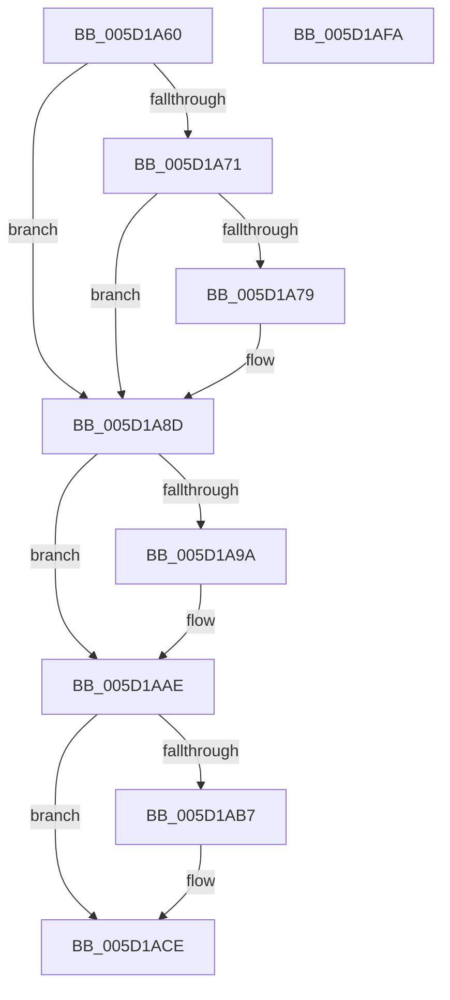

# PoFxIssueComponentPerfStateChangeMultiple

- RVA: `0x005D1A60`–`0x005D1AFB` (길이 `155` bytes)
- VA: `0x00000001405D1A60`
- 실행 섹션: `.text`
- PDB 이름 있음: `예`; PDB Function 태그: `아니요`
- unwind 정보 RVA: `0x0005D2F4`
- 디코드: `44`개 명령, `155/155` bytes 표시
- 미해석 바이트: `0` (있으면 어셈블리에 `.byte`로 보존)

> 이 문서는 커널 이미지의 기계어와 PDB 기호를 분석해 생성했습니다. 4번과 5번은 함수 원형과 자료형을 바이너리 사용 방식에서 추정한 C 해석이며 원본 소스 복구 결과는 아닙니다.

## 1. Dependencies

- 직접 호출 지점: **4**; 고유 호출 대상: **2**
- 직접 호출자로 확인된 함수: **1**
- RIP 상대 이미지 참조: **0**

### Outgoing calls
- `0x005D1A87` → [PopFxBugCheck](../2B/PopFxBugCheck_function_002BFC6C.md) (function, `0x002BFC6C`)
- `0x005D1AA8` → [PopFxBugCheck](../2B/PopFxBugCheck_function_002BFC6C.md) (function, `0x002BFC6C`)
- `0x005D1AC8` → [PopFxBugCheck](../2B/PopFxBugCheck_function_002BFC6C.md) (function, `0x002BFC6C`)
- `0x005D1AF0` → [PopFxIssueComponentPerfStateChanges](../4C/PopFxIssueComponentPerfStateChanges_function_004C1940.md) (function, `0x004C1940`)

### Direct callers
- [PoFxIssueComponentPerfStateChange](PoFxIssueComponentPerfStateChange_function_005D1A30.md) at `0x005D1A49`

### Static image references
- 디코드된 RIP-relative 메모리 참조가 없습니다.

## 2. Other-region calls and transfers

- 다른 실행 섹션으로 향하는 call: **0**
- 별도 외부 분기/꼬리 이동을 확인하지 못했습니다.

## 3. Assembly (complete function range)

```asm
005D1A60  48 83 EC 38                     sub rsp, 0x38
005D1A64  44 8B DA                        mov r11d, edx
005D1A67  BA 01 00 00 00                  mov edx, 1
005D1A6C  44 84 DA                        test dl, r11b
005D1A6F  74 1C                           je 0x1405d1a8d
005D1A71  44 0F 20 C0                     mov rax, cr8
005D1A75  3C 02                           cmp al, 2
005D1A77  72 14                           jb 0x1405d1a8d
005D1A79  44 8B CA                        mov r9d, edx
005D1A7C  45 8B C0                        mov r8d, r8d
005D1A7F  48 8B D1                        mov rdx, rcx
005D1A82  B9 14 06 00 00                  mov ecx, 0x614
005D1A87  E8 E0 E1 CE FF                  call 0x1402bfc6c
005D1A8C  CC                              int3
005D1A8D  41 8B C3                        mov eax, r11d
005D1A90  45 8B D0                        mov r10d, r8d
005D1A93  83 E0 03                        and eax, 3
005D1A96  3C 03                           cmp al, 3
005D1A98  75 14                           jne 0x1405d1aae
005D1A9A  4C 8B CA                        mov r9, rdx
005D1A9D  45 8B C2                        mov r8d, r10d
005D1AA0  48 8B D1                        mov rdx, rcx
005D1AA3  B9 14 06 00 00                  mov ecx, 0x614
005D1AA8  E8 BF E1 CE FF                  call 0x1402bfc6c
005D1AAD  CC                              int3
005D1AAE  44 3B 81 64 03 00 00            cmp r8d, dword ptr [rcx + 0x364]
005D1AB5  72 17                           jb 0x1405d1ace
005D1AB7  48 8B D1                        mov rdx, rcx
005D1ABA  41 B9 02 00 00 00               mov r9d, 2
005D1AC0  B9 14 06 00 00                  mov ecx, 0x614
005D1AC5  4D 8B C2                        mov r8, r10
005D1AC8  E8 9F E1 CE FF                  call 0x1402bfc6c
005D1ACD  CC                              int3
005D1ACE  48 8B 91 68 03 00 00            mov rdx, qword ptr [rcx + 0x368]
005D1AD5  45 8B C3                        mov r8d, r11d
005D1AD8  48 8B 44 24 68                  mov rax, qword ptr [rsp + 0x68]
005D1ADD  48 89 44 24 28                  mov qword ptr [rsp + 0x28], rax
005D1AE2  48 8B 44 24 60                  mov rax, qword ptr [rsp + 0x60]
005D1AE7  4A 8B 14 D2                     mov rdx, qword ptr [rdx + r10*8]
005D1AEB  48 89 44 24 20                  mov qword ptr [rsp + 0x20], rax
005D1AF0  E8 4B FE EE FF                  call 0x1404c1940
005D1AF5  48 83 C4 38                     add rsp, 0x38
005D1AF9  C3                              ret
005D1AFA  CC                              int3
```

## 4. C-style interpretation (structured pseudocode)

```c
__int64 __fastcall PoFxIssueComponentPerfStateChangeMultiple(__int64 a1, int a2, int a3, __int64 a4, __int64 a5, __int64 a6)
{
    __int64 result;
    __int64 v_rsp;
    unsigned __int64 v_stack_m10;
    unsigned __int64 v_stack_m18;

    v_rsp = (v_rsp) - (56);
    if (((1) & ((unsigned __int8)((unsigned int)(a2)))) == 0) goto loc_005D1A8D;
    result = v_cr8;
    if (((unsigned __int8)(v_cr8)) >= 2) {
        a4 = 1;
        a3 = a3;
        a2 = a1;
        a1 = 0x614ULL;
        result = PopFxBugCheck(a1, a2, a3, a4);
    }
    result = (unsigned int)(((unsigned int)((unsigned int)((unsigned int)(a2)))) & (3));
    if (((unsigned __int8)(result)) == 3) {
        a4 = a2;
        a3 = (unsigned int)((unsigned int)(a3));
        a2 = a1;
        a1 = 0x614ULL;
        result = PopFxBugCheck(a1, a2, a3, a4);
    }
    if (a3 >= (*(unsigned int *)(a1 + 868))) {
        a2 = a1;
        a4 = 2;
        a1 = 0x614ULL;
        a3 = (unsigned int)(a3);
        result = PopFxBugCheck(a1, a2, a3, a4);
    }
    v_stack_m10 = a6;
    v_stack_m18 = a5;
    result = PopFxIssueComponentPerfStateChanges(a1, *(unsigned __int64 *)(*(unsigned __int64 *)(a1 + 872) + (unsigned int)(a3) * 8), (unsigned int)((unsigned int)((unsigned int)(a2))), a4);
    v_rsp = (v_rsp) + (56);
    return result;
}
```

## 5. (Beta) C Style

```c
int64_t PoFxIssueComponentPerfStateChangeMultiple(int64_t Arg1, int32_t Arg2, int32_t Arg3, int64_t Arg4, int64_t Arg5, int64_t Arg6)
{
    int64_t result;
    int64_t local_rsp;
    uint64_t v_stack_m10;
    uint64_t v_stack_m18;

    local_rsp = (local_rsp) - (56);
    if (((1) & ((uint8_t)((uint32_t)(Arg2)))) == 0) goto loc_005D1A8D;
    result = v_cr8;
    if (((uint8_t)(v_cr8)) >= 2) {
        Arg4 = 1;
        Arg3 = Arg3;
        Arg2 = Arg1;
        Arg1 = 0x614ULL;
        result = PopFxBugCheck(Arg1, Arg2, Arg3, Arg4);
    }
    result = (uint32_t)(((uint32_t)((uint32_t)((uint32_t)(Arg2)))) & (3));
    if (((uint8_t)(result)) == 3) {
        Arg4 = Arg2;
        Arg3 = (uint32_t)((uint32_t)(Arg3));
        Arg2 = Arg1;
        Arg1 = 0x614ULL;
        result = PopFxBugCheck(Arg1, Arg2, Arg3, Arg4);
    }
    if (Arg3 >= (*(uint32_t *)(Arg1 + 0x364))) {
        Arg2 = Arg1;
        Arg4 = 2;
        Arg1 = 0x614ULL;
        Arg3 = (uint32_t)(Arg3);
        result = PopFxBugCheck(Arg1, Arg2, Arg3, Arg4);
    }
    v_stack_m10 = Arg6;
    v_stack_m18 = Arg5;
    result = PopFxIssueComponentPerfStateChanges(Arg1, *(uint64_t *)(*(uint64_t *)(Arg1 + 0x368) + (uint32_t)(Arg3) * 8), (uint32_t)((uint32_t)((uint32_t)(Arg2))), Arg4);
    local_rsp = (local_rsp) + (56);
    return result;
}
```

## 6. Execution-region graph

[열기: 2D/3D 그래프와 함수 탐색 컨트롤 패널](../../../control-panel.html?section=text&rva=0x005D1A60&view=graph)

- 2D 그래프는 위에서 아래로 흐르고, 3D 그래프는 빈 공간을 드래그해 회전합니다. Shift+드래그는 이동, 휠은 확대·축소, 함수 노드 선택은 대상 보고서 이동입니다.

### Static fallback


