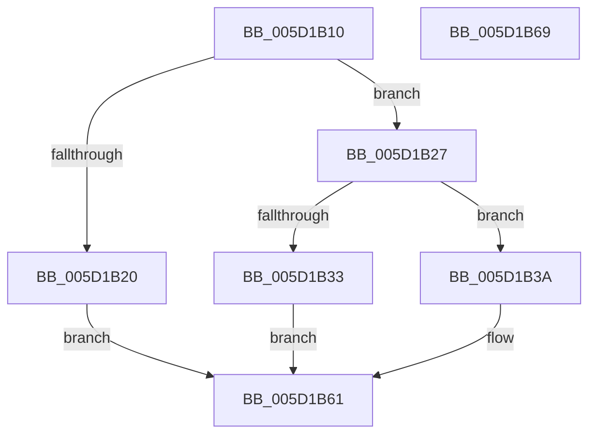

# PoFxPowerOnCrashdumpDevice

- RVA: `0x005D1B10`–`0x005D1B6A` (길이 `90` bytes)
- VA: `0x00000001405D1B10`
- 실행 섹션: `.text`
- PDB 이름 있음: `예`; PDB Function 태그: `아니요`
- unwind 정보 RVA: `0x00064C80`
- 디코드: `28`개 명령, `90/90` bytes 표시
- 미해석 바이트: `0` (있으면 어셈블리에 `.byte`로 보존)

> 이 문서는 커널 이미지의 기계어와 PDB 기호를 분석해 생성했습니다. 4번과 5번은 함수 원형과 자료형을 바이너리 사용 방식에서 추정한 C 해석이며 원본 소스 복구 결과는 아닙니다.

## 1. Dependencies

- 직접 호출 지점: **1**; 고유 호출 대상: **1**
- 직접 호출자로 확인된 함수: **0**
- RIP 상대 이미지 참조: **0**

### Outgoing calls
- `0x005D1B50` → [guard_dispatch_icall](../6B/guard_dispatch_icall_function_006BAAD0.md) (function, `0x006BAAD0`)

### Direct callers
- 이 함수 시작 RVA로 연결되는 직접 call은 확인되지 않았습니다. 간접 호출은 완전히 역산할 수 없습니다.

### Static image references
- 디코드된 RIP-relative 메모리 참조가 없습니다.

## 2. Other-region calls and transfers

- 다른 실행 섹션으로 향하는 call: **0**
- 별도 외부 분기/꼬리 이동을 확인하지 못했습니다.

## 3. Assembly (complete function range)

```asm
005D1B10  40 53                           push rbx
005D1B12  48 83 EC 30                     sub rsp, 0x30
005D1B16  33 DB                           xor ebx, ebx
005D1B18  4C 8B C2                        mov r8, rdx
005D1B1B  48 85 C9                        test rcx, rcx
005D1B1E  75 07                           jne 0x1405d1b27
005D1B20  B9 0D 00 00 C0                  mov ecx, 0xc000000d
005D1B25  EB 3A                           jmp 0x1405d1b61
005D1B27  48 8B 91 78 02 00 00            mov rdx, qword ptr [rcx + 0x278]
005D1B2E  48 85 D2                        test rdx, rdx
005D1B31  75 07                           jne 0x1405d1b3a
005D1B33  B9 01 00 00 C0                  mov ecx, 0xc0000001
005D1B38  EB 27                           jmp 0x1405d1b61
005D1B3A  48 8B 41 48                     mov rax, qword ptr [rcx + 0x48]
005D1B3E  48 8D 4C 24 20                  lea rcx, [rsp + 0x20]
005D1B43  48 89 44 24 20                  mov qword ptr [rsp + 0x20], rax
005D1B48  48 8B C2                        mov rax, rdx
005D1B4B  4C 89 44 24 28                  mov qword ptr [rsp + 0x28], r8
005D1B50  E8 7B 8F 0E 00                  call 0x1406baad0
005D1B55  B9 01 00 00 C0                  mov ecx, 0xc0000001
005D1B5A  84 C0                           test al, al
005D1B5C  0F 44 D9                        cmove ebx, ecx
005D1B5F  8B CB                           mov ecx, ebx
005D1B61  8B C1                           mov eax, ecx
005D1B63  48 83 C4 30                     add rsp, 0x30
005D1B67  5B                              pop rbx
005D1B68  C3                              ret
005D1B69  CC                              int3
```

## 4. C-style interpretation (structured pseudocode)

```c
__int64 __fastcall PoFxPowerOnCrashdumpDevice(__int64 a1, __int64 a2)
{
    __int64 result;
    __int64 v_rbx;
    __int64 v_rsp;
    unsigned __int64 v_stack_m10;
    unsigned __int64 v_stack_m18;

    v_rsp = (v_rsp) - (48);
    v_rbx = 0;
    if (a1 != 0) goto loc_005D1B27;
    goto loc_005D1B61;
loc_005D1B27:
    if (*(unsigned __int64 *)((unsigned int)(0xC000000DULL) + 632) != 0) goto loc_005D1B3A;
    goto loc_005D1B61;
loc_005D1B3A:
    v_stack_m18 = *(unsigned __int64 *)((unsigned int)(0xC0000001ULL) + 72);
    v_stack_m10 = a2;
    result = guard_dispatch_icall(v_stack_m18, *(unsigned __int64 *)((unsigned int)(0xC000000DULL) + 632), a2, a4);
    if ((unsigned __int8)(result) == 0) { v_rbx = (unsigned int)((unsigned int)(0xC0000001ULL)); }
loc_005D1B61:
    v_rsp = (v_rsp) + (48);
    return (unsigned int)((unsigned int)((unsigned int)((unsigned int)(v_rbx))));
}
```

## 5. (Beta) C Style

```c
int64_t PoFxPowerOnCrashdumpDevice(int64_t Arg1, int64_t Arg2)
{
    int64_t result;
    int64_t local_rbx;
    int64_t local_rsp;
    uint64_t v_stack_m10;
    uint64_t v_stack_m18;

    local_rsp = (local_rsp) - (48);
    local_rbx = 0;
    if (Arg1 != 0) goto loc_005D1B27;
    goto loc_005D1B61;
loc_005D1B27:
    if (*(uint64_t *)((uint32_t)(0xC000000DULL) + 0x278) != 0) goto loc_005D1B3A;
    goto loc_005D1B61;
loc_005D1B3A:
    v_stack_m18 = *(uint64_t *)((uint32_t)(0xC0000001ULL) + 0x48);
    v_stack_m10 = Arg2;
    result = guard_dispatch_icall(v_stack_m18, *(uint64_t *)((uint32_t)(0xC000000DULL) + 0x278), Arg2, a4);
    if ((uint8_t)(result) == 0) { local_rbx = (uint32_t)((uint32_t)(0xC0000001ULL)); }
loc_005D1B61:
    local_rsp = (local_rsp) + (48);
    return (uint32_t)((uint32_t)((uint32_t)((uint32_t)(local_rbx))));
}
```

## 6. Execution-region graph

[열기: 2D/3D 그래프와 함수 탐색 컨트롤 패널](../../../control-panel.html?section=text&rva=0x005D1B10&view=graph)

- 2D 그래프는 위에서 아래로 흐르고, 3D 그래프는 빈 공간을 드래그해 회전합니다. Shift+드래그는 이동, 휠은 확대·축소, 함수 노드 선택은 대상 보고서 이동입니다.

### Static fallback


