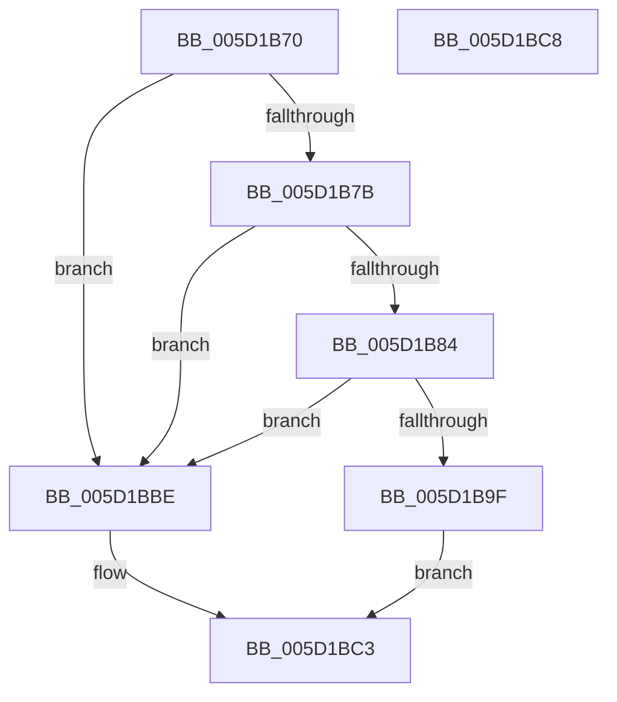

# PoFxQueryCurrentComponentPerfState

- RVA: `0x005D1B70`–`0x005D1BC9` (길이 `89` bytes)
- VA: `0x00000001405D1B70`
- 실행 섹션: `.text`
- PDB 이름 있음: `예`; PDB Function 태그: `아니요`
- unwind 정보 RVA: `0x0005D2F4`
- 디코드: `24`개 명령, `89/89` bytes 표시
- 미해석 바이트: `0` (있으면 어셈블리에 `.byte`로 보존)

> 이 문서는 커널 이미지의 기계어와 PDB 기호를 분석해 생성했습니다. 4번과 5번은 함수 원형과 자료형을 바이너리 사용 방식에서 추정한 C 해석이며 원본 소스 복구 결과는 아닙니다.

## 1. Dependencies

- 직접 호출 지점: **1**; 고유 호출 대상: **1**
- 직접 호출자로 확인된 함수: **0**
- RIP 상대 이미지 참조: **0**

### Outgoing calls
- `0x005D1BB5` → [PopFxQueryCurrentComponentPerfState](PopFxQueryCurrentComponentPerfState_function_005D30BC.md) (function, `0x005D30BC`)

### Direct callers
- 이 함수 시작 RVA로 연결되는 직접 call은 확인되지 않았습니다. 간접 호출은 완전히 역산할 수 없습니다.

### Static image references
- 디코드된 RIP-relative 메모리 참조가 없습니다.

## 2. Other-region calls and transfers

- 다른 실행 섹션으로 향하는 call: **0**
- 별도 외부 분기/꼬리 이동을 확인하지 못했습니다.

## 3. Assembly (complete function range)

```asm
005D1B70  48 83 EC 38                     sub rsp, 0x38
005D1B74  45 8B D1                        mov r10d, r9d
005D1B77  85 D2                           test edx, edx
005D1B79  75 43                           jne 0x1405d1bbe
005D1B7B  44 3B 81 64 03 00 00            cmp r8d, dword ptr [rcx + 0x364]
005D1B82  73 3A                           jae 0x1405d1bbe
005D1B84  0F AE E8                        lfence
005D1B87  48 8B 81 68 03 00 00            mov rax, qword ptr [rcx + 0x368]
005D1B8E  41 8B D0                        mov edx, r8d
005D1B91  48 8B 14 D0                     mov rdx, qword ptr [rax + rdx*8]
005D1B95  48 83 BA A8 01 00 00 00         cmp qword ptr [rdx + 0x1a8], 0
005D1B9D  74 1F                           je 0x1405d1bbe
005D1B9F  48 8B 44 24 60                  mov rax, qword ptr [rsp + 0x60]
005D1BA4  45 33 C9                        xor r9d, r9d
005D1BA7  48 83 64 24 28 00               and qword ptr [rsp + 0x28], 0
005D1BAD  45 8B C2                        mov r8d, r10d
005D1BB0  48 89 44 24 20                  mov qword ptr [rsp + 0x20], rax
005D1BB5  E8 02 15 00 00                  call 0x1405d30bc
005D1BBA  33 C0                           xor eax, eax
005D1BBC  EB 05                           jmp 0x1405d1bc3
005D1BBE  B8 0D 00 00 C0                  mov eax, 0xc000000d
005D1BC3  48 83 C4 38                     add rsp, 0x38
005D1BC7  C3                              ret
005D1BC8  CC                              int3
```

## 4. C-style interpretation (structured pseudocode)

```c
__int64 __fastcall PoFxQueryCurrentComponentPerfState(__int64 a1, int a2, int a3, int a4, __int64 a5)
{
    __int64 result;
    __int64 v_rsp;
    unsigned __int64 v_stack_m10;
    unsigned __int64 v_stack_m18;

    v_rsp = (v_rsp) - (56);
    if (a2 != 0) goto loc_005D1BBE;
    if (a3 >= (*(unsigned int *)(a1 + 868))) goto loc_005D1BBE;
    if ((*(unsigned __int64 *)(*(unsigned __int64 *)(*(unsigned __int64 *)(a1 + 872) + (unsigned int)(a3) * 8) + 424)) == 0) goto loc_005D1BBE;
    a4 = 0;
    v_stack_m18 = a5;
    result = PopFxQueryCurrentComponentPerfState(a1, *(unsigned __int64 *)(*(unsigned __int64 *)(a1 + 872) + (unsigned int)(a3) * 8), (unsigned int)((unsigned int)((unsigned int)(a4))), a4);
    result = 0;
    goto loc_005D1BC3;
loc_005D1BBE:
loc_005D1BC3:
    v_rsp = (v_rsp) + (56);
    return (unsigned int)(0xC000000DULL);
}
```

## 5. (Beta) C Style

```c
int64_t PoFxQueryCurrentComponentPerfState(void *Arg1, int32_t Arg2, int32_t Arg3, int32_t Arg4, int64_t Arg5)
{
    uint8_t *arg1 = (uint8_t *)Arg1;

    int64_t result;
    int64_t local_rsp;
    uint64_t v_stack_m10;
    uint64_t v_stack_m18;

    local_rsp = (local_rsp) - (56);
    if (Arg2 != 0) goto loc_005D1BBE;
    if (Arg3 >= (*(uint32_t *)(arg1 + 0x364))) goto loc_005D1BBE;
    if ((*(uint64_t *)(*(uint64_t *)(*(uint64_t *)(arg1 + 0x368) + (uint32_t)(Arg3) * 8) + 0x1A8)) == 0) goto loc_005D1BBE;
    Arg4 = 0;
    v_stack_m18 = Arg5;
    result = PopFxQueryCurrentComponentPerfState(Arg1, *(uint64_t *)(*(uint64_t *)(arg1 + 0x368) + (uint32_t)(Arg3) * 8), (uint32_t)((uint32_t)((uint32_t)(Arg4))), Arg4);
    result = 0;
    goto loc_005D1BC3;
loc_005D1BBE:
loc_005D1BC3:
    local_rsp = (local_rsp) + (56);
    return (uint32_t)(0xC000000DULL);
}
```

### 관측된 메모리 오프셋

구조체 형식이 확인되지 않은 접근은 인자 기준의 오프셋으로만 기록했습니다.

| 기준 인자 | 오프셋 표현 | 폭 (bit) | 접근 |
|---|---:|---:|---|
| `Arg1` | `+ 0x364` | `32` | `R` |
| `Arg1` | `+ 0x368` | `64` | `R` |

## 6. Execution-region graph

[열기: 2D/3D 그래프와 함수 탐색 컨트롤 패널](../../../control-panel.html?section=text&rva=0x005D1B70&view=graph)

- 2D 그래프는 위에서 아래로 흐르고, 3D 그래프는 빈 공간을 드래그해 회전합니다. Shift+드래그는 이동, 휠은 확대·축소, 함수 노드 선택은 대상 보고서 이동입니다.

### Static fallback


