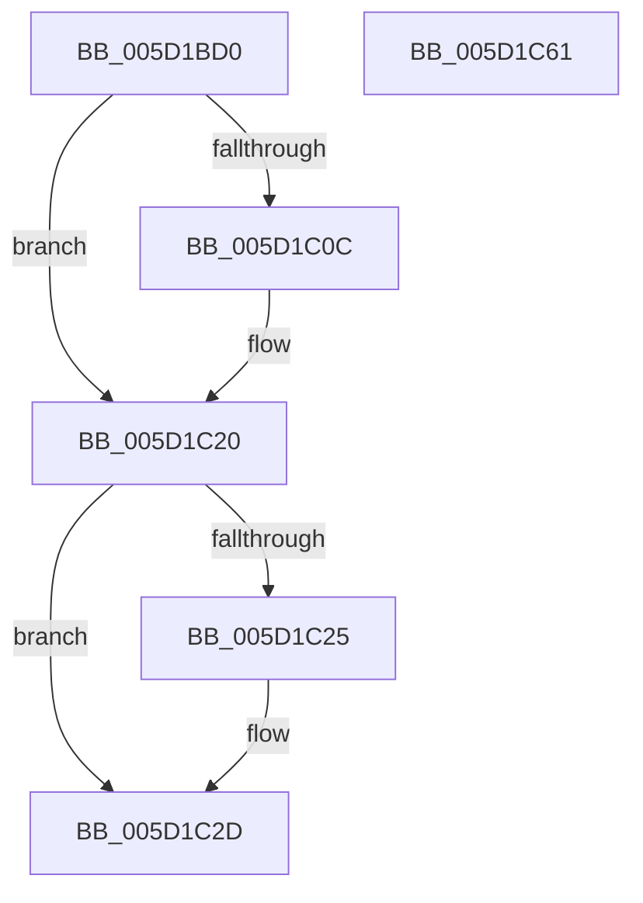

# PoFxRegisterDripsWatchdogCallback

- RVA: `0x005D1BD0`–`0x005D1C62` (길이 `146` bytes)
- VA: `0x00000001405D1BD0`
- 실행 섹션: `.text`
- PDB 이름 있음: `예`; PDB Function 태그: `아니요`
- unwind 정보 RVA: `0x0005E6B4`
- 디코드: `38`개 명령, `146/146` bytes 표시
- 미해석 바이트: `0` (있으면 어셈블리에 `.byte`로 보존)

> 이 문서는 커널 이미지의 기계어와 PDB 기호를 분석해 생성했습니다. 4번과 5번은 함수 원형과 자료형을 바이너리 사용 방식에서 추정한 C 해석이며 원본 소스 복구 결과는 아닙니다.

## 1. Dependencies

- 직접 호출 지점: **3**; 고유 호출 대상: **3**
- 직접 호출자로 확인된 함수: **0**
- RIP 상대 이미지 참조: **0**

### Outgoing calls
- `0x005D1BFD` → [ExAcquireSpinLockExclusive](../24/ExAcquireSpinLockExclusive_function_00248690.md) (function, `0x00248690`)
- `0x005D1C1A` → [PopFxBugCheck](../2B/PopFxBugCheck_function_002BFC6C.md) (function, `0x002BFC6C`)
- `0x005D1C41` → [ExReleaseSpinLockExclusive](../2C/ExReleaseSpinLockExclusive_function_002C0EF0.md) (function, `0x002C0EF0`)

### Direct callers
- 이 함수 시작 RVA로 연결되는 직접 call은 확인되지 않았습니다. 간접 호출은 완전히 역산할 수 없습니다.

### Static image references
- 디코드된 RIP-relative 메모리 참조가 없습니다.

## 2. Other-region calls and transfers

- 다른 실행 섹션으로 향하는 call: **0**
- 별도 외부 분기/꼬리 이동을 확인하지 못했습니다.

## 3. Assembly (complete function range)

```asm
005D1BD0  48 8B C4                        mov rax, rsp
005D1BD3  48 89 58 08                     mov qword ptr [rax + 8], rbx
005D1BD7  48 89 68 10                     mov qword ptr [rax + 0x10], rbp
005D1BDB  48 89 70 18                     mov qword ptr [rax + 0x18], rsi
005D1BDF  48 89 78 20                     mov qword ptr [rax + 0x20], rdi
005D1BE3  41 56                           push r14
005D1BE5  48 83 EC 20                     sub rsp, 0x20
005D1BE9  48 8B 79 30                     mov rdi, qword ptr [rcx + 0x30]
005D1BED  48 8B D9                        mov rbx, rcx
005D1BF0  49 8B E9                        mov rbp, r9
005D1BF3  41 8A F0                        mov sil, r8b
005D1BF6  4C 8B F2                        mov r14, rdx
005D1BF9  48 8D 4F 58                     lea rcx, [rdi + 0x58]
005D1BFD  E8 8E 6A C7 FF                  call 0x140248690
005D1C02  48 83 BB A8 00 00 00 00         cmp qword ptr [rbx + 0xa8], 0
005D1C0A  74 14                           je 0x1405d1c20
005D1C0C  45 33 C9                        xor r9d, r9d
005D1C0F  45 33 C0                        xor r8d, r8d
005D1C12  48 8B D3                        mov rdx, rbx
005D1C15  B9 22 06 00 00                  mov ecx, 0x622
005D1C1A  E8 4D E0 CE FF                  call 0x1402bfc6c
005D1C1F  CC                              int3
005D1C20  40 84 F6                        test sil, sil
005D1C23  74 08                           je 0x1405d1c2d
005D1C25  F0 83 8B 60 03 00 00 08         lock or dword ptr [rbx + 0x360], 8
005D1C2D  8A D0                           mov dl, al
005D1C2F  48 89 AB 88 03 00 00            mov qword ptr [rbx + 0x388], rbp
005D1C36  48 8D 4F 58                     lea rcx, [rdi + 0x58]
005D1C3A  4C 89 B3 A8 00 00 00            mov qword ptr [rbx + 0xa8], r14
005D1C41  E8 AA F2 CE FF                  call 0x1402c0ef0
005D1C46  48 8B 5C 24 30                  mov rbx, qword ptr [rsp + 0x30]
005D1C4B  48 8B 6C 24 38                  mov rbp, qword ptr [rsp + 0x38]
005D1C50  48 8B 74 24 40                  mov rsi, qword ptr [rsp + 0x40]
005D1C55  48 8B 7C 24 48                  mov rdi, qword ptr [rsp + 0x48]
005D1C5A  48 83 C4 20                     add rsp, 0x20
005D1C5E  41 5E                           pop r14
005D1C60  C3                              ret
005D1C61  CC                              int3
```

## 4. C-style interpretation (structured pseudocode)

```c
__int64 __fastcall PoFxRegisterDripsWatchdogCallback(__int64 a1, __int64 a2, int a3, __int64 a4)
{
    __int64 result;
    __int64 v_rsp;
    unsigned __int64 v_stack_p10;
    unsigned __int64 v_stack_p18;
    unsigned __int64 v_stack_p20;
    unsigned __int64 v_stack_p8;

    *(unsigned __int64 *)(v_rsp + 8) = v_rbx;
    *(unsigned __int64 *)(v_rsp + 16) = v_rbp;
    *(unsigned __int64 *)(v_rsp + 24) = v_rsi;
    *(unsigned __int64 *)(v_rsp + 32) = v_rdi;
    v_rsp = (v_rsp) - (32);
    result = ExAcquireSpinLockExclusive(*(unsigned __int64 *)(a1 + 48) + 88, a2, a3, a4);
    if ((*(unsigned __int64 *)(a1 + 168)) != 0) {
        a4 = 0;
        a3 = 0;
        a2 = a1;
        a1 = 0x622ULL;
        result = PopFxBugCheck(a1, a2, a3, a4);
    }
    if ((unsigned __int8)((unsigned __int8)(a3)) != 0) {
    }
    *(unsigned __int64 *)(a1 + 904) = 0;
    *(unsigned __int64 *)(a1 + 168) = a2;
    result = ExReleaseSpinLockExclusive(*(unsigned __int64 *)(a1 + 48) + 88, (unsigned __int8)(result), a3, a4);
    v_rsp = (v_rsp) + (32);
    return result;
}
```

## 5. (Beta) C Style

```c
int64_t PoFxRegisterDripsWatchdogCallback(void *Arg1, int64_t Arg2, int32_t Arg3, int64_t Arg4)
{
    uint8_t *arg1 = (uint8_t *)Arg1;

    int64_t result;
    int64_t local_rsp;
    uint64_t v_stack_p10;
    uint64_t v_stack_p18;
    uint64_t v_stack_p20;
    uint64_t v_stack_p8;

    *(uint64_t *)(local_rsp + 0x8) = local_rbx;
    *(uint64_t *)(local_rsp + 0x10) = local_rbp;
    *(uint64_t *)(local_rsp + 0x18) = local_rsi;
    *(uint64_t *)(local_rsp + 0x20) = local_rdi;
    local_rsp = (local_rsp) - (32);
    result = ExAcquireSpinLockExclusive(*(uint64_t *)(arg1 + 0x30) + 88, Arg2, Arg3, Arg4);
    if ((*(uint64_t *)(arg1 + 0xA8)) != 0) {
        Arg4 = 0;
        Arg3 = 0;
        Arg2 = Arg1;
        Arg1 = 0x622ULL;
        result = PopFxBugCheck(Arg1, Arg2, Arg3, Arg4);
    }
    if ((uint8_t)((uint8_t)(Arg3)) != 0) {
    }
    *(uint64_t *)(arg1 + 0x388) = 0;
    *(uint64_t *)(arg1 + 0xA8) = Arg2;
    result = ExReleaseSpinLockExclusive(*(uint64_t *)(arg1 + 0x30) + 88, (uint8_t)(result), Arg3, Arg4);
    local_rsp = (local_rsp) + (32);
    return result;
}
```

### 관측된 메모리 오프셋

구조체 형식이 확인되지 않은 접근은 인자 기준의 오프셋으로만 기록했습니다.

| 기준 인자 | 오프셋 표현 | 폭 (bit) | 접근 |
|---|---:|---:|---|
| `Arg1` | `+ 0x30` | `64` | `R` |
| `Arg1` | `+ 0xA8` | `64` | `R` |
| `Arg1` | `+ 0xA8` | `64` | `W` |
| `Arg1` | `+ 0x360` | `32` | `R/W` |
| `Arg1` | `+ 0x388` | `64` | `W` |

## 6. Execution-region graph

[열기: 2D/3D 그래프와 함수 탐색 컨트롤 패널](../../../control-panel.html?section=text&rva=0x005D1BD0&view=graph)

- 2D 그래프는 위에서 아래로 흐르고, 3D 그래프는 빈 공간을 드래그해 회전합니다. Shift+드래그는 이동, 휠은 확대·축소, 함수 노드 선택은 대상 보고서 이동입니다.

### Static fallback


