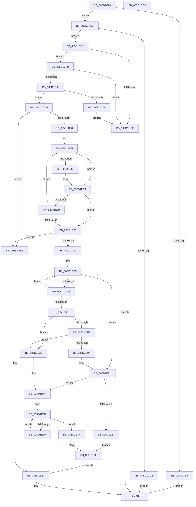

# PoFxRemoveComponentRelation

- RVA: `0x005D1C90`–`0x005D1EDD` (길이 `589` bytes)
- VA: `0x00000001405D1C90`
- 실행 섹션: `.text`
- PDB 이름 있음: `예`; PDB Function 태그: `아니요`
- unwind 정보 RVA: `0x0008C2BC`
- 디코드: `162`개 명령, `589/589` bytes 표시
- 미해석 바이트: `0` (있으면 어셈블리에 `.byte`로 보존)

> 이 문서는 커널 이미지의 기계어와 PDB 기호를 분석해 생성했습니다. 4번과 5번은 함수 원형과 자료형을 바이너리 사용 방식에서 추정한 C 해석이며 원본 소스 복구 결과는 아닙니다.

## 1. Dependencies

- 직접 호출 지점: **15**; 고유 호출 대상: **11**
- 직접 호출자로 확인된 함수: **0**
- RIP 상대 이미지 참조: **0**

### Outgoing calls
- `0x005D1D10` → [ExAcquireSpinLockExclusive](../24/ExAcquireSpinLockExclusive_function_00248690.md) (function, `0x00248690`)
- `0x005D1D26` → [ExReleaseSpinLockExclusive](../2C/ExReleaseSpinLockExclusive_function_002C0EF0.md) (function, `0x002C0EF0`)
- `0x005D1D35` → [PopFxReferenceDevice](../2B/PopFxReferenceDevice_function_002BFD9C.md) (function, `0x002BFD9C`)
- `0x005D1D40` → [ExReleaseSpinLockExclusive](../2C/ExReleaseSpinLockExclusive_function_002C0EF0.md) (function, `0x002C0EF0`)
- `0x005D1D9E` → [PopFxActivateComponent](../2D/PopFxActivateComponent_function_002D9DBC.md) (function, `0x002D9DBC`)
- `0x005D1DAD` → [KeAcquireSpinLockRaiseToDpc](../20/KeAcquireSpinLockRaiseToDpc_function_00208470.md) (function, `0x00208470`)
- `0x005D1DD5` → [PopFxNextParentRelationSafe](../26/PopFxNextParentRelationSafe_function_0026EAC0.md) (function, `0x0026EAC0`)
- `0x005D1E1C` → [KxReleaseSpinLock](../20/KxReleaseSpinLock_function_00206670.md) (function, `0x00206670`)
- `0x005D1E27` → [KeReleaseSpinLock](../39/KeReleaseSpinLock_function_00392BA0.md) (function, `0x00392BA0`)
- `0x005D1E4F` → [KeAcquireSpinLockRaiseToDpc](../20/KeAcquireSpinLockRaiseToDpc_function_00208470.md) (function, `0x00208470`)
- `0x005D1E67` → [PopFxNextComponentChildRelationSafe](../45/PopFxNextComponentChildRelationSafe_function_00450C70.md) (function, `0x00450C70`)
- `0x005D1E7D` → [KeReleaseSpinLock](../39/KeReleaseSpinLock_function_00392BA0.md) (function, `0x00392BA0`)
- `0x005D1E8E` → [PopFxIdleComponent](../2C/PopFxIdleComponent_function_002C01D8.md) (function, `0x002C01D8`)
- `0x005D1EA4` → [PopFxIdleComponent](../2C/PopFxIdleComponent_function_002C01D8.md) (function, `0x002C01D8`)
- `0x005D1EB8` → [PopFxDereferenceDevice](../27/PopFxDereferenceDevice_function_0027038C.md) (function, `0x0027038C`)

### Direct callers
- 이 함수 시작 RVA로 연결되는 직접 call은 확인되지 않았습니다. 간접 호출은 완전히 역산할 수 없습니다.

### Static image references
- 디코드된 RIP-relative 메모리 참조가 없습니다.

## 2. Other-region calls and transfers

- 다른 실행 섹션으로 향하는 call: **0**
- 별도 외부 분기/꼬리 이동을 확인하지 못했습니다.

## 3. Assembly (complete function range)

```asm
005D1C90  48 89 5C 24 10                  mov qword ptr [rsp + 0x10], rbx
005D1C95  48 89 6C 24 18                  mov qword ptr [rsp + 0x18], rbp
005D1C9A  48 89 74 24 20                  mov qword ptr [rsp + 0x20], rsi
005D1C9F  57                              push rdi
005D1CA0  41 54                           push r12
005D1CA2  41 55                           push r13
005D1CA4  41 56                           push r14
005D1CA6  41 57                           push r15
005D1CA8  48 83 EC 30                     sub rsp, 0x30
005D1CAC  33 DB                           xor ebx, ebx
005D1CAE  4D 8B E1                        mov r12, r9
005D1CB1  4C 8B F1                        mov r14, rcx
005D1CB4  48 85 C9                        test rcx, rcx
005D1CB7  75 0A                           jne 0x1405d1cc3
005D1CB9  BB EF 00 00 C0                  mov ebx, 0xc00000ef
005D1CBE  E9 FA 01 00 00                  jmp 0x1405d1ebd
005D1CC3  3B 91 64 03 00 00               cmp edx, dword ptr [rcx + 0x364]
005D1CC9  72 0A                           jb 0x1405d1cd5
005D1CCB  BB F0 00 00 C0                  mov ebx, 0xc00000f0
005D1CD0  E9 E8 01 00 00                  jmp 0x1405d1ebd
005D1CD5  0F AE E8                        lfence
005D1CD8  49 8B 86 68 03 00 00            mov rax, qword ptr [r14 + 0x368]
005D1CDF  8B CA                           mov ecx, edx
005D1CE1  4C 8B 2C C8                     mov r13, qword ptr [rax + rcx*8]
005D1CE5  4C 89 6C 24 20                  mov qword ptr [rsp + 0x20], r13
005D1CEA  4D 85 C0                        test r8, r8
005D1CED  75 0A                           jne 0x1405d1cf9
005D1CEF  BB F1 00 00 C0                  mov ebx, 0xc00000f1
005D1CF4  E9 C4 01 00 00                  jmp 0x1405d1ebd
005D1CF9  49 8B 80 38 01 00 00            mov rax, qword ptr [r8 + 0x138]
005D1D00  48 8B 78 28                     mov rdi, qword ptr [rax + 0x28]
005D1D04  48 85 FF                        test rdi, rdi
005D1D07  74 E6                           je 0x1405d1cef
005D1D09  48 8D 77 58                     lea rsi, [rdi + 0x58]
005D1D0D  48 8B CE                        mov rcx, rsi
005D1D10  E8 7B 69 C7 FF                  call 0x140248690
005D1D15  48 8B 6F 50                     mov rbp, qword ptr [rdi + 0x50]
005D1D19  44 8A F8                        mov r15b, al
005D1D1C  48 85 ED                        test rbp, rbp
005D1D1F  75 0C                           jne 0x1405d1d2d
005D1D21  8A D0                           mov dl, al
005D1D23  48 8B CE                        mov rcx, rsi
005D1D26  E8 C5 F1 CE FF                  call 0x1402c0ef0
005D1D2B  EB C2                           jmp 0x1405d1cef
005D1D2D  BA 06 00 00 00                  mov edx, 6
005D1D32  48 8B CD                        mov rcx, rbp
005D1D35  E8 62 E0 CE FF                  call 0x1402bfd9c
005D1D3A  41 8A D7                        mov dl, r15b
005D1D3D  48 8B CE                        mov rcx, rsi
005D1D40  E8 AB F1 CE FF                  call 0x1402c0ef0
005D1D45  44 8B 8D 64 03 00 00            mov r9d, dword ptr [rbp + 0x364]
005D1D4C  44 8B C3                        mov r8d, ebx
005D1D4F  45 85 C9                        test r9d, r9d
005D1D52  0F 84 53 01 00 00               je 0x1405d1eab
005D1D58  48 8B 95 68 03 00 00            mov rdx, qword ptr [rbp + 0x368]
005D1D5F  48 8B 3A                        mov rdi, qword ptr [rdx]
005D1D62  49 8B 0C 24                     mov rcx, qword ptr [r12]
005D1D66  48 2B 0F                        sub rcx, qword ptr [rdi]
005D1D69  75 09                           jne 0x1405d1d74
005D1D6B  49 8B 4C 24 08                  mov rcx, qword ptr [r12 + 8]
005D1D70  48 2B 4F 08                     sub rcx, qword ptr [rdi + 8]
005D1D74  48 85 C9                        test rcx, rcx
005D1D77  74 0F                           je 0x1405d1d88
005D1D79  41 FF C0                        inc r8d
005D1D7C  48 83 C2 08                     add rdx, 8
005D1D80  48 8B FB                        mov rdi, rbx
005D1D83  45 3B C1                        cmp r8d, r9d
005D1D86  72 D7                           jb 0x1405d1d5f
005D1D88  48 85 FF                        test rdi, rdi
005D1D8B  0F 84 1A 01 00 00               je 0x1405d1eab
005D1D91  45 33 C9                        xor r9d, r9d
005D1D94  49 8B D5                        mov rdx, r13
005D1D97  49 8B CE                        mov rcx, r14
005D1D9A  45 8D 41 01                     lea r8d, [r9 + 1]
005D1D9E  E8 19 80 D0 FF                  call 0x1402d9dbc
005D1DA3  4D 8D BD 80 00 00 00            lea r15, [r13 + 0x80]
005D1DAA  49 8B CF                        mov rcx, r15
005D1DAD  E8 BE 66 C3 FF                  call 0x140208470
005D1DB2  4C 8B 64 24 20                  mov r12, qword ptr [rsp + 0x20]
005D1DB7  44 8A E8                        mov r13b, al
005D1DBA  48 8B CB                        mov rcx, rbx
005D1DBD  48 89 5C 24 60                  mov qword ptr [rsp + 0x60], rbx
005D1DC2  40 8A F3                        mov sil, bl
005D1DC5  48 8B D1                        mov rdx, rcx
005D1DC8  4C 8D 44 24 60                  lea r8, [rsp + 0x60]
005D1DCD  49 8D 8C 24 C8 01 00 00         lea rcx, [r12 + 0x1c8]
005D1DD5  E8 E6 CC C9 FF                  call 0x14026eac0
005D1DDA  84 C0                           test al, al
005D1DDC  74 43                           je 0x1405d1e21
005D1DDE  48 8B 4C 24 60                  mov rcx, qword ptr [rsp + 0x60]
005D1DE3  48 39 79 18                     cmp qword ptr [rcx + 0x18], rdi
005D1DE7  75 DC                           jne 0x1405d1dc5
005D1DE9  83 61 10 F7                     and dword ptr [rcx + 0x10], 0xfffffff7
005D1DED  48 8D 41 38                     lea rax, [rcx + 0x38]
005D1DF1  48 89 59 30                     mov qword ptr [rcx + 0x30], rbx
005D1DF5  4C 8B 00                        mov r8, qword ptr [rax]
005D1DF8  49 39 40 08                     cmp qword ptr [r8 + 8], rax
005D1DFC  75 40                           jne 0x1405d1e3e
005D1DFE  48 8B 50 08                     mov rdx, qword ptr [rax + 8]
005D1E02  48 39 02                        cmp qword ptr [rdx], rax
005D1E05  75 37                           jne 0x1405d1e3e
005D1E07  4C 89 02                        mov qword ptr [rdx], r8
005D1E0A  48 83 C1 08                     add rcx, 8
005D1E0E  49 89 50 08                     mov qword ptr [r8 + 8], rdx
005D1E12  40 B6 01                        mov sil, 1
005D1E15  48 89 40 08                     mov qword ptr [rax + 8], rax
005D1E19  48 89 00                        mov qword ptr [rax], rax
005D1E1C  E8 4F 48 C3 FF                  call 0x140206670
005D1E21  41 8A D5                        mov dl, r13b
005D1E24  49 8B CF                        mov rcx, r15
005D1E27  E8 74 0D DC FF                  call 0x140392ba0
005D1E2C  41 BC 02 00 00 00               mov r12d, 2
005D1E32  40 84 F6                        test sil, sil
005D1E35  75 0E                           jne 0x1405d1e45
005D1E37  BB 0D 00 00 C0                  mov ebx, 0xc000000d
005D1E3C  EB 55                           jmp 0x1405d1e93
005D1E3E  B9 03 00 00 00                  mov ecx, 3
005D1E43  CD 29                           int 0x29
005D1E45  48 8D B7 80 00 00 00            lea rsi, [rdi + 0x80]
005D1E4C  48 8B CE                        mov rcx, rsi
005D1E4F  E8 1C 66 C3 FF                  call 0x140208470
005D1E54  44 8A F8                        mov r15b, al
005D1E57  48 89 5C 24 60                  mov qword ptr [rsp + 0x60], rbx
005D1E5C  48 8B D3                        mov rdx, rbx
005D1E5F  4C 8D 44 24 60                  lea r8, [rsp + 0x60]
005D1E64  48 8B CF                        mov rcx, rdi
005D1E67  E8 04 EE E7 FF                  call 0x140450c70
005D1E6C  84 C0                           test al, al
005D1E6E  74 07                           je 0x1405d1e77
005D1E70  48 8B 54 24 60                  mov rdx, qword ptr [rsp + 0x60]
005D1E75  EB E8                           jmp 0x1405d1e5f
005D1E77  41 8A D7                        mov dl, r15b
005D1E7A  48 8B CE                        mov rcx, rsi
005D1E7D  E8 1E 0D DC FF                  call 0x140392ba0
005D1E82  8B 57 10                        mov edx, dword ptr [rdi + 0x10]
005D1E85  45 33 C9                        xor r9d, r9d
005D1E88  45 8B C4                        mov r8d, r12d
005D1E8B  48 8B CD                        mov rcx, rbp
005D1E8E  E8 45 E3 CE FF                  call 0x1402c01d8
005D1E93  48 8B 44 24 20                  mov rax, qword ptr [rsp + 0x20]
005D1E98  45 33 C9                        xor r9d, r9d
005D1E9B  45 8B C4                        mov r8d, r12d
005D1E9E  49 8B CE                        mov rcx, r14
005D1EA1  8B 50 10                        mov edx, dword ptr [rax + 0x10]
005D1EA4  E8 2F E3 CE FF                  call 0x1402c01d8
005D1EA9  EB 05                           jmp 0x1405d1eb0
005D1EAB  BB F2 00 00 C0                  mov ebx, 0xc00000f2
005D1EB0  BA 06 00 00 00                  mov edx, 6
005D1EB5  48 8B CD                        mov rcx, rbp
005D1EB8  E8 CF E4 C9 FF                  call 0x14027038c
005D1EBD  48 8B 6C 24 70                  mov rbp, qword ptr [rsp + 0x70]
005D1EC2  8B C3                           mov eax, ebx
005D1EC4  48 8B 5C 24 68                  mov rbx, qword ptr [rsp + 0x68]
005D1EC9  48 8B 74 24 78                  mov rsi, qword ptr [rsp + 0x78]
005D1ECE  48 83 C4 30                     add rsp, 0x30
005D1ED2  41 5F                           pop r15
005D1ED4  41 5E                           pop r14
005D1ED6  41 5D                           pop r13
005D1ED8  41 5C                           pop r12
005D1EDA  5F                              pop rdi
005D1EDB  C3                              ret
005D1EDC  CC                              int3
```

## 4. C-style interpretation (structured pseudocode)

```c
__int64 __fastcall PoFxRemoveComponentRelation(__int64 a1, int a2, __int64 a3, __int64 a4)
{
    __int64 result;
    __int64 v_rbx;
    __int64 v_rsp;
    unsigned __int64 v_stack_m38;
    unsigned __int64 v_stack_p10;
    unsigned __int64 v_stack_p18;
    unsigned __int64 v_stack_p20;
    unsigned __int64 v_stack_p8;

    v_stack_p10 = v_rbx;
    v_stack_p18 = v_rbp;
    v_stack_p20 = v_rsi;
    v_rsp = (v_rsp) - (48);
    v_rbx = 0;
    if (a1 != 0) goto loc_005D1CC3;
    goto loc_005D1EBD;
loc_005D1CC3:
    if (a2 < (*(unsigned int *)(a1 + 868))) goto loc_005D1CD5;
    goto loc_005D1EBD;
loc_005D1CD5:
    v_stack_m38 = *(unsigned __int64 *)(*(unsigned __int64 *)(a1 + 872) + (unsigned int)(a2) * 8);
    if (a3 != 0) goto loc_005D1CF9;
loc_005D1CEF:
    goto loc_005D1EBD;
loc_005D1CF9:
    if (*(unsigned __int64 *)(*(unsigned __int64 *)(a3 + 312) + 40) == 0) goto loc_005D1CEF;
    result = ExAcquireSpinLockExclusive(*(unsigned __int64 *)(*(unsigned __int64 *)(a3 + 312) + 40) + 88, a2, a3, a4);
    if (*(unsigned __int64 *)(*(unsigned __int64 *)(*(unsigned __int64 *)(a3 + 312) + 40) + 80) != 0) goto loc_005D1D2D;
    result = ExReleaseSpinLockExclusive(*(unsigned __int64 *)(*(unsigned __int64 *)(a3 + 312) + 40) + 88, (unsigned __int8)(result), a3, a4);
    goto loc_005D1CEF;
loc_005D1D2D:
    result = PopFxReferenceDevice(*(unsigned __int64 *)(*(unsigned __int64 *)(*(unsigned __int64 *)(a3 + 312) + 40) + 80), 6, a3, a4);
    result = ExReleaseSpinLockExclusive(*(unsigned __int64 *)(*(unsigned __int64 *)(a3 + 312) + 40) + 88, (unsigned __int8)((unsigned __int8)(result)), a3, a4);
    if ((unsigned int)((unsigned int)(*(unsigned int *)(*(unsigned __int64 *)(*(unsigned __int64 *)(*(unsigned __int64 *)(a3 + 312) + 40) + 80) + 868))) == 0) goto loc_005D1EAB;
loc_005D1D5F:
    a1 = (*(unsigned __int64 *)(a4)) - (*(unsigned __int64 *)(*(unsigned __int64 *)(*(unsigned __int64 *)(*(unsigned __int64 *)(*(unsigned __int64 *)(*(unsigned __int64 *)(a3 + 312) + 40) + 80) + 872))));
    if (!(condition_is_not_equal)) {
        a1 = *(unsigned __int64 *)(a4 + 8);
        a1 = (a1) - (*(unsigned __int64 *)(*(unsigned __int64 *)(*(unsigned __int64 *)(*(unsigned __int64 *)(*(unsigned __int64 *)(*(unsigned __int64 *)(a3 + 312) + 40) + 80) + 872)) + 8));
    }
    if (a1 == 0) goto loc_005D1D88;
    a3 = (unsigned int)(((unsigned int)((unsigned int)((unsigned int)(0xC00000F1ULL)))) + 1);
    a2 = (*(unsigned __int64 *)(*(unsigned __int64 *)(*(unsigned __int64 *)(*(unsigned __int64 *)(a3 + 312) + 40) + 80) + 872)) + (8);
    if (((unsigned int)(a3)) < ((unsigned int)((unsigned int)(*(unsigned int *)(*(unsigned __int64 *)(*(unsigned __int64 *)(*(unsigned __int64 *)(a3 + 312) + 40) + 80) + 868))))) goto loc_005D1D5F;
loc_005D1D88:
    if ((unsigned int)(0xC00000F1ULL) == 0) goto loc_005D1EAB;
    a4 = 0;
    result = PopFxActivateComponent(a1, *(unsigned __int64 *)(*(unsigned __int64 *)(a1 + 872) + (unsigned int)(a2) * 8), a4 + 1, a4);
    result = KeAcquireSpinLockRaiseToDpc(*(unsigned __int64 *)(*(unsigned __int64 *)(a1 + 872) + (unsigned int)(a2) * 8) + 128, *(unsigned __int64 *)(*(unsigned __int64 *)(a1 + 872) + (unsigned int)(a2) * 8), a4 + 1, a4);
    v_stack_p8 = (unsigned int)(0xC00000F1ULL);
loc_005D1DC5:
    result = PopFxNextParentRelationSafe(v_stack_m38 + 456, (unsigned int)(0xC00000F1ULL), v_stack_p8, a4);
    if ((unsigned __int8)(result) == 0) goto loc_005D1E21;
    if ((*(unsigned __int64 *)(v_stack_p8 + 24)) != ((unsigned int)(0xC00000F1ULL))) goto loc_005D1DC5;
    *(unsigned __int64 *)(v_stack_p8 + 48) = (unsigned int)(0xC00000F1ULL);
    if ((*(unsigned __int64 *)(*(unsigned __int64 *)(v_stack_p8 + 56) + 8)) != (v_stack_p8 + 56)) goto loc_005D1E3E;
    if ((*(unsigned __int64 *)(*(unsigned __int64 *)(v_stack_p8 + 56 + 8))) != (v_stack_p8 + 56)) goto loc_005D1E3E;
    *(unsigned __int64 *)(*(unsigned __int64 *)(v_stack_p8 + 56 + 8)) = *(unsigned __int64 *)(v_stack_p8 + 56);
    a1 = (v_stack_p8) + (8);
    *(unsigned __int64 *)(*(unsigned __int64 *)(v_stack_p8 + 56) + 8) = *(unsigned __int64 *)(v_stack_p8 + 56 + 8);
    *(unsigned __int64 *)(v_stack_p8 + 56 + 8) = v_stack_p8 + 56;
    *(unsigned __int64 *)(v_stack_p8 + 56) = v_stack_p8 + 56;
    result = KxReleaseSpinLock(a1, *(unsigned __int64 *)(v_stack_p8 + 56 + 8), *(unsigned __int64 *)(v_stack_p8 + 56), a4);
loc_005D1E21:
    result = KeReleaseSpinLock(*(unsigned __int64 *)(*(unsigned __int64 *)(a1 + 872) + (unsigned int)(a2) * 8) + 128, (unsigned __int8)((unsigned __int8)(result)), *(unsigned __int64 *)(v_stack_p8 + 56), a4);
    if (1 != 0) goto loc_005D1E45;
    goto loc_005D1E93;
loc_005D1E3E:
loc_005D1E45:
    result = KeAcquireSpinLockRaiseToDpc((unsigned int)(0xC00000F1ULL) + 128, (unsigned __int8)((unsigned __int8)(result)), *(unsigned __int64 *)(v_stack_p8 + 56), a4);
    v_stack_p8 = (unsigned int)(0xC000000DULL);
loc_005D1E5F:
    result = PopFxNextComponentChildRelationSafe((unsigned int)(0xC00000F1ULL), (unsigned int)(0xC000000DULL), v_stack_p8, a4);
    if ((unsigned __int8)(result) == 0) goto loc_005D1E77;
    goto loc_005D1E5F;
loc_005D1E77:
    result = KeReleaseSpinLock((unsigned int)(0xC00000F1ULL) + 128, (unsigned __int8)((unsigned __int8)(result)), v_stack_p8, a4);
    a4 = 0;
    result = PopFxIdleComponent(*(unsigned __int64 *)(*(unsigned __int64 *)(*(unsigned __int64 *)(a3 + 312) + 40) + 80), (unsigned int)(*(unsigned int *)((unsigned int)(0xC00000F1ULL) + 16)), 2, a4);
loc_005D1E93:
    a4 = 0;
    result = PopFxIdleComponent(a1, (unsigned int)(*(unsigned int *)(v_stack_m38 + 16)), 2, a4);
    goto loc_005D1EB0;
loc_005D1EAB:
loc_005D1EB0:
    result = PopFxDereferenceDevice(*(unsigned __int64 *)(*(unsigned __int64 *)(*(unsigned __int64 *)(a3 + 312) + 40) + 80), 6, 2, a4);
loc_005D1EBD:
    v_rsp = (v_rsp) + (48);
    return (unsigned int)((unsigned int)((unsigned int)(0xC00000F2ULL)));
}
```

## 5. (Beta) C Style

```c
int64_t PoFxRemoveComponentRelation(void *Arg1, int32_t Arg2, int64_t Arg3, void *Arg4)
{
    uint8_t *arg1 = (uint8_t *)Arg1;
    uint8_t *arg4 = (uint8_t *)Arg4;

    int64_t result;
    int64_t local_rbx;
    int64_t local_rsp;
    uint64_t v_stack_m38;
    uint64_t v_stack_p10;
    uint64_t v_stack_p18;
    uint64_t v_stack_p20;
    uint64_t v_stack_p8;

    v_stack_p10 = local_rbx;
    v_stack_p18 = local_rbp;
    v_stack_p20 = local_rsi;
    local_rsp = (local_rsp) - (48);
    local_rbx = 0;
    if (Arg1 != NULL) goto loc_005D1CC3;
    goto loc_005D1EBD;
loc_005D1CC3:
    if (Arg2 < (*(uint32_t *)(arg1 + 0x364))) goto loc_005D1CD5;
    goto loc_005D1EBD;
loc_005D1CD5:
    v_stack_m38 = *(uint64_t *)(*(uint64_t *)(arg1 + 0x368) + (uint32_t)(Arg2) * 8);
    if (Arg3 != 0) goto loc_005D1CF9;
loc_005D1CEF:
    goto loc_005D1EBD;
loc_005D1CF9:
    if (*(uint64_t *)(*(uint64_t *)(Arg3 + 0x138) + 0x28) == 0) goto loc_005D1CEF;
    result = ExAcquireSpinLockExclusive(*(uint64_t *)(*(uint64_t *)(Arg3 + 0x138) + 0x28) + 88, Arg2, Arg3, Arg4);
    if (*(uint64_t *)(*(uint64_t *)(*(uint64_t *)(Arg3 + 0x138) + 0x28) + 0x50) != 0) goto loc_005D1D2D;
    result = ExReleaseSpinLockExclusive(*(uint64_t *)(*(uint64_t *)(Arg3 + 0x138) + 0x28) + 88, (uint8_t)(result), Arg3, Arg4);
    goto loc_005D1CEF;
loc_005D1D2D:
    result = PopFxReferenceDevice(*(uint64_t *)(*(uint64_t *)(*(uint64_t *)(Arg3 + 0x138) + 0x28) + 0x50), 6, Arg3, Arg4);
    result = ExReleaseSpinLockExclusive(*(uint64_t *)(*(uint64_t *)(Arg3 + 0x138) + 0x28) + 88, (uint8_t)((uint8_t)(result)), Arg3, Arg4);
    if ((uint32_t)((uint32_t)(*(uint32_t *)(*(uint64_t *)(*(uint64_t *)(*(uint64_t *)(Arg3 + 0x138) + 0x28) + 0x50) + 0x364))) == 0) goto loc_005D1EAB;
loc_005D1D5F:
    Arg1 = (*(uint64_t *)(arg4)) - (*(uint64_t *)(*(uint64_t *)(*(uint64_t *)(*(uint64_t *)(*(uint64_t *)(*(uint64_t *)(Arg3 + 0x138) + 0x28) + 0x50) + 0x368))));
    if (!(condition_is_not_equal)) {
        Arg1 = *(uint64_t *)(arg4 + 0x8);
        Arg1 = (Arg1) - (*(uint64_t *)(*(uint64_t *)(*(uint64_t *)(*(uint64_t *)(*(uint64_t *)(*(uint64_t *)(Arg3 + 0x138) + 0x28) + 0x50) + 0x368)) + 0x8));
    }
    if (Arg1 == NULL) goto loc_005D1D88;
    Arg3 = (uint32_t)(((uint32_t)((uint32_t)((uint32_t)(0xC00000F1ULL)))) + 1);
    Arg2 = (*(uint64_t *)(*(uint64_t *)(*(uint64_t *)(*(uint64_t *)(Arg3 + 0x138) + 0x28) + 0x50) + 0x368)) + (8);
    if (((uint32_t)(Arg3)) < ((uint32_t)((uint32_t)(*(uint32_t *)(*(uint64_t *)(*(uint64_t *)(*(uint64_t *)(Arg3 + 0x138) + 0x28) + 0x50) + 0x364))))) goto loc_005D1D5F;
loc_005D1D88:
    if ((uint32_t)(0xC00000F1ULL) == 0) goto loc_005D1EAB;
    Arg4 = 0;
    result = PopFxActivateComponent(Arg1, *(uint64_t *)(*(uint64_t *)(arg1 + 0x368) + (uint32_t)(Arg2) * 8), Arg4 + 1, Arg4);
    result = KeAcquireSpinLockRaiseToDpc(*(uint64_t *)(*(uint64_t *)(arg1 + 0x368) + (uint32_t)(Arg2) * 8) + 128, *(uint64_t *)(*(uint64_t *)(arg1 + 0x368) + (uint32_t)(Arg2) * 8), Arg4 + 1, Arg4);
    v_stack_p8 = (uint32_t)(0xC00000F1ULL);
loc_005D1DC5:
    result = PopFxNextParentRelationSafe(v_stack_m38 + 456, (uint32_t)(0xC00000F1ULL), v_stack_p8, Arg4);
    if ((uint8_t)(result) == 0) goto loc_005D1E21;
    if ((*(uint64_t *)(v_stack_p8 + 0x18)) != ((uint32_t)(0xC00000F1ULL))) goto loc_005D1DC5;
    *(uint64_t *)(v_stack_p8 + 0x30) = (uint32_t)(0xC00000F1ULL);
    if ((*(uint64_t *)(*(uint64_t *)(v_stack_p8 + 0x38) + 0x8)) != (v_stack_p8 + 56)) goto loc_005D1E3E;
    if ((*(uint64_t *)(*(uint64_t *)(v_stack_p8 + 0x38 + 0x8))) != (v_stack_p8 + 56)) goto loc_005D1E3E;
    *(uint64_t *)(*(uint64_t *)(v_stack_p8 + 0x38 + 0x8)) = *(uint64_t *)(v_stack_p8 + 0x38);
    Arg1 = (v_stack_p8) + (8);
    *(uint64_t *)(*(uint64_t *)(v_stack_p8 + 0x38) + 0x8) = *(uint64_t *)(v_stack_p8 + 0x38 + 0x8);
    *(uint64_t *)(v_stack_p8 + 0x38 + 0x8) = v_stack_p8 + 56;
    *(uint64_t *)(v_stack_p8 + 0x38) = v_stack_p8 + 56;
    result = KxReleaseSpinLock(Arg1, *(uint64_t *)(v_stack_p8 + 0x38 + 0x8), *(uint64_t *)(v_stack_p8 + 0x38), Arg4);
loc_005D1E21:
    result = KeReleaseSpinLock(*(uint64_t *)(*(uint64_t *)(arg1 + 0x368) + (uint32_t)(Arg2) * 8) + 128, (uint8_t)((uint8_t)(result)), *(uint64_t *)(v_stack_p8 + 0x38), Arg4);
    if (1 != 0) goto loc_005D1E45;
    goto loc_005D1E93;
loc_005D1E3E:
loc_005D1E45:
    result = KeAcquireSpinLockRaiseToDpc((uint32_t)(0xC00000F1ULL) + 128, (uint8_t)((uint8_t)(result)), *(uint64_t *)(v_stack_p8 + 0x38), Arg4);
    v_stack_p8 = (uint32_t)(0xC000000DULL);
loc_005D1E5F:
    result = PopFxNextComponentChildRelationSafe((uint32_t)(0xC00000F1ULL), (uint32_t)(0xC000000DULL), v_stack_p8, Arg4);
    if ((uint8_t)(result) == 0) goto loc_005D1E77;
    goto loc_005D1E5F;
loc_005D1E77:
    result = KeReleaseSpinLock((uint32_t)(0xC00000F1ULL) + 128, (uint8_t)((uint8_t)(result)), v_stack_p8, Arg4);
    Arg4 = 0;
    result = PopFxIdleComponent(*(uint64_t *)(*(uint64_t *)(*(uint64_t *)(Arg3 + 0x138) + 0x28) + 0x50), (uint32_t)(*(uint32_t *)((uint32_t)(0xC00000F1ULL) + 0x10)), 2, Arg4);
loc_005D1E93:
    Arg4 = 0;
    result = PopFxIdleComponent(Arg1, (uint32_t)(*(uint32_t *)(v_stack_m38 + 0x10)), 2, Arg4);
    goto loc_005D1EB0;
loc_005D1EAB:
loc_005D1EB0:
    result = PopFxDereferenceDevice(*(uint64_t *)(*(uint64_t *)(*(uint64_t *)(Arg3 + 0x138) + 0x28) + 0x50), 6, 2, Arg4);
loc_005D1EBD:
    local_rsp = (local_rsp) + (48);
    return (uint32_t)((uint32_t)((uint32_t)(0xC00000F2ULL)));
}
```

### 관측된 메모리 오프셋

구조체 형식이 확인되지 않은 접근은 인자 기준의 오프셋으로만 기록했습니다.

| 기준 인자 | 오프셋 표현 | 폭 (bit) | 접근 |
|---|---:|---:|---|
| `Arg1` | `+ 0x368` | `64` | `R` |
| `Arg4` | `+ 0x0` | `64` | `R` |
| `Arg4` | `+ 0x8` | `64` | `R` |

## 6. Execution-region graph

[열기: 2D/3D 그래프와 함수 탐색 컨트롤 패널](../../../control-panel.html?section=text&rva=0x005D1C90&view=graph)

- 2D 그래프는 위에서 아래로 흐르고, 3D 그래프는 빈 공간을 드래그해 회전합니다. Shift+드래그는 이동, 휠은 확대·축소, 함수 노드 선택은 대상 보고서 이동입니다.

### Static fallback


