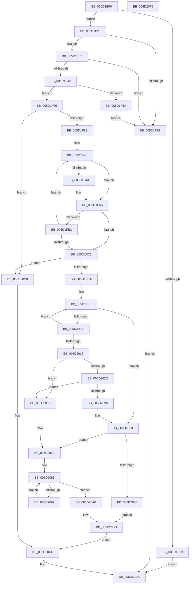

# PoFxRemoveDeviceRelation

- RVA: `0x005D1EF0`–`0x005D20FA` (길이 `522` bytes)
- VA: `0x00000001405D1EF0`
- 실행 섹션: `.text`
- PDB 이름 있음: `예`; PDB Function 태그: `아니요`
- unwind 정보 RVA: `0x0005D79C`
- 디코드: `146`개 명령, `522/522` bytes 표시
- 미해석 바이트: `0` (있으면 어셈블리에 `.byte`로 보존)

> 이 문서는 커널 이미지의 기계어와 PDB 기호를 분석해 생성했습니다. 4번과 5번은 함수 원형과 자료형을 바이너리 사용 방식에서 추정한 C 해석이며 원본 소스 복구 결과는 아닙니다.

## 1. Dependencies

- 직접 호출 지점: **15**; 고유 호출 대상: **12**
- 직접 호출자로 확인된 함수: **0**
- RIP 상대 이미지 참조: **0**

### Outgoing calls
- `0x005D1F49` → [ExAcquireSpinLockExclusive](../24/ExAcquireSpinLockExclusive_function_00248690.md) (function, `0x00248690`)
- `0x005D1F5F` → [ExReleaseSpinLockExclusive](../2C/ExReleaseSpinLockExclusive_function_002C0EF0.md) (function, `0x002C0EF0`)
- `0x005D1F6E` → [PopFxReferenceDevice](../2B/PopFxReferenceDevice_function_002BFD9C.md) (function, `0x002BFD9C`)
- `0x005D1F79` → [ExReleaseSpinLockExclusive](../2C/ExReleaseSpinLockExclusive_function_002C0EF0.md) (function, `0x002C0EF0`)
- `0x005D1FD3` → [PopFxActivateDevice](../4A/PopFxActivateDevice_function_004A0DC8.md) (function, `0x004A0DC8`)
- `0x005D1FE2` → [KeAcquireSpinLockRaiseToDpc](../20/KeAcquireSpinLockRaiseToDpc_function_00208470.md) (function, `0x00208470`)
- `0x005D2004` → [PopFxNextParentRelationSafe](../26/PopFxNextParentRelationSafe_function_0026EAC0.md) (function, `0x0026EAC0`)
- `0x005D204B` → [KxReleaseSpinLock](../20/KxReleaseSpinLock_function_00206670.md) (function, `0x00206670`)
- `0x005D2056` → [KeReleaseSpinLock](../39/KeReleaseSpinLock_function_00392BA0.md) (function, `0x00392BA0`)
- `0x005D2078` → [KeAcquireSpinLockRaiseToDpc](../20/KeAcquireSpinLockRaiseToDpc_function_00208470.md) (function, `0x00208470`)
- `0x005D2090` → [PopFxNextComponentChildRelationSafe](../45/PopFxNextComponentChildRelationSafe_function_00450C70.md) (function, `0x00450C70`)
- `0x005D20A6` → [KeReleaseSpinLock](../39/KeReleaseSpinLock_function_00392BA0.md) (function, `0x00392BA0`)
- `0x005D20B8` → [PopFxIdleComponent](../2C/PopFxIdleComponent_function_002C01D8.md) (function, `0x002C01D8`)
- `0x005D20C1` → [PoFxIdleDevice](../48/PoFxIdleDevice_function_00483EE8.md) (function, `0x00483EE8`)
- `0x005D20D5` → [PopFxDereferenceDevice](../27/PopFxDereferenceDevice_function_0027038C.md) (function, `0x0027038C`)

### Direct callers
- 이 함수 시작 RVA로 연결되는 직접 call은 확인되지 않았습니다. 간접 호출은 완전히 역산할 수 없습니다.

### Static image references
- 디코드된 RIP-relative 메모리 참조가 없습니다.

## 2. Other-region calls and transfers

- 다른 실행 섹션으로 향하는 call: **0**
- 별도 외부 분기/꼬리 이동을 확인하지 못했습니다.

## 3. Assembly (complete function range)

```asm
005D1EF0  48 89 5C 24 10                  mov qword ptr [rsp + 0x10], rbx
005D1EF5  48 89 6C 24 18                  mov qword ptr [rsp + 0x18], rbp
005D1EFA  48 89 74 24 20                  mov qword ptr [rsp + 0x20], rsi
005D1EFF  57                              push rdi
005D1F00  41 54                           push r12
005D1F02  41 55                           push r13
005D1F04  41 56                           push r14
005D1F06  41 57                           push r15
005D1F08  48 83 EC 20                     sub rsp, 0x20
005D1F0C  33 DB                           xor ebx, ebx
005D1F0E  4D 8B E0                        mov r12, r8
005D1F11  4C 8B F9                        mov r15, rcx
005D1F14  48 85 C9                        test rcx, rcx
005D1F17  75 0A                           jne 0x1405d1f23
005D1F19  BB EF 00 00 C0                  mov ebx, 0xc00000ef
005D1F1E  E9 B7 01 00 00                  jmp 0x1405d20da
005D1F23  48 85 D2                        test rdx, rdx
005D1F26  75 0A                           jne 0x1405d1f32
005D1F28  BB F0 00 00 C0                  mov ebx, 0xc00000f0
005D1F2D  E9 A8 01 00 00                  jmp 0x1405d20da
005D1F32  48 8B 82 38 01 00 00            mov rax, qword ptr [rdx + 0x138]
005D1F39  48 8B 78 28                     mov rdi, qword ptr [rax + 0x28]
005D1F3D  48 85 FF                        test rdi, rdi
005D1F40  74 E6                           je 0x1405d1f28
005D1F42  48 8D 77 58                     lea rsi, [rdi + 0x58]
005D1F46  48 8B CE                        mov rcx, rsi
005D1F49  E8 42 67 C7 FF                  call 0x140248690
005D1F4E  48 8B 6F 50                     mov rbp, qword ptr [rdi + 0x50]
005D1F52  44 8A F0                        mov r14b, al
005D1F55  48 85 ED                        test rbp, rbp
005D1F58  75 0C                           jne 0x1405d1f66
005D1F5A  8A D0                           mov dl, al
005D1F5C  48 8B CE                        mov rcx, rsi
005D1F5F  E8 8C EF CE FF                  call 0x1402c0ef0
005D1F64  EB C2                           jmp 0x1405d1f28
005D1F66  BA 06 00 00 00                  mov edx, 6
005D1F6B  48 8B CD                        mov rcx, rbp
005D1F6E  E8 29 DE CE FF                  call 0x1402bfd9c
005D1F73  41 8A D6                        mov dl, r14b
005D1F76  48 8B CE                        mov rcx, rsi
005D1F79  E8 72 EF CE FF                  call 0x1402c0ef0
005D1F7E  44 8B 8D 64 03 00 00            mov r9d, dword ptr [rbp + 0x364]
005D1F85  44 8B C3                        mov r8d, ebx
005D1F88  45 85 C9                        test r9d, r9d
005D1F8B  0F 84 37 01 00 00               je 0x1405d20c8
005D1F91  48 8B 95 68 03 00 00            mov rdx, qword ptr [rbp + 0x368]
005D1F98  48 8B 3A                        mov rdi, qword ptr [rdx]
005D1F9B  49 8B 0C 24                     mov rcx, qword ptr [r12]
005D1F9F  48 2B 0F                        sub rcx, qword ptr [rdi]
005D1FA2  75 09                           jne 0x1405d1fad
005D1FA4  49 8B 4C 24 08                  mov rcx, qword ptr [r12 + 8]
005D1FA9  48 2B 4F 08                     sub rcx, qword ptr [rdi + 8]
005D1FAD  48 85 C9                        test rcx, rcx
005D1FB0  74 0F                           je 0x1405d1fc1
005D1FB2  41 FF C0                        inc r8d
005D1FB5  48 83 C2 08                     add rdx, 8
005D1FB9  48 8B FB                        mov rdi, rbx
005D1FBC  45 3B C1                        cmp r8d, r9d
005D1FBF  72 D7                           jb 0x1405d1f98
005D1FC1  48 85 FF                        test rdi, rdi
005D1FC4  0F 84 FE 00 00 00               je 0x1405d20c8
005D1FCA  49 8B 4F 60                     mov rcx, qword ptr [r15 + 0x60]
005D1FCE  45 33 C0                        xor r8d, r8d
005D1FD1  33 D2                           xor edx, edx
005D1FD3  E8 F0 ED EC FF                  call 0x1404a0dc8
005D1FD8  4D 8D B7 00 05 00 00            lea r14, [r15 + 0x500]
005D1FDF  49 8B CE                        mov rcx, r14
005D1FE2  E8 89 64 C3 FF                  call 0x140208470
005D1FE7  44 8A E8                        mov r13b, al
005D1FEA  48 89 5C 24 50                  mov qword ptr [rsp + 0x50], rbx
005D1FEF  48 8B CB                        mov rcx, rbx
005D1FF2  40 8A F3                        mov sil, bl
005D1FF5  48 8B D1                        mov rdx, rcx
005D1FF8  4C 8D 44 24 50                  lea r8, [rsp + 0x50]
005D1FFD  49 8D 8F 18 05 00 00            lea rcx, [r15 + 0x518]
005D2004  E8 B7 CA C9 FF                  call 0x14026eac0
005D2009  84 C0                           test al, al
005D200B  74 43                           je 0x1405d2050
005D200D  48 8B 4C 24 50                  mov rcx, qword ptr [rsp + 0x50]
005D2012  48 39 79 18                     cmp qword ptr [rcx + 0x18], rdi
005D2016  75 DD                           jne 0x1405d1ff5
005D2018  83 61 10 F7                     and dword ptr [rcx + 0x10], 0xfffffff7
005D201C  48 8D 41 38                     lea rax, [rcx + 0x38]
005D2020  48 89 59 30                     mov qword ptr [rcx + 0x30], rbx
005D2024  4C 8B 00                        mov r8, qword ptr [rax]
005D2027  49 39 40 08                     cmp qword ptr [r8 + 8], rax
005D202B  75 3A                           jne 0x1405d2067
005D202D  48 8B 50 08                     mov rdx, qword ptr [rax + 8]
005D2031  48 39 02                        cmp qword ptr [rdx], rax
005D2034  75 31                           jne 0x1405d2067
005D2036  4C 89 02                        mov qword ptr [rdx], r8
005D2039  48 83 C1 08                     add rcx, 8
005D203D  49 89 50 08                     mov qword ptr [r8 + 8], rdx
005D2041  40 B6 01                        mov sil, 1
005D2044  48 89 40 08                     mov qword ptr [rax + 8], rax
005D2048  48 89 00                        mov qword ptr [rax], rax
005D204B  E8 20 46 C3 FF                  call 0x140206670
005D2050  41 8A D5                        mov dl, r13b
005D2053  49 8B CE                        mov rcx, r14
005D2056  E8 45 0B DC FF                  call 0x140392ba0
005D205B  40 84 F6                        test sil, sil
005D205E  75 0E                           jne 0x1405d206e
005D2060  BB 0D 00 00 C0                  mov ebx, 0xc000000d
005D2065  EB 56                           jmp 0x1405d20bd
005D2067  B9 03 00 00 00                  mov ecx, 3
005D206C  CD 29                           int 0x29
005D206E  48 8D B7 80 00 00 00            lea rsi, [rdi + 0x80]
005D2075  48 8B CE                        mov rcx, rsi
005D2078  E8 F3 63 C3 FF                  call 0x140208470
005D207D  44 8A F0                        mov r14b, al
005D2080  48 89 5C 24 50                  mov qword ptr [rsp + 0x50], rbx
005D2085  48 8B D3                        mov rdx, rbx
005D2088  4C 8D 44 24 50                  lea r8, [rsp + 0x50]
005D208D  48 8B CF                        mov rcx, rdi
005D2090  E8 DB EB E7 FF                  call 0x140450c70
005D2095  84 C0                           test al, al
005D2097  74 07                           je 0x1405d20a0
005D2099  48 8B 54 24 50                  mov rdx, qword ptr [rsp + 0x50]
005D209E  EB E8                           jmp 0x1405d2088
005D20A0  41 8A D6                        mov dl, r14b
005D20A3  48 8B CE                        mov rcx, rsi
005D20A6  E8 F5 0A DC FF                  call 0x140392ba0
005D20AB  8B 57 10                        mov edx, dword ptr [rdi + 0x10]
005D20AE  45 33 C9                        xor r9d, r9d
005D20B1  48 8B CD                        mov rcx, rbp
005D20B4  45 8D 41 02                     lea r8d, [r9 + 2]
005D20B8  E8 1B E1 CE FF                  call 0x1402c01d8
005D20BD  49 8B 4F 60                     mov rcx, qword ptr [r15 + 0x60]
005D20C1  E8 22 1E EB FF                  call 0x140483ee8
005D20C6  EB 05                           jmp 0x1405d20cd
005D20C8  BB F1 00 00 C0                  mov ebx, 0xc00000f1
005D20CD  BA 06 00 00 00                  mov edx, 6
005D20D2  48 8B CD                        mov rcx, rbp
005D20D5  E8 B2 E2 C9 FF                  call 0x14027038c
005D20DA  48 8B 6C 24 60                  mov rbp, qword ptr [rsp + 0x60]
005D20DF  8B C3                           mov eax, ebx
005D20E1  48 8B 5C 24 58                  mov rbx, qword ptr [rsp + 0x58]
005D20E6  48 8B 74 24 68                  mov rsi, qword ptr [rsp + 0x68]
005D20EB  48 83 C4 20                     add rsp, 0x20
005D20EF  41 5F                           pop r15
005D20F1  41 5E                           pop r14
005D20F3  41 5D                           pop r13
005D20F5  41 5C                           pop r12
005D20F7  5F                              pop rdi
005D20F8  C3                              ret
005D20F9  CC                              int3
```

## 4. C-style interpretation (structured pseudocode)

```c
__int64 __fastcall PoFxRemoveDeviceRelation(__int64 a1, __int64 a2, __int64 a3)
{
    __int64 result;
    __int64 v_rbx;
    __int64 v_rsp;
    unsigned __int64 v_stack_p10;
    unsigned __int64 v_stack_p18;
    unsigned __int64 v_stack_p20;
    unsigned __int64 v_stack_p8;

    v_stack_p10 = v_rbx;
    v_stack_p18 = v_rbp;
    v_stack_p20 = v_rsi;
    v_rsp = (v_rsp) - (32);
    v_rbx = 0;
    if (a1 != 0) goto loc_005D1F23;
    goto loc_005D20DA;
loc_005D1F23:
    if (a2 != 0) goto loc_005D1F32;
loc_005D1F28:
    goto loc_005D20DA;
loc_005D1F32:
    if (*(unsigned __int64 *)(*(unsigned __int64 *)(a2 + 312) + 40) == 0) goto loc_005D1F28;
    result = ExAcquireSpinLockExclusive(*(unsigned __int64 *)(*(unsigned __int64 *)(a2 + 312) + 40) + 88, a2, a3, a4);
    if (*(unsigned __int64 *)(*(unsigned __int64 *)(*(unsigned __int64 *)(a2 + 312) + 40) + 80) != 0) goto loc_005D1F66;
    result = ExReleaseSpinLockExclusive(*(unsigned __int64 *)(*(unsigned __int64 *)(a2 + 312) + 40) + 88, (unsigned __int8)(result), a3, a4);
    goto loc_005D1F28;
loc_005D1F66:
    result = PopFxReferenceDevice(*(unsigned __int64 *)(*(unsigned __int64 *)(*(unsigned __int64 *)(a2 + 312) + 40) + 80), 6, a3, a4);
    result = ExReleaseSpinLockExclusive(*(unsigned __int64 *)(*(unsigned __int64 *)(a2 + 312) + 40) + 88, (unsigned __int8)((unsigned __int8)(result)), a3, a4);
    if ((unsigned int)((unsigned int)(*(unsigned int *)(*(unsigned __int64 *)(*(unsigned __int64 *)(*(unsigned __int64 *)(a2 + 312) + 40) + 80) + 868))) == 0) goto loc_005D20C8;
loc_005D1F98:
    a1 = (*(unsigned __int64 *)(a3)) - (*(unsigned __int64 *)(*(unsigned __int64 *)(*(unsigned __int64 *)(*(unsigned __int64 *)(*(unsigned __int64 *)(*(unsigned __int64 *)(a2 + 312) + 40) + 80) + 872))));
    if (!(condition_is_not_equal)) {
        a1 = *(unsigned __int64 *)(a3 + 8);
        a1 = (a1) - (*(unsigned __int64 *)(*(unsigned __int64 *)(*(unsigned __int64 *)(*(unsigned __int64 *)(*(unsigned __int64 *)(*(unsigned __int64 *)(a2 + 312) + 40) + 80) + 872)) + 8));
    }
    if (a1 == 0) goto loc_005D1FC1;
    a3 = (unsigned int)(((unsigned int)((unsigned int)((unsigned int)(0xC00000F0ULL)))) + 1);
    a2 = (*(unsigned __int64 *)(*(unsigned __int64 *)(*(unsigned __int64 *)(*(unsigned __int64 *)(a2 + 312) + 40) + 80) + 872)) + (8);
    if (((unsigned int)(a3)) < ((unsigned int)((unsigned int)(*(unsigned int *)(*(unsigned __int64 *)(*(unsigned __int64 *)(*(unsigned __int64 *)(a2 + 312) + 40) + 80) + 868))))) goto loc_005D1F98;
loc_005D1FC1:
    if ((unsigned int)(0xC00000F0ULL) == 0) goto loc_005D20C8;
    a3 = 0;
    a2 = 0;
    result = PopFxActivateDevice(*(unsigned __int64 *)(a1 + 96), a2, a3, (unsigned int)(*(unsigned int *)(*(unsigned __int64 *)(*(unsigned __int64 *)(*(unsigned __int64 *)(a2 + 312) + 40) + 80) + 868)));
    result = KeAcquireSpinLockRaiseToDpc(a1 + 1280, a2, a3, (unsigned int)(*(unsigned int *)(*(unsigned __int64 *)(*(unsigned __int64 *)(*(unsigned __int64 *)(a2 + 312) + 40) + 80) + 868)));
    v_stack_p8 = (unsigned int)(0xC00000F0ULL);
loc_005D1FF5:
    result = PopFxNextParentRelationSafe(a1 + 1304, (unsigned int)(0xC00000F0ULL), v_stack_p8, (unsigned int)(*(unsigned int *)(*(unsigned __int64 *)(*(unsigned __int64 *)(*(unsigned __int64 *)(a2 + 312) + 40) + 80) + 868)));
    if ((unsigned __int8)(result) == 0) goto loc_005D2050;
    if ((*(unsigned __int64 *)(v_stack_p8 + 24)) != ((unsigned int)(0xC00000F0ULL))) goto loc_005D1FF5;
    *(unsigned __int64 *)(v_stack_p8 + 48) = (unsigned int)(0xC00000F0ULL);
    if ((*(unsigned __int64 *)(*(unsigned __int64 *)(v_stack_p8 + 56) + 8)) != (v_stack_p8 + 56)) goto loc_005D2067;
    if ((*(unsigned __int64 *)(*(unsigned __int64 *)(v_stack_p8 + 56 + 8))) != (v_stack_p8 + 56)) goto loc_005D2067;
    *(unsigned __int64 *)(*(unsigned __int64 *)(v_stack_p8 + 56 + 8)) = *(unsigned __int64 *)(v_stack_p8 + 56);
    a1 = (v_stack_p8) + (8);
    *(unsigned __int64 *)(*(unsigned __int64 *)(v_stack_p8 + 56) + 8) = *(unsigned __int64 *)(v_stack_p8 + 56 + 8);
    *(unsigned __int64 *)(v_stack_p8 + 56 + 8) = v_stack_p8 + 56;
    *(unsigned __int64 *)(v_stack_p8 + 56) = v_stack_p8 + 56;
    result = KxReleaseSpinLock(a1, *(unsigned __int64 *)(v_stack_p8 + 56 + 8), *(unsigned __int64 *)(v_stack_p8 + 56), (unsigned int)(*(unsigned int *)(*(unsigned __int64 *)(*(unsigned __int64 *)(*(unsigned __int64 *)(a2 + 312) + 40) + 80) + 868)));
loc_005D2050:
    result = KeReleaseSpinLock(a1 + 1280, (unsigned __int8)((unsigned __int8)(result)), *(unsigned __int64 *)(v_stack_p8 + 56), (unsigned int)(*(unsigned int *)(*(unsigned __int64 *)(*(unsigned __int64 *)(*(unsigned __int64 *)(a2 + 312) + 40) + 80) + 868)));
    if (1 != 0) goto loc_005D206E;
    goto loc_005D20BD;
loc_005D2067:
loc_005D206E:
    result = KeAcquireSpinLockRaiseToDpc((unsigned int)(0xC00000F0ULL) + 128, (unsigned __int8)((unsigned __int8)(result)), *(unsigned __int64 *)(v_stack_p8 + 56), (unsigned int)(*(unsigned int *)(*(unsigned __int64 *)(*(unsigned __int64 *)(*(unsigned __int64 *)(a2 + 312) + 40) + 80) + 868)));
    v_stack_p8 = (unsigned int)(0xC000000DULL);
loc_005D2088:
    result = PopFxNextComponentChildRelationSafe((unsigned int)(0xC00000F0ULL), (unsigned int)(0xC000000DULL), v_stack_p8, (unsigned int)(*(unsigned int *)(*(unsigned __int64 *)(*(unsigned __int64 *)(*(unsigned __int64 *)(a2 + 312) + 40) + 80) + 868)));
    if ((unsigned __int8)(result) == 0) goto loc_005D20A0;
    goto loc_005D2088;
loc_005D20A0:
    result = KeReleaseSpinLock((unsigned int)(0xC00000F0ULL) + 128, (unsigned __int8)((unsigned __int8)(result)), v_stack_p8, (unsigned int)(*(unsigned int *)(*(unsigned __int64 *)(*(unsigned __int64 *)(*(unsigned __int64 *)(a2 + 312) + 40) + 80) + 868)));
    a4 = 0;
    result = PopFxIdleComponent(*(unsigned __int64 *)(*(unsigned __int64 *)(*(unsigned __int64 *)(a2 + 312) + 40) + 80), (unsigned int)(*(unsigned int *)((unsigned int)(0xC00000F0ULL) + 16)), a4 + 2, a4);
loc_005D20BD:
    result = PoFxIdleDevice(*(unsigned __int64 *)(a1 + 96), (unsigned int)(*(unsigned int *)((unsigned int)(0xC00000F0ULL) + 16)), a4 + 2, a4);
    goto loc_005D20CD;
loc_005D20C8:
loc_005D20CD:
    result = PopFxDereferenceDevice(*(unsigned __int64 *)(*(unsigned __int64 *)(*(unsigned __int64 *)(a2 + 312) + 40) + 80), 6, a4 + 2, a4);
loc_005D20DA:
    v_rsp = (v_rsp) + (32);
    return (unsigned int)((unsigned int)((unsigned int)(0xC00000F1ULL)));
}
```

## 5. (Beta) C Style

```c
int64_t PoFxRemoveDeviceRelation(void *Arg1, int64_t Arg2, void *Arg3)
{
    uint8_t *arg1 = (uint8_t *)Arg1;
    uint8_t *arg3 = (uint8_t *)Arg3;

    int64_t result;
    int64_t local_rbx;
    int64_t local_rsp;
    uint64_t v_stack_p10;
    uint64_t v_stack_p18;
    uint64_t v_stack_p20;
    uint64_t v_stack_p8;

    v_stack_p10 = local_rbx;
    v_stack_p18 = local_rbp;
    v_stack_p20 = local_rsi;
    local_rsp = (local_rsp) - (32);
    local_rbx = 0;
    if (Arg1 != NULL) goto loc_005D1F23;
    goto loc_005D20DA;
loc_005D1F23:
    if (Arg2 != 0) goto loc_005D1F32;
loc_005D1F28:
    goto loc_005D20DA;
loc_005D1F32:
    if (*(uint64_t *)(*(uint64_t *)(Arg2 + 0x138) + 0x28) == 0) goto loc_005D1F28;
    result = ExAcquireSpinLockExclusive(*(uint64_t *)(*(uint64_t *)(Arg2 + 0x138) + 0x28) + 88, Arg2, Arg3, a4);
    if (*(uint64_t *)(*(uint64_t *)(*(uint64_t *)(Arg2 + 0x138) + 0x28) + 0x50) != 0) goto loc_005D1F66;
    result = ExReleaseSpinLockExclusive(*(uint64_t *)(*(uint64_t *)(Arg2 + 0x138) + 0x28) + 88, (uint8_t)(result), Arg3, a4);
    goto loc_005D1F28;
loc_005D1F66:
    result = PopFxReferenceDevice(*(uint64_t *)(*(uint64_t *)(*(uint64_t *)(Arg2 + 0x138) + 0x28) + 0x50), 6, Arg3, a4);
    result = ExReleaseSpinLockExclusive(*(uint64_t *)(*(uint64_t *)(Arg2 + 0x138) + 0x28) + 88, (uint8_t)((uint8_t)(result)), Arg3, a4);
    if ((uint32_t)((uint32_t)(*(uint32_t *)(*(uint64_t *)(*(uint64_t *)(*(uint64_t *)(Arg2 + 0x138) + 0x28) + 0x50) + 0x364))) == 0) goto loc_005D20C8;
loc_005D1F98:
    Arg1 = (*(uint64_t *)(arg3)) - (*(uint64_t *)(*(uint64_t *)(*(uint64_t *)(*(uint64_t *)(*(uint64_t *)(*(uint64_t *)(Arg2 + 0x138) + 0x28) + 0x50) + 0x368))));
    if (!(condition_is_not_equal)) {
        Arg1 = *(uint64_t *)(arg3 + 0x8);
        Arg1 = (Arg1) - (*(uint64_t *)(*(uint64_t *)(*(uint64_t *)(*(uint64_t *)(*(uint64_t *)(*(uint64_t *)(Arg2 + 0x138) + 0x28) + 0x50) + 0x368)) + 0x8));
    }
    if (Arg1 == NULL) goto loc_005D1FC1;
    Arg3 = (uint32_t)(((uint32_t)((uint32_t)((uint32_t)(0xC00000F0ULL)))) + 1);
    Arg2 = (*(uint64_t *)(*(uint64_t *)(*(uint64_t *)(*(uint64_t *)(Arg2 + 0x138) + 0x28) + 0x50) + 0x368)) + (8);
    if (((uint32_t)(Arg3)) < ((uint32_t)((uint32_t)(*(uint32_t *)(*(uint64_t *)(*(uint64_t *)(*(uint64_t *)(Arg2 + 0x138) + 0x28) + 0x50) + 0x364))))) goto loc_005D1F98;
loc_005D1FC1:
    if ((uint32_t)(0xC00000F0ULL) == 0) goto loc_005D20C8;
    Arg3 = 0;
    Arg2 = 0;
    result = PopFxActivateDevice(*(uint64_t *)(arg1 + 0x60), Arg2, Arg3, (uint32_t)(*(uint32_t *)(*(uint64_t *)(*(uint64_t *)(*(uint64_t *)(Arg2 + 0x138) + 0x28) + 0x50) + 0x364)));
    result = KeAcquireSpinLockRaiseToDpc(Arg1 + 1280, Arg2, Arg3, (uint32_t)(*(uint32_t *)(*(uint64_t *)(*(uint64_t *)(*(uint64_t *)(Arg2 + 0x138) + 0x28) + 0x50) + 0x364)));
    v_stack_p8 = (uint32_t)(0xC00000F0ULL);
loc_005D1FF5:
    result = PopFxNextParentRelationSafe(Arg1 + 1304, (uint32_t)(0xC00000F0ULL), v_stack_p8, (uint32_t)(*(uint32_t *)(*(uint64_t *)(*(uint64_t *)(*(uint64_t *)(Arg2 + 0x138) + 0x28) + 0x50) + 0x364)));
    if ((uint8_t)(result) == 0) goto loc_005D2050;
    if ((*(uint64_t *)(v_stack_p8 + 0x18)) != ((uint32_t)(0xC00000F0ULL))) goto loc_005D1FF5;
    *(uint64_t *)(v_stack_p8 + 0x30) = (uint32_t)(0xC00000F0ULL);
    if ((*(uint64_t *)(*(uint64_t *)(v_stack_p8 + 0x38) + 0x8)) != (v_stack_p8 + 56)) goto loc_005D2067;
    if ((*(uint64_t *)(*(uint64_t *)(v_stack_p8 + 0x38 + 0x8))) != (v_stack_p8 + 56)) goto loc_005D2067;
    *(uint64_t *)(*(uint64_t *)(v_stack_p8 + 0x38 + 0x8)) = *(uint64_t *)(v_stack_p8 + 0x38);
    Arg1 = (v_stack_p8) + (8);
    *(uint64_t *)(*(uint64_t *)(v_stack_p8 + 0x38) + 0x8) = *(uint64_t *)(v_stack_p8 + 0x38 + 0x8);
    *(uint64_t *)(v_stack_p8 + 0x38 + 0x8) = v_stack_p8 + 56;
    *(uint64_t *)(v_stack_p8 + 0x38) = v_stack_p8 + 56;
    result = KxReleaseSpinLock(Arg1, *(uint64_t *)(v_stack_p8 + 0x38 + 0x8), *(uint64_t *)(v_stack_p8 + 0x38), (uint32_t)(*(uint32_t *)(*(uint64_t *)(*(uint64_t *)(*(uint64_t *)(Arg2 + 0x138) + 0x28) + 0x50) + 0x364)));
loc_005D2050:
    result = KeReleaseSpinLock(Arg1 + 1280, (uint8_t)((uint8_t)(result)), *(uint64_t *)(v_stack_p8 + 0x38), (uint32_t)(*(uint32_t *)(*(uint64_t *)(*(uint64_t *)(*(uint64_t *)(Arg2 + 0x138) + 0x28) + 0x50) + 0x364)));
    if (1 != 0) goto loc_005D206E;
    goto loc_005D20BD;
loc_005D2067:
loc_005D206E:
    result = KeAcquireSpinLockRaiseToDpc((uint32_t)(0xC00000F0ULL) + 128, (uint8_t)((uint8_t)(result)), *(uint64_t *)(v_stack_p8 + 0x38), (uint32_t)(*(uint32_t *)(*(uint64_t *)(*(uint64_t *)(*(uint64_t *)(Arg2 + 0x138) + 0x28) + 0x50) + 0x364)));
    v_stack_p8 = (uint32_t)(0xC000000DULL);
loc_005D2088:
    result = PopFxNextComponentChildRelationSafe((uint32_t)(0xC00000F0ULL), (uint32_t)(0xC000000DULL), v_stack_p8, (uint32_t)(*(uint32_t *)(*(uint64_t *)(*(uint64_t *)(*(uint64_t *)(Arg2 + 0x138) + 0x28) + 0x50) + 0x364)));
    if ((uint8_t)(result) == 0) goto loc_005D20A0;
    goto loc_005D2088;
loc_005D20A0:
    result = KeReleaseSpinLock((uint32_t)(0xC00000F0ULL) + 128, (uint8_t)((uint8_t)(result)), v_stack_p8, (uint32_t)(*(uint32_t *)(*(uint64_t *)(*(uint64_t *)(*(uint64_t *)(Arg2 + 0x138) + 0x28) + 0x50) + 0x364)));
    a4 = 0;
    result = PopFxIdleComponent(*(uint64_t *)(*(uint64_t *)(*(uint64_t *)(Arg2 + 0x138) + 0x28) + 0x50), (uint32_t)(*(uint32_t *)((uint32_t)(0xC00000F0ULL) + 0x10)), a4 + 2, a4);
loc_005D20BD:
    result = PoFxIdleDevice(*(uint64_t *)(arg1 + 0x60), (uint32_t)(*(uint32_t *)((uint32_t)(0xC00000F0ULL) + 0x10)), a4 + 2, a4);
    goto loc_005D20CD;
loc_005D20C8:
loc_005D20CD:
    result = PopFxDereferenceDevice(*(uint64_t *)(*(uint64_t *)(*(uint64_t *)(Arg2 + 0x138) + 0x28) + 0x50), 6, a4 + 2, a4);
loc_005D20DA:
    local_rsp = (local_rsp) + (32);
    return (uint32_t)((uint32_t)((uint32_t)(0xC00000F1ULL)));
}
```

### 관측된 메모리 오프셋

구조체 형식이 확인되지 않은 접근은 인자 기준의 오프셋으로만 기록했습니다.

| 기준 인자 | 오프셋 표현 | 폭 (bit) | 접근 |
|---|---:|---:|---|
| `Arg1` | `+ 0x60` | `64` | `R` |
| `Arg1` | `+ 0x500` | `64` | `R` |
| `Arg1` | `+ 0x518` | `64` | `R` |
| `Arg3` | `+ 0x0` | `64` | `R` |
| `Arg3` | `+ 0x8` | `64` | `R` |

## 6. Execution-region graph

[열기: 2D/3D 그래프와 함수 탐색 컨트롤 패널](../../../control-panel.html?section=text&rva=0x005D1EF0&view=graph)

- 2D 그래프는 위에서 아래로 흐르고, 3D 그래프는 빈 공간을 드래그해 회전합니다. Shift+드래그는 이동, 휠은 확대·축소, 함수 노드 선택은 대상 보고서 이동입니다.

### Static fallback


