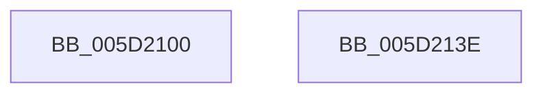

# PoFxSetComponentResidency

- RVA: `0x005D2100`–`0x005D213F` (길이 `63` bytes)
- VA: `0x00000001405D2100`
- 실행 섹션: `.text`
- PDB 이름 있음: `예`; PDB Function 태그: `아니요`
- unwind 정보 RVA: `0x00060BC4`
- 디코드: `19`개 명령, `63/63` bytes 표시
- 미해석 바이트: `0` (있으면 어셈블리에 `.byte`로 보존)

> 이 문서는 커널 이미지의 기계어와 PDB 기호를 분석해 생성했습니다. 4번과 5번은 함수 원형과 자료형을 바이너리 사용 방식에서 추정한 C 해석이며 원본 소스 복구 결과는 아닙니다.

## 1. Dependencies

- 직접 호출 지점: **2**; 고유 호출 대상: **2**
- 직접 호출자로 확인된 함수: **1**
- RIP 상대 이미지 참조: **0**

### Outgoing calls
- `0x005D211B` → [PopDiagTraceFxComponentResidency](PopDiagTraceFxComponentResidency_function_005D677C.md) (function, `0x005D677C`)
- `0x005D2129` → [PopPepComponentSetResidency](PopPepComponentSetResidency_function_005DC9A4.md) (function, `0x005DC9A4`)

### Direct callers
- [DifPoFxSetComponentResidencyWrapper](../63/DifPoFxSetComponentResidencyWrapper_function_00639CE0.md) at `0x00639DC4`

### Static image references
- 디코드된 RIP-relative 메모리 참조가 없습니다.

## 2. Other-region calls and transfers

- 다른 실행 섹션으로 향하는 call: **0**
- 별도 외부 분기/꼬리 이동을 확인하지 못했습니다.

## 3. Assembly (complete function range)

```asm
005D2100  48 89 5C 24 08                  mov qword ptr [rsp + 8], rbx
005D2105  48 89 74 24 10                  mov qword ptr [rsp + 0x10], rsi
005D210A  57                              push rdi
005D210B  48 83 EC 20                     sub rsp, 0x20
005D210F  48 8B F1                        mov rsi, rcx
005D2112  49 8B D8                        mov rbx, r8
005D2115  48 8B 49 30                     mov rcx, qword ptr [rcx + 0x30]
005D2119  8B FA                           mov edi, edx
005D211B  E8 5C 46 00 00                  call 0x1405d677c
005D2120  48 8B 4E 38                     mov rcx, qword ptr [rsi + 0x38]
005D2124  4C 8B C3                        mov r8, rbx
005D2127  8B D7                           mov edx, edi
005D2129  E8 76 A8 00 00                  call 0x1405dc9a4
005D212E  48 8B 5C 24 30                  mov rbx, qword ptr [rsp + 0x30]
005D2133  48 8B 74 24 38                  mov rsi, qword ptr [rsp + 0x38]
005D2138  48 83 C4 20                     add rsp, 0x20
005D213C  5F                              pop rdi
005D213D  C3                              ret
005D213E  CC                              int3
```

## 4. C-style interpretation (structured pseudocode)

```c
__int64 __fastcall PoFxSetComponentResidency(__int64 a1, int a2, __int64 a3)
{
    __int64 result;
    __int64 v_rsp;
    unsigned __int64 v_stack_p10;
    unsigned __int64 v_stack_p8;

    v_stack_p8 = v_rbx;
    v_stack_p10 = v_rsi;
    v_rsp = (v_rsp) - (32);
    result = PopDiagTraceFxComponentResidency(*(unsigned __int64 *)(a1 + 48), a2, a3, a4);
    result = PopPepComponentSetResidency(*(unsigned __int64 *)(a1 + 56), (unsigned int)((unsigned int)((unsigned int)(a2))), a3, a4);
    v_rsp = (v_rsp) + (32);
    return result;
}
```

## 5. (Beta) C Style

```c
int64_t PoFxSetComponentResidency(void *Arg1, int32_t Arg2, int64_t Arg3)
{
    uint8_t *arg1 = (uint8_t *)Arg1;

    int64_t result;
    int64_t local_rsp;
    uint64_t v_stack_p10;
    uint64_t v_stack_p8;

    v_stack_p8 = local_rbx;
    v_stack_p10 = local_rsi;
    local_rsp = (local_rsp) - (32);
    result = PopDiagTraceFxComponentResidency(*(uint64_t *)(arg1 + 0x30), Arg2, Arg3, a4);
    result = PopPepComponentSetResidency(*(uint64_t *)(arg1 + 0x38), (uint32_t)((uint32_t)((uint32_t)(Arg2))), Arg3, a4);
    local_rsp = (local_rsp) + (32);
    return result;
}
```

### 관측된 메모리 오프셋

구조체 형식이 확인되지 않은 접근은 인자 기준의 오프셋으로만 기록했습니다.

| 기준 인자 | 오프셋 표현 | 폭 (bit) | 접근 |
|---|---:|---:|---|
| `Arg1` | `+ 0x30` | `64` | `R` |
| `Arg1` | `+ 0x38` | `64` | `R` |

## 6. Execution-region graph

[열기: 2D/3D 그래프와 함수 탐색 컨트롤 패널](../../../control-panel.html?section=text&rva=0x005D2100&view=graph)

- 2D 그래프는 위에서 아래로 흐르고, 3D 그래프는 빈 공간을 드래그해 회전합니다. Shift+드래그는 이동, 휠은 확대·축소, 함수 노드 선택은 대상 보고서 이동입니다.

### Static fallback


