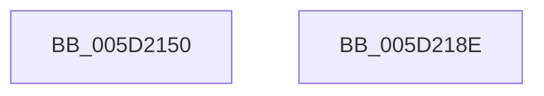

# PoFxSetComponentWake

- RVA: `0x005D2150`–`0x005D218F` (길이 `63` bytes)
- VA: `0x00000001405D2150`
- 실행 섹션: `.text`
- PDB 이름 있음: `예`; PDB Function 태그: `아니요`
- unwind 정보 RVA: `0x00060BC4`
- 디코드: `19`개 명령, `63/63` bytes 표시
- 미해석 바이트: `0` (있으면 어셈블리에 `.byte`로 보존)

> 이 문서는 커널 이미지의 기계어와 PDB 기호를 분석해 생성했습니다. 4번과 5번은 함수 원형과 자료형을 바이너리 사용 방식에서 추정한 C 해석이며 원본 소스 복구 결과는 아닙니다.

## 1. Dependencies

- 직접 호출 지점: **2**; 고유 호출 대상: **2**
- 직접 호출자로 확인된 함수: **1**
- RIP 상대 이미지 참조: **0**

### Outgoing calls
- `0x005D216B` → [PopDiagTraceFxComponentWake](PopDiagTraceFxComponentWake_function_005D6860.md) (function, `0x005D6860`)
- `0x005D2179` → [PopPepComponentSetWakeHint](PopPepComponentSetWakeHint_function_005DCAA0.md) (function, `0x005DCAA0`)

### Direct callers
- [DifPoFxSetComponentWakeWrapper](../63/DifPoFxSetComponentWakeWrapper_function_00639E60.md) at `0x00639F47`

### Static image references
- 디코드된 RIP-relative 메모리 참조가 없습니다.

## 2. Other-region calls and transfers

- 다른 실행 섹션으로 향하는 call: **0**
- 별도 외부 분기/꼬리 이동을 확인하지 못했습니다.

## 3. Assembly (complete function range)

```asm
005D2150  48 89 5C 24 08                  mov qword ptr [rsp + 8], rbx
005D2155  48 89 74 24 10                  mov qword ptr [rsp + 0x10], rsi
005D215A  57                              push rdi
005D215B  48 83 EC 20                     sub rsp, 0x20
005D215F  48 8B F1                        mov rsi, rcx
005D2162  41 8A D8                        mov bl, r8b
005D2165  48 8B 49 30                     mov rcx, qword ptr [rcx + 0x30]
005D2169  8B FA                           mov edi, edx
005D216B  E8 F0 46 00 00                  call 0x1405d6860
005D2170  48 8B 4E 38                     mov rcx, qword ptr [rsi + 0x38]
005D2174  44 8A C3                        mov r8b, bl
005D2177  8B D7                           mov edx, edi
005D2179  E8 22 A9 00 00                  call 0x1405dcaa0
005D217E  48 8B 5C 24 30                  mov rbx, qword ptr [rsp + 0x30]
005D2183  48 8B 74 24 38                  mov rsi, qword ptr [rsp + 0x38]
005D2188  48 83 C4 20                     add rsp, 0x20
005D218C  5F                              pop rdi
005D218D  C3                              ret
005D218E  CC                              int3
```

## 4. C-style interpretation (structured pseudocode)

```c
__int64 __fastcall PoFxSetComponentWake(__int64 a1, int a2, unsigned __int8 a3)
{
    __int64 result;
    __int64 v_rsp;
    unsigned __int64 v_stack_p10;
    unsigned __int64 v_stack_p8;

    v_stack_p8 = v_rbx;
    v_stack_p10 = v_rsi;
    v_rsp = (v_rsp) - (32);
    result = PopDiagTraceFxComponentWake(*(unsigned __int64 *)(a1 + 48), a2, a3, a4);
    result = PopPepComponentSetWakeHint(*(unsigned __int64 *)(a1 + 56), (unsigned int)((unsigned int)((unsigned int)(a2))), a3, a4);
    v_rsp = (v_rsp) + (32);
    return result;
}
```

## 5. (Beta) C Style

```c
int64_t PoFxSetComponentWake(void *Arg1, int32_t Arg2, uint8_t Arg3)
{
    uint8_t *arg1 = (uint8_t *)Arg1;

    int64_t result;
    int64_t local_rsp;
    uint64_t v_stack_p10;
    uint64_t v_stack_p8;

    v_stack_p8 = local_rbx;
    v_stack_p10 = local_rsi;
    local_rsp = (local_rsp) - (32);
    result = PopDiagTraceFxComponentWake(*(uint64_t *)(arg1 + 0x30), Arg2, Arg3, a4);
    result = PopPepComponentSetWakeHint(*(uint64_t *)(arg1 + 0x38), (uint32_t)((uint32_t)((uint32_t)(Arg2))), Arg3, a4);
    local_rsp = (local_rsp) + (32);
    return result;
}
```

### 관측된 메모리 오프셋

구조체 형식이 확인되지 않은 접근은 인자 기준의 오프셋으로만 기록했습니다.

| 기준 인자 | 오프셋 표현 | 폭 (bit) | 접근 |
|---|---:|---:|---|
| `Arg1` | `+ 0x30` | `64` | `R` |
| `Arg1` | `+ 0x38` | `64` | `R` |

## 6. Execution-region graph

[열기: 2D/3D 그래프와 함수 탐색 컨트롤 패널](../../../control-panel.html?section=text&rva=0x005D2150&view=graph)

- 2D 그래프는 위에서 아래로 흐르고, 3D 그래프는 빈 공간을 드래그해 회전합니다. Shift+드래그는 이동, 휠은 확대·축소, 함수 노드 선택은 대상 보고서 이동입니다.

### Static fallback


