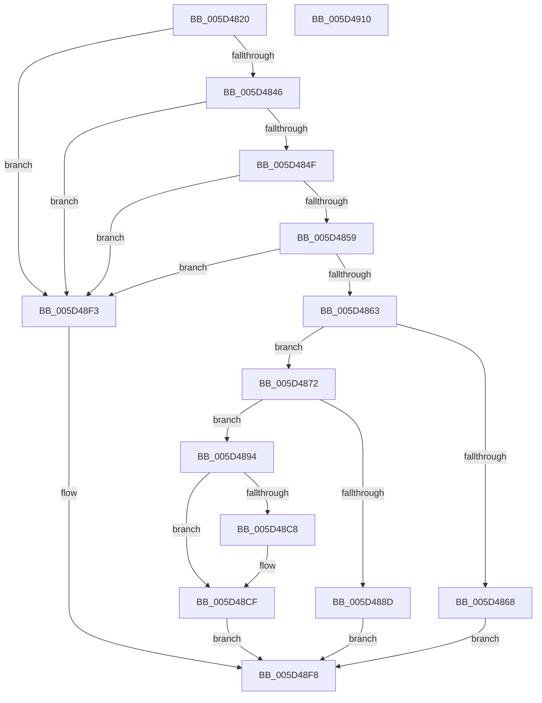

# PoRegisterSstNotificationHandler

- RVA: `0x005D4820`–`0x005D4911` (길이 `241` bytes)
- VA: `0x00000001405D4820`
- 실행 섹션: `.text`
- PDB 이름 있음: `예`; PDB Function 태그: `아니요`
- unwind 정보 RVA: `0x0006F978`
- 디코드: `62`개 명령, `241/241` bytes 표시
- 미해석 바이트: `0` (있으면 어셈블리에 `.byte`로 보존)

> 이 문서는 커널 이미지의 기계어와 PDB 기호를 분석해 생성했습니다. 4번과 5번은 함수 원형과 자료형을 바이너리 사용 방식에서 추정한 C 해석이며 원본 소스 복구 결과는 아닙니다.

## 1. Dependencies

- 직접 호출 지점: **3**; 고유 호출 대상: **3**
- 직접 호출자로 확인된 함수: **0**
- RIP 상대 이미지 참조: **4**

### Outgoing calls
- `0x005D4880` → [ExAllocatePool2](../../poolcode/B8/ExAllocatePool2_function_00B820F0.md) (function, `0x00B820F0`)
- `0x005D48B0` → [KeAcquireSpinLockRaiseToDpc](../20/KeAcquireSpinLockRaiseToDpc_function_00208470.md) (function, `0x00208470`)
- `0x005D48E9` → [KeReleaseSpinLock](../39/KeReleaseSpinLock_function_00392BA0.md) (function, `0x00392BA0`)

### Direct callers
- 이 함수 시작 RVA로 연결되는 직접 call은 확인되지 않았습니다. 간접 호출은 완전히 역산할 수 없습니다.

### Static image references
- `0x005D4896` → RVA `0x00F0DF20` (`.data`; read)
- `0x005D48B5` → RVA `0x00F0DF38` (`.data`; read)
- `0x005D48BC` → RVA `0x00F0DF30` (`.data`; read)
- `0x005D48E2` → RVA `0x00F0DF38` (`.data`; write)

## 2. Other-region calls and transfers

- 다른 실행 섹션으로 향하는 call: **1**
  - `0x005D4880` → [ExAllocatePool2](../../poolcode/B8/ExAllocatePool2_function_00B820F0.md) (`.text` → `POOLCODE`)
- 별도 외부 분기/꼬리 이동을 확인하지 못했습니다.

## 3. Assembly (complete function range)

```asm
005D4820  48 89 5C 24 08                  mov qword ptr [rsp + 8], rbx
005D4825  48 89 74 24 10                  mov qword ptr [rsp + 0x10], rsi
005D482A  48 89 7C 24 18                  mov qword ptr [rsp + 0x18], rdi
005D482F  41 56                           push r14
005D4831  48 83 EC 20                     sub rsp, 0x20
005D4835  33 DB                           xor ebx, ebx
005D4837  4C 8B F2                        mov r14, rdx
005D483A  48 8B F1                        mov rsi, rcx
005D483D  48 85 C9                        test rcx, rcx
005D4840  0F 84 AD 00 00 00               je 0x1405d48f3
005D4846  48 85 D2                        test rdx, rdx
005D4849  0F 84 A4 00 00 00               je 0x1405d48f3
005D484F  8B 01                           mov eax, dword ptr [rcx]
005D4851  85 C0                           test eax, eax
005D4853  0F 84 9A 00 00 00               je 0x1405d48f3
005D4859  48 39 59 08                     cmp qword ptr [rcx + 8], rbx
005D485D  0F 84 90 00 00 00               je 0x1405d48f3
005D4863  83 F8 01                        cmp eax, 1
005D4866  76 0A                           jbe 0x1405d4872
005D4868  BB BB 00 00 C0                  mov ebx, 0xc00000bb
005D486D  E9 86 00 00 00                  jmp 0x1405d48f8
005D4872  BA 28 00 00 00                  mov edx, 0x28
005D4877  41 B8 68 69 62 72               mov r8d, 0x72626968
005D487D  8D 4A 18                        lea ecx, [rdx + 0x18]
005D4880  E8 6B D8 5A 00                  call 0x140b820f0
005D4885  48 8B F8                        mov rdi, rax
005D4888  48 85 C0                        test rax, rax
005D488B  75 07                           jne 0x1405d4894
005D488D  BB 9A 00 00 C0                  mov ebx, 0xc000009a
005D4892  EB 64                           jmp 0x1405d48f8
005D4894  8B 06                           mov eax, dword ptr [rsi]
005D4896  48 8D 0D 83 96 93 00            lea rcx, [rip + 0x939683]
005D489D  89 47 10                        mov dword ptr [rdi + 0x10], eax
005D48A0  48 8B 46 08                     mov rax, qword ptr [rsi + 8]
005D48A4  48 89 47 18                     mov qword ptr [rdi + 0x18], rax
005D48A8  48 8B 46 10                     mov rax, qword ptr [rsi + 0x10]
005D48AC  48 89 47 20                     mov qword ptr [rdi + 0x20], rax
005D48B0  E8 BB 3B C3 FF                  call 0x140208470
005D48B5  48 8B 0D 7C 96 93 00            mov rcx, qword ptr [rip + 0x93967c]
005D48BC  48 8D 15 6D 96 93 00            lea rdx, [rip + 0x93966d]
005D48C3  48 39 11                        cmp qword ptr [rcx], rdx
005D48C6  74 07                           je 0x1405d48cf
005D48C8  B9 03 00 00 00                  mov ecx, 3
005D48CD  CD 29                           int 0x29
005D48CF  48 89 17                        mov qword ptr [rdi], rdx
005D48D2  8A D0                           mov dl, al
005D48D4  48 89 4F 08                     mov qword ptr [rdi + 8], rcx
005D48D8  48 89 39                        mov qword ptr [rcx], rdi
005D48DB  48 8D 0D 3E 96 93 00            lea rcx, [rip + 0x93963e]
005D48E2  48 89 3D 4F 96 93 00            mov qword ptr [rip + 0x93964f], rdi
005D48E9  E8 B2 E2 DB FF                  call 0x140392ba0
005D48EE  49 89 3E                        mov qword ptr [r14], rdi
005D48F1  EB 05                           jmp 0x1405d48f8
005D48F3  BB 0D 00 00 C0                  mov ebx, 0xc000000d
005D48F8  48 8B 74 24 38                  mov rsi, qword ptr [rsp + 0x38]
005D48FD  8B C3                           mov eax, ebx
005D48FF  48 8B 5C 24 30                  mov rbx, qword ptr [rsp + 0x30]
005D4904  48 8B 7C 24 40                  mov rdi, qword ptr [rsp + 0x40]
005D4909  48 83 C4 20                     add rsp, 0x20
005D490D  41 5E                           pop r14
005D490F  C3                              ret
005D4910  CC                              int3
```

## 4. C-style interpretation (structured pseudocode)

```c
__int64 __fastcall PoRegisterSstNotificationHandler(__int64 a1, __int64 a2)
{
    __int64 result;
    __int64 v_rbx;
    __int64 v_rsp;
    unsigned __int64 v_stack_p10;
    unsigned __int64 v_stack_p18;
    unsigned __int64 v_stack_p8;

    v_stack_p8 = v_rbx;
    v_stack_p10 = v_rsi;
    v_stack_p18 = v_rdi;
    v_rsp = (v_rsp) - (32);
    v_rbx = 0;
    if (a1 == 0) goto loc_005D48F3;
    if (a2 == 0) goto loc_005D48F3;
    if ((unsigned int)((unsigned int)(*(unsigned int *)(a1))) == 0) goto loc_005D48F3;
    if ((*(unsigned __int64 *)(a1 + 8)) == 0) goto loc_005D48F3;
    if (((unsigned int)((unsigned int)(*(unsigned int *)(a1)))) <= 1) goto loc_005D4872;
    goto loc_005D48F8;
loc_005D4872:
    result = ExAllocatePool2(40 + 24, 40, (unsigned int)(0x72626968ULL), a4);
    if (result != 0) goto loc_005D4894;
    goto loc_005D48F8;
loc_005D4894:
    *(unsigned int *)(result + 16) = (unsigned int)((unsigned int)(*(unsigned int *)(a1)));
    *(unsigned __int64 *)(result + 24) = *(unsigned __int64 *)(a1 + 8);
    *(unsigned __int64 *)(result + 32) = *(unsigned __int64 *)(a1 + 16);
    result = KeAcquireSpinLockRaiseToDpc(v_rip + 9672323, 40, (unsigned int)(0x72626968ULL), a4);
    if ((*(unsigned __int64 *)(*(unsigned __int64 *)(v_rip + 9672316))) != (v_rip + 9672301)) {
        a1 = 3;
    }
    *(unsigned __int64 *)(result) = v_rip + 9672301;
    *(unsigned __int64 *)(result + 8) = a1;
    *(unsigned __int64 *)(a1) = result;
    *(unsigned __int64 *)(v_rip + 9672271) = result;
    result = KeReleaseSpinLock(v_rip + 9672254, (unsigned __int8)(result), (unsigned int)(0x72626968ULL), a4);
    *(unsigned __int64 *)(a2) = result;
    goto loc_005D48F8;
loc_005D48F3:
loc_005D48F8:
    v_rsp = (v_rsp) + (32);
    return (unsigned int)((unsigned int)((unsigned int)(0xC000000DULL)));
}
```

## 5. (Beta) C Style

```c
int64_t PoRegisterSstNotificationHandler(void *Arg1, void *Arg2)
{
    uint8_t *arg1 = (uint8_t *)Arg1;
    uint8_t *arg2 = (uint8_t *)Arg2;

    int64_t result;
    int64_t local_rbx;
    int64_t local_rsp;
    uint64_t v_stack_p10;
    uint64_t v_stack_p18;
    uint64_t v_stack_p8;

    v_stack_p8 = local_rbx;
    v_stack_p10 = local_rsi;
    v_stack_p18 = local_rdi;
    local_rsp = (local_rsp) - (32);
    local_rbx = 0;
    if (Arg1 == NULL) goto loc_005D48F3;
    if (Arg2 == NULL) goto loc_005D48F3;
    if ((uint32_t)((uint32_t)(*(uint32_t *)(arg1))) == 0) goto loc_005D48F3;
    if ((*(uint64_t *)(arg1 + 0x8)) == 0) goto loc_005D48F3;
    if (((uint32_t)((uint32_t)(*(uint32_t *)(arg1)))) <= 1) goto loc_005D4872;
    goto loc_005D48F8;
loc_005D4872:
    result = ExAllocatePool2(40 + 24, 40, (uint32_t)(0x72626968ULL), a4);
    if (result != 0) goto loc_005D4894;
    goto loc_005D48F8;
loc_005D4894:
    *(uint32_t *)(result + 0x10) = (uint32_t)((uint32_t)(*(uint32_t *)(arg1)));
    *(uint64_t *)(result + 0x18) = *(uint64_t *)(arg1 + 0x8);
    *(uint64_t *)(result + 0x20) = *(uint64_t *)(arg1 + 0x10);
    result = KeAcquireSpinLockRaiseToDpc(v_rip + 9672323, 40, (uint32_t)(0x72626968ULL), a4);
    if ((*(uint64_t *)(*(uint64_t *)(v_rip + 0x93967C))) != (v_rip + 9672301)) {
        Arg1 = 3;
    }
    *(uint64_t *)(result) = v_rip + 9672301;
    *(void **)(result + 0x8) = Arg1;
    *(uint64_t *)(arg1) = result;
    *(uint64_t *)(v_rip + 0x93964F) = result;
    result = KeReleaseSpinLock(v_rip + 9672254, (uint8_t)(result), (uint32_t)(0x72626968ULL), a4);
    *(uint64_t *)(arg2) = result;
    goto loc_005D48F8;
loc_005D48F3:
loc_005D48F8:
    local_rsp = (local_rsp) + (32);
    return (uint32_t)((uint32_t)((uint32_t)(0xC000000DULL)));
}
```

### 관측된 메모리 오프셋

구조체 형식이 확인되지 않은 접근은 인자 기준의 오프셋으로만 기록했습니다.

| 기준 인자 | 오프셋 표현 | 폭 (bit) | 접근 |
|---|---:|---:|---|
| `Arg1` | `+ 0x0` | `32` | `R` |
| `Arg1` | `+ 0x8` | `64` | `R` |
| `Arg1` | `+ 0x10` | `64` | `R` |
| `Arg2` | `+ 0x0` | `64` | `W` |

## 6. Execution-region graph

[열기: 2D/3D 그래프와 함수 탐색 컨트롤 패널](../../../control-panel.html?section=text&rva=0x005D4820&view=graph)

- 2D 그래프는 위에서 아래로 흐르고, 3D 그래프는 빈 공간을 드래그해 회전합니다. Shift+드래그는 이동, 휠은 확대·축소, 함수 노드 선택은 대상 보고서 이동입니다.

### Static fallback


